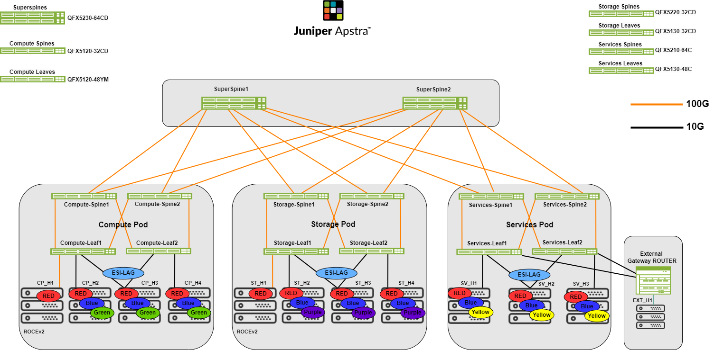

# Configuration Snippets (snips)

This `snips/` directory contains **focused, templated configuration excerpts**
extracted from the validated device configurations in [`../conf/`](../conf/).
Each file isolates one construct — a fabric link, a server-facing port, ESI-LAG
or breakout, an IRB or loopback unit, a MAC-VRF or Type 5 VRF, an eBGP underlay or
EVPN overlay group, a class-of-service object, a firewall filter, a routing policy
or community, or a system service — so it can be read, compared and adapted on its
own. Every body
is measured against the source: the `Count:` header is the number of exact
source instances the template reproduces on each device.

## Topology



A 5-stage EVPN-VXLAN edge-routed bridging fabric managed by Juniper Apstra. Two
super spines (`superspine1`, `superspine2`, QFX5230-64CD, **Junos OS
Evolved**) connect three PODs, each a 3-stage fabric of two spines and two
leaves: **Compute** (spines QFX5210-64C and leaves QFX5120-48YM, **Junos OS**),
**Storage** (spines QFX5220-32CD and leaves QFX5130-32CD, Junos OS Evolved) and
**Services** (spines QFX5210-64C, Junos OS; border leaves QFX5130-48C, Junos OS
Evolved). Super spines and POD spines run the dual-stack eBGP underlay (one AS
for the super spines, one per POD spine tier, one per leaf, BFD) and relay the
eBGP EVPN overlay; tier communities mark where routes came from. The leaves carry
VLAN-aware MAC-VRFs with IGMP snooping (and OISM on the Junos OS Evolved leaves)
and route their IRB units in EVPN Type 5 VRFs, with OSPF and PIM for multicast,
DHCP relay and a RoCEv2 class of service; the border leaves peer over eBGP with
an external gateway (MX, Junos OS), whose configuration is included. Device
tokens in snippet headers are the file names in `../conf/` (for example
`compute-leaf1_qfx5120-48ym`, `superspine1_qfx5230-64cd`, `external-gw_mx`).

## Layout

```
snips/
  junos/        ← Junos OS forms (QFX5120-48YM, QFX5210-64C, MX)
  evo/          ← Junos OS Evolved forms (QFX5130-32CD, QFX5130-48C, QFX5220-32CD, QFX5230-64CD)
```

218 snippet files: 103 Junos and 115 EVO. 78 constructs have the same body on both
operating systems and appear once in each folder, registered as OS-scoped mirrors in
[`_snip-library.json`](_snip-library.json); each file's `Seen on` lists only devices of
its own OS.

| Sub-folder | What's in it |
|---|---|
| `interfaces/` | Fabric links and their dual-stack units, server-facing ports, ESI-LAG bundles and their members, breakout and disabled ports, trunk units, IRB units (anycast and virtual-gateway), and the loopback units. |
| `routing-instances/` | The leaves' VLAN-aware MAC-VRFs with 51 VLANs (`evpn-elan/`) and the EVPN Type 5 VRFs, including the border leaves' VRFs with eBGP to the external gateway (`l3vpn/`). |
| `class-of-service/` | The RoCEv2 model: DSCP classifiers and rewrite rules, forwarding classes, congestion notification profile, drop profiles, schedulers and scheduler map, shared and dedicated buffers, and their binding on the interfaces. |
| `protocols/` | BGP global options, the eBGP underlay groups (dual-stack, BFD) and EVPN overlay groups of each tier, the external gateway's eBGP group, IGMP, PIM, OSPF, IPv6 router advertisements, LLDP, RSTP and Layer 2 learning telemetry. |
| `policy-options/` | Loopback, direct-route, export and tier-tagging policies, the tier communities, prefix lists, route-filter lists and the per-packet load-balancing policy. |
| `firewall/` | The Routing Engine protection filter, its policer, and the Ethernet-switching filter. |
| `routing-options/`, `forwarding-options/` | Router ID, AS, route distinguisher ID, graceful restart, static discard routes, the forwarding-table load-balance export; hash keys and dynamic load balancing, VXLAN routing, OISM multicast replication, storm control and shared tunnels. |
| `system/`, `chassis/` | Host name, management instance, Apstra extension scripts, host profile, NETCONF and the gRPC service over SSL; aggregated-device count, port speeds, breakouts and tunnel services. |

## Snippet headers

Every snippet starts with a C-style header whose fields follow the repository
snippet contract:

- **`Seen on:`** — every validated device whose configuration reproduces this
  exact template, split by OS. Shared applicability is not a peer relationship.
- **`Count:`** — distinct source instances of the template per device and in
  total, generated from [`_bindings.json`](_bindings.json); never hand-edited.
- **`Pair with:`** — directed, required same-device dependencies measured from
  the source: named objects a snippet references by a fixed name (here the tier
  communities, the class-of-service objects of the RoCEv2 model, and the Routing
  Engine protection filter and its policer). Dependencies that go through a
  template value are listed as Needs in the BYOAI bundle.
- **`Peers with:`** — `n/a` for local constructs. Constructs whose peer
  cannot be verified from the configurations carry no claim: see Scope.

## Templated values — `$VAR` placeholders

Deployment-specific values (loopbacks, addresses, AS numbers, interface, instance,
VLAN, group, policy, term and community names, VLAN IDs, VNIs, ESIs, route
distinguishers and targets) appear as `$VAR`
placeholders. Design constants and the names other configuration references by
name are left literal. Each header lists the placeholders it uses with example
values from a validated device; the full glossary is
[`_variables.md`](_variables.md).

## Source examples

[`_bindings.md`](_bindings.md) summarises, and [`_bindings.json`](_bindings.json)
records in full, the exact source instances and variable bindings each template
reproduces. Example values in headers are illustrative; the bindings are the
evidence.

## Scope

Snippets reproduce the active configuration of the fifteen design devices. The
software version stamp of each device is excluded
([`_source-exclusions.json`](_source-exclusions.json)): it is release information of
the captured device, not reusable configuration. The published configurations
contain no `traceoptions` and no deactivated configuration.

### Known limitations of the published configurations

- **Overlapping templates.** A few templates are subsets of others on some
  devices (the leaf DSCP rewrite rule inside the spines' larger one, the CoS
  interface binding without a congestion notification profile, the tunnel-services
  FPC statement inside a breakout FPC); each keeps its own `Count`.
- **Peers.** The eBGP underlay and EVPN overlay groups between the fabric
  tiers and the fabric links carry verified peers. The external gateway's eBGP
  group (its peers are VRF neighbors on the border leaves), the ESI-LAG bundle,
  system, LLDP, RSTP, router advertisement, Layer 2 learning, IGMP, PIM, OSPF,
  MAC-VRF, Type 5 VRF and BGP global constructs have no peer rule and carry no
  claim.
- **Building blocks.** Snippets are building blocks, not complete device
  configurations. The device configurations under [`../conf/`](../conf/) are the
  as-captured reference.

## Topic index

Totals are source instances across all devices.

| Topic | What it shows |
|---|---|
| `evo/chassis/aggregated-devices-ethernet.conf` | Aggregated Ethernet device-count for the chassis (4) |
| `junos/chassis/aggregated-devices-ethernet.conf` | Aggregated Ethernet device-count for the chassis (2) |
| `junos/chassis/fpc-pic-0-2-ports-100g.conf` | Two PIC 0 ports set to 100 Gbps (1) |
| `junos/chassis/fpc-pic-0-3-ports-100g.conf` | Three PIC 0 ports set to 100 Gbps (1) |
| `evo/chassis/fpc-pic-0-4-ports-100g.conf` | Four PIC 0 ports set to 100 Gbps (2) |
| `junos/chassis/fpc-pic-0-4-ports-100g.conf` | Four PIC 0 ports set to 100 Gbps (2) |
| `junos/chassis/fpc-pic-0-tunnel-services-4-breakout-10g.conf` | PIC 0 with tunnel services and four ports broken out into four 10-Gbps sub-ports (1) |
| `junos/chassis/tunnel-services.conf` | Tunnel services on an FPC and PIC (1) |
| `evo/class-of-service/classifiers/cl-dscp-classifier-leaf.conf` | DSCP classifier dscp-classifier for the leaf forwarding classes (2) |
| `junos/class-of-service/classifiers/cl-dscp-classifier-leaf.conf` | DSCP classifier dscp-classifier for the leaf forwarding classes (2) |
| `evo/class-of-service/classifiers/cl-dscp-classifier-spine.conf` | DSCP classifier dscp-classifier for the spine and superspine forwarding classes (4) |
| `junos/class-of-service/classifiers/cl-dscp-classifier-spine.conf` | DSCP classifier dscp-classifier for the spine and superspine forwarding classes (4) |
| `evo/class-of-service/congestion-notification-profile/cnp-ieee-802-1-flow-control-queue-5.conf` | Congestion notification profile cnp: IEEE 802.1p code point 011 flow control on queue 5 (2) |
| `junos/class-of-service/congestion-notification-profile/cnp-ieee-802-1-flow-control-queue-5.conf` | Congestion notification profile cnp: IEEE 802.1p code point 011 flow control on queue 5 (2) |
| `evo/class-of-service/dedicated-buffer-profile-p1-egress.conf` | Dedicated buffer profile p1 for egress (2) |
| `junos/class-of-service/dedicated-buffer-profile-p1-egress.conf` | Dedicated buffer profile p1 for egress (2) |
| `evo/class-of-service/drop-profiles/dp0-dp1.conf` | Drop profiles dp0 (0-20 percent fill) and dp1 (1-2 percent fill) (6) |
| `junos/class-of-service/drop-profiles/dp0-dp1.conf` | Drop profiles dp0 (0-20 percent fill) and dp1 (1-2 percent fill) (6) |
| `evo/class-of-service/forwarding-classes/fc-9-classes.conf` | Forwarding classes fc0 to fc7 on queues 0 to 7, and mcast-fc on queue 8 (6) |
| `junos/class-of-service/forwarding-classes/fc-9-classes.conf` | Forwarding classes fc0 to fc7 on queues 0 to 7, and mcast-fc on queue 8 (6) |
| `evo/class-of-service/interfaces/ifd-cnp-scheduler-map-unit-0-dscp-classifier-rewrite.conf` | Interface with congestion notification profile cnp and scheduler map sm1, and the DSCP classifier and rewrite rule on unit 0 (1) |
| `junos/class-of-service/interfaces/ifd-scheduler-map-dscp-classifier-rewrite.conf` | Interface with scheduler map sm1, the DSCP classifier and the DSCP rewrite rule (204) |
| `evo/class-of-service/interfaces/ifd-scheduler-map-unit-0-dscp-classifier-rewrite.conf` | Interface with scheduler map sm1, and the DSCP classifier and rewrite rule on unit 0 (205) |
| `junos/class-of-service/interfaces/ifd-scheduler-map-unit-0-dscp-classifier-rewrite.conf` | Interface with scheduler map sm1, and the DSCP classifier and rewrite rule on unit 0 (1) |
| `evo/class-of-service/rewrite-rules/rw-dscp-rw1-leaf.conf` | DSCP rewrite rule rw1 for the leaf forwarding classes (6) |
| `junos/class-of-service/rewrite-rules/rw-dscp-rw1-leaf.conf` | DSCP rewrite rule rw1 for the leaf forwarding classes (6) |
| `evo/class-of-service/rewrite-rules/rw-dscp-rw1-spine.conf` | DSCP rewrite rule rw1 for the spine and superspine forwarding classes (4) |
| `junos/class-of-service/rewrite-rules/rw-dscp-rw1-spine.conf` | DSCP rewrite rule rw1 for the spine and superspine forwarding classes (4) |
| `evo/class-of-service/scheduler-maps/sm1.conf` | Scheduler map sm1 binding fc0 to fc7 to schedulers s0 to s7 (6) |
| `junos/class-of-service/scheduler-maps/sm1.conf` | Scheduler map sm1 binding fc0 to fc7 to schedulers s0 to s7 (6) |
| `evo/class-of-service/schedulers/schedulers-s0-s7-leaf.conf` | Leaf schedulers s0 to s7: transmit rates, buffer sizes, drop profiles and ECN (2) |
| `junos/class-of-service/schedulers/schedulers-s0-s7-leaf.conf` | Leaf schedulers s0 to s7: transmit rates, buffer sizes, drop profiles and ECN (2) |
| `evo/class-of-service/schedulers/schedulers-s0-s7-spine.conf` | Spine and superspine schedulers s0 to s7: transmit rates, drop profiles and ECN (4) |
| `junos/class-of-service/schedulers/schedulers-s0-s7-spine.conf` | Spine and superspine schedulers s0 to s7: transmit rates, drop profiles and ECN (4) |
| `junos/class-of-service/shared-buffer-lossy-multicast.conf` | Shared buffer: all ingress and egress buffer in the lossy partitions, with an egress multicast partition (2) |
| `evo/class-of-service/shared-buffer-lossy.conf` | Shared buffer: all ingress and egress buffer in the lossy partitions (2) |
| `evo/firewall/filter-cpp-filter-v1.conf` | cpp-filter-v1: the loopback control-plane protection filter: SSH, BGP, NTP and SNMP from their source prefix lists; policed ICMP; DNS, DHCP, NETCONF, BFD and OSPF; everything else discarded (8) |
| `junos/firewall/filter-cpp-filter-v1.conf` | cpp-filter-v1: the loopback control-plane protection filter: SSH, BGP, NTP and SNMP from their source prefix lists; policed ICMP; DNS, DHCP, NETCONF, BFD and OSPF; everything else discarded (6) |
| `evo/firewall/filter-ethernet-switching-allowed-from-host.conf` | ALLOWED_FROM_HOST: Ethernet-switching filter that discards IPv4 and IPv6 multicast-MAC frames from hosts and accepts the rest (2) |
| `junos/firewall/filter-ethernet-switching-allowed-from-host.conf` | ALLOWED_FROM_HOST: Ethernet-switching filter that discards IPv4 and IPv6 multicast-MAC frames from hosts and accepts the rest (2) |
| `evo/firewall/policer-police-5mbps.conf` | police-5mbps: a 5-Mbps policer that discards excess traffic (8) |
| `junos/firewall/policer-police-5mbps.conf` | police-5mbps: a 5-Mbps policer that discards excess traffic (6) |
| `evo/forwarding-options/enhanced-hash-key-ecmp-dlb-flowlet.conf` | ECMP dynamic load balancing in flowlet mode, with inactivity interval and flowset table size (2) |
| `junos/forwarding-options/enhanced-hash-key-ecmp-dlb-flowlet.conf` | ECMP dynamic load balancing in flowlet mode, with inactivity interval and flowset table size (2) |
| `junos/forwarding-options/evpn-vxlan-shared-tunnels.conf` | EVPN-VXLAN shared tunnels (5) |
| `evo/forwarding-options/multicast-replication-evpn-irb-enhanced-oism.conf` | EVPN multicast replication with enhanced OISM on IRB interfaces (4) |
| `junos/forwarding-options/multicast-replication-evpn-irb-enhanced-oism.conf` | EVPN multicast replication with enhanced OISM on IRB interfaces (2) |
| `evo/forwarding-options/storm-control-profile1-all.conf` | Storm-control profile profile1 for all traffic at a fixed bandwidth level (2) |
| `junos/forwarding-options/storm-control-profile1-all.conf` | Storm-control profile profile1 for all traffic at a fixed bandwidth level (2) |
| `junos/forwarding-options/vxlan-routing-next-hop-interface-num-overlay-ecmp.conf` | VXLAN routing with next-hop and interface-number allocations and overlay ECMP (2) |
| `junos/forwarding-options/vxlan-routing-overlay-ecmp.conf` | VXLAN routing with overlay ECMP (2) |
| `evo/forwarding-options/vxlan-tos-copy-filter.conf` | Copy the inner ToS to the VXLAN header (2) |
| `junos/forwarding-options/vxlan-tos-copy-filter.conf` | Copy the inner ToS to the VXLAN header (2) |
| `evo/interfaces/ifd-ae-esi-all-active-lacp-system-id.conf` | Aggregated Ethernet interface for an ESI-LAG: all-active Ethernet segment, active LACP with a fixed system ID and a 9216-byte MTU (4) |
| `junos/interfaces/ifd-ae-esi-all-active-lacp-system-id.conf` | Aggregated Ethernet interface for an ESI-LAG: all-active Ethernet segment, active LACP with a fixed system ID and a 9216-byte MTU (2) |
| `evo/interfaces/ifd-breakout-description-10g.conf` | Port broken out into 10-Gbps sub-ports, with a description (2) |
| `evo/interfaces/ifd-description-ae-member.conf` | Access port with a description, a member of an aggregated Ethernet bundle (2) |
| `junos/interfaces/ifd-description-ae-member.conf` | Access port with a description, a member of an aggregated Ethernet bundle (2) |
| `evo/interfaces/ifd-description-flexible-vlan-tagging-native-vlan-speed-10g.conf` | 10-Gbps access port with a description, flexible VLAN tagging and native VLAN 1 (2) |
| `evo/interfaces/ifd-description-mtu-9216.conf` | Physical interface with a description and a 9216-byte MTU (10) |
| `junos/interfaces/ifd-description-mtu-9216.conf` | Physical interface with a description and a 9216-byte MTU (23) |
| `evo/interfaces/ifd-description-speed-100g-mtu-9216.conf` | 100-Gbps fabric port with a description and a 9216-byte MTU (21) |
| `evo/interfaces/ifd-description-speed-10g-mtu-9216.conf` | 10-Gbps access port with a description and a 9216-byte MTU (2) |
| `evo/interfaces/ifd-disable.conf` | Administratively disabled port (1,206) |
| `junos/interfaces/ifd-disable.conf` | Administratively disabled port (1,848) |
| `evo/interfaces/ifd-lag-member-ether-description-speed-10g.conf` | Described 10G member link of an aggregated-Ethernet bundle (2) |
| `junos/interfaces/ifd-vlan-tagging.conf` | Port with VLAN tagging (3) |
| `evo/interfaces/ifl-core-inet-inet6-mtu-9170.conf` | Unit 0 with an IPv4 and an IPv6 address and a 9170-byte family MTU on a fabric link (28) |
| `junos/interfaces/ifl-core-inet-inet6-mtu-9170.conf` | Unit 0 with an IPv4 and an IPv6 address and a 9170-byte family MTU on a fabric link (20) |
| `evo/interfaces/ifl-ethernet-switching-trunk-vlans-filter-storm-control.conf` | Unit 0 as an Ethernet-switching trunk carrying the MAC-VRF VLANs, with the ALLOWED_FROM_HOST input filter and storm control (1) |
| `junos/interfaces/ifl-ethernet-switching-trunk-vlans-filter-storm-control.conf` | Unit 0 as an Ethernet-switching trunk carrying the MAC-VRF VLANs, with the ALLOWED_FROM_HOST input filter and storm control (1) |
| `evo/interfaces/ifl-ethernet-switching-trunk-vlans.conf` | Unit 0 as an Ethernet-switching trunk carrying the MAC-VRF VLANs (8) |
| `junos/interfaces/ifl-ethernet-switching-trunk-vlans.conf` | Unit 0 as an Ethernet-switching trunk carrying the MAC-VRF VLANs (4) |
| `evo/interfaces/ifl-loopback-0-inet-filter-inet6.conf` | Loopback unit 0 with IPv4 and IPv6 addresses and the cpp-filter-v1 input filter (8) |
| `junos/interfaces/ifl-loopback-0-inet-filter-inet6.conf` | Loopback unit 0 with IPv4 and IPv6 addresses and the cpp-filter-v1 input filter (6) |
| `evo/interfaces/ifl-loopback-inet-inet6.conf` | Loopback unit with one IPv4 and one IPv6 address (16) |
| `junos/interfaces/ifl-loopback-inet-inet6.conf` | Loopback unit with one IPv4 and one IPv6 address (7) |
| `evo/interfaces/ifl-unit-0-inet-no-address.conf` | Unit 0 with family inet and no address, on a port that carries no traffic in the design (439) |
| `junos/interfaces/ifl-unit-0-inet-no-address.conf` | Unit 0 with family inet and no address (287) |
| `evo/interfaces/ifl-vlan-inet-inet6-description.conf` | VLAN unit with a description and IPv4 and IPv6 addresses (10) |
| `junos/interfaces/ifl-vlan-inet-inet6.conf` | VLAN logical interface with IPv4 and IPv6 addresses (11) |
| `junos/interfaces/ifl-vlan-inet-no-address.conf` | VLAN-tagged unit 0 with family inet and no address (2) |
| `evo/interfaces/irb-inet-inet6-mtu-9000-mac-no-dhcp-flood.conf` | IRB unit with IPv4 and IPv6 gateway addresses, a 9000-byte family MTU, a MAC address and no DHCP flooding (8) |
| `junos/interfaces/irb-inet-inet6-mtu-9000-mac-no-dhcp-flood.conf` | IRB unit with IPv4 and IPv6 gateway addresses, a 9000-byte family MTU, a MAC address and no DHCP flooding (6) |
| `evo/interfaces/irb-inet-inet6-mtu-9000-mac.conf` | IRB unit with IPv4 and IPv6 gateway addresses, a 9000-byte family MTU and a MAC address (192) |
| `junos/interfaces/irb-inet-inet6-mtu-9000-mac.conf` | IRB unit with IPv4 and IPv6 gateway addresses, a 9000-byte family MTU and a MAC address (94) |
| `evo/interfaces/irb-inet-virtual-gateway-mtu-9000.conf` | IRB unit with an IPv4 address, a virtual gateway address and MAC, and virtual-gateway-accept-data (4) |
| `junos/interfaces/irb-inet-virtual-gateway-mtu-9000.conf` | IRB unit with an IPv4 address, a virtual gateway address and MAC, and virtual-gateway-accept-data (2) |
| `evo/interfaces/irb-mtu-9216.conf` | IRB interface with a 9216-byte MTU (4) |
| `junos/interfaces/irb-mtu-9216.conf` | IRB interface with a 9216-byte MTU (2) |
| `evo/policy-options/community/community-2-members.conf` | Community with two standard members (68) |
| `junos/policy-options/community/community-2-members.conf` | Community with two standard members (24) |
| `evo/policy-options/community/fabric-communities.conf` | FABRIC_COMMUNITIES: the tier and Apstra communities removed from routes sent to the external router (2) |
| `evo/policy-options/community/from-spine-evpn-tier.conf` | FROM_SPINE_EVPN_TIER: the community that marks routes advertised by the spine EVPN tier (6) |
| `junos/policy-options/community/from-spine-evpn-tier.conf` | FROM_SPINE_EVPN_TIER: the community that marks routes advertised by the spine EVPN tier (6) |
| `evo/policy-options/community/from-spine-fabric-tier.conf` | FROM_SPINE_FABRIC_TIER: the community that marks routes advertised by the spine tier (6) |
| `junos/policy-options/community/from-spine-fabric-tier.conf` | FROM_SPINE_FABRIC_TIER: the community that marks routes advertised by the spine tier (6) |
| `evo/policy-options/community/from-superspine-evpn-tier.conf` | FROM_SUPERSPINE_EVPN_TIER: the community that marks routes advertised by the superspine EVPN tier (4) |
| `junos/policy-options/community/from-superspine-evpn-tier.conf` | FROM_SUPERSPINE_EVPN_TIER: the community that marks routes advertised by the superspine EVPN tier (4) |
| `evo/policy-options/community/from-superspine-fabric-tier.conf` | FROM_SUPERSPINE_FABRIC_TIER: the community that marks routes advertised by the superspine tier (4) |
| `junos/policy-options/community/from-superspine-fabric-tier.conf` | FROM_SUPERSPINE_FABRIC_TIER: the community that marks routes advertised by the superspine tier (4) |
| `evo/policy-options/policy-statement/per-packet-load-balance-no-term.conf` | Per-packet load-balancing policy without terms (8) |
| `junos/policy-options/policy-statement/per-packet-load-balance-no-term.conf` | Per-packet load-balancing policy without terms (6) |
| `evo/policy-options/policy-statement/ps-accept-all.conf` | Export policy with one term that accepts every route (4) |
| `junos/policy-options/policy-statement/ps-accept-all.conf` | Export policy with one term that accepts every route (2) |
| `evo/policy-options/policy-statement/ps-add-from-spine-evpn-tier-accept.conf` | Spine EVPN export policy that tags every route FROM_SPINE_EVPN_TIER and accepts it (2) |
| `junos/policy-options/policy-statement/ps-add-from-spine-evpn-tier-accept.conf` | Spine EVPN export policy that tags every route FROM_SPINE_EVPN_TIER and accepts it (4) |
| `evo/policy-options/policy-statement/ps-add-from-spine-tier-accept.conf` | Spine export policy that tags every route FROM_SPINE_FABRIC_TIER and accepts it (2) |
| `junos/policy-options/policy-statement/ps-add-from-spine-tier-accept.conf` | Spine export policy that tags every route FROM_SPINE_FABRIC_TIER and accepts it (4) |
| `evo/policy-options/policy-statement/ps-add-from-superspine-evpn-tier-accept.conf` | Superspine EVPN export policy that tags every route FROM_SUPERSPINE_EVPN_TIER and accepts it (2) |
| `evo/policy-options/policy-statement/ps-add-from-superspine-tier-accept.conf` | Superspine export policy that tags every route FROM_SUPERSPINE_FABRIC_TIER and accepts it (2) |
| `junos/policy-options/policy-statement/ps-bgp-next-hop-self-accept-reject.conf` | Policy that accepts BGP routes with next-hop self and rejects everything else (1) |
| `evo/policy-options/policy-statement/ps-direct-inet-inet6-community-add-reject.conf` | Policy that accepts direct IPv4 and IPv6 routes, each with a community added, and rejects everything else (24) |
| `junos/policy-options/policy-statement/ps-direct-inet-inet6-community-add-reject.conf` | Policy that accepts direct IPv4 and IPv6 routes, each with a community added, and rejects everything else (12) |
| `evo/policy-options/policy-statement/ps-from-policy-bgp-accept-reject.conf` | Export policy that accepts the routes another policy accepts and BGP routes, and rejects everything else (4) |
| `junos/policy-options/policy-statement/ps-from-policy-bgp-accept-reject.conf` | Policy that accepts the routes another policy accepts and BGP routes, and rejects everything else (4) |
| `evo/policy-options/policy-statement/ps-from-policy-bgp-evpn-host-routes-accept-reject.conf` | Export policy that accepts the routes another policy accepts, BGP routes and EVPN IPv4 /32 and IPv6 /128 host routes, and rejects everything else (2) |
| `evo/policy-options/policy-statement/ps-from-policy-bgp-evpn-host-routes-community-add-reject.conf` | EVPN Type 5 export policy that accepts the routes another policy accepts and BGP routes, adds a community to EVPN IPv4 /32 and IPv6 /128 host routes, and rejects everything else (10) |
| `evo/policy-options/policy-statement/ps-from-policy-evpn-host-routes-accept-reject.conf` | Export policy that accepts the routes another policy accepts and EVPN IPv4 /32 and IPv6 /128 host routes, and rejects everything else (2) |
| `junos/policy-options/policy-statement/ps-from-policy-evpn-host-routes-accept-reject.conf` | Export policy that accepts the routes another policy accepts and EVPN IPv4 /32 and IPv6 /128 host routes, and rejects everything else (2) |
| `evo/policy-options/policy-statement/ps-from-policy-evpn-host-routes-community-add-reject.conf` | EVPN Type 5 export policy that accepts the routes another policy accepts, adds a community to EVPN IPv4 /32 and IPv6 /128 host routes, and rejects everything else (6) |
| `junos/policy-options/policy-statement/ps-from-policy-evpn-host-routes-community-add-reject.conf` | EVPN Type 5 export policy that accepts the routes another policy accepts, adds a community to EVPN IPv4 /32 and IPv6 /128 host routes, and rejects everything else (6) |
| `junos/policy-options/policy-statement/ps-loopback-default-routes-accept.conf` | Export policy that accepts the loopback and the IPv4 and IPv6 default routes (static or BGP) (1) |
| `evo/policy-options/policy-statement/ps-reject-bgp-from-spine-evpn-tier-accept.conf` | Leaf EVPN export policy that rejects BGP routes tagged FROM_SPINE_EVPN_TIER and accepts every other route (4) |
| `junos/policy-options/policy-statement/ps-reject-bgp-from-spine-evpn-tier-accept.conf` | Leaf EVPN export policy that rejects BGP routes tagged FROM_SPINE_EVPN_TIER and accepts every other route (2) |
| `evo/policy-options/policy-statement/ps-reject-bgp-from-spine-tier-accept.conf` | Leaf export policy that rejects BGP routes tagged FROM_SPINE_FABRIC_TIER and accepts every other route (4) |
| `junos/policy-options/policy-statement/ps-reject-bgp-from-spine-tier-accept.conf` | Leaf export policy that rejects BGP routes tagged FROM_SPINE_FABRIC_TIER and accepts every other route (2) |
| `evo/policy-options/policy-statement/ps-reject-bgp-from-superspine-evpn-tier-accept.conf` | Spine EVPN export policy toward the superspines that rejects BGP routes tagged FROM_SUPERSPINE_EVPN_TIER and accepts every other route (2) |
| `junos/policy-options/policy-statement/ps-reject-bgp-from-superspine-evpn-tier-accept.conf` | Spine EVPN export policy toward the superspines that rejects BGP routes tagged FROM_SUPERSPINE_EVPN_TIER and accepts every other route (4) |
| `evo/policy-options/policy-statement/ps-reject-bgp-from-superspine-tier-accept.conf` | Spine export policy toward the superspines that rejects BGP routes tagged FROM_SUPERSPINE_FABRIC_TIER and accepts every other route (2) |
| `junos/policy-options/policy-statement/ps-reject-bgp-from-superspine-tier-accept.conf` | Spine export policy toward the superspines that rejects BGP routes tagged FROM_SUPERSPINE_FABRIC_TIER and accepts every other route (4) |
| `evo/policy-options/policy-statement/ps-route-filter-list-inet-inet6-community-add-reject.conf` | VRF import policy from the external router that accepts the IPv4 and IPv6 routes in two route-filter lists, each with a community added, and rejects everything else (10) |
| `evo/policy-options/policy-statement/ps-route-filter-list-inet-inet6-community-delete-reject.conf` | VRF export policy toward the external router that accepts the IPv4 and IPv6 routes in two route-filter lists with the fabric communities removed, and rejects everything else (10) |
| `evo/policy-options/prefix-list/bgp-sources.conf` | bgp-sources: prefixes allowed to reach BGP on the loopback (8) |
| `junos/policy-options/prefix-list/bgp-sources.conf` | bgp-sources: prefixes allowed to reach BGP on the loopback (6) |
| `evo/policy-options/prefix-list/ntp-sources.conf` | ntp-sources: prefixes allowed to reach NTP on the loopback (8) |
| `junos/policy-options/prefix-list/ntp-sources.conf` | ntp-sources: prefixes allowed to reach NTP on the loopback (6) |
| `evo/policy-options/prefix-list/snmp-sources.conf` | snmp-sources: prefixes allowed to reach SNMP on the loopback (8) |
| `junos/policy-options/prefix-list/snmp-sources.conf` | snmp-sources: prefixes allowed to reach SNMP on the loopback (6) |
| `evo/policy-options/prefix-list/ssh-sources.conf` | ssh-sources: prefixes allowed to reach SSH on the loopback (8) |
| `junos/policy-options/prefix-list/ssh-sources.conf` | ssh-sources: prefixes allowed to reach SSH on the loopback (6) |
| `evo/policy-options/route-filter-list/rfl-inet-any-3-prefixes-upto-32.conf` | Route-filter list with any IPv4 prefix and three tenant prefixes up to /32 (2) |
| `evo/policy-options/route-filter-list/rfl-inet-any-4-prefixes-upto-32.conf` | Route-filter list with any IPv4 prefix and four tenant prefixes up to /32 (6) |
| `evo/policy-options/route-filter-list/rfl-inet-any-5-prefixes-upto-32.conf` | Route-filter list with any IPv4 prefix and five tenant prefixes up to /32 (2) |
| `evo/policy-options/route-filter-list/rfl-inet-default-exact.conf` | Route-filter list with the IPv4 default route, exact (10) |
| `junos/policy-options/route-filter-list/rfl-inet-inet6-default-exact.conf` | Route-filter list with the IPv4 and IPv6 default routes, exact (1) |
| `evo/policy-options/route-filter-list/rfl-inet6-any-3-prefixes-upto-128.conf` | Route-filter list with any IPv6 prefix and three tenant prefixes up to /128 (2) |
| `evo/policy-options/route-filter-list/rfl-inet6-any-4-prefixes-upto-128.conf` | Route-filter list with any IPv6 prefix and four tenant prefixes up to /128 (4) |
| `evo/policy-options/route-filter-list/rfl-inet6-any-5-prefixes-upto-128.conf` | Route-filter list with any IPv6 prefix and five tenant prefixes up to /128 (4) |
| `evo/policy-options/route-filter-list/rfl-inet6-default-exact.conf` | Route-filter list with the IPv6 default route, exact (10) |
| `junos/protocols/bgp-group-ebgp-10-peers-dual-stack-export.conf` | External gateway eBGP group with ten fabric peers over IPv4 and IPv6, exporting one policy (1) |
| `evo/protocols/bgp-group-ebgp-evpn-overlay-2-peers-bfd-export-2-policies.conf` | Leaf eBGP EVPN overlay group with two spine loopback peers, BFD and a two-policy export chain (4) |
| `junos/protocols/bgp-group-ebgp-evpn-overlay-2-peers-bfd-export-2-policies.conf` | Leaf eBGP EVPN overlay group with two spine loopback peers, BFD and a two-policy export chain (2) |
| `evo/protocols/bgp-group-ebgp-evpn-overlay-4-peers-bfd-export-1-policy.conf` | Spine eBGP EVPN overlay group with four loopback peers (two leaves and two superspines), BFD and one export policy per peer (2) |
| `junos/protocols/bgp-group-ebgp-evpn-overlay-4-peers-bfd-export-1-policy.conf` | Spine eBGP EVPN overlay group with four loopback peers (two leaves and two superspines), BFD and one export policy per peer (4) |
| `evo/protocols/bgp-group-ebgp-evpn-overlay-6-peers-bfd-export-1-policy.conf` | Superspine eBGP EVPN overlay group with six spine loopback peers, BFD and one export policy (2) |
| `evo/protocols/bgp-group-ebgp-underlay-2-peers-dual-stack-bfd-export-2-policies.conf` | Leaf eBGP underlay group with two spine peers over IPv4 and IPv6, BFD and a two-policy export chain (4) |
| `junos/protocols/bgp-group-ebgp-underlay-2-peers-dual-stack-bfd-export-2-policies.conf` | Leaf eBGP underlay group with two spine peers over IPv4 and IPv6, BFD and a two-policy export chain (2) |
| `evo/protocols/bgp-group-ebgp-underlay-4-peers-dual-stack-bfd-export-2-policies.conf` | Spine eBGP underlay group with four peers (two leaves and two superspines) over IPv4 and IPv6, BFD and two-policy export chains (2) |
| `junos/protocols/bgp-group-ebgp-underlay-4-peers-dual-stack-bfd-export-2-policies.conf` | Spine eBGP underlay group with four peers (two leaves and two superspines) over IPv4 and IPv6, BFD and two-policy export chains (4) |
| `evo/protocols/bgp-group-ebgp-underlay-6-peers-dual-stack-bfd-export-2-policies.conf` | Superspine eBGP underlay group with six spine peers over IPv4 and IPv6, BFD and a two-policy export chain (2) |
| `evo/protocols/bgp-log-updown-graceful-restart-multipath.conf` | BGP global options: log-updown, graceful restart without helping on shared-fate BFD down, and multipath (8) |
| `junos/protocols/bgp-log-updown-graceful-restart-multipath.conf` | BGP global options: log-updown, graceful restart without helping on shared-fate BFD down, and multipath (6) |
| `evo/protocols/igmp-interface-all.conf` | IGMP on all interfaces (4) |
| `junos/protocols/igmp-interface-all.conf` | IGMP on all interfaces (3) |
| `evo/protocols/l2-learning-telemetry-remote-entries.conf` | Layer 2 learning telemetry that includes remote entries (4) |
| `junos/protocols/l2-learning-telemetry-remote-entries.conf` | Layer 2 learning telemetry that includes remote entries (2) |
| `evo/protocols/lldp-interface-all-port-id-interface-name.conf` | LLDP on all interfaces with the interface name as port ID and the interface description as port description (8) |
| `junos/protocols/lldp-interface-all-port-id-interface-name.conf` | LLDP on all interfaces with the interface name as port ID and the interface description as port description (6) |
| `junos/protocols/ospf-area-0-loopback-2-interfaces.conf` | OSPF area 0 on the loopback and two interfaces (1) |
| `junos/protocols/pim-rp-local-interface-all.conf` | PIM with a local rendezvous point, on all interfaces (1) |
| `evo/protocols/router-advertisement-interface.conf` | IPv6 router advertisements on one logical interface (a fabric link or an IRB unit), with 30-second maximum and 10-second minimum intervals (238) |
| `junos/protocols/router-advertisement-interface.conf` | IPv6 router advertisements on one logical interface (a fabric link or an IRB unit), with 30-second maximum and 10-second minimum intervals (120) |
| `evo/protocols/rstp-bridge-priority-0-bpdu-block-on-edge.conf` | RSTP with bridge priority 0 and BPDU block on edge ports (4) |
| `junos/protocols/rstp-bridge-priority-0-bpdu-block-on-edge.conf` | RSTP with bridge priority 0 and BPDU block on edge ports (2) |
| `evo/protocols/rstp-disable.conf` | RSTP disabled (4) |
| `junos/protocols/rstp-disable.conf` | RSTP disabled (4) |
| `evo/protocols/rstp-interface-edge.conf` | RSTP edge port (9) |
| `junos/protocols/rstp-interface-edge.conf` | RSTP edge port (5) |
| `evo/routing-instances/evpn-elan/ri-mac-vrf-vlan-aware-51-vlans-igmp-snooping-oism-2-ac.conf` | VLAN-aware EVPN-VXLAN MAC-VRF with 51 VLANs, IGMP snooping, OISM and two access interfaces (2) |
| `junos/routing-instances/evpn-elan/ri-mac-vrf-vlan-aware-51-vlans-igmp-snooping-proxy-2-ac.conf` | VLAN-aware EVPN-VXLAN MAC-VRF with 51 VLANs, IGMP snooping with proxy, and two access interfaces (1) |
| `junos/routing-instances/evpn-elan/ri-mac-vrf-vlan-aware-51-vlans-igmp-snooping-proxy-3-ac.conf` | VLAN-aware EVPN-VXLAN MAC-VRF with 51 VLANs, IGMP snooping with proxy, and three access interfaces (1) |
| `evo/routing-instances/evpn-elan/ri-mac-vrf-vlan-aware-51-vlans-igmp-snooping-proxy-oism-2-ac.conf` | VLAN-aware EVPN-VXLAN MAC-VRF with 51 VLANs, IGMP snooping with proxy, OISM and two access interfaces (1) |
| `evo/routing-instances/evpn-elan/ri-mac-vrf-vlan-aware-51-vlans-igmp-snooping-proxy-oism-3-ac.conf` | VLAN-aware EVPN-VXLAN MAC-VRF with 51 VLANs, IGMP snooping with proxy, OISM and three access interfaces (1) |
| `evo/routing-instances/l3vpn/ri-vrf-evpn-type-5-10-irb.conf` | EVPN Type 5 VRF with ten IRB units and a loopback unit (2) |
| `junos/routing-instances/l3vpn/ri-vrf-evpn-type-5-dhcp-relay-10-irb.conf` | EVPN Type 5 VRF with ten IRB units, a loopback unit and DHCP relay (2) |
| `evo/routing-instances/l3vpn/ri-vrf-evpn-type-5-dhcp-relay-20-irb.conf` | EVPN Type 5 VRF with twenty IRB units, a loopback unit and DHCP relay (2) |
| `junos/routing-instances/l3vpn/ri-vrf-evpn-type-5-dhcp-relay-20-irb.conf` | EVPN Type 5 VRF with twenty IRB units, a loopback unit and DHCP relay (2) |
| `evo/routing-instances/l3vpn/ri-vrf-evpn-type-5-ebgp-10-irb.conf` | Border EVPN Type 5 VRF with eBGP (IPv4 and IPv6) to the external router and ten IRB units (2) |
| `evo/routing-instances/l3vpn/ri-vrf-evpn-type-5-ebgp-dhcp-relay-20-irb.conf` | Border EVPN Type 5 VRF with eBGP (IPv4 and IPv6) to the external router, twenty IRB units and DHCP relay (2) |
| `evo/routing-instances/l3vpn/ri-vrf-evpn-type-5-ebgp-dhcp-relay.conf` | Border EVPN Type 5 VRF with eBGP (IPv4 and IPv6) to the external router and DHCP relay (2) |
| `evo/routing-instances/l3vpn/ri-vrf-evpn-type-5-ebgp-ospf-pim-oism-dhcp-relay.conf` | Border EVPN Type 5 VRF with eBGP (IPv4 and IPv6) to the external router, OSPF and PIM, OISM, DHCP relay and static routes (2) |
| `evo/routing-instances/l3vpn/ri-vrf-evpn-type-5-ebgp.conf` | Border EVPN Type 5 VRF with eBGP (IPv4 and IPv6) to the external router (2) |
| `evo/routing-instances/l3vpn/ri-vrf-evpn-type-5-ospf-pim-oism-dhcp-relay.conf` | EVPN Type 5 VRF with OSPF and PIM on its IRB and loopback units, OISM with a supplemental bridge domain, and DHCP relay (2) |
| `junos/routing-instances/l3vpn/ri-vrf-evpn-type-5-ospf-pim-oism-dhcp-relay.conf` | EVPN Type 5 VRF with OSPF and PIM on its IRB and loopback units, OISM with a supplemental bridge domain, and DHCP relay (2) |
| `evo/routing-options/autonomous-system.conf` | Device autonomous-system number (8) |
| `junos/routing-options/autonomous-system.conf` | Device autonomous-system number (7) |
| `evo/routing-options/forwarding-table-pplb-ecmp-fast-reroute-chained-nh-evpn.conf` | Forwarding-table export of the per-packet load-balancing policy, with ECMP fast reroute and ingress chained composite next hops for EVPN (4) |
| `junos/routing-options/forwarding-table-pplb-ecmp-fast-reroute-chained-nh-evpn.conf` | Forwarding-table export of the per-packet load-balancing policy, with ECMP fast reroute and ingress chained composite next hops for EVPN (2) |
| `evo/routing-options/forwarding-table-pplb-ecmp-fast-reroute.conf` | Forwarding-table export of the per-packet load-balancing policy, with ECMP fast reroute (4) |
| `junos/routing-options/forwarding-table-pplb-ecmp-fast-reroute.conf` | Forwarding-table per-packet load balancing with ECMP fast reroute (4) |
| `evo/routing-options/graceful-restart.conf` | Graceful restart (8) |
| `junos/routing-options/graceful-restart.conf` | Graceful restart (6) |
| `junos/routing-options/rib-inet6-static-default-discard.conf` | IPv6 static default route to discard (1) |
| `junos/routing-options/route-distinguisher-id.conf` | Automatic Route Distinguisher seed (1) |
| `evo/routing-options/router-id.conf` | Transport router identity (8) |
| `junos/routing-options/router-id.conf` | Transport router identity (6) |
| `junos/routing-options/static-default-discard.conf` | Static default route to discard (1) |
| `evo/system/extensions-aos-show-scripts.conf` | Extension-service application scripts that Apstra uses (show tech and show version), run as root (8) |
| `evo/system/host-name.conf` | System host name (8) |
| `junos/system/host-name.conf` | System host name (6) |
| `evo/system/management-instance.conf` | Dedicated management routing instance (mgmt_junos) for the management interface and services (8) |
| `junos/system/management-instance.conf` | Dedicated management routing instance (mgmt_junos) for the management interface and services (6) |
| `evo/system/packet-forwarding-options-host-profile.conf` | Packet-forwarding host profile for the forwarding table (4) |
| `evo/system/ports-console-log-out.conf` | Console log-out on disconnect (8) |
| `junos/system/ports-console-log-out.conf` | Console log-out on disconnect (7) |
| `junos/system/services-netconf-ssh-root-login-grpc-ssl-local-certificate-mgmt-junos.conf` | NETCONF and SSH with root login, and the gRPC request-response extension service over SSL in the management instance, using a local certificate (6) |
| `evo/system/services-netconf-ssh-root-login.conf` | NETCONF over SSH, and SSH with root login allowed (8) |
