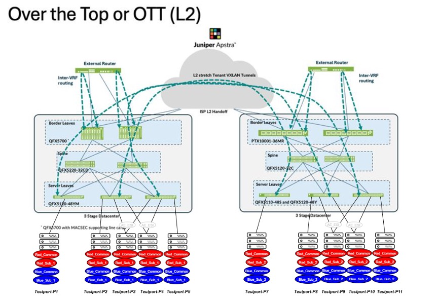
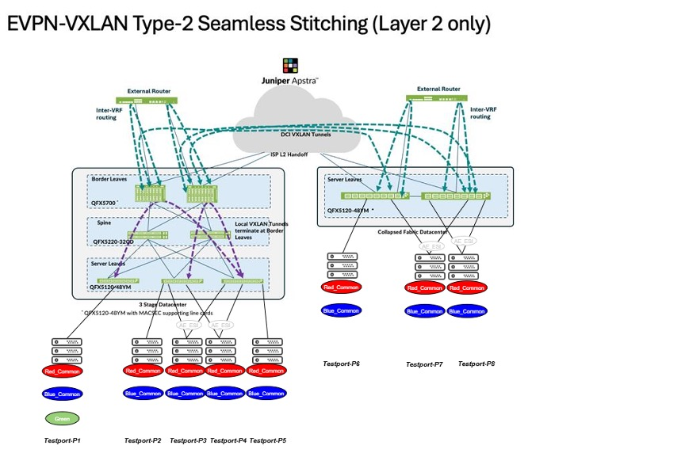
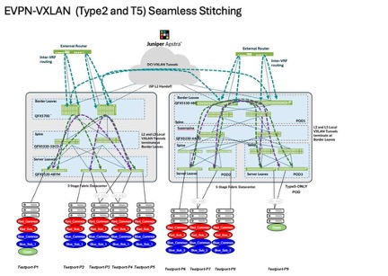

# Configuration Snippets (snips)

This `snips/` directory contains **focused, templated configuration excerpts**
extracted from the validated device configurations in [`../conf/`](../conf/).
Each file isolates one construct — a fabric or DCI link, a server-facing port,
ESI-LAG or breakout, an IRB or loopback unit, a MAC-VRF or Type 5 VRF, an EVPN
interconnect, an eBGP underlay, EVPN overlay or DCI group, MACsec, a firewall
filter, a routing policy or community, or a system service — so it can be read,
compared and adapted on its own. Every body is measured against the source: the
`Count:` header is the number of exact source instances the template reproduces
on each device.

## Topology

Three EVPN-VXLAN data center interconnect scenarios, managed by Juniper Apstra.
Each is captured as its own set of device configurations in a scenario folder
under [`../conf/`](../conf/) and was validated as a separate test bed:

- **Over-the-Top (OTT)** — [`dc1-dc2_ott`](../conf/dc1-dc2_ott/): the 3-stage
  DC1 fabric (spines QFX5220-32CD, border leaves QFX5130-32CD, ESI and server
  leaves QFX5120-48Y) and the 3-stage DC2 fabric (spines QFX5120-48Y-8C, border
  leaves QFX5700, ESI and server leaves QFX5120-48Y).
- **Type 2 seamless stitching** — [`dc1-dc3_type2_seamless`](../conf/dc1-dc3_type2_seamless/):
  DC1 (spines, border leaves and leaves QFX5120-48Y) and DC3, a collapsed fabric
  of two QFX5120-48Y leaves that are also its DCI gateways.
- **Type 2 + Type 5 seamless stitching** — [`dc1-dc4_type2_type5_seamless`](../conf/dc1-dc4_type2_type5_seamless/):
  DC1 and the 5-stage DC4 fabric: super spines QFX5230-64CD; compute POD spines
  QFX5210-64C and leaves QFX5120-48YM; storage POD spines QFX5220-32CD and leaves
  QFX5130-32CD; services POD spines QFX5210-64C and services leaves QFX5130-48C,
  DC4's DCI gateways.





Within each fabric the spines (and the DC4 super spines) run the eBGP underlay
and the eBGP EVPN overlay with BFD; tier communities mark where routes came from.
The DCI gateways (the DC1 and DC2 border leaves, the DC3 leaves and the DC4
services leaves) run eBGP to the remote gateway over the DCI link, the multihop
DCI overlay eBGP between the gateways' loopbacks and, in the tenant VRFs, eBGP to
the external router; in the seamless-stitching scenarios they also run the EVPN
interconnect with VNI translation, and the DC1, DC2 and DC3 gateways run MACsec
(static CAK) on their DCI interfaces. The leaves carry VLAN-aware MAC-VRFs and
route the VLANs' IRB units in EVPN Type 5 VRFs, most of them with DHCP relay.

Device tokens in snippet headers are the scenario folder and the file name in
`../conf/` (for example `dc1-dc2_ott/dc1_borderleaf1_qfx5130-32cd`). The DC1
hosts are captured once per scenario that uses them: 44 configurations of 33
hosts.

## Layout

```
snips/
  junos/        ← Junos OS forms (QFX5120-48Y, QFX5120-48Y-8C, QFX5120-48YM, QFX5210-64C)
  evo/          ← Junos OS Evolved forms (QFX5130-32CD, QFX5130-48C, QFX5220-32CD, QFX5230-64CD, QFX5700)
```

269 snippet files: 117 Junos and 152 EVO. 77 constructs have the same body on both
operating systems and appear once in each folder, registered as OS-scoped mirrors in
[`_snip-library.json`](_snip-library.json); each file's `Seen on` lists only devices of
its own OS.

| Sub-folder | What's in it |
|---|---|
| `interfaces/` | Fabric and DCI links and their units, LAG members, server-facing ports and ESI-LAG bundles, breakout and unused ports, trunk units, IRB units and the loopback units. |
| `routing-instances/` | The VLAN-aware MAC-VRFs, including the DCI gateways' MAC-VRFs with an EVPN interconnect and VNI translation (`evpn-elan/`), and the EVPN Type 5 VRFs, including the gateways' VRFs with an EVPN interconnect or with eBGP to the external router (`l3vpn/`). |
| `protocols/` | BGP global options, the eBGP underlay and EVPN overlay groups of each tier, the DCI groups (eBGP over the DCI link and the multihop DCI overlay), the EVPN interconnect's multihoming peer gateways, IPv6 router advertisements, LLDP, RSTP and Layer 2 learning telemetry. |
| `policy-options/` | Loopback, direct-route, export, DCI and tier-tagging policies, the tier, fabric and DCI communities, prefix lists, route-filter lists and the per-packet load-balancing policy. |
| `security/` | MACsec with a static CAK on a DCI interface, and the local certificate. |
| `firewall/` | The Routing Engine protection filter and its policer. |
| `routing-options/`, `forwarding-options/` | Router ID, AS, graceful restart and the forwarding-table load-balance export; VXLAN routing, shared tunnels (with VNI translation) and tunnel termination. |
| `system/`, `chassis/` | Host name, management instance, commit synchronization, host profile, console log-out, NETCONF and the gRPC service over SSL; aggregated-device count, port speeds and Routing Engine redundancy. |

## Snippet headers

Every snippet starts with a C-style header whose fields follow the repository
snippet contract:

- **`Seen on:`** — every validated device whose configuration reproduces this
  exact template, split by OS. Shared applicability is not a peer relationship.
- **`Count:`** — distinct source instances of the template per device and in
  total, generated from [`_bindings.json`](_bindings.json); never hand-edited.
- **`Pair with:`** — directed, required same-device dependencies measured from
  the source: named objects a snippet references by a fixed name (here the tier,
  fabric and DCI communities, and the Routing Engine protection filter and its
  policer). Dependencies that go through a template value are listed as Needs in
  the BYOAI bundle.
- **`Peers with:`** — `n/a` for local constructs. Constructs whose peer
  cannot be verified from the configurations carry no claim: see Scope.

## Templated values — `$VAR` placeholders

Deployment-specific values (loopbacks, addresses, AS numbers, interface, instance,
VLAN, group, policy, term and community names, VLAN IDs, VNIs, ESIs, route
distinguishers, MACsec keys) appear as `$VAR` placeholders. Design constants,
the route targets and the names other configuration references by name are left
literal. Each header lists the placeholders it uses with example values from a
validated device; the full glossary is [`_variables.md`](_variables.md).

## Source examples

[`_bindings.md`](_bindings.md) summarises, and [`_bindings.json`](_bindings.json)
records in full, the exact source instances and variable bindings each template
reproduces. Example values in headers are illustrative; the bindings are the
evidence.

## Scope

Snippets reproduce the active configuration of the 44 device configurations. The
software version stamp of each device is excluded
([`_source-exclusions.json`](_source-exclusions.json)): it is release information of
the captured device, not reusable configuration (one configuration,
`dc1-dc2_ott/dc1_server-leaf1_qfx5120-48y`, has none). The published
configurations contain no `traceoptions` and no deactivated configuration.

### Known limitations of the published configurations

- **Peers.** The DCI groups (eBGP over the DCI link and the DCI overlay) and the
  underlay and overlay groups whose neighbors resolve to one device carry verified
  peers. The other underlay and overlay groups carry no claim: the DC1, DC2 and
  DC4 fabrics reuse the same IPv6 link addresses, so their neighbors cannot be
  resolved to one device. The ESI-LAG bundle, MACsec, the EVPN interconnect,
  system, LLDP, RSTP, router advertisement, Layer 2 learning, MAC-VRF, Type 5 VRF
  and BGP global constructs have no peer rule or no verified peer and carry no
  claim.
- **Building blocks.** Snippets are building blocks, not complete device
  configurations. The device configurations under [`../conf/`](../conf/) are the
  as-captured reference.

## Topic index

Totals are source instances across all devices.

| Topic | What it shows |
|---|---|
| `evo/chassis/aggregated-devices-ethernet.conf` | Aggregated Ethernet device-count for the chassis (2) |
| `junos/chassis/aggregated-devices-ethernet.conf` | Aggregated Ethernet device-count for the chassis (12) |
| `junos/chassis/fpc-pic-0-2-ports-100g.conf` | Two PIC 0 ports set to 100 Gbps (4) |
| `evo/chassis/fpc-pic-0-4-ports-100g.conf` | Four PIC 0 ports set to 100 Gbps (2) |
| `junos/chassis/fpc-pic-0-4-ports-100g.conf` | Four PIC 0 ports set to 100 Gbps (2) |
| `evo/chassis/fpc-pic-0-5-ports-100g.conf` | Five PIC 0 ports set to 100 Gbps (6) |
| `junos/chassis/fpc-pic-0-port-50-100g.conf` | PIC 0 port 50 set to 100 Gbps (1) |
| `junos/chassis/fpc-pic-0-port-50-and-1-port-100g.conf` | PIC 0 port 50 and one other port set to 100 Gbps (4) |
| `evo/chassis/redundancy-re0-primary-re1-backup-failover-graceful-switchover.conf` | Routing Engine redundancy: RE0 primary and RE1 backup, failover on loss of keepalives or disk failure, and graceful switchover (6) |
| `evo/firewall/filter-cpp-filter-v1-tcp-8080.conf` | cpp-filter-v1: the loopback control-plane protection filter, with an additional term that accepts TCP port 8080 (8) |
| `junos/firewall/filter-cpp-filter-v1-tcp-8080.conf` | cpp-filter-v1: the loopback control-plane protection filter, with an additional term that accepts TCP port 8080 (6) |
| `evo/firewall/policer-police-5mbps.conf` | police-5mbps: a 5-Mbps policer that discards excess traffic (8) |
| `junos/firewall/policer-police-5mbps.conf` | police-5mbps: a 5-Mbps policer that discards excess traffic (6) |
| `junos/forwarding-options/evpn-vxlan-shared-tunnels-vxlan-trans-vni-enable.conf` | EVPN-VXLAN shared tunnels with VXLAN VNI translation enabled (2) |
| `junos/forwarding-options/evpn-vxlan-shared-tunnels.conf` | EVPN-VXLAN shared tunnels (20) |
| `evo/forwarding-options/tunnel-termination.conf` | Tunnel termination in the forwarding plane (2) |
| `junos/forwarding-options/vxlan-routing-next-hop-interface-num-overlay-ecmp.conf` | VXLAN routing with next-hop and interface-number allocations and overlay ECMP (16) |
| `junos/forwarding-options/vxlan-routing-overlay-ecmp.conf` | VXLAN routing with overlay ECMP (4) |
| `evo/interfaces/ifd-ae-esi-all-active-lacp-system-id.conf` | Aggregated Ethernet interface for an ESI-LAG: all-active Ethernet segment, active LACP with a fixed system ID and a 9216-byte MTU (2) |
| `junos/interfaces/ifd-ae-esi-all-active-lacp-system-id.conf` | Aggregated Ethernet interface for an ESI-LAG: all-active Ethernet segment, active LACP with a fixed system ID and a 9216-byte MTU (20) |
| `evo/interfaces/ifd-breakout-description-10g.conf` | Port broken out into 10-Gbps sub-ports, with a description (16) |
| `evo/interfaces/ifd-core-lag-member-ether-description.conf` | Described physical member of a core aggregated Ethernet bundle (2) |
| `junos/interfaces/ifd-core-lag-member-ether-description.conf` | Described physical member of a core aggregated Ethernet bundle (18) |
| `evo/interfaces/ifd-description-flexible-vlan-tagging-mtu-9216.conf` | Port with a description, flexible VLAN tagging and a 9216-byte MTU (4) |
| `evo/interfaces/ifd-description-flexible-vlan-tagging-native-vlan-mtu-9216.conf` | Port with a description, flexible VLAN tagging, native VLAN 1 and a 9216-byte MTU (4) |
| `junos/interfaces/ifd-description-flexible-vlan-tagging-native-vlan-mtu-9216.conf` | Port with a description, flexible VLAN tagging, native VLAN 1 and a 9216-byte MTU (2) |
| `evo/interfaces/ifd-description-flexible-vlan-tagging-native-vlan-speed-10g-mtu-9216.conf` | 10-Gbps port with a description, flexible VLAN tagging, native VLAN 1 and a 9216-byte MTU (2) |
| `evo/interfaces/ifd-description-flexible-vlan-tagging-native-vlan-speed-10g.conf` | 10-Gbps access port with a description, flexible VLAN tagging and native VLAN 1 (2) |
| `evo/interfaces/ifd-description-mtu-9216.conf` | Physical interface with a description and a 9216-byte MTU (55) |
| `junos/interfaces/ifd-description-mtu-9216.conf` | Physical interface with a description and a 9216-byte MTU (75) |
| `evo/interfaces/ifd-description-speed-100g-mtu-9216.conf` | 100-Gbps fabric port with a description and a 9216-byte MTU (25) |
| `evo/interfaces/ifd-description-speed-10g-mtu-9216.conf` | 10-Gbps access port with a description and a 9216-byte MTU (2) |
| `evo/interfaces/ifd-description-speed-10g.conf` | 10-Gbps port with a description (2) |
| `evo/interfaces/ifd-description-unused.conf` | Port marked unused, with a description (36) |
| `evo/interfaces/ifd-flexible-vlan-tagging-native-vlan-1.conf` | Physical interface with a description, flexible VLAN tagging and native VLAN 1 for VLAN-tagged Layer 3 units (8) |
| `junos/interfaces/ifd-flexible-vlan-tagging-native-vlan-1.conf` | Physical interface with a description, flexible VLAN tagging and native VLAN 1 for VLAN-tagged Layer 3 units (2) |
| `junos/interfaces/ifd-lag-member-hold-time-up-100000.conf` | Aggregated Ethernet member link with a description and a hold-up timer of 100000 ms (2) |
| `evo/interfaces/ifl-core-inet-inet6-mtu-9170.conf` | Unit 0 with an IPv4 and an IPv6 address and a 9170-byte family MTU on a fabric link (74) |
| `junos/interfaces/ifl-core-inet-inet6-mtu-9170.conf` | Unit 0 with an IPv4 and an IPv6 address and a 9170-byte family MTU on a fabric link (54) |
| `junos/interfaces/ifl-core-inet-mtu-9170.conf` | Unit 0 with an IPv4 address and a 9170-byte family MTU on a leaf-to-leaf link (4) |
| `evo/interfaces/ifl-description-vlan-inet-inet6-mtu-9000.conf` | VLAN-tagged unit with a description, an IPv4 and an IPv6 address and a 9000-byte family MTU (4) |
| `evo/interfaces/ifl-description-vlan-inet-mtu.conf` | VLAN-tagged unit with a description, an IPv4 address and a family MTU (6) |
| `junos/interfaces/ifl-description-vlan-inet-mtu.conf` | VLAN-tagged unit with a description, an IPv4 address and a family MTU (2) |
| `junos/interfaces/ifl-description-vlan-inet.conf` | Described tagged routed unit with an IPv4 address (4) |
| `evo/interfaces/ifl-ethernet-switching-trunk-10-vlans.conf` | Unit 0 as an Ethernet-switching trunk carrying 10 MAC-VRF VLANs (4) |
| `junos/interfaces/ifl-ethernet-switching-trunk-20-vlans.conf` | Unit 0 as an Ethernet-switching trunk carrying 20 MAC-VRF VLANs (10) |
| `junos/interfaces/ifl-ethernet-switching-trunk-30-vlans.conf` | Unit 0 as an Ethernet-switching trunk carrying 30 MAC-VRF VLANs (1) |
| `junos/interfaces/ifl-ethernet-switching-trunk-40-vlans.conf` | Unit 0 as an Ethernet-switching trunk carrying 40 VLANs (24) |
| `junos/interfaces/ifl-ethernet-switching-trunk-vlans.conf` | Unit 0 as an Ethernet-switching trunk carrying the MAC-VRF VLANs (1) |
| `evo/interfaces/ifl-inet-inet6.conf` | Dual-stack logical interface (40) |
| `junos/interfaces/ifl-inet-inet6.conf` | Dual-stack logical interface (50) |
| `evo/interfaces/ifl-loopback-0-inet-filter-inet6.conf` | Loopback unit 0 with IPv4 and IPv6 addresses and the cpp-filter-v1 input filter (8) |
| `junos/interfaces/ifl-loopback-0-inet-filter-inet6.conf` | Loopback unit 0 with IPv4 and IPv6 addresses and the cpp-filter-v1 input filter (6) |
| `evo/interfaces/ifl-unit-0-inet-no-address.conf` | Unit 0 with family inet and no address (1,366) |
| `junos/interfaces/ifl-unit-0-inet-no-address.conf` | Unit 0 with family inet and no address (1,110) |
| `evo/interfaces/ifl-vlan-inet-inet6-description.conf` | VLAN unit with a description and IPv4 and IPv6 addresses (20) |
| `evo/interfaces/irb-inet-inet6-mtu-9000-mac-no-dhcp-flood.conf` | IRB unit with IPv4 and IPv6 gateway addresses, a 9000-byte family MTU, a MAC address and no DHCP flooding (4) |
| `junos/interfaces/irb-inet-inet6-mtu-9000-mac-no-dhcp-flood.conf` | IRB unit with IPv4 and IPv6 gateway addresses, a 9000-byte family MTU, a MAC address and no DHCP flooding (12) |
| `evo/interfaces/irb-inet-inet6-mtu-9000-mac.conf` | IRB unit with IPv4 and IPv6 gateway addresses, a 9000-byte family MTU and a MAC address (256) |
| `junos/interfaces/irb-inet-inet6-mtu-9000-mac.conf` | IRB unit with IPv4 and IPv6 gateway addresses, a 9000-byte family MTU and a MAC address (548) |
| `evo/interfaces/irb-mtu-9216.conf` | IRB interface with a 9216-byte MTU (8) |
| `evo/policy-options/community/cm-instance-target.conf` | Route-target community named after its hub-and-spoke instance (24) |
| `junos/policy-options/community/cm-instance-target.conf` | Route-target community named after its hub-and-spoke instance (4) |
| `evo/policy-options/community/community-2-members.conf` | Community with two standard members (166) |
| `junos/policy-options/community/community-2-members.conf` | Community with two standard members (126) |
| `evo/policy-options/community/evpn-gw-out.conf` | EVPN_GW_OUT: a community regular expression that matches any member with the assigned number 20001 (10) |
| `junos/policy-options/community/evpn-gw-out.conf` | EVPN_GW_OUT: a community regular expression that matches any member with the assigned number 20001 (2) |
| `evo/policy-options/community/fabric-communities.conf` | FABRIC_COMMUNITIES: the fabric-internal communities that external export policies delete (10) |
| `junos/policy-options/community/fabric-communities.conf` | FABRIC_COMMUNITIES: the fabric-internal communities that external export policies delete (2) |
| `evo/policy-options/community/from-spine-evpn-tier.conf` | FROM_SPINE_EVPN_TIER: the community that marks routes advertised by the spine EVPN tier (20) |
| `junos/policy-options/community/from-spine-evpn-tier.conf` | FROM_SPINE_EVPN_TIER: the community that marks routes advertised by the spine EVPN tier (20) |
| `evo/policy-options/community/from-spine-fabric-tier.conf` | FROM_SPINE_FABRIC_TIER: the community that marks routes advertised by the spine tier (20) |
| `junos/policy-options/community/from-spine-fabric-tier.conf` | FROM_SPINE_FABRIC_TIER: the community that marks routes advertised by the spine tier (20) |
| `evo/policy-options/community/from-superspine-evpn-tier.conf` | FROM_SUPERSPINE_EVPN_TIER: the community that marks routes advertised by the superspine EVPN tier (4) |
| `junos/policy-options/community/from-superspine-evpn-tier.conf` | FROM_SUPERSPINE_EVPN_TIER: the community that marks routes advertised by the superspine EVPN tier (4) |
| `evo/policy-options/community/from-superspine-fabric-tier.conf` | FROM_SUPERSPINE_FABRIC_TIER: the community that marks routes advertised by the superspine tier (4) |
| `junos/policy-options/community/from-superspine-fabric-tier.conf` | FROM_SUPERSPINE_FABRIC_TIER: the community that marks routes advertised by the superspine tier (4) |
| `evo/policy-options/community/no-advertise.conf` | NO_ADVERTISE: the well-known no-advertise community (6) |
| `junos/policy-options/community/no-advertise.conf` | NO_ADVERTISE: the well-known no-advertise community (2) |
| `evo/policy-options/policy-statement/per-packet-load-balance-no-term.conf` | Per-packet load-balancing policy without terms (22) |
| `junos/policy-options/policy-statement/per-packet-load-balance-no-term.conf` | Per-packet load-balancing policy without terms (22) |
| `evo/policy-options/policy-statement/ps-accept-all.conf` | Policy with a single term that accepts everything (12) |
| `junos/policy-options/policy-statement/ps-accept-all.conf` | Policy with a single term that accepts everything (16) |
| `junos/policy-options/policy-statement/ps-accept-fabric-evi-reject-dci-l2-target.conf` | Leaf EVPN export policy that accepts FABRIC_EVI_TARGET routes, rejects EVPN_DCI_L2_TARGET routes and accepts every other route (2) |
| `evo/policy-options/policy-statement/ps-add-from-spine-evpn-tier-accept.conf` | Spine EVPN export policy that tags every route FROM_SPINE_EVPN_TIER and accepts it (8) |
| `junos/policy-options/policy-statement/ps-add-from-spine-evpn-tier-accept.conf` | Spine EVPN export policy that tags every route FROM_SPINE_EVPN_TIER and accepts it (6) |
| `evo/policy-options/policy-statement/ps-add-from-spine-tier-accept.conf` | Spine export policy that tags every route FROM_SPINE_FABRIC_TIER and accepts it (8) |
| `junos/policy-options/policy-statement/ps-add-from-spine-tier-accept.conf` | Spine export policy that tags every route FROM_SPINE_FABRIC_TIER and accepts it (6) |
| `evo/policy-options/policy-statement/ps-add-from-superspine-evpn-tier-accept.conf` | Superspine EVPN export policy that tags every route FROM_SUPERSPINE_EVPN_TIER and accepts it (2) |
| `evo/policy-options/policy-statement/ps-add-from-superspine-tier-accept.conf` | Superspine export policy that tags every route FROM_SUPERSPINE_FABRIC_TIER and accepts it (2) |
| `evo/policy-options/policy-statement/ps-direct-inet-inet6-community-add-reject.conf` | Policy that accepts direct IPv4 and IPv6 routes, each with a community added, and rejects everything else (48) |
| `junos/policy-options/policy-statement/ps-direct-inet-inet6-community-add-reject.conf` | Policy that accepts direct IPv4 and IPv6 routes, each with a community added, and rejects everything else (56) |
| `evo/policy-options/policy-statement/ps-evpn-community-add-accept.conf` | EVPN import policy from the DCI gateway peers that adds a community to every EVPN route and accepts it (4) |
| `evo/policy-options/policy-statement/ps-evpn-dci-l2-l3-targets-community-add-reject.conf` | EVPN import policy from the DCI gateway peers that accepts EVPN_DCI_L2_TARGET routes (adding a community and NO_ADVERTISE) and each VRF's EVPN_DCI_L3_TARGET routes in its route-filter lists (adding a community), and rejects other EVPN routes (4) |
| `evo/policy-options/policy-statement/ps-evpn-dci-l2-target-community-add-no-advertise-reject.conf` | EVPN import policy from the DCI gateway peers that accepts routes with the EVPN_DCI_L2_TARGET target, adding a community and NO_ADVERTISE, and rejects other EVPN routes (2) |
| `junos/policy-options/policy-statement/ps-evpn-dci-l2-target-community-add-no-advertise-reject.conf` | EVPN import policy from the DCI gateway peers that accepts routes with the EVPN_DCI_L2_TARGET target, adding a community and NO_ADVERTISE, and rejects other EVPN routes (2) |
| `evo/policy-options/policy-statement/ps-evpn-reject-gw-out-community-delete-accept.conf` | EVPN export policy toward the DCI gateway peers that rejects routes tagged EVPN_GW_OUT and removes FABRIC_COMMUNITIES from the rest (4) |
| `evo/policy-options/policy-statement/ps-evpn-reject-gw-out-dci-l2-l3-targets-community-delete-reject.conf` | EVPN export policy toward the DCI gateway peers that rejects routes tagged EVPN_GW_OUT, accepts EVPN_DCI_L2_TARGET routes and each VRF's EVPN_DCI_L3_TARGET routes in its route-filter lists with FABRIC_COMMUNITIES removed, and rejects other EVPN routes (4) |
| `evo/policy-options/policy-statement/ps-evpn-reject-gw-out-dci-l2-target-community-delete-reject.conf` | EVPN export policy toward the DCI gateway peers that rejects routes tagged EVPN_GW_OUT, accepts EVPN_DCI_L2_TARGET routes with FABRIC_COMMUNITIES removed, and rejects other EVPN routes (2) |
| `junos/policy-options/policy-statement/ps-evpn-reject-gw-out-dci-l2-target-community-delete-reject.conf` | EVPN export policy toward the DCI gateway peers that rejects routes tagged EVPN_GW_OUT, accepts EVPN_DCI_L2_TARGET routes with FABRIC_COMMUNITIES removed, and rejects other EVPN routes (2) |
| `junos/policy-options/policy-statement/ps-from-policy-accept-reject.conf` | Policy that accepts the routes another policy accepts and rejects everything else (10) |
| `evo/policy-options/policy-statement/ps-from-policy-bgp-accept-reject.conf` | Policy that accepts the routes another policy accepts and BGP routes, and rejects everything else (16) |
| `junos/policy-options/policy-statement/ps-from-policy-bgp-accept-reject.conf` | Policy that accepts the routes another policy accepts and BGP routes, and rejects everything else (12) |
| `evo/policy-options/policy-statement/ps-from-policy-bgp-evpn-accept-host-routes-community-add-reject.conf` | EVPN Type 5 export policy that accepts the routes another policy accepts and BGP and EVPN routes, adds a community to EVPN IPv4 /32 and IPv6 /128 host routes, and rejects everything else (12) |
| `evo/policy-options/policy-statement/ps-from-policy-bgp-evpn-host-routes-accept-reject.conf` | Export policy that accepts the routes another policy accepts, BGP routes and EVPN IPv4 /32 and IPv6 /128 host routes, and rejects everything else (8) |
| `evo/policy-options/policy-statement/ps-from-policy-bgp-evpn-host-routes-community-add-reject.conf` | EVPN Type 5 export policy that accepts the routes another policy accepts and BGP routes, adds a community to EVPN IPv4 /32 and IPv6 /128 host routes, and rejects everything else (8) |
| `evo/policy-options/policy-statement/ps-from-policy-evpn-host-routes-accept-reject.conf` | Export policy that accepts the routes another policy accepts and EVPN IPv4 /32 and IPv6 /128 host routes, and rejects everything else (2) |
| `junos/policy-options/policy-statement/ps-from-policy-evpn-host-routes-accept-reject.conf` | Export policy that accepts the routes another policy accepts and EVPN IPv4 /32 and IPv6 /128 host routes, and rejects everything else (11) |
| `evo/policy-options/policy-statement/ps-from-policy-evpn-host-routes-community-add-reject.conf` | EVPN Type 5 export policy that accepts the routes another policy accepts, adds a community to EVPN IPv4 /32 and IPv6 /128 host routes, and rejects everything else (2) |
| `junos/policy-options/policy-statement/ps-from-policy-evpn-host-routes-community-add-reject.conf` | EVPN Type 5 export policy that accepts the routes another policy accepts, adds a community to EVPN IPv4 /32 and IPv6 /128 host routes, and rejects everything else (23) |
| `evo/policy-options/policy-statement/ps-reject-bgp-from-spine-evpn-tier-accept-fabric-evi-reject-dci-l2-target.conf` | Border-leaf EVPN export policy toward the spines that rejects BGP routes tagged FROM_SPINE_EVPN_TIER, accepts FABRIC_EVI_TARGET routes, rejects EVPN_DCI_L2_TARGET routes and accepts every other route (2) |
| `evo/policy-options/policy-statement/ps-reject-bgp-from-spine-evpn-tier-accept-fabric-evi-reject-dci-targets.conf` | Border-leaf EVPN export policy toward the spines that rejects BGP routes tagged FROM_SPINE_EVPN_TIER, accepts FABRIC_EVI_TARGET routes, rejects the DCI Layer 2 and Layer 3 targets and accepts every other route (4) |
| `evo/policy-options/policy-statement/ps-reject-bgp-from-spine-evpn-tier-accept.conf` | Leaf EVPN export policy that rejects BGP routes tagged FROM_SPINE_EVPN_TIER and accepts every other route (6) |
| `junos/policy-options/policy-statement/ps-reject-bgp-from-spine-evpn-tier-accept.conf` | Leaf EVPN export policy that rejects BGP routes tagged FROM_SPINE_EVPN_TIER and accepts every other route (14) |
| `evo/policy-options/policy-statement/ps-reject-bgp-from-spine-tier-accept.conf` | Leaf export policy that rejects BGP routes tagged FROM_SPINE_FABRIC_TIER and accepts every other route (12) |
| `junos/policy-options/policy-statement/ps-reject-bgp-from-spine-tier-accept.conf` | Leaf export policy that rejects BGP routes tagged FROM_SPINE_FABRIC_TIER and accepts every other route (14) |
| `evo/policy-options/policy-statement/ps-reject-bgp-from-superspine-evpn-tier-accept.conf` | Spine EVPN export policy toward the superspines that rejects BGP routes tagged FROM_SUPERSPINE_EVPN_TIER and accepts every other route (2) |
| `junos/policy-options/policy-statement/ps-reject-bgp-from-superspine-evpn-tier-accept.conf` | Spine EVPN export policy toward the superspines that rejects BGP routes tagged FROM_SUPERSPINE_EVPN_TIER and accepts every other route (4) |
| `evo/policy-options/policy-statement/ps-reject-bgp-from-superspine-tier-accept.conf` | Spine export policy toward the superspines that rejects BGP routes tagged FROM_SUPERSPINE_FABRIC_TIER and accepts every other route (2) |
| `junos/policy-options/policy-statement/ps-reject-bgp-from-superspine-tier-accept.conf` | Spine export policy toward the superspines that rejects BGP routes tagged FROM_SUPERSPINE_FABRIC_TIER and accepts every other route (4) |
| `evo/policy-options/policy-statement/ps-route-filter-list-community-add-reject-inet.conf` | Import policy that accepts IPv4 routes in a route-filter list with a community added and rejects other IPv4 routes (10) |
| `junos/policy-options/policy-statement/ps-route-filter-list-community-add-reject-inet.conf` | Import policy that accepts IPv4 routes in a route-filter list with a community added and rejects other IPv4 routes (6) |
| `junos/policy-options/policy-statement/ps-route-filter-list-community-delete-reject-inet.conf` | Export policy that accepts IPv4 routes in a route-filter list with the fabric communities removed and rejects other IPv4 routes (4) |
| `evo/policy-options/policy-statement/ps-route-filter-list-inet-community-delete-next-hop-self-reject.conf` | Export policy on the DCI link toward the remote data center's gateway that accepts the IPv4 routes in a route-filter list with FABRIC_COMMUNITIES removed and next-hop self, and rejects other IPv4 routes (10) |
| `junos/policy-options/policy-statement/ps-route-filter-list-inet-community-delete-next-hop-self-reject.conf` | Export policy on the DCI link toward the remote data center's gateway that accepts the IPv4 routes in a route-filter list with FABRIC_COMMUNITIES removed and next-hop self, and rejects other IPv4 routes (2) |
| `evo/policy-options/policy-statement/ps-route-filter-list-inet-inet6-community-add-reject.conf` | VRF import policy from the external router that accepts the IPv4 and IPv6 routes in two route-filter lists, each with a community added, and rejects everything else (20) |
| `evo/policy-options/policy-statement/ps-route-filter-list-inet-inet6-community-delete-reject.conf` | VRF export policy toward the external router that accepts the IPv4 and IPv6 routes in two route-filter lists with the fabric communities removed, and rejects everything else (20) |
| `evo/policy-options/prefix-list/bgp-sources.conf` | bgp-sources: prefixes allowed to reach BGP on the loopback (8) |
| `junos/policy-options/prefix-list/bgp-sources.conf` | bgp-sources: prefixes allowed to reach BGP on the loopback (6) |
| `evo/policy-options/prefix-list/ntp-sources.conf` | ntp-sources: prefixes allowed to reach NTP on the loopback (8) |
| `junos/policy-options/prefix-list/ntp-sources.conf` | ntp-sources: prefixes allowed to reach NTP on the loopback (6) |
| `evo/policy-options/prefix-list/snmp-sources.conf` | snmp-sources: prefixes allowed to reach SNMP on the loopback (8) |
| `junos/policy-options/prefix-list/snmp-sources.conf` | snmp-sources: prefixes allowed to reach SNMP on the loopback (6) |
| `evo/policy-options/prefix-list/ssh-sources.conf` | ssh-sources: prefixes allowed to reach SSH on the loopback (8) |
| `junos/policy-options/prefix-list/ssh-sources.conf` | ssh-sources: prefixes allowed to reach SSH on the loopback (6) |
| `evo/policy-options/route-filter-list-default-route.conf` | Route-filter list that matches only the IPv4 default route (20) |
| `junos/policy-options/route-filter-list-default-route.conf` | Route-filter list that matches only the IPv4 default route (4) |
| `junos/policy-options/route-filter-list/rfl-inet-1-upto-32-1-exact.conf` | Route-filter list with one prefix up to /32 and one exact prefix (2) |
| `evo/policy-options/route-filter-list/rfl-inet-2-exact-all-upto-32.conf` | Route-filter list with two exact prefixes and every IPv4 prefix up to /32 (2) |
| `evo/policy-options/route-filter-list/rfl-inet-2-exact.conf` | Route-filter list with two exact prefixes (2) |
| `junos/policy-options/route-filter-list/rfl-inet-2-exact.conf` | Route-filter list with two exact prefixes (2) |
| `evo/policy-options/route-filter-list/rfl-inet-2-upto-32-1-exact.conf` | Route-filter list with two prefixes up to /32 and one exact prefix (4) |
| `evo/policy-options/route-filter-list/rfl-inet-2-upto-32-2-exact.conf` | Route-filter list with two prefixes up to /32 and two exact prefixes (4) |
| `evo/policy-options/route-filter-list/rfl-inet-3-exact.conf` | Route-filter list with three exact prefixes (2) |
| `evo/policy-options/route-filter-list/rfl-inet-3-upto-32-1-exact.conf` | Route-filter list with three prefixes up to /32 and one exact prefix (2) |
| `evo/policy-options/route-filter-list/rfl-inet-3-upto-32.conf` | Route-filter list with three prefixes up to /32 (4) |
| `evo/policy-options/route-filter-list/rfl-inet-5-upto-32-2-exact.conf` | Route-filter list with five prefixes up to /32 and two exact prefixes (4) |
| `evo/policy-options/route-filter-list/rfl-inet-5-upto-32-3-exact-blue.conf` | Route-filter list with five prefixes up to /32 and three exact prefixes (blue VRF prefixes) (2) |
| `evo/policy-options/route-filter-list/rfl-inet-5-upto-32-3-exact-red.conf` | Route-filter list with five prefixes up to /32 and three exact prefixes (red VRF prefixes) (2) |
| `evo/policy-options/route-filter-list/rfl-inet-all-upto-32.conf` | Route-filter list with every IPv4 prefix up to /32 (16) |
| `junos/policy-options/route-filter-list/rfl-inet-any-2-upto-32-2-exact.conf` | Route-filter list with any IPv4 prefix, two prefixes up to /32 and two exact prefixes (4) |
| `evo/policy-options/route-filter-list/rfl-inet-any-3-upto-32-3-exact-blue.conf` | Route-filter list with any IPv4 prefix, three prefixes up to /32 and three exact prefixes (blue VRF prefixes) (2) |
| `evo/policy-options/route-filter-list/rfl-inet-any-3-upto-32-3-exact-red.conf` | Route-filter list with any IPv4 prefix, three prefixes up to /32 and three exact prefixes (red VRF prefixes) (2) |
| `evo/policy-options/route-filter-list/rfl-inet-any-5-upto-32-2-exact.conf` | Route-filter list with any IPv4 prefix, five prefixes up to /32 and two exact prefixes (4) |
| `evo/policy-options/route-filter-list/rfl-inet-any-5-upto-32-3-exact-blue.conf` | Route-filter list with any IPv4 prefix, five prefixes up to /32 and three exact prefixes (blue VRF prefixes) (6) |
| `evo/policy-options/route-filter-list/rfl-inet-any-5-upto-32-3-exact-red.conf` | Route-filter list with any IPv4 prefix, five prefixes up to /32 and three exact prefixes (red VRF prefixes) (6) |
| `evo/policy-options/route-filter-list/rfl-inet6-3-upto-128-1-exact.conf` | Route-filter list with three prefixes up to /128 and one exact prefix (2) |
| `evo/policy-options/route-filter-list/rfl-inet6-3-upto-128.conf` | Route-filter list with three prefixes up to /128 (2) |
| `evo/policy-options/route-filter-list/rfl-inet6-4-upto-128-5-exact.conf` | Route-filter list with four prefixes up to /128 and five exact prefixes (2) |
| `evo/policy-options/route-filter-list/rfl-inet6-5-upto-128-2-exact.conf` | Route-filter list with five prefixes up to /128 and two exact prefixes (4) |
| `evo/policy-options/route-filter-list/rfl-inet6-5-upto-128-3-exact.conf` | Route-filter list with five prefixes up to /128 and three exact prefixes (2) |
| `evo/policy-options/route-filter-list/rfl-inet6-all-upto-128.conf` | Route-filter list with every IPv6 prefix up to /128 (12) |
| `evo/policy-options/route-filter-list/rfl-inet6-any-1-32-3-upto-128-3-exact-blue.conf` | Route-filter list with any IPv6 prefix of length 1 to 32, three prefixes up to /128 and three exact prefixes (blue VRF prefixes) (2) |
| `evo/policy-options/route-filter-list/rfl-inet6-any-1-32-3-upto-128-3-exact-red.conf` | Route-filter list with any IPv6 prefix of length 1 to 32, three prefixes up to /128 and three exact prefixes (red VRF prefixes) (2) |
| `evo/policy-options/route-filter-list/rfl-inet6-any-1-32-5-upto-128-3-exact-blue.conf` | Route-filter list with any IPv6 prefix of length 1 to 32, five prefixes up to /128 and three exact prefixes (blue VRF prefixes) (4) |
| `evo/policy-options/route-filter-list/rfl-inet6-any-1-32-5-upto-128-3-exact-red.conf` | Route-filter list with any IPv6 prefix of length 1 to 32, five prefixes up to /128 and three exact prefixes (red VRF prefixes) (4) |
| `evo/policy-options/route-filter-list/rfl-inet6-any-4-upto-128-5-exact.conf` | Route-filter list with any IPv6 prefix, four prefixes up to /128 and five exact prefixes (2) |
| `evo/policy-options/route-filter-list/rfl-inet6-any-5-upto-128-2-exact.conf` | Route-filter list with any IPv6 prefix, five prefixes up to /128 and two exact prefixes (4) |
| `evo/policy-options/route-filter-list/rfl-inet6-any-5-upto-128-3-exact.conf` | Route-filter list with any IPv6 prefix, five prefixes up to /128 and three exact prefixes (2) |
| `evo/policy-options/route-filter-list/rfl-inet6-default-exact.conf` | Route-filter list with the IPv6 default route, exact (20) |
| `evo/protocols/bgp-group-ebgp-dci-link-1-peer-multihop-bfd-import-export.conf` | eBGP group in the default instance toward the remote data center's DCI gateway over the DCI link (Apstra's external-router connection): one IPv4 peer over multihop, BFD, an import and an export policy (10) |
| `junos/protocols/bgp-group-ebgp-dci-link-1-peer-multihop-bfd-import-export.conf` | eBGP group in the default instance toward the remote data center's DCI gateway over the DCI link (Apstra's external-router connection): one IPv4 peer over multihop, BFD, an import and an export policy (2) |
| `evo/protocols/bgp-group-ebgp-evpn-dci-gateway-1-peer-multihop-bfd-import-export-2-policies.conf` | eBGP EVPN group toward the remote data center gateway: one loopback peer over multihop, BFD, an import policy and a two-policy export chain (8) |
| `evo/protocols/bgp-group-ebgp-evpn-dci-gateway-2-peers-multihop-import-export-2-policies.conf` | eBGP EVPN group toward the remote data center gateways: two loopback peers over multihop, an import policy and a two-policy export chain (2) |
| `junos/protocols/bgp-group-ebgp-evpn-dci-gateway-2-peers-multihop-import-export-2-policies.conf` | eBGP EVPN group toward the remote data center gateways: two loopback peers over multihop, an import policy and a two-policy export chain (2) |
| `junos/protocols/bgp-group-ebgp-evpn-overlay-1-peer-bfd-export-2-expressions.conf` | Leaf eBGP EVPN overlay group with one loopback peer, BFD and an export list of two policy expressions (2) |
| `evo/protocols/bgp-group-ebgp-evpn-overlay-2-peers-bfd-export-2-policies-per-peer-as.conf` | Leaf eBGP EVPN overlay group with two spine loopback peers, each in its own AS, BFD and a two-policy export chain (12) |
| `junos/protocols/bgp-group-ebgp-evpn-overlay-2-peers-bfd-export-2-policies-per-peer-as.conf` | Leaf eBGP EVPN overlay group with two spine loopback peers, each in its own AS, BFD and a two-policy export chain (14) |
| `evo/protocols/bgp-group-ebgp-evpn-overlay-2-peers-bfd-export-2-policies.conf` | Leaf eBGP EVPN overlay group with two spine loopback peers, BFD and a two-policy export chain (4) |
| `junos/protocols/bgp-group-ebgp-evpn-overlay-2-peers-bfd-export-2-policies.conf` | Leaf eBGP EVPN overlay group with two spine loopback peers, BFD and a two-policy export chain (2) |
| `evo/protocols/bgp-group-ebgp-evpn-overlay-4-peers-bfd-export-1-policy.conf` | Spine eBGP EVPN overlay group with four loopback peers (two leaves and two superspines), BFD and one export policy per peer (2) |
| `junos/protocols/bgp-group-ebgp-evpn-overlay-4-peers-bfd-export-1-policy.conf` | Spine eBGP EVPN overlay group with four loopback peers (two leaves and two superspines), BFD and one export policy per peer (4) |
| `evo/protocols/bgp-group-ebgp-evpn-overlay-5-peers-bfd-export-1-policy.conf` | Spine eBGP EVPN overlay group with five leaf loopback peers, each in its own AS, BFD and one export policy (6) |
| `junos/protocols/bgp-group-ebgp-evpn-overlay-5-peers-bfd-export-1-policy.conf` | Spine eBGP EVPN overlay group with five leaf loopback peers, each in its own AS, BFD and one export policy (2) |
| `evo/protocols/bgp-group-ebgp-evpn-overlay-6-peers-bfd-export-1-policy.conf` | Superspine eBGP EVPN overlay group with six spine loopback peers, BFD and one export policy (2) |
| `junos/protocols/bgp-group-ebgp-underlay-2-peers-bfd.conf` | eBGP underlay group with two directly connected peers, export policy, BFD at 1000 ms and multiple-AS multipath (2) |
| `evo/protocols/bgp-group-ebgp-underlay-2-peers-dual-stack-bfd-export-2-policies-per-peer-as.conf` | Leaf eBGP underlay group with two spine peers, each in its own AS, over IPv4 and IPv6, BFD and a two-policy export chain (12) |
| `junos/protocols/bgp-group-ebgp-underlay-2-peers-dual-stack-bfd-export-2-policies-per-peer-as.conf` | Leaf eBGP underlay group with two spine peers, each in its own AS, over IPv4 and IPv6, BFD and a two-policy export chain (14) |
| `evo/protocols/bgp-group-ebgp-underlay-2-peers-dual-stack-bfd-export-2-policies.conf` | Leaf eBGP underlay group with two spine peers over IPv4 and IPv6, BFD and a two-policy export chain (4) |
| `junos/protocols/bgp-group-ebgp-underlay-2-peers-dual-stack-bfd-export-2-policies.conf` | Leaf eBGP underlay group with two spine peers over IPv4 and IPv6, BFD and a two-policy export chain (2) |
| `evo/protocols/bgp-group-ebgp-underlay-4-peers-dual-stack-bfd-export-2-policies.conf` | Spine eBGP underlay group with four peers (two leaves and two superspines) over IPv4 and IPv6, BFD and two-policy export chains (2) |
| `junos/protocols/bgp-group-ebgp-underlay-4-peers-dual-stack-bfd-export-2-policies.conf` | Spine eBGP underlay group with four peers (two leaves and two superspines) over IPv4 and IPv6, BFD and two-policy export chains (4) |
| `evo/protocols/bgp-group-ebgp-underlay-5-peers-dual-stack-bfd-export-2-policies.conf` | Spine eBGP underlay group with five leaf peers, each in its own AS, over IPv4 and IPv6, BFD and a two-policy export chain (6) |
| `junos/protocols/bgp-group-ebgp-underlay-5-peers-dual-stack-bfd-export-2-policies.conf` | Spine eBGP underlay group with five leaf peers, each in its own AS, over IPv4 and IPv6, BFD and a two-policy export chain (2) |
| `evo/protocols/bgp-group-ebgp-underlay-6-peers-dual-stack-bfd-export-2-policies.conf` | Superspine eBGP underlay group with six spine peers over IPv4 and IPv6, BFD and a two-policy export chain (2) |
| `evo/protocols/bgp-log-updown-graceful-restart-multipath.conf` | BGP global options: log-updown, graceful restart without helping on shared-fate BFD down, and multipath (22) |
| `junos/protocols/bgp-log-updown-graceful-restart-multipath.conf` | BGP global options: log-updown, graceful restart without helping on shared-fate BFD down, and multipath (22) |
| `evo/protocols/evpn-interconnect-multihoming-peer-gateways.conf` | EVPN interconnect multihoming peer gateways: the loopbacks of the two local DCI gateways (6) |
| `junos/protocols/evpn-no-core-isolation-interconnect-multihoming-peer-gateways.conf` | EVPN without core isolation, with the loopbacks of the two local DCI gateways as interconnect multihoming peers (2) |
| `evo/protocols/l2-learning-telemetry-remote-entries.conf` | Layer 2 learning telemetry that includes remote entries (12) |
| `junos/protocols/l2-learning-telemetry-remote-entries.conf` | Layer 2 learning telemetry that includes remote entries (16) |
| `evo/protocols/lldp-interface-all-port-id-interface-name.conf` | LLDP on all interfaces with the interface name as port ID and the interface description as port description (22) |
| `junos/protocols/lldp-interface-all-port-id-interface-name.conf` | LLDP on all interfaces with the interface name as port ID and the interface description as port description (22) |
| `evo/protocols/router-advertisement-interface.conf` | IPv6 router advertisements on one interface, with 30-second maximum and 10-second minimum intervals (358) |
| `junos/protocols/router-advertisement-interface.conf` | IPv6 router advertisements on one interface, with 30-second maximum and 10-second minimum intervals (614) |
| `evo/protocols/rstp-bridge-priority-0-2-edge-bpdu-block.conf` | RSTP with bridge priority 0, two edge interfaces and BPDU block on edge (2) |
| `junos/protocols/rstp-bridge-priority-0-2-edge-bpdu-block.conf` | RSTP with bridge priority 0, two edge interfaces and BPDU block on edge (28) |
| `evo/protocols/rstp-bridge-priority-0-bpdu-block-on-edge.conf` | RSTP with bridge priority 0 and BPDU block on edge ports (12) |
| `junos/protocols/rstp-bridge-priority-0-bpdu-block-on-edge.conf` | RSTP with bridge priority 0 and BPDU block on edge ports (16) |
| `evo/protocols/rstp-disable.conf` | RSTP disabled (10) |
| `junos/protocols/rstp-disable.conf` | RSTP disabled (6) |
| `evo/protocols/rstp-interface-edge.conf` | RSTP edge port (4) |
| `junos/protocols/rstp-interface-edge.conf` | RSTP edge port (36) |
| `evo/routing-instances/evpn-elan/ri-mac-vrf-vlan-aware-10-vlans-2-ac.conf` | VLAN-aware EVPN-VXLAN MAC-VRF with 10 VLANs and two access interfaces (2) |
| `junos/routing-instances/evpn-elan/ri-mac-vrf-vlan-aware-20-vlans-3-ac.conf` | VLAN-aware EVPN-VXLAN MAC-VRF with 20 VLANs and three access interfaces (2) |
| `junos/routing-instances/evpn-elan/ri-mac-vrf-vlan-aware-30-vlans-1-ac.conf` | VLAN-aware EVPN-VXLAN MAC-VRF with 30 VLANs and one access interface (1) |
| `junos/routing-instances/evpn-elan/ri-mac-vrf-vlan-aware-40-vlans-1-ac-dc1.conf` | VLAN-aware EVPN-VXLAN MAC-VRF with 40 VLANs and one access interface (dc1 VNIs) (1) |
| `junos/routing-instances/evpn-elan/ri-mac-vrf-vlan-aware-40-vlans-1-ac-dc2.conf` | VLAN-aware EVPN-VXLAN MAC-VRF with 40 VLANs and one access interface (dc2 VNIs) (1) |
| `junos/routing-instances/evpn-elan/ri-mac-vrf-vlan-aware-40-vlans-2-ac.conf` | VLAN-aware EVPN-VXLAN MAC-VRF with 40 VLANs and two access interfaces (2) |
| `junos/routing-instances/evpn-elan/ri-mac-vrf-vlan-aware-40-vlans-3-ac-dc1.conf` | VLAN-aware EVPN-VXLAN MAC-VRF with 40 VLANs and three access interfaces (dc1 VNIs) (4) |
| `junos/routing-instances/evpn-elan/ri-mac-vrf-vlan-aware-40-vlans-3-ac-dc2.conf` | VLAN-aware EVPN-VXLAN MAC-VRF with 40 VLANs and three access interfaces (dc2 VNIs) (2) |
| `junos/routing-instances/evpn-elan/ri-mac-vrf-vlan-aware-50-vlans-1-ac.conf` | VLAN-aware EVPN-VXLAN MAC-VRF with 50 VLANs and one access interface (1) |
| `junos/routing-instances/evpn-elan/ri-mac-vrf-vlan-aware-interconnect-translation-vni-20-vlans-2-ac.conf` | VLAN-aware EVPN-VXLAN MAC-VRF with 20 VLANs, an EVPN interconnect with VNI translation toward the remote data center and two access interfaces (2) |
| `evo/routing-instances/evpn-elan/ri-mac-vrf-vlan-aware-interconnect-translation-vni-20-vlans.conf` | VLAN-aware EVPN-VXLAN MAC-VRF with 20 VLANs and an EVPN interconnect with VNI translation toward the remote data center (2) |
| `evo/routing-instances/evpn-elan/ri-mac-vrf-vlan-aware-interconnect-translation-vni-50-vlans-borderleaf.conf` | VLAN-aware EVPN-VXLAN MAC-VRF with 50 VLANs and an EVPN interconnect with VNI translation toward the remote data center (border leaves) (2) |
| `evo/routing-instances/evpn-elan/ri-mac-vrf-vlan-aware-interconnect-translation-vni-50-vlans-services-leaf.conf` | VLAN-aware EVPN-VXLAN MAC-VRF with 50 VLANs and an EVPN interconnect with VNI translation toward the remote data center (services leaves) (2) |
| `evo/routing-instances/l3vpn/ri-vrf-evpn-type-5-10-irb.conf` | EVPN Type 5 VRF with ten IRB units and a loopback unit (2) |
| `junos/routing-instances/l3vpn/ri-vrf-evpn-type-5-10-irb.conf` | EVPN Type 5 VRF with ten IRB units and a loopback unit (2) |
| `junos/routing-instances/l3vpn/ri-vrf-evpn-type-5-dhcp-relay-20-irb-blue.conf` | EVPN Type 5 VRF with DHCP relay, twenty IRB units and a loopback unit (blue tenant) (8) |
| `junos/routing-instances/l3vpn/ri-vrf-evpn-type-5-dhcp-relay-20-irb-red.conf` | EVPN Type 5 VRF with DHCP relay, twenty IRB units and a loopback unit (red tenant) (8) |
| `junos/routing-instances/l3vpn/ri-vrf-evpn-type-5-dhcp-relay-overrides-10-irb-blue.conf` | EVPN Type 5 VRF with DHCP relay (loopback as relay source), ten IRB units and a loopback unit (blue tenant) (3) |
| `junos/routing-instances/l3vpn/ri-vrf-evpn-type-5-dhcp-relay-overrides-10-irb-red.conf` | EVPN Type 5 VRF with DHCP relay (loopback as relay source), ten IRB units and a loopback unit (red tenant) (3) |
| `junos/routing-instances/l3vpn/ri-vrf-evpn-type-5-dhcp-relay-overrides-20-irb-blue.conf` | EVPN Type 5 VRF with DHCP relay (loopback as relay source), twenty IRB units and a loopback unit (blue tenant) (3) |
| `junos/routing-instances/l3vpn/ri-vrf-evpn-type-5-dhcp-relay-overrides-20-irb-red.conf` | EVPN Type 5 VRF with DHCP relay (loopback as relay source), twenty IRB units and a loopback unit (red tenant) (3) |
| `evo/routing-instances/l3vpn/ri-vrf-evpn-type-5-ebgp-dhcp-relay-blue.conf` | Border EVPN Type 5 VRF with eBGP (IPv4 and IPv6) to the external router, DHCP relay and a loopback unit (blue tenant) (4) |
| `evo/routing-instances/l3vpn/ri-vrf-evpn-type-5-ebgp-dhcp-relay-overrides-10-irb-blue.conf` | Border EVPN Type 5 VRF with eBGP (IPv4 and IPv6) to the external router, DHCP relay (loopback as relay source), ten IRB units and a loopback unit (blue tenant) (2) |
| `evo/routing-instances/l3vpn/ri-vrf-evpn-type-5-ebgp-dhcp-relay-overrides-10-irb-red.conf` | Border EVPN Type 5 VRF with eBGP (IPv4 and IPv6) to the external router, DHCP relay (loopback as relay source), ten IRB units and a loopback unit (red tenant) (2) |
| `evo/routing-instances/l3vpn/ri-vrf-evpn-type-5-ebgp-dhcp-relay-red.conf` | Border EVPN Type 5 VRF with eBGP (IPv4 and IPv6) to the external router, DHCP relay and a loopback unit (red tenant) (4) |
| `junos/routing-instances/l3vpn/ri-vrf-evpn-type-5-ebgp-inet-10-irb-blue.conf` | Border EVPN Type 5 VRF with eBGP (IPv4) to the external router, ten IRB units and a loopback unit (blue tenant) (2) |
| `junos/routing-instances/l3vpn/ri-vrf-evpn-type-5-ebgp-inet-10-irb-red.conf` | Border EVPN Type 5 VRF with eBGP (IPv4) to the external router, ten IRB units and a loopback unit (red tenant) (2) |
| `evo/routing-instances/l3vpn/ri-vrf-evpn-type-5-ebgp-interconnect-dhcp-relay-20-irb-blue.conf` | Border EVPN Type 5 VRF with eBGP (IPv4 and IPv6) to the external router, an EVPN interconnect toward the remote data center, DHCP relay, twenty IRB units and a loopback unit (blue tenant) (4) |
| `evo/routing-instances/l3vpn/ri-vrf-evpn-type-5-ebgp-interconnect-dhcp-relay-20-irb-red.conf` | Border EVPN Type 5 VRF with eBGP (IPv4 and IPv6) to the external router, an EVPN interconnect toward the remote data center, DHCP relay, twenty IRB units and a loopback unit (red tenant) (4) |
| `evo/routing-instances/l3vpn/ri-vrf-evpn-type-5-interconnect-10-irb.conf` | EVPN Type 5 VRF with an EVPN interconnect toward the remote data center, ten IRB units and a loopback unit (4) |
| `evo/routing-options/autonomous-system.conf` | Device autonomous-system number (22) |
| `junos/routing-options/autonomous-system.conf` | Device autonomous-system number (22) |
| `evo/routing-options/forwarding-table-pplb-ecmp-fast-reroute-chained-nh-evpn.conf` | Forwarding-table per-packet load balancing, ECMP fast reroute and chained composite next hops for EVPN (12) |
| `junos/routing-options/forwarding-table-pplb-ecmp-fast-reroute-chained-nh-evpn.conf` | Forwarding-table per-packet load balancing, ECMP fast reroute and chained composite next hops for EVPN (16) |
| `evo/routing-options/forwarding-table-pplb-ecmp-fast-reroute.conf` | Forwarding-table per-packet load balancing with ECMP fast reroute (10) |
| `junos/routing-options/forwarding-table-pplb-ecmp-fast-reroute.conf` | Forwarding-table per-packet load balancing with ECMP fast reroute (6) |
| `evo/routing-options/graceful-restart.conf` | Graceful restart (22) |
| `junos/routing-options/graceful-restart.conf` | Graceful restart (22) |
| `evo/routing-options/router-id.conf` | Transport router identity (22) |
| `junos/routing-options/router-id.conf` | Transport router identity (22) |
| `evo/security/certificates-local.conf` | Local certificate and private key used by the gRPC SSL service (14) |
| `junos/security/certificates-local.conf` | Local certificate and private key used by the gRPC SSL service (22) |
| `evo/security/macsec-static-cak-gcm-aes-xpn-128-1-interface.conf` | MACsec on a DCI link: one connectivity association with a static CAK (pre-shared key name and key) and the GCM-AES-XPN-128 cipher suite, applied to one interface (8) |
| `junos/security/macsec-static-cak-gcm-aes-xpn-128-1-interface.conf` | MACsec on a DCI link: one connectivity association with a static CAK (pre-shared key name and key) and the GCM-AES-XPN-128 cipher suite, applied to one interface (2) |
| `evo/system/commit-synchronize.conf` | Commit synchronization between Routing Engines (6) |
| `evo/system/host-name.conf` | System host name (22) |
| `junos/system/host-name.conf` | System host name (22) |
| `evo/system/management-instance.conf` | Dedicated management routing instance (mgmt_junos) for the management interface and services (22) |
| `junos/system/management-instance.conf` | Dedicated management routing instance (mgmt_junos) for the management interface and services (22) |
| `evo/system/packet-forwarding-options-host-profile.conf` | Packet-forwarding host profile for the forwarding table (6) |
| `evo/system/ports-console-log-out.conf` | Console log-out on disconnect (22) |
| `junos/system/ports-console-log-out.conf` | Console log-out on disconnect (22) |
| `junos/system/services-netconf-ssh-grpc-ssl-local-certificate-mgmt-junos.conf` | NETCONF over SSH, and the gRPC request-response extension service over SSL in the management instance, using a local certificate (1) |
| `evo/system/services-netconf-ssh-root-login-grpc-ssl-local-certificate.conf` | NETCONF over SSH, SSH with root login, and a gRPC extension service over SSL on port 32767 in the management instance, using a local certificate (14) |
| `junos/system/services-netconf-ssh-root-login-grpc-ssl-local-certificate.conf` | NETCONF over SSH, SSH with root login, and a gRPC extension service over SSL on port 32767 in the management instance, using a local certificate (21) |
| `evo/system/services-netconf-ssh-root-login.conf` | NETCONF over SSH, and SSH with root login allowed (8) |
