> Faithful markdown conversion of the published HPE Juniper Validated Design
> *Telco Cloud and EVPN-VXLAN Data Center Fabric Using HPE Networking Apstra Data
> Center Director* (JVD-TELCO-DC-01-01). The published guide on
> [juniper.net](https://www.juniper.net/documentation/us/en/software/jvd/jvd-hybrid-telco-dcfabric/index.html)
> is the source of truth. The complete validated device configurations are in
> [`../configuration/conf/`](../configuration/conf/) and
> [`../configuration/set/`](../configuration/set/).

# Telco Cloud and EVPN-VXLAN Data Center Fabric Using HPE Networking Apstra Data Center Director — Validated Design

## About this Document

This document presents a validated design for a Service Provider Hybrid Cloud solution that delivers high‑performance networking for telco workloads. The solution leverages an EVPN‑VXLAN bridged overlay fabric, host‑based routing (JCNR/HBR), and SR‑IOV acceleration to support diverse workload requirements across a private cloud environment.

The design supports **multitenant deployments**, including **5G Core cloud**‑**native network functions (CNFs)**, enterprise virtual network functions (VNFs), analytics platforms, and customer specific applications deployed across **bare**‑**metal servers, virtual machines, and Kubernetes clusters**. These workloads have diverse networking requirements ranging from standard overlay-based connectivity to ultra-low-latency, high-throughput SR-IOV based data paths.

The underlay network is built as an IPv6-IPV4 spine-leaf 3-clos fabric. The overlay network uses EVPN-VXLAN for tenant isolation, MAC-VRF/IP-VRF segmentation, and scalable L2/L3 connectivity across the fabric. The architecture also incorporates dedicated off‑ramp routing and security services, enabling controlled and secure connectivity to public cloud resources while maintaining operational simplicity and scalability.

## Solution Overview and Benefits

Telco cloud adoption has been hindered by the complexity of designing and operating highly automated data center environments, combined with ongoing skills and resource constraints across many service providers. While demand for flexible, cloud-based services continue to grow, public cloud alternatives often fail to meet regulatory data residency requirements and can be cost prohibitive for high traffic workloads.

The Telco Cloud Solution addresses these challenges by delivering a modern, cloud‑native platform that enables service providers to deploy, scale, and operate 5G core, edge, and enterprise services while retaining full control over infrastructure, data locality, and service quality. Designed for high‑performance and multi‑tenant environments, the solution combines carrier‑grade networking with the agility of Kubernetes‑based cloud operations.

> Note: While this Validated Design solution specifically calls out the Telco Cloud Service Provider Solution, the design principles and the architecture can be extended to any high scale Enterprise private cloud solution such as banking financial services, healthcare environment requiring strict compliance and other independent/remote campuses.

### HPE Juniper Hybrid Cloud Solution Benefits

- **Massive Address Scale for Cloud‑Native Workloads**—IPv6 enables massive, scalable addressing for telco cloud workloads, eliminating IP exhaustion and complex NAT while aligning natively with 5G and cloud‑native architectures.

- **Carrier**‑**Grade Performance**—Juniper platforms such as QFX5130-32CD, PTX10002-36QDD deliver deterministic, high capacity Data Center networking for telco cloud environments, while SRIOV and DPDK V-router support ultra low latency, high throughput user plane workloads required for 5G and edge services.

- **Multi‑Tenant Service Isolation**—EVPN‑based segmentation across the Juniper data center fabric provides strong default isolation between tenants, slices, and services, enabling secure co‑hosting of consumer, enterprise, and vertical‑specific workloads on a shared infrastructure.

- **Operational Simplicity Through Fabric Separation**—The design keeps the data center fabric focused on scalable, deterministic transport, moving routing, policy, and service stitching to the network edge. This simplifies operations, improves fault isolation, and allows the fabric to scale independently as traffic and workload demands grow.

- **Cloud‑Native Agility at Scale**—Juniper Cloud‑Native Router (JCNR) integrates seamlessly with Kubernetes environments, allowing cloud‑native network functions (CNFs) to scale dynamically while maintaining consistent networking behaviour and policy enforcement across bare‑metal, virtualized, and containerized workloads.

- **Centralized Policy and Predictable Traffic Control**—The offramp gateway platforms serve as centralized convergence and policy control points, enabling explicit, auditable inter‑service connectivity while preserving strong default isolation. This approach reduces configuration complexity and ensures predictable traffic flows across distributed telco cloud deployments.

- **Future‑Ready Platform**—Designed to evolve with 5G, edge computing, and hybrid cloud adoption, supporting new services and revenue opportunities without architectural redesign.

The solution delivers a public cloud like tenant experience within a private telco cloud, while preserving strict operational control for the service provider. Tenants can independently deploy Kubernetes clusters, choose between SR-IOV or overlay networking, reuse VLAN identifiers, and operate in isolated environments without impacting others. At the same time, the operator retains centralized routing and policy enforcement, keeps the fabric simple for scale, and maintains a clear separation between control and user planes. This ensures predictable operations, security, and performance.

### HPE Networking Apstra Data Center Director

HPE Networking Apstra Data Center Director (Apstra) is a multivendor, intent based networking system (IBNS) that delivers closed loop automation and assurance for data center networks. By translating high‑level intent into validated configurations and continuously verifying network state, Apstra reduces operational risk, accelerates deployment, and simplifies day‑2 operations. Advanced analytics and telemetry improve visibility and reduce MTTR, while inherent simplicity enables scalable, resilient designs (such as multi-data‑center interconnects) with clearly isolated failure domains.

### Apstra Data Center Director 6.2 introduces Telco Cloud Support Capabilities

**Native Telco Cloud Data Center Fabric Support**

Apstra version 6.2 introduces support for provisioning Telco Cloud data center fabrics using a Data Center Reference Design, simplifying deployment by leveraging native Apstra workflows and commands to accelerate and standardize fabric provisioning.

**VLAN Overlap Support**

Apstra 6.2 supports per‑tenant VLAN reuse by modelling tenant isolation at the EVPN MAC‑VRF level, enabling overlapping VLAN IDs across tenants while maintaining strict traffic separation.

**Q‑in‑Q (802.1ad) Enablement**

Apstra 6.2 enables Q‑in‑Q–based designs allowing service‑provider‑style S‑VLAN/C‑VLAN encapsulation to preserve tenant isolation and support high‑performance workloads such as SR‑IOV with overlapping tenant VLANs.

**IPv6‑Enabled Fabric and Overlay Foundations**

From Apstra 6.1 onwards IPv6 support has been added in the fabric underlay and EVPN‑VXLAN overlay. Apstra can manage IPv6 BGP auto‑discovery without the need of specific Junos OS configuration.

### Benefits of Using HPE Apstra Data Center Director in a Telco Cloud Solution

With the Telco Cloud Data Center Reference Design, Apstra enables operators to:

- Establish a **simple, deterministic fabric optimized for large‑scale growth**
- Deliver **repeatable multi‑site deployments** with clearly isolated failure domains
- **Reduce deployment and change risk** through validated design rules and guardrails
- **Accelerate time to service** while maintaining carrier‑grade reliability
- Preserve **operational simplicity** by keeping the fabric focused on scalable transport

By abstracting fabric complexity and embedding **continuous intent**‑**based assurance** directly into operations, **Apstra Data Center Director allows Telco Cloud teams to focus on service innovation and workload delivery**, rather than low level fabric configurations.

## Use Case and Reference Architecture

The Telco cloud solution simplifies the design, deployment, and operation of modern, cloud-native software. The solution enables Private Telco Providers to build multi-tenant environment without compromising on security, scale or performance. Hybrid Telco architecture is shown in Figure 1: Hybrid Telco Cloud Solution Architecture which covers broadly two uses cases:

### Private Telco Cloud Solution

A private Telco cloud utilizes a dedicated, on-premises infrastructure to run applications that are time sensitive low latency 5G workloads that require minimal latency. Also, sensitive customer data often remain on-premises environment to ensure regulatory and security compliance.

In Phase 1, the Private Telco cloud solution is deployed and qualified. This deployment validates the integration between the QFX Series-based Data Center fabric and Telco cloud workload compute. The compute platform consists of bare-metal nodes utilizing SR-IOV, Kubernetes pods running application workloads, and Juniper Cloud-Native Router (JCNR) as secondary CNI along with meta-CNI Multus to provision multiple pod interfaces. The JCNR CNI leverages virtio (Virtual Input/Output) interfaces to forward high-throughput traffic directly into the DPDK-accelerated Cloud-Native vRouter data plane. Finally, an Offramp Gateway is integrated to manage inter-tenant routing and facilitate bidirectional traffic between SR-IOV workloads and JCNR.

### Hybrid (Private-Public) Telco Cloud Solution

Hybrid Telco cloud integrates the on-premises infrastructure with public cloud resources to efficiently manage mission critical applications and predictable on-demand high intensity workloads. Apart from that, public cloud can be used as disaster recovery (DR) site or for backups of non-sensitive data. During peak congestion, public clouds can offer respite by sharing the workloads with private cloud. And since public clouds are adopting Artificial Intelligence (AI), private clouds are leveraging these AI services to run complex AI training jobs that are cost effective to run on public cloud.

<span id="figure-1-hybrid-telco-cloud-solution-architecture"></span>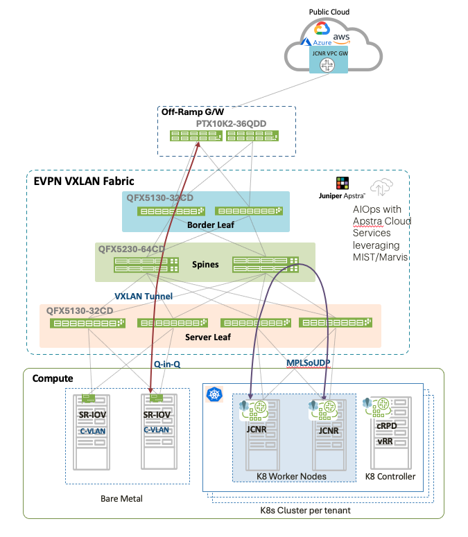

*Figure 1: Hybrid Telco Cloud Solution Architecture*

[Figure 1: Hybrid Telco Cloud Solution Architecture](#figure-1-hybrid-telco-cloud-solution-architecture), shows a high-level architecture of Hybrid Telco Cloud components which consists of the private telco components - Data center fabric as transport layer, compute shows the SR-IOV bare metal servers and the Kubernetes cluster for each tenant hosting the workload and JCNR pods with DPDK vRouter. The compute layer also consists of the storage servers that may be assigned to a particular tenant or shared. The offramp gateway allows for inter-tenant communications and for SR-IOV to JCNR workload.

Apstra provides the intent-based management of the multi-tenant EVPN Private cloud Fabric using QFX5130-32CD as Server and Border leaf switches, QFX5230-64CD as Spines. On the private Telco side, Service Providers can bring their own compute and deployment framework to host applications without worrying about the Fabric.

## Solution Architecture

The telco cloud architecture consists of three main components, EVPN VXLAN data center Fabric, Baremetal/Virtual Machine/Kubernetes cluster as private telco cloud compute and an offramp gateway which makes it easier to individually manage and operate all these components and scale easily without impacting each component.

### EVPN VXLAN Data Center Fabric

For most Telco cloud use cases, 3-stage Clos Bridged Overlay architecture should suffice. In this architecture, lean spine switches are connected to the server leaf switches and border leaf switches. The Server leaf switches host the compute components, and the Border Leaf switches are then connected to the offramp gateway, see [Figure 1: Hybrid Telco Cloud Solution Architecture](#figure-1-hybrid-telco-cloud-solution-architecture).

In this validated design, the fabric is designed with an IPv6 underlay and adopts both Bridged Overlay and Border Leaf Routing models.

#### Bridged Overlay (BO) for SR-IOV Services

SR-IOV services use a Bridged Overlay approach, with Q-in-Q traffic transported across the EVPN-VXLAN fabric and terminated on the Off-Ramp Gateway for Layer 3 processing. Traffic is forwarded based on the outer Service VLAN (S-VLAN), which is mapped to a VNI within the EVPN-VXLAN fabric. The inner Customer VLAN (C-VLAN) is preserved across the fabric and is used to identify the tenant network. Layer 3 processing and inter-network routing for SR-IOV traffic are performed on the Off-Ramp Gateway, where the Q-in-Q services are terminated.

#### Border Leaf Routing for JCNR Services

JCNR services use Anycast gateway (IRB) hosted on the Border Leaf switches to provide Layer 3 east-west connectivity between JCNR instances within the same tenant. Traffic requiring inter-subnet connectivity is forwarded through the Border Leaf and, where required, towards the Off-Ramp Gateway for tenant policy enforcement, route leaking, and external connectivity.

The fabric provides high availability through ESI-LAG connectivity between the server-facing leaf switches and compute nodes, ensuring resilient access to compute, storage, and network resources. The fabric provides tenant isolation using a dedicated EVPN instance (MAC-VRF) per tenant. For SRIOV-connected workloads, the per-tenant MAC-VRF isolation additionally enables the transport of multiple overlapping CVLAN groups in Layer 2 mode across the fabric to the Off-Ramp Gateway. This allows for separation of tenant traffic generated from compute, storage and network services including provision of high-performance connectivity directly from the workloads hosted on Virtual Machines (VMs), bare metal, and Kubernetes based workloads to the wider network.

As discussed earlier, HPE Juniper data center switches QFX5130-32CD are used as server leaf and border leaf switches. QFX5230-64CD is used as high port density Spine switches that allow for future growth. The fabric can be conveniently provisioned using Apstra intent based platform using the SP Data Center Reference architecture that’s available from Apstra 6.2. This allows for most private Telco scenarios to be managed and monitored using Apstra.

### Compute Networking

The EVPN VXLAN fabric provides network services to allow for interconnecting physical and virtualized server components for a tenant in highly scalable manner. Depending on the Telco Cloud providers use case there are two main overlay networking within the compute server space - Host Based Overlay and Network-based overlays.

#### Host-Based Routing (HBR) Using Juniper Cloud Native Router

Host based routing is responsible for constructing overlay networks within the context of single tenant. The overlays stretch from host to host (East-West) or from host to DC Offramp Gateway.

Juniper Cloud-Native Router (JCNR) is a containerized router that combines Juniper’s proven routing technology with the Junos OS containerized routing protocol daemon (cRPD) as the controller and a high-performance Data Plane Development Kit (DPDK) or extended Berkley Packet Filter (eBPF) eXpress Data Path (XDP) datapath based vRouter forwarding plane. It is implemented in Kubernetes and interacts seamlessly with a Kubernetes container network interface (CNI) framework. The third component is the Cloud-Native Router container network interface (CNI) that interacts with Kubernetes as a secondary CNI to create pod interfaces, assign addresses and generate the router configuration. For more information on JCNR, see [JCNR guide](https://www.juniper.net/documentation/us/en/software/cloud-native-router25.2/cloud-native-router-deployment-guide/index.html).

JCNR can support EVPN VXLAN and MPLS-over-UDP as overlay. For this Telco Cloud validated design, MPLS-over-UDP is selected as JCNR overlays to prevent VNI collisions between the Fabric and the JCNR overlays. With this approach, the host is not required to function as a leaf switch. From an operations perspective, Apstra Data Center Director can control the management of the fabric VXLAN overlays seamlessly.

#### Network-based VXLAN Overlays

SR-IOV is an extension to the PCI Express (PCIe) specification that provides virtualization of physical cards such as network adapters to access resources enabling near-real time traffic. This allows Virtual Machines (VMs) to bypass the software switch layer of the Hyper-V virtualization stack and directly access physical network hardware. For this reason, SR-IOV workloads use network-based overlays to map the bare metal traffic into the EVPN VXLAN fabric. A customer VLAN (C-VLAN) is configured on the bare metals hosting the SR-IOV workloads. A service-VLAN (S-VLAN) is then used to provide Q-in-Q tagging to bundle the C-VLAN traffic towards the server leaf switch that is hosting the bare metal. The Server leaf then encapsulates the Q-in-Q traffic into EVPN VXLAN overlays that route the traffic towards Border leaf and then finally towards to the Offramp Gateway where all the routing decisions are made.

### Offramp Gateway

The Offramp gateway serves as Gateway between the Data Center Fabric and the external network, including Public Cloud VPC gateways running Juniper Cloud Native Router (JCNR). The offramp gateway performs following functions:

1.  The Border leaf switches from the fabric connect to the offramp gateway routers to terminate the overlays from the computes such MPLS-over-UDP and the Q-in-Q tunnels as discussed above in the Compute Networking section.
2.  The Offramp gateway performs inter-VRF routing between tenants as well as between SR-IOV and JCNR-based workloads.
3.  In hybrid telco environments, the Public Cloud VPC gateways advertise NLRI (Network Layer Reachability Information) via BGP to seamlessly connect private and public telco cloud infrastructure.

In a production network, deploying two PTX10002-36QDD routers as Offramp Gateways is recommended for high availability. Each border leaf connects two physical interfaces towards the offramp gateway routers, one for L2 traffic i.e. Q-in-Q and the other for MPLS-over-UDP (L3) traffic as shown in [Figure 2: Offramp Gateway Connectivity](#figure-2-offramp-gateway-connectivity).

For the purpose of this validated design, only one PTX10002-36QDD router is deployed as Offramp Gateway. The design assumes that the Border leaf switches are not directly connected and there may be other Layer 3 connectivity in between the border leaf switch and Offramp gateway. Due to the current limitation whereby Q-in-Q services cannot be terminated directly on the IRB interfaces on the border leaf switches, a dummy interface (physical loopback construct) is implemented on the Off-Ramp Gateway. This interface provides a routing transition point between the Layer 3 VPN services hosted in tenant VRFs and the Layer 2 EVPN-VXLAN domain used for SR-IOV traffic transport.

> Note: The term ‘Physical loopback’ is used to define the implementation in this validated design. It should not be mistaken for the loopback interface. The implementation is a workaround for the current Q-in-Q service termination limitation and should not be considered a fundamental architectural requirement. Future enhancements that support direct Q-in-Q termination on IRB interfaces may eliminate the need for this construct.

<span id="figure-2-offramp-gateway-connectivity"></span>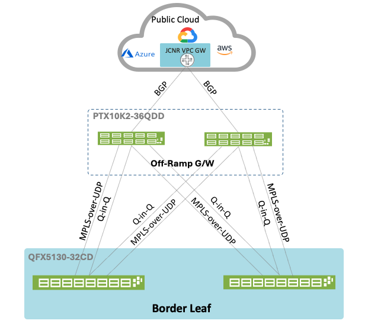

*Figure 2: Offramp Gateway Connectivity*

### Virtual Route Reflector (vRR)

JCNR instances are deployed on a per-tenant basis and must learn VPN and service routes from the network. Establishing direct BGP peering between every JCNR instance and all relevant network devices would create a complex and difficult-to-manage BGP topology as the environment scales. To simplify the control plane, a Virtual Route Reflector (vRR) is deployed on the Kubernetes controller node(s).

#### Centralized Route Reflector

The vRR performs the role of centralized route reflector for the JCNR environment and is responsible for distributing BGP routing information between JCNR and the offramp gateway. Each JCNR instance establishes an internal BGP (iBGP) session with the vRR using its loopback address as the BGP endpoint over the data center IP fabric. The vRR reflects VPN routing information to all participating JCNR instances, eliminating the need for a full-mesh BGP topology.

The off-ramp gateway establishes internal BGP (iBGP) peering with the vRR using the data center fabric infrastructure network to exchange tenant routes, Route targets and JCNR service reachability. Tenant routes originating from SR-IOV and JCNR VRFs are advertised as VPNv6 routes and selectively tagged with Route Targets through export policies. The vRR reflects these routes to the appropriate JCNR instances, enabling controlled route sharing, MPLS-over-UDP tunnel reachability, and communication between JCNR and SR-IOV service domains.

#### Centralized Inter-VRF Reachability for JCNR-to-vRR Control Plane Sessions

The JCNR loopback addresses reside within tenant-specific VRFs (for example, VRF_4001), whereas the vRR is reachable through a dedicated control-plane VRF (VRF_CRPD_4010). As these routing domains are isolated, direct IP reachability between the JCNR and vRR endpoints cannot be provided by the EVPN-VXLAN fabric alone.

To enable BGP session establishment, the off-ramp Gateway performs the required inter-VRF route leaking between the tenant VRFs and the vRR-facing VRF. Consequently, while the iBGP relationship exists logically between the JCNR instances and the vRR, the reachability required to establish and maintain those sessions is provided through the Off-Ramp Gateway. The objective is not to minimize hop count but to centralize all inter-VRF connectivity, policy enforcement, and route leaking functions on the Off-Ramp Gateway. This approach preserves tenant isolation and avoids distributing route-leaking logic across multiple leaf switches or Kubernetes nodes.

#### Border Leaf Switch Anycast IRB Role

The Border Leaf Switch Anycast IRBs provide Layer 3 gateway services within individual routing domains and enable IP reachability across the EVPN-VXLAN fabric. However, they do not perform inter-VRF forwarding between tenant VRFs and the vRR control-plane VRF.

For example, a JCNR loopback may reside in a tenant VRF such as VRF_4001, while the vRR is reachable through a dedicated control-plane VRF such as VRF_CRPD_4010. The Border Leaf Anycast IRB can provide forwarding within each VRF but cannot directly route traffic between them.

When a JCNR instance initiates a BGP session towards the vRR, traffic remains within the tenant VRF while traversing the EVPN-VXLAN fabric until it reaches the Off-Ramp Gateway, where inter-VRF route leaking is applied. The off-ramp gateway then performs the required inter-VRF route lookup and inter-VRF route leaking from the tenant VRF into the control-plane VRF. Once the route has been resolved in the control-plane VRF, the packet is forwarded toward the vRR. The reverse route is leaked in the opposite direction, ensuring bidirectional reachability for the BGP/TCP session.

Consequently, even when the JCNR instance and vRR are physically connected to the same leaf pair, physical proximity does not eliminate the VRF boundary. Traffic must still traverse the Off-Ramp Gateway because the offramp gateway serves as the centralized inter-VRF routing and policy enforcement point for the architecture.

The Border Leaf Switch Anycast IRBs and the Off-ramp gateway therefore serve complementary functions as listed in [Table 1: Border Leaf Anycast Gateway (IRBs) and Off-Ramp Gateway Function](#table-1-border-leaf-anycast-gateway-irbs-and-off-ramp-gateway-function).

##### Table 1: Border Leaf Anycast Gateway (IRBs) and Off-Ramp Gateway Function

| **Border Leaf Anycast IRBs** | **Off-Ramp Gateway** |
|----|----|
| Provide Layer 3 gateway functionality within a VRF. | Acts as the routing boundary between tenant and control-plane VRFs. |
| Enable reachability across the EVPN-VXLAN fabric. | Supports inter-network, inter-tenant, and external connectivity. |
| Do not perform cross-VRF route leaking. |  |

Performs inter-VRF route leaking. Provides centralized routing policy enforcement. \|

#### Fabric Role

The EVPN-VXLAN fabric serves as the underlying transport infrastructure for both control-plane and data-plane communications. The fabric provides IP reachability between the JCNR instances, Virtual Route Reflectors (vRRs), and the Off-Ramp Gateway, while maintaining tenant isolation through EVPN-VXLAN forwarding domains.

For control-plane communications, the fabric transports iBGP traffic between the JCNR instances, the vRR, and the Off-Ramp Gateway. For data plane communications, the fabric transports MPLS-over-UDP traffic between the JCNR data plane endpoints and the Off-Ramp Gateway.

The fabric does not perform route reflection, VPN route distribution, or inter-VRF route leaking. These functions are provided by the vRR and the Off-Ramp Gateway, respectively.

The vRR reduces operational complexity of BGP peering and improves scalability as additional JCNR instances can be added without increasing BGP peering. More details about configuration, see [Apstra: Provision Overlay Network](#apstra-provision-overlay-network) and [BGP Sessions to Advertise Routes](#bgp-sessions-to-advertise-routes) sections.

## HPE Juniper Networking Hardware and Software Components

For this solution, the Juniper products and software versions are the following.

The design documented in this validated design is considered the baseline representation for the solution. As part of a complete solutions suite, we routinely swap hardware devices with other models during iterative use case testing. Each switch platform validated in this document goes through the same rigorous role-based testing using specified versions of Junos OS and Apstra software.

### HPE Juniper Networking Hardware Components

The following switches are tested and validated to work with the 3-Stage Fabric with Apstra Data Center Director in the following roles:

##### Table 2: Telco Cloud Service Provider Devices and Positioning

<table>
<colgroup>
<col style="width: 20%" />
<col style="width: 20%" />
<col style="width: 20%" />
<col style="width: 20%" />
<col style="width: 20%" />
</colgroup>
<thead>
<tr class="header">
<th>Server Leaf Switches</th>
<th>Border Leaf Switches</th>
<th>Spine</th>
<th>Offramp Routers</th>
<th>Bare Metal Servers (SR-IOV and JCNR)</th>
</tr>
</thead>
<tbody>
<tr class="odd">
<td>QFX5130-48C</td>
<td>QFX5130-32CD</td>
<td>QFX5230-64CD</td>
<td>PTX10002-36QDD</td>
<td>HPE DL360 Gen<br />
DELL PowerEdge R750</td>
</tr>
</tbody>
</table>

##### Table 3: HPE Juniper Networking Software and Version

| HPE Juniper Networking Products | Software or Image Version |
|---------------------------------|---------------------------|
| Apstra Data Center Director     | 6.2                       |
| Juniper OS Evolved (QFX)        | 25.2X100-D30              |
| Juniper OS Evolved (PTX)        | 25.4R1-S1                 |
| JCNR                            | 25.2                      |

> Note: JCNR is installed on the Kubernetes Worker pods after the HELM Chart is installed. An appropriate license must be installed for the JCNR cRPD pod to be in running state, otherwise it enters CrashLoopBackOff state. To procure the license, contact your HPE Juniper Account team.

##### Table 4: Pre-requisite Compute Software Configured for the Validated Design

| Software Name | Software or Image Version |
|----|----|
| Ubuntu | 22.04.4 LTS |
| Kubernetes (K9s) Client Version | v1.35.1 |
| Kustomize Version | v5.7.1 |
| Kubernetes Server Version | v1.35.1 |
| Python | 3.12 |
| Multus CNI | https://github.com/k8snetworkplumbingwg/multus-cni.git |
| HELM Chart | curl -fsSL -o get_helm.sh https://raw.githubusercontent.com/helm/helm/main/scripts/get-helm-3 |

> Note: GIT must be installed after the Ubuntu server is upgraded to 22.04.4. **Also,**, there may be more packages required, **which** can be installed separately as needed, **see** Compute Install and Deployment of Ubuntu Operating System, Kubernetes.

#### Feature Validation

The 3-Stage SP Telco Data Center Fabric is validated for the following baseline features:

##### Table 5: Apstra Intent Based DC Reference

<table style="width:99%;">
<colgroup>
<col style="width: 33%" />
<col style="width: 33%" />
<col style="width: 33%" />
</colgroup>
<thead>
<tr class="header">
<th>CATEGORY</th>
<th>FEATURES</th>
<th>HPE Juniper Networking Standard Document Link</th>
</tr>
</thead>
<tbody>
<tr class="odd">
<td><strong>Bridged Overlay with IPv6 Underlay</strong></td>
<td>IPv6 underlay [ Apstra 6.1 provides IPv6 assignment and BGP configuration; hence BGP unnumbered is not included]</td>
<td><a href="https://www.juniper.net/documentation/us/en/software/nce/sg-005-data-center-fabric/topics/task/bridged-overlay-cloud-dc-configuring.html">Bridged Overlay Design and Implementation</a></td>
</tr>
<tr class="even">
<td><strong>Crb-proxy-mac on Leaf Switches in Bridge Overlay Fabric with Spines as Junos OS Evolved</strong></td>
<td>With crb-proxy-mac command leaf devices are responsible to refresh ARP entries using the configured MAC address. Here MAC address can be any unused MAC address. After leaf device receives ARP reply, it sends BGP EVPN type 2 route towards the Spine so the ARP knowledge can be refreshed on the Spine device.</td>
<td><a href="https://www.juniper.net/documentation/us/en/software/junos/cli-reference/topics/ref/statement/crb-proxy-mac.html">crb-proxy-mac</a></td>
</tr>
<tr class="odd">
<td><strong>EVPN Instance Type (MAC-VRF)</strong></td>
<td>MAC-VRF is an Ethernet VPN (EVPN) instance type that provides layer 2 multitenancy by creating dedicated MAC address forwarding tables per tenant VLAN-aware as Apstra provisions both VLAN-AWARE and VLAN-Bundle.<br />
<br />
MAC-VRF is also configured for VLAN isolation which is a hardware-agnostic mechanism to support overlapping VLAN IDs across tenants.</td>
<td><a href="https://www.juniper.net/documentation/us/en/software/junos/evpn/topics/concept/mac-vrf-routing-instance-overview.html">MAC-VRF Routing Instance Type Overview</a></td>
</tr>
<tr class="even">
<td><strong>Underlay EBGP</strong></td>
<td>Underlay IPv6 eBGP Peering session</td>
<td><a href="https://www.juniper.net/documentation/us/en/software/nce/sg-005-data-center-fabric/topics/task/ipv6-fabric-underlay-and-overlay-ebgp.html#id-configure-interfaces-and-ebgp-as-the-routing-protocol-in-an-ipv6-underlay">Configure Interfaces and EBGP as the Routing Protocol in the IPv6 Fabric Underlay</a></td>
</tr>
<tr class="odd">
<td><strong>Overlay EBGP</strong></td>
<td>Overlay IPv6 eBGP Peering session</td>
<td><a href="https://www.juniper.net/documentation/us/en/software/nce/sg-005-data-center-fabric/topics/task/ipv6-fabric-underlay-and-overlay-ebgp.html#id-configure-ebgp-with-ipv6-device-connectivity-for-the-overlay">Configure EBGP for IPv6 Overlay Peering</a></td>
</tr>
<tr class="even">
<td><strong>Load Balancing</strong></td>
<td>ECMP with EBGP session</td>
<td><a href="https://www.juniper.net/documentation/us/en/software/junos/bgp/topics/topic-map/load-balancing-bgp-session.html#id-understanding-bgp-multipath">Understanding BGP Multipath</a></td>
</tr>
<tr class="odd">
<td><strong>Single Homing and Multi-homing</strong></td>
<td>ESI-LAG for single and Multi-homed (Active-Active).</td>
<td><a href="https://www.juniper.net/documentation/us/en/software/junos/evpn/topics/concept/evpn-bgp-multihoming-overview.html#evpn-multihoming-overview__d4185e151">Understanding EVPN Multihoming Concepts</a></td>
</tr>
<tr class="even">
<td><strong>EVPN Multihoming Designated Forwarder Election</strong></td>
<td>When deploying Active-Standby EVPN multi-homing, by default EVPN runs modulo calculation for individual VLAN/EVI. But by using per-ESI, it resolves some operational problems during failover in an Active-Standby setup.<br />
<br />
The QFX5K series devices only support port-based DF elections and not the DF election per EVI per ESI procedure.</td>
<td><a href="https://www.juniper.net/documentation/us/en/software/junos/evpn/topics/topic-map/evpn-mh-df-election.html">EVPN Multihoming Designated Forwarder Election</a></td>
</tr>
</tbody>
</table>

## Solution Walkthrough

The validated design focusses mainly on the network aspect such as data center fabric and the JCNR, while briefly covering Kubernetes and SR-IOV configuration from network configuration perspective. The configuration of the applications and tools that generate compute traffic in the network overlay are out of scope as this depends mainly upon each customer use case.

### Data Center Fabric Using HPE Juniper Configuration

The Data center fabric serving the compute infrastructure is provisioned using HPE Apstra Data Center Director (Apstra). The procedure to create logical devices, Interface maps and adding devices to Apstra for management is similar to configuration steps discussed in Juniper Validated [3-Stage EVPN/VXLAN Fabric with Juniper Apstra—Juniper Validated Design (JVD)](https://networkingdocs.hpe.com/documentation/us/en/software/jvd/jvd-3-stage-datacenterdesign-with-juniper-apstra/index.html) and this validated design covers the variations required to Telco Service Provider Data Center Reference design Blueprint.

### Apstra: Provisioning IPv6 Fabric

Once all the devices are added into Apstra, the devices are acknowledged. For each device type Apstra requires a Logical Device and associated Interface Map created that should be associated with Device Profile. The devices recommended for this validated design are listed in [Table 2: Telco Cloud Service Provider Devices and Positioning](#table-2-telco-cloud-service-provider-devices-and-positioning). The logical devices and associated Interface Maps are shown here that represent the device uplinks towards Spine switches and downlinks towards Servers. There needs to be a sufficient count of links created as a logical device which is then used to associate device Profile to Interface Maps where the actual interface is selected based on physical connectivity setup.

**QFX5130-48C as Server Leaf Switches**

The server leaf switches used in this architecture are QFX5130-48C. The logical device and Interface Map created based on the switch connectivity towards Spine and servers is shown in [Figure 3: QFX5130-48C Logical Device and Interface Map](#figure-3-qfx5130-48c-logical-device-and-interface-map).

<span id="figure-3-qfx5130-48c-logical-device-and-interface-map"></span>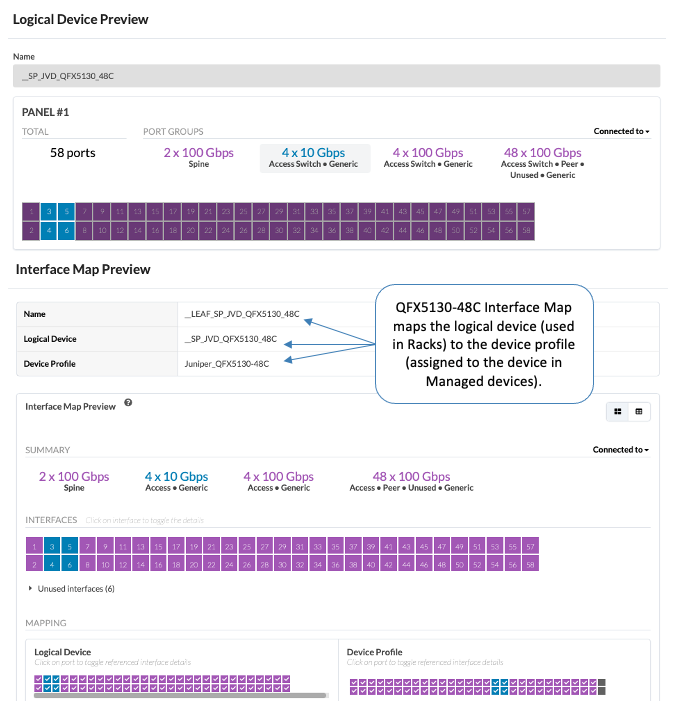

*Figure 3: QFX5130-48C Logical Device and Interface Map*

**QFX5130-32CD as Border Leaf Switches**

The border leaf switches used in this architecture are QFX5130-32CD. The logical device and Interface Map is created based on the physical switch connectivity to Spine switches as uplinks and towards the Offramp Gateway router.

<span id="figure-4-logical-device-and-interface-map-of-leaf-switch-qfx5130-32cd"></span>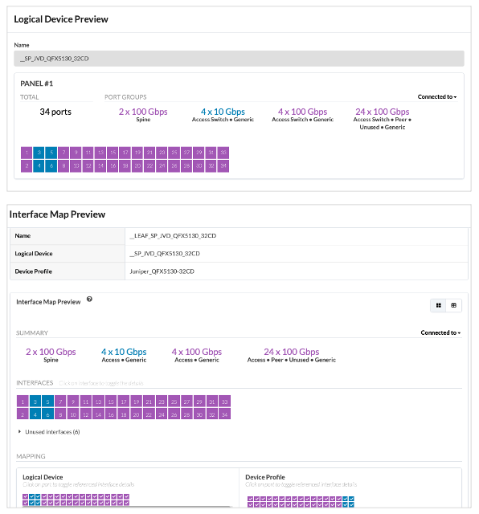

*Figure 4: Logical Device and Interface Map of Leaf Switch QFX5130-32CD*

To create Apstra Blueprint, blueprint template is created first as shown in [Figure 5: Blueprint Template](#figure-5-blueprint-template). The rack is added and associated with the Spine’s logical device. In this validated design only 2 Spine switches are used. However, this number could be higher for large scale setup and can be increased using Apstra Blueprint.

<span id="figure-5-blueprint-template"></span>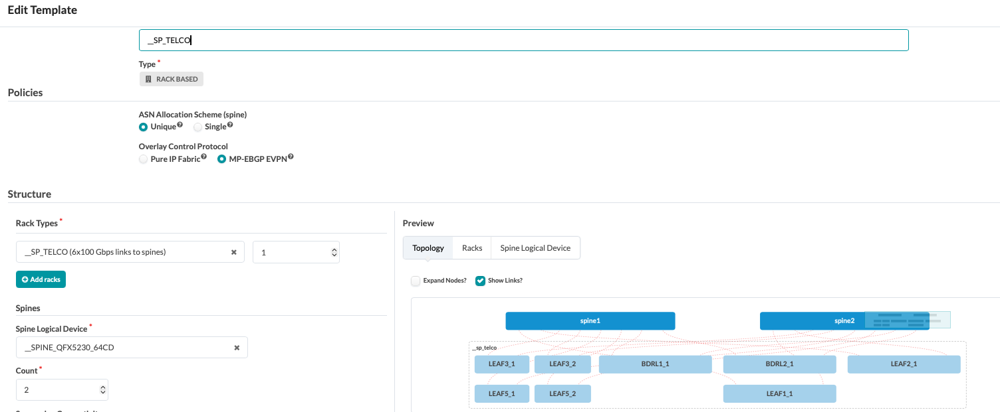

*Figure 5: Blueprint Template*

After creating the template, a blueprint is created from the template. The Telco fabric design uses IPv6 underlay and overlay.

<span id="figure-6-blueprint"></span>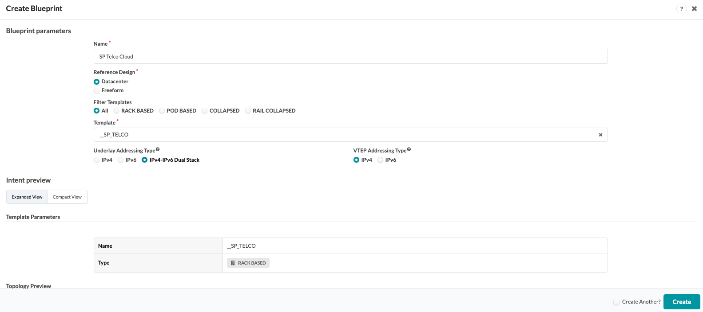

*Figure 6: Blueprint*

After creating Blueprint, resources such as ASN pools, IPv6 Loopback Address Pools and IPv6 Link Address Pools under **Blueprint \> Staged**. The interface maps can be selected under **Blueprint \> Staged \> Device Profiles**, to ensure the correct Interface Map is selected ensure the device profile, The devices are also assigned under Systems, if the rack contains the appropriate logical device and the appropriate Interface Maps are available under **Blueprint \> Staged \> Catalog**. If Interface map is not visible under Catalog then review it to ensure the Interface Map is correctly associated to the device profile and the logical device. The interface map should also be created with the appropriate transformation that matches the device Interfaces so that the cable connectivity is correctly identified.

<span id="figure-7-assign-resources-system-id-and-device-profiles-in-blueprint"></span>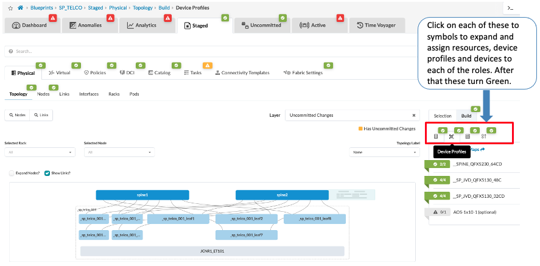

*Figure 7: Assign Resources, System ID and Device Profiles in Blueprint*

After the devices are assigned, ensure that the cabling is correctly picked up by Apstra. Navigate to **Blueprints \> Staged \> Physical** and click on **Links**. Alternatively, click on **Fetch discovered LLDP data** to discover the links. LLDP configuration is applied when the devices are added to Apstra.

By now all the basic underlay IPv6 fabric configuration is created by Apstra which is not pushed to the switches till Commit is performed. To review the configuration, navigate to **Blueprint \> Staged \> Physical** and either Select devices from **Topology** or Click on **Nodes** and then click on device, which presents a screen with option to view the rendered configuration as shown in [Figure 8: View Rendered Configuration](#figure-8-view-rendered-configuration).

<span id="figure-8-view-rendered-configuration"></span>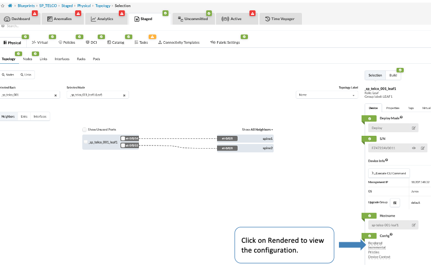

*Figure 8: View Rendered Configuration*

### Underlay Configuration Applied by Apstra

Once all the changes are committed, Apstra version 6.2 applies the underlay configuration across the spine and leaf switches like the Enterprise Data Center design. Although dual stack is selected while creating blueprint, this validated design proposes IPv6 underlay and overlay solution.

**EVPN/VXLAN Fabric with IPv6 Underlay**

EVPN VXLAN with an IPv6 underlay uses IPv6 for the underlying network infrastructure to connect Virtual Tunnel Endpoints (VTEPs), allowing for a larger IP address space and more efficient packet processing. This setup enables modern routing protocols like BGP unnumbered peering in the underlay and supports overlay hosts that can be either IPv4 or IPv6. BGP unnumbered peering streamlines the configuration of an IPv6 underlay in an EVPN-VXLAN data center fabric by automatically discovering IPv6 neighbors, eliminating the need for manual setup.

> Note: Apstra automatically provides similar functionality to BGP unnumbered peering, eliminating the need for manual configuration within this Validated Design.

In case BGP unnumbered is required, a configlet could be used in Apstra, if Apstra is used for managing the network. For more information on BGP unnumbered peering, also known as BGP auto-discovery or BGP auto-peering see [AI Multitenancy validated design](https://networkingdocs.hpe.com/documentation/us/en/software/jvd/jvd-ai-dc-evpn-multitenancy/type_5_evpnvxlan_gpu_backend_fabric_implementation_control_plane.html#Toc210205895__control_plane_implementation_with_ipv6_link-local_underlay).

A snippet of BGP unnumbered config is attached in Appendix A of this validated design document, in case BGP unnumbered is required and Apstra is not used for managing the network.

**IPv6 Underlay Fabric with Apstra**

There are different options to implement the underlay in an EVPN/VXLAN fabric, depending on design goals, operational preferences, and hardware capabilities.

- IPv4 addresses (/31 subnet masks) numbered interfaces
- IPv6 addresses (/127 subnet masks) numbered interfaces
- IPv6 link-local addresses (unnumbered interfaces), with BGP neighbor auto-discovery based on IPv6 neighbor discovery (RFC 4861) and IPv4 route advertisement via IPv6 next-hops (RFC 5549) for IPv4 overlays.

Starting with Apstra 6.1, IPv6 underlay is supported on all applicable supporting Devices (see the [Apstra guide](https://networkingdocs.hpe.com/documentation/us/en/software/apstra6.2/apstra-user-guide/topics/topic-map/ipv6.html) for more information).

Apstra statically assigns IPv6 addresses (/127 subnet masks) from IPv6 Pool (assigned to the blueprint) for fabric addressing which makes it easier to manage and avoid manually performing IP administration functions. This reduces operational complexity, especially in large-scale fabrics where scalability and automation are key. By using Apstra the need to assign and manage global IP addresses on leaf-to-spine links, eliminates a major source of administrative overhead.

In Apstra the resource group concept is used to create IP Address Pools. Each link is automatically assigned unique addresses once the IP address resource pool is assigned, streamlining both deployment and ongoing maintenance. This is a significant advantage in environments with thousands of interfaces. All leaf and spine nodes are also configured with IPv6 addresses on the loopback interface (lo0.0).

The underlay EBGP sessions are set up between the leaf and spine nodes, by explicitly configuring each neighbor, using the /127 IPv6 addresses assigned between them.

> Note: BGP unnumbered/auto-discovery is not configured as Apstra performs similar features without the need for manual assignment of IP address.

The EBGP configuration for this model includes each neighbor’s IPv6 address and Autonomous System (AS) number, the local Autonomous System (AS) number, and the export policy that allows the advertisement of routes to reach all the leaf and spine nodes in the fabric. These routes are standard IPv6 unicast advertising the IPv6 addresses assigned to the loopback interface (lo0.0).

Following is an example of the Apstra config snippet of the underlay EBGP configuration applied by Apstra:

``` junos
protocols {
    bgp {
    group l3clos-l {
        type external;
        multipath {
            multiple-as;
        }
        bfd-liveness-detection {
            minimum-interval 1000;
            multiplier 3;
        }
        neighbor 2001:2001:2001:2001:: {
            description facing_spine1;
            local-address 2001:2001:2001:2001::1;
            family inet {
                unicast {
                    extended-nexthop;
                }
            }
            family inet6 {
                unicast;
            }
            export ( LEAF_TO_SPINE_FABRIC_OUT && BGP-AOS-Policy );
            peer-as 100;
        }
        neighbor 2001:2001:2001:2001::10 {
            description facing_spine2;
            local-address 2001:2001:2001:2001::11;
            family inet {
                unicast {
                    extended-nexthop;
                }
            }
            family inet6 {
                unicast;
            }
            export ( LEAF_TO_SPINE_FABRIC_OUT && BGP-AOS-Policy );
            peer-as 101;
        }
        vpn-apply-export;
    }
}
```

To verify that underlay BGP is established between the spine and leaf switches, execute the `show bgp summary` command on the spine switch’s CLI.

``` text
regress@spine2> show bgp summary

Warning: License key missing; requires 'BGP' license

Threading mode: BGP I/O
Default eBGP mode: advertise - accept, receive - accept
Groups: 2 Peers: 16 Down peers: 0
Table          Tot Paths  Act Paths Suppressed    History Damp State    Pending
inet.0
                      16          8          0          0          0          0
inet6.0
                      24         16          0          0          0          0
bgp.evpn.0
                     101        101          0          0          0          0
Peer                     AS      InPkt     OutPkt    OutQ   Flaps Last Up/Dwn State|#Active/Received/Accepted/Damped...
2001:2001:2001:2001::11         102        171        197       0       1     1:15:17 Establ
  inet.0: 1/2/2/0
  inet6.0: 2/3/3/0
2001:2001:2001:2001::13         103        244        274       0       0     1:47:59 Establ
  inet.0: 1/2/2/0
  inet6.0: 2/3/3/0
2001:2001:2001:2001::15         104        245        274       0       0     1:47:53 Establ
  inet.0: 1/2/2/0
  inet6.0: 1/2/2/0
2001:2001:2001:2001::17         105        244        274       0       0     1:48:09 Establ
  inet.0: 1/2/2/0
  inet6.0: 2/3/3/0
2001:2001:2001:2001::19         106        244        275       0       0     1:48:17 Establ
  inet.0: 1/2/2/0
  inet6.0: 2/3/3/0
2001:2001:2001:2001::1b         107        231        260       0       0     1:42:35 Establ
  inet.0: 1/2/2/0
  inet6.0: 2/3/3/0
2001:2001:2001:2001::1d         108        149        152       0       1     1:02:39 Establ
  inet.0: 1/2/2/0
  inet6.0: 3/4/4/0
2001:2001:2001:2001::1f         109        199        218       0       0     1:26:19 Establ
  inet.0: 1/2/2/0
  inet6.0: 2/3/3/0
```

### Router-IDs for EBGP Sessions

Router IDs are used to uniquely identify each switch or router in the network. Because the underlay is IPv6 and uses the IPv6 address family to establish BGP connections, it is still essential to assign a 32‑bit router ID to ensure BGP functions correctly. The router ID is represented in the format of a unique IPv4 address. Following is the CLI configuration statement:

``` junos
set routing-options router-id <loopback-ipv4-address>
```

Apstra assigns the loopback IP from the Resources selected under **Blueprint \> Stage**.

<span id="figure-9-assign-ip-pool-under-resources-after-creating-blueprint"></span>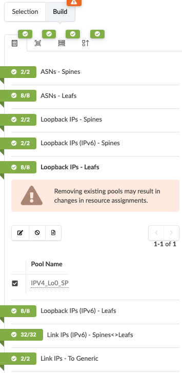

*Figure 9: Assign IP Pool Under Resources After Creating Blueprint*

### Apstra: Provision Overlay Network

After the fabric is provisioned, next step is to configure the overlay network. To provision overlay network in Apstra, create Routing zone, Switching zone and Virtual Network. For more information on provisioning overlay network, see [Apstra user guide](https://networkingdocs.hpe.com/documentation/us/en/software/apstra6.2/apstra-user-guide/topics/concept/virtual-networks.html).

For the purposes of the Service Provider Telco solution following are the key Virtual Network setup needed to allow JCNR and SR-IOV traffic flow from the compute to the destination host. The following examples provided to show context and understanding of the configuration required for this solution.

1.  JCNR per tenant: For JCNR traffic, per tenant routing zone (VRF), switching zone (EVPN Instance) are created and associated with the Virtual Network in Apstra.
2.  vRR: Without a route reflector, every JCNR would need to establish BGP sessions with multiple peers, creating a complex mesh. By using vRR which is setup on the tenant Kubernetes controller, JCNR can learn routes to reach destination host. An IBGP session is established between offramp gateway and the vRR instance which is covered later in this document and a IBGP session is established between JCNR and thee vRR instance. In Apstra, a routing zone, switching zone and virtual network is created to allow the control plane traffic between compute and the offramp gateway.
3.  SR-IOV per tenant per VN: For SR-IOV traffic, Q-in-Q encapsulation is required which can now be configured using Apstra version 6.2.

#### Routing Zone

To create L3 routing zone (VRF) the Apstra routing zone is used to create all the L3 VRFs. A routing policy is created separately if variations are required in the policy, however in this validated design the default routing policy is applied in Apstra and assigned to the VRF instance.

<span id="figure-10-default-routing-policy-created-by-apstra"></span>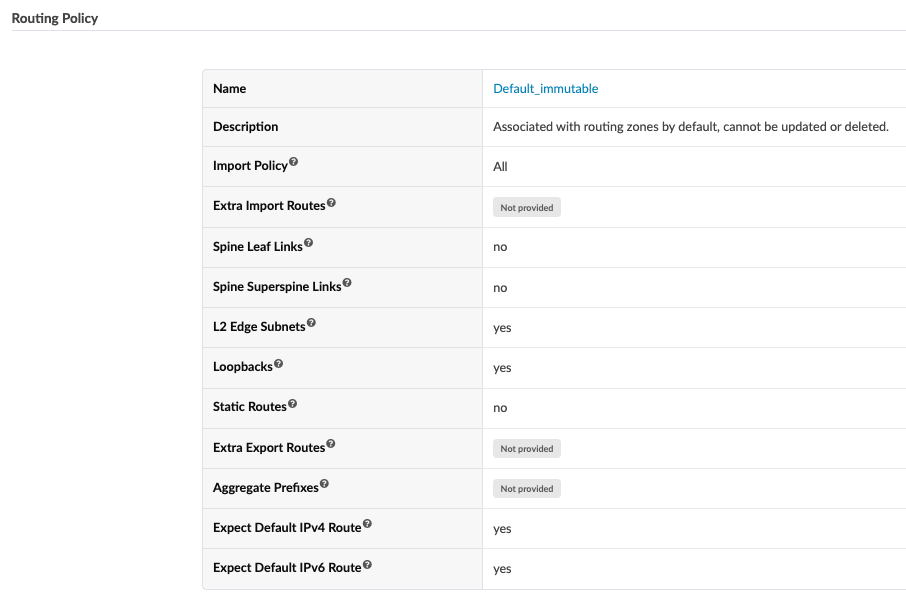

*Figure 10: Default Routing Policy Created by Apstra*

After creating routing policy, routing zone is created under **Blueprints → Virtual** in Apstra. A separate L3 VNI is assigned as shown in the following screenshot. This can be assigned after creating the routing zone and a resource pool can be used. The default routing policy is assigned. Lastly, the IRB type is selected. Asymmetric IRB is the default and is applied by both Junos OS and Apstra. However, the selected IRB type has no impact on this design because it uses a Bridged Overlay. The leaf switches operate at Layer 2 only, except for the border leaf switches, and all inter-vlan, inter-subnet routing decisions are handled by the off-ramp gateway. To understand more about Symmetric IRB, see [Symmetric Integrated Routing and Bridging with EVPN Type 2 Routes in EVPN-VXLAN Fabrics](https://networkingdocs.hpe.com/documentation/us/en/software/junos/evpn/topics/topic-map/evpn-sym-t2-routing-ov.html). Also, the 3-stage IPv6 validated design has section that explains the difference between Asymmetric and Symmetric IRB.

##### Table 6: Routing Zone Example

| **Parameters** | **JCNR Routing Zone Per Tenant** | **JCNR vRR** | **SR-IOV for All Virtual Networks Per Tenant** |
|----|----|----|----|
| **VRF Name** | VRF_ALL_4001 | VRF_CRPD_4010 | VRF_2001_3000 |
| **VRF Description** |  |  |  |
| **Type** | EVPN | EVPN | EVPN |
| **Tags** |  |  |  |
| **VLAN ID** | 4 | 2 | 5 |
| **VNI** | 5004 | 5002 | 5005 |
| **Route Target** | 5004:1 | 5002:1 | 5005:1 |
| **Junos EVPN IRB Mode** | Symmetric | Symmetric | Asymmetric |
| **DHCP Servers** | DHCP Relay not configured | DHCP Relay not configured | DHCP Relay not configured |

For each of the routing zones IPv6 addressing is selected, but the IPv4 address is not disabled.

<span id="figure-11-ip-addressing-type-for-routing-zone"></span>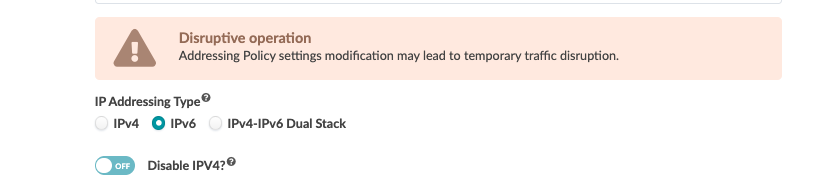

*Figure 11: IP Addressing Type for Routing Zone*

<span id="figure-12-routing-zone-vrf-for-jcnr-for-a-tenant"></span>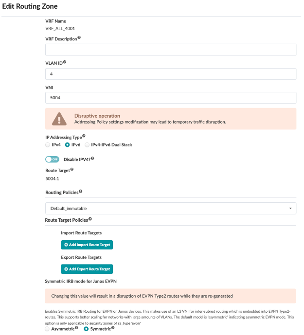

*Figure 12: Routing Zone (VRF) for JCNR for a Tenant*

<span id="figure-13-routing-zone-vrf-for-sr-iov-per-tenant"></span>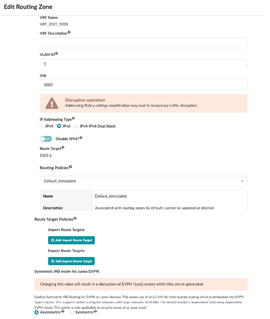

*Figure 13: Routing Zone (VRF) for SR-IOV per Tenant*

After creating the routing zone (L3 VRF), assign the loopback address by using the resource pool for each of the VRF created, as shown in [Figure 14: Routing Zone for JCNR and Loopback IP Assigned per Tenant](#figure-14-routing-zone-for-jcnr-and-loopback-ip-assigned-per-tenant).

<span id="figure-14-routing-zone-for-jcnr-and-loopback-ip-assigned-per-tenant"></span>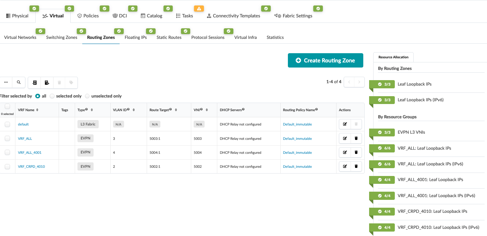

*Figure 14: Routing Zone for JCNR and Loopback IP Assigned per Tenant*

#### Switching Zones

Switching zone is the EVPN MAC VRF instance that is associated to the Virtual Network for segregation of tenant layer 2 traffic. For SR-IOV, VLAN bundle is selected so as to map tenant VLANs. A tenant is assigned the SVLAN and the SVLAN can be associated with multiple CVLAN.

##### Table 7: Switching Zone for Each Overlay Network

| **Parameters**       | **JCNR**        | **JCNR vRR**    | **SR-IOV**  |
|----------------------|-----------------|-----------------|-------------|
| Label                | MACVRFJCNR_4000 | MACVRFCRPD_4010 | MACVRF_2001 |
| Implementation Type  | mac_vrf         | mac_vrf         | mac_vrf     |
| MAC-VRF Service Type | VLAN Aware      | VLAN Aware      | VLAN Bundle |
| MAC-VRF Name         | MACVRFJCNR_4000 | MACVRFCRPD_4010 | MACVRF_2001 |
| MAC-VRF ID           | 10001           | 10000           | 10003       |
| Route Target         | 100:110001      | 100:10000       | 100:10001   |
| Virtual Networks     | VN4000          | VN4010          | VN2001      |

<span id="figure-15-switching-zones"></span>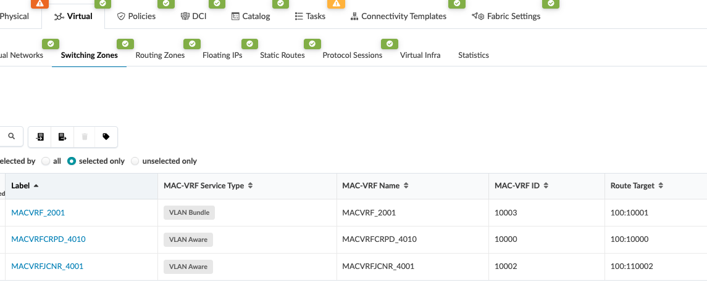

*Figure 15: Switching Zones*

#### Virtual Networks

After creating the routing zone and the switching zone, virtual network is created and assigned to the relevant leaf switches. For JCNR there is no VLAN assigned only VNI is assigned as shown in the following screenshot. Here are the parameters provided for each type of Network that are needed for JCNR and SR-IOV network to be configured. In the case of SR-IOV the **Encapsulate Inner VLAN** is enabled to allow Q-in-Q traffic. For JCNR, **Encapsulate Inner VLAN** is not selected.

##### Table 8: Virtual Network Example

| **Parameters** | **JCNR Virtual Network** | **SR-IOV Virtual Network** | **Virtual Route Reflector (vRR) for JCNR Network** |
|----|----|----|----|
| Name | VN4000 | VN2001 | VN4010 |
| VLAN | 4000 | 2001 | 4010 |
| Type | VXLAN | VXLAN | VXLAN |
| Tags |  |  |  |
| Routing Zone | VRF_ALL | VRF_2001_3000 | VRF_CRPD_4010 |
| Switching Zone | MACVRFJCNR_4000 | MACVRF_2001 | MACVRFCRPD_4010 |
| VNI | 2004000 | 202001 | 2004010 |
| DHCP Service | Disabled | Disabled | Disabled |
| L3 MTU | 9000 | 9000 | 9000 |
| IPv4 Connectivity | Enabled | Disabled | Enabled |
| IPv4 Subnet | 172.31.255.0/24 |  | 193.168.255.0/24 |
| Virtual Gateway IPv4 | 172.31.255.1 |  | 193.168.255.1 |
| IPv6 Connectivity | Enabled | Disabled | Enabled |
| IPv6 Subnet | fd51:9b86:a688:2862::/64 |  | fdf8:db3c:29c5:ac6c::/64 |
| Virtual Gateway IPv6 | fd51:9b86:a688:2862::ffff |  | fdf8:db3c:29c5:ac6c::ffff |
| Encapsulate Inner VLAN? | No | Yes | No |
| Route Target | 2004000:1 | 202001:1 | 2004010:1 |

> Note: For SR-IOV network no IPv4 or IPv6 connectivity is enabled as its purely Layer 2 with Q-in-Q encapsulation. In all the above scenarios, the leaf switch hosting the server and the border leaf switch are assigned. The border leaf switch is selected because all routing decisions are carried out on the offramp gateway which is connected to the Border leaf switch. The ‘IPv4 Connectivity’ and ‘IPv6 Connectivity’ although enabled for JCNR and vRR network can be disabled while assigning individual leaf switches, hence only border leaf switches are enabled for IRB.

As shown in [Figure 16: Assigning JCNR Virtual Network to Leaf Switches](#figure-16-assigning-jcnr-virtual-network-to-leaf-switches), all the parameters listed above for JCNR Network VLAN 4000 is created and assigned to Border leaf switches and leaf switches hosting the server are assigned. However, the IRB is enabled only on the Border leaf switches under the section ‘**Assigned to**’ by selecting ‘**Enabled**’ for IPv4 Mode and IPv6 Mode, as for leaf switches these are ‘**Disabled**’.

<span id="figure-16-assigning-jcnr-virtual-network-to-leaf-switches"></span>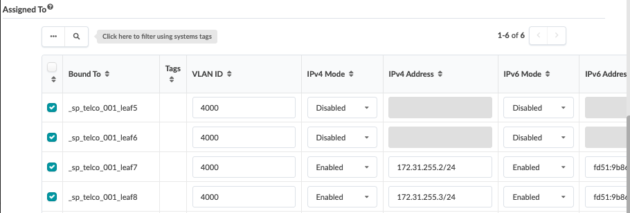

*Figure 16: Assigning JCNR Virtual Network to Leaf Switches*

<span id="figure-17-jcnr-virtual-network"></span>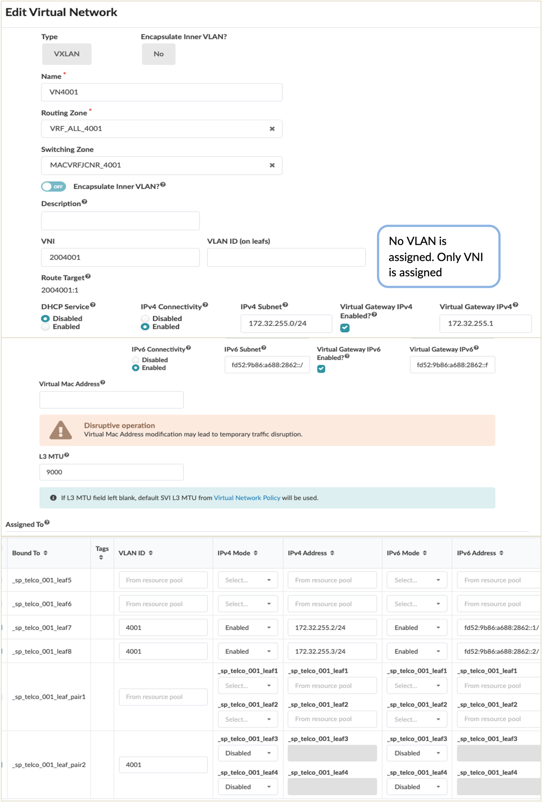

*Figure 17: JCNR Virtual Network*

Optionally, while creating Virtual Network connectivity template can be selected. Upon selecting Connectivity template, Apstra automatically creates a connectivity template. If this option is not selected, then navigate to **Blueprints → Staged → Connectivity Template** and create a template with primitive **Virtual Network (Single)** and select the **Virtual Network ID** (VNI) as shown in [Figure 18: Connectivity Template for Assigning VNI to Leaf Switch Interface](#figure-18-connectivity-template-for-assigning-vni-to-leaf-switch-interface) and after saving the template, assign the template to the leaf switch interface as shown in the following. This leaf switch is selected when creating a Virtual Network.

The connectivity template is used to assign VLAN tagging on the selected leaf switch interfaces facing the JCNR hosting server.

<span id="figure-18-connectivity-template-for-assigning-vni-to-leaf-switch-interface"></span>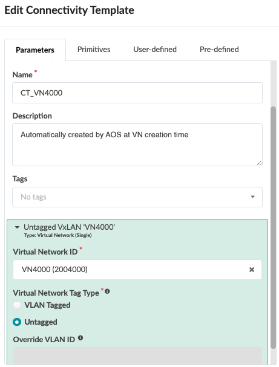

*Figure 18: Connectivity Template for Assigning VNI to Leaf Switch Interface*

<span id="figure-19-assign-connectivity-template"></span>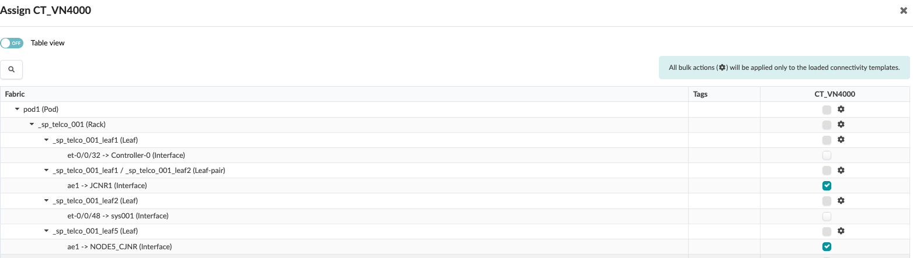

*Figure 19: Assign Connectivity Template*

A virtual network should be created for the vRR as described in Virtual Route Reflector (vRR). The vRR control plane is formed between JCNR and offramp gateway that facilitates learning and exchanging routes that will be used to create MPLS-over-UDP tunnel from the JCNR to destination. The vRR virtual network is then assigned to the leaf switches hosting the Kubernetes controller and the Border leaf switches. However, the IRB is only enabled on the Border leaf. Apstra configure the Border leaf switches with Anycast gateway (IRB). Although the Anycast gateway is configured on the Border leaf switches it doesn’t perform inter-vrf forwarding between JCNR tenants and vRR as described in Virtual Route Reflector (vRR). The border leaf passes the traffic to off-ramp gateway to perform routing between JCNR and vRR tenants.

<span id="figure-20-vrr-network-virtual-network"></span>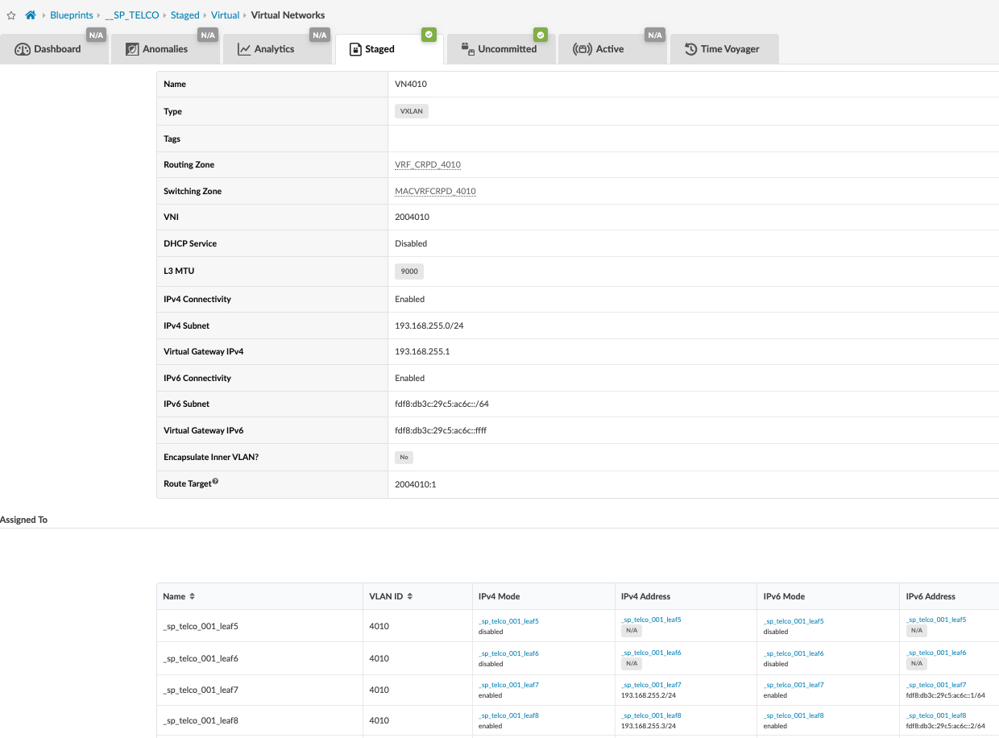

*Figure 20: vRR Network Virtual Network*

While creating the vRR virtual network, ensure that the connectivity template is enabled which automatically generates a connectivity template. A VLAN tagging is generated on the selected leaf switch interfaces facing the JCNR hosting server.

<span id="figure-21-vrr-for-jcnr-traffic"></span>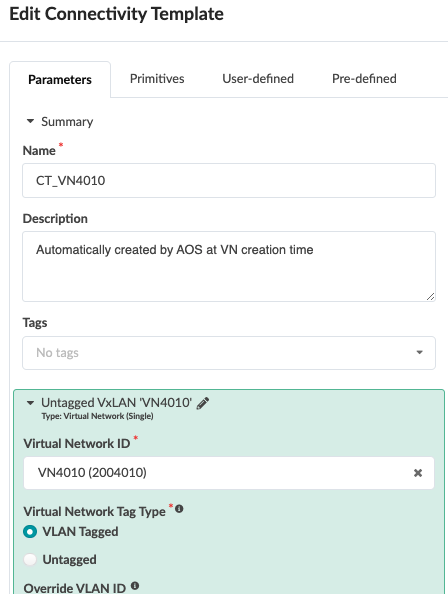

*Figure 21: vRR for JCNR Traffic*

<span id="figure-22-assign-connectivity-template-to-the-leaf-switch-interfaces-facing-the-jcnr-controller"></span>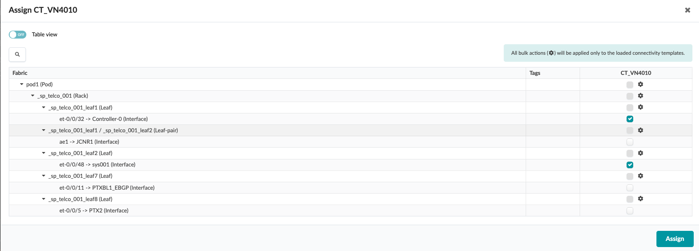

*Figure 22: Assign Connectivity Template to the Leaf Switch Interfaces Facing the JCNR Controller*

The configuration here shows the interface selected in the screenshot in [Figure 22: Assign Connectivity Template to the Leaf Switch Interfaces Facing the JCNR Controller](#figure-22-assign-connectivity-template-to-the-leaf-switch-interfaces-facing-the-jcnr-controller) and the MAC-VRF and L3 VRF routing instance configuration applied by Apstra.

``` text
regress@sp-telco-001-leaf2> show configuration interfaces et-0/0/48
description to.sys001;
flexible-vlan-tagging;
speed 100g;
mtu 9216;
encapsulation flexible-ethernet-services;
unit 10000 {
    description to.sys001;
    family ethernet-switching {
        interface-mode trunk;
        vlan {
            members vn4010;
        }
    }
}
regress@sp-telco-001-leaf2> show configuration routing-instances
MACVRFCRPD_4010 {
    instance-type mac-vrf;
    protocols {
        evpn {
            encapsulation vxlan;
            default-gateway do-not-advertise;
            duplicate-mac-detection {
                auto-recovery-time 9;
            }
            extended-vni-list all;
            vni-options {
                vni 2004010 {
                    vrf-target target:2004010L:1;
                }
            }
        }
    }
    vtep-source-interface lo0.0 inet6;
    service-type vlan-aware;
    interface et-0/0/48.10000;
    route-distinguisher 192.168.0.3:10000;
    vrf-target target:100:10000;
    vlans {
        vn4010 {
            description VN4010;
            vlan-id 4010;
            vxlan {
                vni 2004010;
            }
        }
    }
}
 VRF_CRPD_4010 {
    instance-type vrf;
    routing-options {
        rib VRF_CRPD_4010.inet6.0 {
            multipath;
        }
        graceful-restart;
        multipath;
        auto-export;
    }
    protocols {
        evpn {
            irb-symmetric-routing {
                vni 5002;
            }
            ip-prefix-routes {
                advertise direct-nexthop;
                encapsulation vxlan;
                vni 5002;
                export BGP-AOS-Policy-VRF_CRPD_4010;
            }
        }
    }
    interface lo0.2;
    route-distinguisher 192.168.0.3:2;
    vrf-target target:5002:1;
}
```

<span id="figure-23-virtual-network-for-sr-iov"></span>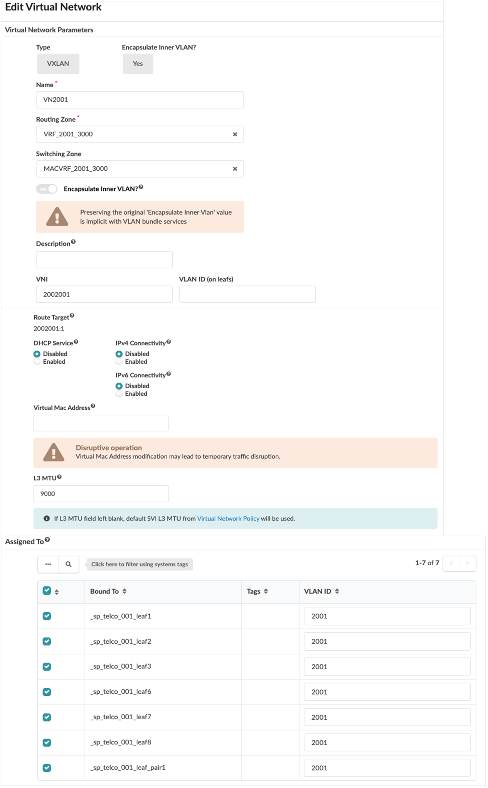

*Figure 23: Virtual Network for SR-IOV*

For the SR-IOV Virtual networks, one single **Connectivity Template** is created under **Blueprints → Staged → Virtual** instead of several individual connectivity templates for brevity and to consolidate per tenant. Apstra allows multiple VNIs to be assigned at once to a leaf switch interface as shown in.

<span id="figure-24-multiple-vnis-connectivity-template"></span>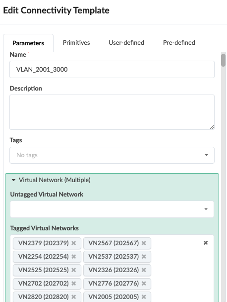

*Figure 24: Multiple Vnis Connectivity Template*

<span id="figure-25-assign-connectivity-template-to-leaf-switch-interfaces"></span>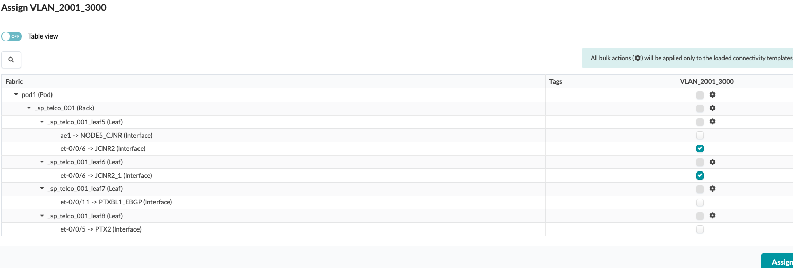

*Figure 25: Assign Connectivity Template to Leaf Switch Interfaces*

Once the virtual network is created and associated to the SR-IOV routing zone, it is visible under each Routing zone under **Blueprints → Staged → Virtual → Routing Zone** and select the routing zone.

<span id="figure-26-sr-iov-routing-zone-shows-virtual-networks-associated"></span>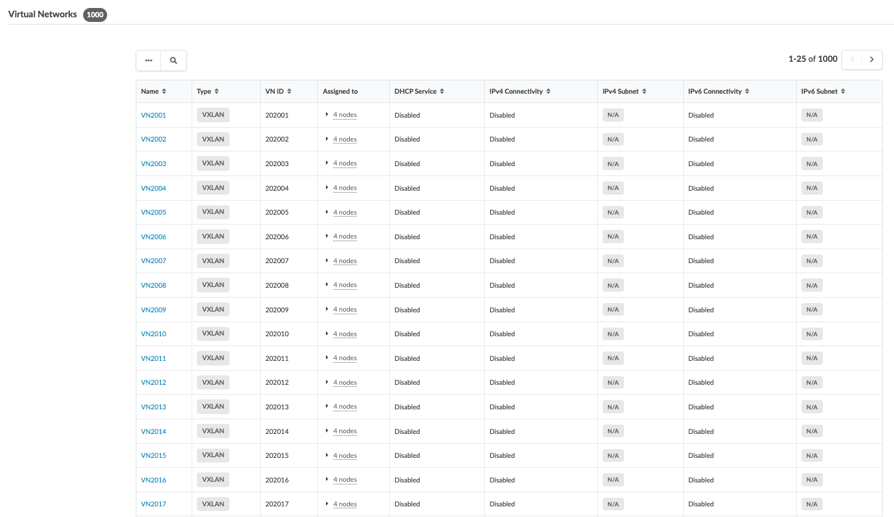

*Figure 26: SR-IOV Routing Zone Shows Virtual Networks Associated*

The configuration applied on the leaf switches show multiple logical interfaces `[edit interface unit]` per tenant created with service provider style configuration using Q-in-Q encapsulation. And a corresponding MAC-VRF with VLAN bundle service type is generated as is configured in Apstra **Blueprints → Staged → Switching Zone**. Each of the Virtual network denotes a SR-IOV instance for the tenant.

``` text
regress@sp-telco-001-leaf5> show configuration interfaces et-0/0/6
description to.jcnr2;
flexible-vlan-tagging;
speed 100g;
mtu 9216;
encapsulation flexible-ethernet-services;
unit 2001 {
    description to.jcnr2;
    encapsulation vlan-bridge;
    vlan-id 2001;
    input-vlan-map pop;
    output-vlan-map push;
}
unit 2002 {
    description to.jcnr2;
    encapsulation vlan-bridge;
    vlan-id 2002;
    input-vlan-map pop;
    output-vlan-map push;
}
unit 2003 {
    description to.jcnr2;
    encapsulation vlan-bridge;
    vlan-id 2003;
    input-vlan-map pop;
    output-vlan-map push;
}
unit 2004 {
    description to.jcnr2;
    encapsulation vlan-bridge;
    vlan-id 2004;
    input-vlan-map pop;
    output-vlan-map push;
}
unit 2005 {
    description to.jcnr2;
    encapsulation vlan-bridge;
    vlan-id 2005;
    input-vlan-map pop;
    output-vlan-map push;
}
unit 2006 {
    description to.jcnr2;
    encapsulation vlan-bridge;
    vlan-id 2006;
    input-vlan-map pop;
    output-vlan-map push;
}
}

regress@sp-telco-001-leaf5> show configuration routing-instances 
    VRF_2001_3000 {
        instance-type vrf;
        interface lo0.5;
        route-distinguisher 192.168.0.6:5;
        vrf-target target:5005:1;
        routing-options {
            multipath;
            auto-export;
            graceful-restart;
            rib VRF_2001_3000.inet6.0 {
                multipath;
            }
        }
        protocols {
            evpn {
                ip-prefix-routes {
                    advertise direct-nexthop;
                    encapsulation vxlan;
                    vni 5005;
                    export BGP-AOS-Policy-VRF_2001_3000;
                }
            }
        }
    MACVRF_2001 {
        instance-type mac-vrf;
        protocols {
            evpn {
                vni-options {
                    vni 202001 {
                        vrf-target target:202001L:1;
                    }
                }
                encapsulation vxlan;
                default-gateway do-not-advertise;
                duplicate-mac-detection {
                    auto-recovery-time 9;
                }
                extended-vni-list all;
            }
        }
        vtep-source-interface lo0.0 inet6;
        service-type vlan-bundle;
        route-distinguisher 192.168.0.6:10003;
        vrf-target target:100:10001;
        vlans {
            vn2001 {
                interface et-0/0/6.2001;
                description "VN2001";
                vxlan {
                    vni 202001;
                    decapsulate-accept-inner-vlan;
                    encapsulate-inner-vlan;
                }
            }
        }
    }
}
```

### Apstra: Configuring Border Leaf Connectivity for JCNR Route Exchange

The Border Leaf switches connected to the Off-Ramp Gateway provide the connectivity required for exchanging JCNR loopback reachability information. JCNR loopback (lo0) addresses are selectively leaked towards the Off-Ramp Gateway to enable identification and reachability of the JCNR MPLS-over-UDP tunnel endpoints.

These loopback addresses serve as the next-hop and tunnel endpoint addresses used by the JCNR overlay. The Off-Ramp Gateway uses the learned loopback routes to establish MPLS-over-UDP reachability and forward traffic towards the appropriate JCNR instance. To limit route propagation and maintain routing scalability, only the loopback prefixes are advertised through dedicated route policies rather than the complete tenant routing table.

The Border Leaf switches provide transport reachability across the EVPN-VXLAN fabric, while the Off-Ramp Gateway uses the leaked loopback routes to perform tunnel resolution, inter-VRF policy enforcement, and forwarding towards the JCNR service endpoints.

Following are the key functions:

- Border Leaf switches provide fabric connectivity between the JCNR environment and the Off-Ramp Gateway.
- JCNR loopback (lo0) addresses identify MPLS-over-UDP tunnel endpoints.
- The off-ramp gateway learns the JCNR loopback routes through controlled route leaking and route policies.
- Loopback routes are used for tunnel endpoint resolution and VPN next-hop reachability.
- Only loopback prefixes are exchanged to minimize route distribution and preserve scalability.

To configure the border leaf switches for the above connectivity, a connectivity template is applied in Apstra to form the IP Link between the border leaf switch and the offramp gateway as shown in the following. To create a connectivity template, navigate to **Blueprint → Staged → Connectivity Template**. The template is then assigned to the Border leaf that is connected to the offramp gateway.

> Note: For the purposes of this lab testing, only one offramp gateway and one Border leaf switch is configured. However it is recommended to have two Offramp Gateway connecting to each border leaf switch. Note: For the purposes of this lab testing, only one offramp gateway and one Border leaf switch is configured. However it is recommended to have two Offramp Gateway connecting to each border leaf switch.

<span id="figure-27-connectivity-template-to-form-ip-link-connection"></span>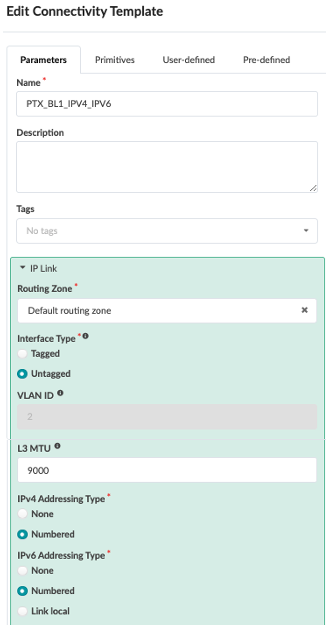

*Figure 27: Connectivity Template to Form IP Link Connection*

After the connectivity template is created then allocate the IPv6 addresses by navigating to **Blueprint → Virtual → Routing -zones** and selecting the default routing zone that was allocated on the connectivity template.

<span id="figure-28-allocating-ip-addresses"></span>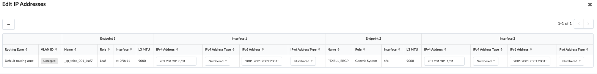

*Figure 28: Allocating IP Addresses*

A configlet is applied to the Border Leaf switches to selectively leak JCNR loopback routes towards the Off-Ramp Gateway. These loopback addresses identify the JCNR MPLS-over-UDP tunnel endpoints and provide the reachability required for offramp gateway-to-vRR control-plane communication and MPLS-over-UDP service operation. The off-ramp gateway establishes iBGP VPN peering with the vRR instance running within the Kubernetes cluster to exchange tenant VPN routes and service reachability information. The configlet is available on [Validated Design Github](https://github.com/Juniper/jvd/tree/main/data_center/adc) in Telco Cloud directory.

The configuration shows that a dedicated eBGP peering is established for the vRR routing instance (VRF) to exchange only the JCNR loopback prefixes required for control-plane connectivity. Static routes and RIB groups are used to selectively leak the JCNR loopback addresses between the vRR VRF and the global routing table. The BGP import and export policies strictly control route advertisement. The policies ensure all incoming routes from offramp gateway are accepted using the policy `RoutesFromExt-default-Default_immutable` , however only the JCNR routes are exported using the `EXPORT-TO-PTX` policy and `RoutesToExt-default-Default_immutable` under `[edit policy-options]` ensures that the fabric or tenant routes are not advertised. This ensures that only the required JCNR node loopback routes are exchanged with the Off-Ramp Gateway and prevents unintended route leakage of tenant routes into other routing instances or the wider network. The `extended-nexthop` under `family inet unicast` border leaf switch can also advertise IPv4 unicast routes over an IPv6 BGP session using IPv6 network layer reachability information (NLRI) next-hops.

> Note: The tenant routes are contained within their respective tenant VRF and hence the JCNR loopback routes are isolated from tenant routes.

``` junos
 
VRF_CRPD_4010 {
    instance-type vrf;
    routing-options {
        rib VRF_CRPD_4010.inet6.0 {
            static { <<< static routes for JCNR/vRR loopback routes
                route fdf9:db3c:29c5:ac6c::ffff:fffe/128 next-hop fdf8:db3c:29c5:ac6c::ffff:fffe;
                route fdf9:db3c:29c5:ac6c::ffff:ffff/128 next-hop fdf8:db3c:29c5:ac6c::ffff:ffff;
            }
            multipath;
        }
        interface-routes { <<< only selected routes to be shared between routing tables instead of leaking the entire VRF routing table
            rib-group inet6 CRPD4010-TO-GLOBAL;  <<< Rib group to only share JCNR loopback routes
        }
        graceful-restart;
        multipath;
        auto-export;
    }
    protocols {
        bgp { <<< EBGP with offramp gateway to form control plane to exchange JCNR/vRR routes 
            group l3rtr {
                type external;
                multihop {
                    ttl 1;
                }
                family inet {
                    unicast {
                        loops 2;
                    }
                }
                family inet6 {
                    unicast {
                        loops 2;
                    }
                }
                multipath {
                    multiple-as;
                }
                neighbor 2001:2001:2001:2001::21 {
                    description facing_sys001;
                    local-address 2001:2001:2001:2001::20;
                    import ( RoutesFromExt-default-Default_immutable );
                    family inet {
                        unicast {
                            extended-nexthop; <<< Allow advertising IPv4 routes over IPv6 NLRI next-hop
                        }
                    }
                    family inet6 {
                        unicast;
                    }
                    export [ EXPORT-TO-PTX RoutesToExt-default-Default_immutable ];
                    peer-as 64513;
                }
            }
        }
        evpn {
            irb-symmetric-routing {
                vni 5002;
            }
            ip-prefix-routes {
                advertise direct-nexthop;
                encapsulation vxlan;
                vni 5002;
                export BGP-AOS-Policy-VRF_CRPD_4010;
            }
        }
    }
    interface et-0/0/11.0;
    interface irb.4000;
    interface irb.4001;
    interface irb.4010;
    interface lo0.2;
    route-distinguisher 192.168.0.8:2;
    vrf-target target:5002:1;
}

routing-options {
rib inet.0 {
    static {
        route 192.168.255.0/24 next-table VRF_CRPD_4010.inet.0;
    }
}
rib inet6.0 {
    static {        
        route fdf9:db3c:29c5:ac6c::ffff:fffe/128 next-hop fdf8:db3c:29c5:ac6c::ffff:fffe;
        route fdf9:db3c:29c5:ac6c::ffff:ffff/128 next-hop fdf8:db3c:29c5:ac6c::ffff:ffff;
    }
}
router-id 192.168.0.8;
autonomous-system 108;
graceful-restart;
rib-groups {
    CRPD4010-TO-GLOBAL {
        import-rib [ VRF_CRPD_4010.inet6.0 inet6.0 ];
        import-policy LEAK-4010-CONNECTED; <<< Import policy to filter only JCNR Fabric routes into inet6.0 table
    }
}
}
protocols {
  router-advertisement
   interface et-0/0/11.0 { <<< Interface assigned in Connectivity Template to connect to Offramp Gateway
        max-advertisement-interval 30;
        min-advertisement-interval 10;
    }
  }
}
policy-options {
 policy-statement LEAK-4010-CONNECTED {
  term IPv6-DIRECT {
      from {
           protocol direct;
           route-filter fdf8:db3c:29c5:ac6c::/64 exact;
      }
      then accept;
  }
  term REJECT {
      then reject;
   }
 }

policy-statement EXPORT-TO-PTX { <<< Export to Offramp Gw JCNR Loopback routes
    term NODE1-LO0 {
    from {
        family inet6;
        protocol static;
        route-filter fdf9:db3c:29c5:ac6c::ffff:ffff/128 exact;
        route-filter fdf9:db3c:29c5:ac6c::ffff:fffe/128 exact;
    }
    then {
        next-hop self;
        accept;
    }
  }
}

 policy-statement BGP-AOS-Policy-VRF_CRPD_4010 { <<< Apstra applies this policy natively when VRF was created
  term BGP-AOS-Policy-VRF_CRPD_4010-10 {
      from policy AllPodNetworks-VRF_CRPD_4010;
      then accept;
  }
  term BGP-AOS-Policy-VRF_CRPD_4010-100 {
      then reject;
  }
  term BGP-AOS-Policy-VRF_CRPD_4010-20 { <<< configlet modified Apstra applied policy
      from protocol bgp;
      then accept;
  }
 }

route-filter-list RoutesFromExt-default-Default_immutable {
    0.0.0.0/0 upto /32;
}
route-filter-list RoutesFromExtV6-default-Default_immutable {
    0::0/0 upto /128;
}
route-filter-list RoutesToExt-default-Default_immutable {
    192.168.0.0/29 upto /32;
    192.168.0.8/31 upto /32;
    192.168.255.0/24 exact;
}
route-filter-list RoutesToExtV6-default-Default_immutable {
    fd86:8ff:73b0:22de::/125 upto /128;
    fd86:8ff:73b0:22de::8/127 upto /128;
    fdf8:db3c:29c5:ac6c::/64 exact; 
}

 policy-statement RoutesFromExt-default-Default_immutable {
  term RoutesFromExt-default-Default_immutable-10 {
    from {
        family inet;
        route-filter-list RoutesFromExt-default-Default_immutable;
    }
    then {
        community add RoutesFromExt-default-Default_immutable;
        accept;
    }
  }
  term RoutesFromExt-default-Default_immutable-20 {
    from {
        family inet6;
        route-filter-list RoutesFromExtV6-default-Default_immutable;
    }
    then {
        community add RoutesFromExtV6-default-Default_immutable;
        accept;
    }
  }
  term RoutesFromExt-default-Default_immutable-30 {
    from family inet;
    then reject;
  }
  term RoutesFromExt-default-Default_immutable-40 {
    from family inet6;
    then reject;
  }
}

 policy-statement RoutesToExt-default-Default_immutable {
   term RoutesToExt-default-Default_immutable-10 {
      from {
          family inet;
          route-filter-list RoutesToExt-default-Default_immutable;
      }
      then {
          community delete FABRIC_COMMUNITIES;
          next-hop self;
          accept;
      }
    }
    term RoutesToExt-default-Default_immutable-20 {
      from {
          family inet6;
          route-filter-list RoutesToExtV6-default-Default_immutable;
      }
      then {
          community delete FABRIC_COMMUNITIES;
          next-hop self;
          accept;
      }
   }
   term RoutesToExt-default-Default_immutable-30 {
      from family inet;
      then reject;
   }
  term RoutesToExt-default-Default_immutable-40 {
      from family inet6;
      then reject;
    }
 }
community FABRIC_COMMUNITIES members [ 0:12 0:13 0:14 0:15 .+:200.. 2....:260.. ];
community RoutesFromExt-default-Default_immutable members [ 9:20009 21001:26000 ];
community RoutesFromExtV6-default-Default_immutable members [ 9:20010 21001:26000 ];
}
```

### Overlay Junos OS Configuration Applied by Apstra 6.2

Apstra version 6.2 introduces the ability to create blueprints using reference design option for Service Providers which allows for native service provider-style configurations and intent-based anomaly identification. Prior to version 6.2, Apstra Freeform blueprint was used to provision Service Provider data center configuration.

#### Flexible Ethernet Services

In the service provide style configuration, multiple logical interfaces are configured per port and `[flexible-ethernet-services]` encapsulation is applied per interface. These logical interfaces are then bridged into separate or same EVPN instances (MAC-VRF). From Apstra version 6.2, the service provider style is supported and Apstra renders the Virtual Network into Service Provider (SP) style configuration. Following is the configuration snippet for the overlay network.

Flexible Ethernet services is a type of encapsulation that enables a physical interface to support different types of Ethernet encapsulations at the logical interface level. Junos OS supports two different styles of configuration for switch interfaces: the service provider style and the enterprise style. Service provider style requires more configuration but provides greater flexibility. An enterprise style is easier to configure but offers less functionality. Each configuration style requires a different Ethernet encapsulation type which can be achieved using Flexible Ethernet services. A per-unit Ethernet encapsulations make it easier to customize Ethernet-based services to multiple hosts connected to the same physical interface. However, in this validated design, the encapsulation type is the same for each logical unit as is shown in the following example. For more information about Flexible Ethernet Encapsulation, see [Flexible Ethernet Services Encapsulation](https://networkingdocs.hpe.com/documentation/us/en/software/junos/multicast-l2/interfaces-ethernet-switches/topics/topic-map/switches-interface-flexible.html). The logical interface is configured with `[vlan-bridge]` encapsulation and mapped to bridge domains i.e. MAC-VRF instance.

#### Service Provider Style Configuration

In the service provider style configuration, each bridge interface should be configured with features explicitly and the bridged interface should be referenced in the EVPN instance (MAC-VRF) as show in the following configuration. Each logical interface is configured with encapsulation `vlan-bridge`under `[edit interface *<interface-name>* unit *<logical-unit-number>*]`

``` text
regress@sp-telco-001-leaf5> show configuration interfaces et-0/0/6
description to.jcnr2;
flexible-vlan-tagging;
speed 100g;
mtu 9216;
encapsulation flexible-ethernet-services;
unit 2001 {
    description to.jcnr2;
    encapsulation vlan-bridge;
    vlan-id 2001;
    input-vlan-map pop; <<< Removes the outermost VLAN tag (2001) from the frame immediately after it enters the router.
    output-vlan-map push;
}
unit 2002 {
    description to.jcnr2;
    encapsulation vlan-bridge;
    vlan-id 2002;
    input-vlan-map pop;
    output-vlan-map push;
}
unit 2003 {
    description to.jcnr2;
    encapsulation vlan-bridge;
    vlan-id 2003;
    input-vlan-map pop;
    output-vlan-map push;
}
unit 2004 {
    description to.jcnr2;
    encapsulation vlan-bridge;
    vlan-id 2004;
    input-vlan-map pop;
    output-vlan-map push;
}
unit 2005 {
    description to.jcnr2;
    encapsulation vlan-bridge;
    vlan-id 2005;
    input-vlan-map pop;
    output-vlan-map push;
}
regress@sp-telco-001-leaf5> show configuration routing-instances 
    MACVRF_2001 {
        instance-type mac-vrf;
        protocols {
            evpn {
                vni-options {
                    vni 202001 {
                        vrf-target target:202001L:1;
                    }
                }
                encapsulation vxlan;
                default-gateway do-not-advertise; 
                duplicate-mac-detection { <<< detects MAC duplication especially when MAC Address flaps rapidly between two leaf switches and suppresses MAC updates for the length of time suggested for auto-recovery-time.
                    auto-recovery-time 9;
                }
                extended-vni-list all; <<< All VNIs are extended
            }
        }
        vtep-source-interface lo0.0 inet6; <<< VXLAN Tunnel End Point (VTEP) source is bound to the logical IPv6 loopback interface address
        service-type vlan-bundle; <<<< multiple VLANs can share a single MAC address (bridge) table and broadcast domain within one EVPN (MAC-VRF) instance for a tenant
        route-distinguisher 192.168.0.6:10003;
        vrf-target target:100:10001; << route target for MAC-VRF instance
        vlans {
            vn2001 {
                interface et-0/0/6.2001; <<< SP Style config denoting per VLAN logical interface that is using MAC-VRF instance.
                description "VN2001";
                vxlan {
                    vni 202001;
                    decapsulate-accept-inner-vlan; <<< to de-encapsulate and to accept original VLAN tags in VXLAN packets
                    encapsulate-inner-vlan; <<< to preserve the original VLAN tag (in the inner Ethernet packet) when performing VXLAN encapsulation.
                }
            }
        }
    }
MACVRF_2002 {
    instance-type mac-vrf;
    protocols {
        evpn {
            encapsulation vxlan;
            default-gateway do-not-advertise;
            duplicate-mac-detection {
                auto-recovery-time 9;
            }
            extended-vni-list all;
            vni-options {
                vni 202002 {
                    vrf-target target:202002L:1;
                }
            }
        }
    }
    vtep-source-interface lo0.0 inet6;
    service-type vlan-bundle;
    route-distinguisher 192.168.0.6:10004;
    vrf-target target:100:10002;
    vlans {
        vn2002 {
            description VN2002;
            interface et-0/0/6.2002;
            vxlan {
                vni 202002;
                encapsulate-inner-vlan;
                decapsulate-accept-inner-vlan;
            }
        }
    }
}
    VRF_2001_3000 {
        instance-type vrf;
        interface lo0.5;
        route-distinguisher 192.168.0.6:5;
        vrf-target target:5005:1;
        routing-options {
            multipath;
            auto-export;
            graceful-restart;
            rib VRF_2001_3000.inet6.0 {
                multipath;
            }
        }
        protocols {
            evpn {
                ip-prefix-routes {
                    advertise direct-nexthop;
                    encapsulation vxlan;
                    vni 5005;
                    export BGP-AOS-Policy-VRF_2001_3000;
                }
            }
        }
   }
```

#### IPv6 Overlay BGP Peering

In a Juniper EVPN-VXLAN fabric, VTEPs (Virtual Tunnel Endpoints) are the gateway switches, typically leaf switches, that handle the encapsulation and de-encapsulation of user traffic into VXLAN overlay tunnels. The overlay network can be IPv4 or IPv6 networks. This validated design focuses only on the IPv6 underlay with IPv6 overlay EBGP peering.

EBGP routing protocol is used in overlay peering configuration and hence the configuration is similar to the underlay configuration. The only difference being IPv6 loopback addresses are used to specify EBGP neighbors in the overlay. Another difference is that EVPN signaling is configured in the overlay configuration.

EBGP sessions between leaf and spine nodes are established using the loopback IPv6 addresses advertised by the underlay, with BGP multihop enabled. These overlay sessions carry the IPv6 prefixes corresponding to the point-to-point links between servers and leaf nodes.

Following is an example of an Apstra configuration snippet of the overlay BGP configuration between the leaf and spine devices:

``` junos
protocols {
   bgp {       
       group l3clos-s-evpn {
         type external;
         multihop {
            ttl 1;
            no-nexthop-change;
         }
        family evpn {
            signaling {
            loops 2;
            }
        }
        multipath {
            multiple-as;
        }
        bfd-liveness-detection {
            minimum-interval 3000;
            multiplier 3;
        }
        neighbor fd86:8ff:73b0:22de::2 {
            description facing_sp-telco-001-leaf1-evpn-overlay;
            local-address fd86:8ff:73b0:22de::1;
            family evpn {
                signaling;
            }
            export ( SPINE_TO_LEAF_EVPN_OUT );
            peer-as 102;
        }
        neighbor fd86:8ff:73b0:22de::3 {
            description facing_sp-telco-001-leaf2-evpn-overlay;
            local-address fd86:8ff:73b0:22de::1;
            family evpn {
                signaling;
            }
            export ( SPINE_TO_LEAF_EVPN_OUT );
            peer-as 103;
        }
        neighbor fd86:8ff:73b0:22de::4 {
            description facing_sp-telco-001-leaf3-evpn-overlay;
            local-address fd86:8ff:73b0:22de::1;
            family evpn {
                signaling;
            }
            export ( SPINE_TO_LEAF_EVPN_OUT );
            peer-as 104;
        }
        neighbor fd86:8ff:73b0:22de::5 {
            description facing_sp-telco-001-leaf4-evpn-overlay;
            local-address fd86:8ff:73b0:22de::1;
            family evpn {
                signaling;
            }
            export ( SPINE_TO_LEAF_EVPN_OUT );
            peer-as 105;
        }
        neighbor fd86:8ff:73b0:22de::6 {
            description facing_sp-telco-001-leaf5-evpn-overlay;
            local-address fd86:8ff:73b0:22de::1;
            family evpn {
               signaling;
            }
            export ( SPINE_TO_LEAF_EVPN_OUT );
            peer-as 106;
        }
        neighbor fd86:8ff:73b0:22de::7 {
            description facing_sp-telco-001-leaf6-evpn-overlay;
            local-address fd86:8ff:73b0:22de::1;
            family evpn {
                signaling;
            }
            export ( SPINE_TO_LEAF_EVPN_OUT );
            peer-as 107;
        }
        neighbor fd86:8ff:73b0:22de::8 {
            description facing_sp-telco-001-leaf7-evpn-overlay;
            local-address fd86:8ff:73b0:22de::1;
            family evpn {
                signaling;
            }
            export ( SPINE_TO_LEAF_EVPN_OUT );
            peer-as 108;
        }
        neighbor fd86:8ff:73b0:22de::9 {
            description facing_sp-telco-001-leaf8-evpn-overlay;
            local-address fd86:8ff:73b0:22de::1;
            import ( DrainEvpn );
            family evpn {
                signaling;
            }
            export ( DrainEvpn );
            peer-as 109;
        }
        vpn-apply-export;
       }
   }
}  
```

#### CRB Proxy MAC Option for Bridged Overlay Fabric

In an EVPN Bridged Overlay (BO) environment, the leaf switches act strictly as L2 gateways and do not possess local Layer 3 context or IRB interfaces and hence don’t participate in ARP and NDP operations by default. The ARP request packets or NDP solicitation packets are sent as broadcast traffic by the IP fabric. To avoid this ARP and NDP broadcast traffic, configure the `crb-proxy-mac` option on the leaf devices as the Spine devices (QFX5230-64CD) are running Junos OS Evolved.

``` junos
set protocols l2-learning crb-proxy-mac family inet <MAC address>
set protocols l2-learning crb-proxy-mac family inet6 <MAC address>
```

With `crb-proxy-mac` set, the leaf devices learn MAC-IP information from the transit traffic and use EVPN Type 2 routes to update other EVPN leaf devices. The leaf devices can reply to ARP request packets or NDP solicitation packets from their connected hosts. Apstra 6.2 sets this configuration natively. Following is the configuration applied to the leaf switches.

``` text
root@LEAF5> show configuration protocols l2-learning
telemetry {
    enable-remote-entries;
}
crb-proxy-mac {
    family {
        inet {
            02:fb:00:00:00:07; <<< Any unused MAC Address 
        }
        inet6 {
            02:fb:00:00:00:07; <<< Any unused MAC Address
        }
    }
}
```

> Note: When choosing an unused MAC address for a Bridged Overlay (BO) leaf switch, use locally administered address whose first octet of the MAC address ends in 2, 6, A, or E (for example: 02:xx:xx…, 12:xx:xx…, 4e:xx:xx…). This marks the address space as private/locally managed, meaning it won’t conflict with globally registered hardware MACs (OUI assigned to vendors). All leaf switches are configured with `crb-proxy-mac` with separate unused MAC address.

### Apstra Freeform: Deployment and Configuration of Offramp Gateway

The Off-Ramp Gateway is deployed outside the EVPN-VXLAN fabric and serves as the interconnection point between the data center fabric, external networks, and cloud environments. The gateway is responsible for providing Layer 3 connectivity beyond the fabric boundary and acts as the central routing point for tenant services. By positioning the Off-Ramp Gateway outside the fabric, the EVPN-VXLAN data center fabric remains focused on tenant transport and isolation, while centralized routing, policy enforcement, and external network integration are handled by the gateway. This creates a clear separation between the data center transport fabric and the service routing functions required to support hybrid telco cloud deployments.

For the purposes of this design, Apstra Freeform is used to provision the Offramp Gateway as this is not natively supported using the Data Center reference architecture. Using Terraform scripts, a separate Apstra Freeform Blueprint is created to provision offramp gateway. To deploy off-ramp gateway in Apstra Terraform scripts were used to deploy Freeform Blueprint for Off-ramp gateway. The objective of the scripts is to help get started and can be modified as per requirement. For more information about Apstra freeform, see [Apstra user guide](https://networkingdocs.hpe.com/documentation/us/en/software/apstra6.2/apstra-user-guide/topics/concept/freeform.html). However, it’s mandatory to use the Data Center reference design architecture for deploying the Fabric.

> Note: The terraform scripts for Apstra Freeform are outside the scope of this validated design. However, if these scripts are needed to deploy PTX10002-36QDD as Offramp-gateway as is described in this Validated Solution design, then contact HPE Juniper Networking or your HPE Juniper Networking account representative.

Thorough testing and validation is necessary if this script is used to deploy Production network.

#### Junos OS Configuration Applied on the Offramp Gateway Using Apstra Freeform

This section explains key decisions and features used to configure the offramp gateway. For full configuration, see [Validated Design Github](https://github.com/Juniper/jvd/tree/main/data_center/adc) in Telco Cloud directory.

### Offramp Gateway Connectivity and Tunnel Configuration

To create connectivity between the border leaf and the offramp gateway as covered in section Apstra: Configuring Border Leaf Connectivity for JCNR Route Exchange where a connectivity template was applied to create the IP Link on Border leaf switch. In the case of offramp gateway, PTX10002-36QDD is connected to the border leaf gateway.

``` junos
interfaces {
    et-0/0/11 {
        speed 100g;
        unit 0 {
            family inet6 {
                address 2001:2001:2001:2001::101/127;
            }
        }
    }
  }
```

For the JCNR traffic, a dedicated interface Flexible-tunnel interface (`fti`) is configured to transport MPLS-over-UDP traffic between the JCNR and the Off-Ramp Gateway. The FTI provides a logical tunnel endpoint capable of encapsulating and terminating MPLS, IPv4, and IPv6 traffic over UDP, making it well suited for cloud-native and containerized routing environments. In this implementation, `fti0.1` is configured with UDP encapsulation (`encapsulation UDP)` and enabled for tunnel termination. Traffic forwarded through the interface is encapsulated within UDP packets, allowing MPLS services to traverse IP-based transport networks without requiring a native MPLS underlay. For more information on this interface, see [flexible tunnel interfaces guide](https://networkingdocs.hpe.com/documentation/us/en/software/junos/interfaces-encryption/topics/topic-map/configuring-flexible-tunnel-interfaces.html).

The tunnel source address is configured using the JCNR loopback (lo0) address, which provides a stable endpoint for tunnel establishment and BGP peering. A dedicated payload port profile (jcnr) is associated with the interface to define the UDP destination ports used for encapsulating various payload types, including MPLS, IPv4, IPv6, and ISO traffic.

The FTI is enabled for different payload traffic allows the containerized router (JCNR) to exchange core routing information with other routers:

- IPv4 forwarding (family inet)
- IPv6 forwarding (family inet6)
- MPLS forwarding (family mpls)
- IS-IS routing packets

This allows the interface to transport VPN services and control-plane traffic carried over the MPLS-over-UDP overlay.

``` junos
interfaces {
    fti0 {
        unit 1 {
            tunnel {
                encapsulation udp {
                    tunnel-termination;
                    source {
                        address fd86:8ff:73b0:22de::b;
                    }
                    payload-port-profile jcnr;
                }
            }
            family inet {
                address 172.31.255.1/32;
            }
            family inet6 {
                address fd86:8ff:73b0:22df::ffff/128;
            }
            family mpls;
        }
    }
    lo0 {
        unit 0 {
            family inet {
                address 192.168.255.11/32;
            }
            family inet6 {
                address fd86:08ff:73b0:22de::b/128;
            }
        }
    }
}
 forwarding-options {
    tunnels {
        udp {
            payload-port-profile {
                jcnr;
                inet 6636;
                inet6 6637;
                mpls 6635;
                iso 6638;
            }
        }
    }
}
```

#### Physical Loopback (Dummy Interface) Requirement

In the beginning of this document in section Off-ramp Gateway it was suggested that a “physical loopback’ construct is used to facilitate the termination of the q-in-q traffic on offramp gateway instead of the border leaf due to the limitation of the IRB feature.

From an implementation perspective, this approach simplifies the Apstra fabric configuration as the Border Leaf configuration remains largely aligned with standard Apstra fabric constructs, while the Off-Ramp Gateway performs the required traffic transition between Layer 2 and Layer 3 services.

As shown by the LLDP neighbor information, two interfaces on the Off-Ramp Gateway (sp-jvd-ptx10002-01.englab.juniper.net) are interconnected to form a physical loopback construct. This loopback is used to bridge the Layer 3 VPN domain and the Layer 2 EVPN-VXLAN domain required for SR-IOV services.

One interface is dedicated to Q-in-Q Layer 2 service termination, while the other provides Layer 3 tenant gateway services. The physical loopback enables traffic to transition between these domains, addressing the current limitation whereby Q-in-Q services cannot be terminated directly on IRB interfaces when the Off-Ramp Gateway is reached through an intermediate Layer 3 network.

From the following configuration, the interface `et-0/0/34` is used to terminate Q-in-Q SR-IOV VLAN bundles. While on the interface `et-0/0/35,`each logical unit on the interface is associated with a tenant-specific Service VLAN (S-VLAN) and Customer VLAN (C-VLAN) combination and provides Layer 3 connectivity into the corresponding tenant VRF. For instance, the configuration statement `vlan-tags outer 0x8100.2001 inner 0x8100.200`defines a Q-in-Q service where Service VLAN (S-VLAN) 2001 identifies the tenant service and Customer VLAN (C-VLAN) 200 identifies a specific tenant network. The Off-Ramp Gateway terminates the double-tagged Ethernet frames on a dedicated logical interface and maps them to the appropriate tenant VRF, enabling Layer 3 gateway services and tenant isolation for SR-IOV workloads.

To provide resilient gateway services, Virtual Router Redundancy Protocol (VRRP) is configured on the Layer 3 interfaces associated with each tenant network. The VRRP virtual IP address is presented to workloads as the default gateway, ensuring consistent gateway reachability. This approach enables highly available Layer 3 services for SR-IOV workloads while maintaining strict tenant separation and integration with the EVPN-VXLAN fabric.

``` text
regress@sp-jvd-ptx10002-01> show lldp neighbors
Local Interface    Parent Interface    Chassis Id                               Port info          System Name
et-0/0/11          -                   00:cc:34:35:c8:f5                        et-0/0/11           sp-telco-001-leaf7.englab.juniper.net
et-0/0/14          -                   00:cc:34:35:c8:f5                        et-0/0/15           sp-telco-001-leaf7.englab.juniper.net
et-0/0/10          -                   00:cc:34:35:e6:f5                        et-0/0/11           sp-telco-001-leaf8.englab.juniper.net
et-0/0/15          -                   00:cc:34:35:e6:f5                        et-0/0/16           sp-telco-001-leaf8.englab.juniper.net
et-0/0/4           -                   00:cc:34:35:e6:f5                        et-0/0/4            sp-telco-001-leaf8.englab.juniper.net
re0:mgmt-0         -                   64:ac:2b:2f:9b:00                        ge-0/0/12           hmlsw133
et-0/0/35          -                   f0:d3:2b:e6:f3:16                        et-0/0/34           sp-jvd-ptx10002-01.englab.juniper.net
et-0/0/34          -                   f0:d3:2b:e6:f3:16                        et-0/0/35           sp-jvd-ptx10002-01.englab.juniper.net


configuration of interfaces
interfaces {
        et-0/0/34 {
        description " Tenant1 SVLAN EVPN egress";
        flexible-vlan-tagging;
        speed 100g;
        mtu 9000;
        encapsulation extended-vlan-bridge;
        unit 2001 {
            description "Tenant1 SVLAN SR-IOV egress";
            vlan-id 2001;
            input-vlan-map pop;
            output-vlan-map push;
        }
        unit 2002 {
            description " Tenant2 SVLAN SR-IOV egress";
            vlan-id 2002;
            input-vlan-map pop;
            output-vlan-map push;
        }
    }
    et-0/0/35 {
        description "Interface for L3 VRF ingress ";
        flexible-vlan-tagging;
        speed 100g;
        mtu 9000;
        encapsulation flexible-ethernet-services;
        unit 1 {
            description "Interface to terminate Tenant1 SR-IOV VN1";
            vlan-tags outer 0x8100.2001 inner 0x8100.100;
            family inet {
                address 10.201.255.1/24 {
                    vrrp-group 1 {
                        virtual-address 10.201.255.254;
                        accept-data;
                    }
                }
            }
            family inet6 {
                address 2001::10:201:255:1/112 {
                    vrrp-inet6-group 1 {
                        virtual-inet6-address 2001::10:201:255:ffff;
                        accept-data;
                    }
                }
            }
        }
        unit 2 {
            description "Interface to terminate Tenant1 SR-IOV VN2";
            vlan-tags outer 0x8100.2001 inner 0x8100.200;
            family inet {
                address 10.202.255.1/24 {
                    vrrp-group 2 {
                        virtual-address 10.202.255.254;
                        accept-data;
                    }
                }
            }
            family inet6 {
                address 2001::10:202:255:1/112 {
                    vrrp-inet6-group 2 {
                        virtual-inet6-address 2001::10:202:255:ffff;
                        accept-data;
                    }
                }
            }
        }
        unit 3 {
            description "Interface to terminate Tenant2 SR-IOV VN1";
            vlan-tags outer 0x8100.2002 inner 0x8100.100;
            family inet {
                address 10.211.255.1/24 {
                    vrrp-group 1 {
                        virtual-address 10.211.255.254;
                        accept-data;
                    }
                }
            }
            family inet6 {
                address 2001::10:211:255:1/112 {
                    vrrp-inet6-group 1 {
                        virtual-inet6-address 2001::10:211:255:ffff;
                        accept-data;
                    }
                }
            }
        }
    }
}
```

#### Configuring Tenant VRFs for SR-IOV and JCNR Networks

The Off-Ramp Gateway hosts dedicated VRFs for JCNR and SR-IOV services.

For the tenant SR-IOVs, a virtual switch is used to provide the Layer 2 domain for the SRIOV SVLANs. A virtual switch is a Layer 2 switching instance that can be used as a layer 2 bridging domain with one or more VLANs. Each virtual-switch instance is associated with a tenant-specific SVLAN and bridges traffic between the relevant interfaces. These Layer 2 forwarding domains are used to transport tenant SRIOV traffic and are connected to the corresponding tenant Layer 3 VRFs on the offramp gateway through the physical loopback construct.

``` junos
routing-instances {
    vrf-t1-sriov-vns {
        instance-type virtual-switch;
        description "SRIOV Tenant1 VLANs";
        vlans {
            vlan-t1-sriov-svlan {
                interface et-0/0/34.2001;
          interface et-0/0/14.2001;
            }
        }
    }
    vrf-t2-sriov-vns {
        instance-type virtual-switch;
         description "SRIOV Tenant2 VLANs";
        vlans {
            vlan-t2-sriov-svlan {
                interface et-0/0/34.2002;
          interface et-0/0/14.2002;
            }
        }
    }
```

The `vrf-t1-sriov-vn1` routing instance provides Layer 3 services for Tenant 1 Virtual Network 1. The VRF is associated with the Layer 3 gateway interface terminating the corresponding Q-in-Q VLAN bundle, and a dedicated loopback interface used for routing and control-plane functions. Import and export policies, together with VPN route-targets, control route distribution and maintain tenant isolation. Similarly, vrf-t1-sriov-vn2 routing instance provides Layer 3 services for Tenant 1 Virtual Network 2. And the import policies allow for route leaking between the Tenant 1 Virtual Network 2 and Virtual Network 1 for the same tenant. Similarly, the routing-instance `vrf-t2-sriov-vn1` provides Layer 3 services for Tenant 2 Virtual Network 1.

``` junos
vrf-t1-sriov-vn1 {
    instance-type vrf;
    routing-options {
        rib vrf-t1-sriov-vn1.inet6.0;
        auto-export {
            family inet6 {
                unicast;
            }
        }
    }
    interface et-0/0/35.1;
    interface lo0.100;
    vrf-import import-vrf-t1-sriov-vn1;
    vrf-export EXPORT_SRIOV;
    vrf-target {
        target:4200000001L:20011;
        import target:4200000002L:1001;
    }
    vrf-table-label;
}
vrf-t1-sriov-vn2 {
    instance-type vrf;
    routing-options {
        auto-export {
            family inet {
                unicast;
            }
            family inet6 {
                unicast;
            }
        }
    }
    interface et-0/0/35.2;
    vrf-import [ t1v2-import leak-t1v1-to-t1v2 ];
    vrf-target target:4200000001L:20012;
    vrf-table-label;
}
vrf-t2-sriov-vn1 {
    instance-type vrf;
    routing-options {
        auto-export {
            family inet {
                unicast;
            }
            family inet6 {
                unicast;
            }
        }
    }
    interface et-0/0/35.3;
    vrf-import [ t2v1-import leak-t1v1-to-t2v1 ];
    vrf-target target:4200000001L:20021;
    vrf-table-label;
}
}
```

The `vrf-t1-jcnr-ocp-vn1` routing instance provides Layer 3 connectivity for Tenant 1 JCNR-hosted workloads and participates in MPLS-over-UDP VPN services using a dedicated loopback interface. Controlled route leaking is implemented through import and export policies, allowing selective exchange of routes between the JCNR and SR-IOV VRFs while maintaining tenant isolation. The `vrf-t1-jcnr-ol-vn1` routing instance provides the overlay service context used by JCNR for tenant VPN and MPLS-over-UDP connectivity.

``` junos
routing-instances {    
     vrf-t1-jcnr-ocp-vn1 {
        instance-type vrf;
        routing-options {
            rib vrf-t1-jcnr-ocp-vn1.inet6.0;
            auto-export {
                family inet6 {
                    unicast;
                }
            }
        }
        interface lo0.1;
        vrf-import leak-sriov-to-jcnr;
        vrf-export export-jcnr-vrf;
        vrf-target {
            target:4200000002L:1001;
            import target:4200000001L:20011;
        }
        vrf-table-label;
    }
    vrf-t1-jcnr-ol-vn1 {
        instance-type vrf;
        interface lo0.11;
        vrf-target target:4200000001L:11;
    }
 }
```

#### Selective Route Leaking

The configuration also configures rib-groups to selectively leak only the tenant loopback addresses from global routing table to tenant routing tables under `edit routing-options rib-groups` statement. For JCNR to SR-IOV traffic, route leaking policy of specific JCNR fabric subnet is performed under `edit policy-options`. The `dynamic-tunnels` statement refers to the dynamic MPLS-over-UDP tunnel configuration to establish connectivity with JCNR instances and uses the offramp gateway loopback address as source address.

``` junos
routing-options {
    rib inet.0;
    rib inet6.0 {
        static {
            route ::/0 next-hop 2001:db8:1::1;
            route 2001::10:201:255:0/112 discard;
            route 2001::10:201:255:4/128 next-table vrf-t1-sriov-vn1.inet6.0;
        }
    }
    interface-routes {
        rib-group inet6 LEAK-INET6;
        family inet6 {
            export {
                lan;
            }
        }
    }
    router-id 192.168.255.11;
    route-distinguisher-id-use-router-id;
    autonomous-system 64513;
    rib-groups {
        loopback-to-fabrics {
            import-rib [ inet6.0 vr-t1-jcnr-fabric.inet6.0 ];
            import-policy loopbacks-only;
        }
        default-reject {
            import-rib [ inet.0 vr-t1-jcnr-fabric.inet.0 ];
            import-policy default-reject;
        }
        LEAK-INET6 {
            import-rib [ inet6.0 vrf-t1-sriov-vn1.inet6.0 ];
            import-policy LEAK-FD51;
        }
    }
    dynamic-tunnels {
        t1-jcnr-fabric {
            source-address fd86:8ff:73b0:22de::b;
            udp;
            destination-networks {
                fd01:976b:d604:2006::/64;
            }
        }
        ocp-jcnr-fabric {
            source-address fd86:8ff:73b0:22de::b;
            udp;
            destination-networks {
                fd51:9b86:a688:2862::/64;
            }
        }
    }
    forwarding-table {
        export PPLB;
    }
}
```

#### BGP Sessions to Advertise Routes

BGP protocol is configured to perform two control plane functions:

1.  The Off-Ramp Gateway establishes an eBGP session with the Border Leaf switches to exchange loopback addresses used for MPLS-over-UDP tunnel establishment. The routes learned from border leaf switches are automatically placed into the primary table (`inet6.0`) and immediately replicated to the secondary tables defined in the rib-group `LEAK-INET6`as discussed in previous section\`\`Selective Route Leaking.

``` junos
protocols {
    bgp {
        group EBGP_TO_BL1 {
            type external;
            family inet6 {
                unicast {
                    rib-group LEAK-INET6;
                }
            }
            peer-as 106;
            multipath {
                multiple-as;
            }
            neighbor 2001:2001:2001:2001::100 { <<< Border leaf loopback address
                export EXPORT_Lo0;
            }
        }
  }
```

2.  The offramp gateway establishes an IBGP Session with the JCNR Controller (vRR) to exchange the JCNR routes. The export policy is used to advertise selective SR-IOV routes to JCNR instances by applying the JCNR route target to tag the routes. This ensures only the selected routes are advertised maintaining tenant isolation.

``` junos
protocols {
    bgp {
        group client {
            type internal;
            local-address fd86:8ff:73b0:22de::b;
            family inet-vpn {
                unicast {
                    extended-nexthop; <<< to allow IPv4 routes over IPv6
                }
            }
            family inet6-vpn {
                unicast {
                    extended-nexthop-tunnel; 
                }
            }
            export add-jcnr-rt-to-sriov;
            local-as 4200000001;
            multipath;
            neighbor fdf8:db3c:29c5:ac6c::ffff:ffff;
            vpn-apply-export;
        }
    }
}
```

### Compute Install and Deployment of Ubuntu Operating System, Kubernetes

The compute infrastructure provides the hosting platform for Kubernetes, JCNR, and SR-IOV workloads. Prior to deploying cloud-native services, the servers must be prepared with a supported operating system, appropriate hardware settings, and Kubernetes components. For this setup, both SR-IOV and JCNR are used and hence all commands and setup used applied here apply to all servers.

> Note: The deployment steps described in this document are based on the HPE and Dell server platforms used in the lab, which provides high level overview of packages, configurations, and dependencies. Actual deployment procedures may vary depending on the server hardware, operating system version, network topology, and architectural requirements of a given environment. For production setup, proper due diligence should be performed before proceeding with these steps.

#### Prerequisite Steps Required for All Servers

1.  Ensure physical host (for example, HPE server) has SR-IOV and Intel VT-d enabled in System BIOS. On HPE DL360 server, using the steps, enable the SR-IOV function from the BIOS, see [HPE ProLiant server related configuration](https://support.hpe.com/hpesc/public/docDisplay?docId=c04398276&page=s_enabling_VT-d.html):

``` text
Boot into system utilities by pressing F9.
From the System Utilities screen, select System Configuration -> BIOS/Platform Configuration (RBSU) -> System Options -> Virtualization Options -> SR-IOV and press Enter.

Enabling or disabling Intel VT-d
From the System Utilities screen, select System Configuration > BIOS/Platform Configuration (RBSU) > System Options > Virtualization Options > Intel (R) VT-d and press Enter.
Select a setting and press Enter.
Enabled—Enables a hypervisor or operating system supporting this option to use hardware capabilities provided by Intel’s Virtualization Technology for directed I/O.
Disabled—Does not enable a hypervisor or operating system supporting this option to use hardware capabilities provided by Intel’s Virtualization Technology for directed I/O.
Press F10.
```

2.  Ensure the server OS on the nodes is Ubuntu 22.04 and higher.

``` text
root@master1:~# lsb_release -a
No LSB modules are available.
Distributor ID:    Ubuntu
Description:   Ubuntu 22.04.5 LTS
Release:   22.04
Codename:  jammy

 root@master1:~# cat /etc/os-release
PRETTY_NAME="Ubuntu 22.04.5 LTS"
NAME="Ubuntu"
VERSION_ID="22.04"
VERSION="22.04.5 LTS (Jammy Jellyfish)"
VERSION_CODENAME=jammy
ID=ubuntu
ID_LIKE=debian
HOME_URL="https://www.ubuntu.com/"
SUPPORT_URL="https://help.ubuntu.com/"
BUG_REPORT_URL="https://bugs.launchpad.net/ubuntu/"
PRIVACY_POLICY_URL="https://www.ubuntu.com/legal/terms-and-policies/privacy-policy"
UBUNTU_CODENAME=jammy
```

3.  Verify NIC details (for SR-IOV).

``` text
root@master1:~# lspci | grep -i net
04:00.0 Ethernet controller: Broadcom Inc. and subsidiaries NetXtreme BCM5720 Gigabit Ethernet PCIe
04:00.1 Ethernet controller: Broadcom Inc. and subsidiaries NetXtreme BCM5720 Gigabit Ethernet PCIe
32:00.0 Ethernet controller: Intel Corporation Ethernet Controller X710 for 10GbE SFP+ (rev 02)
32:00.1 Ethernet controller: Intel Corporation Ethernet Controller X710 for 10GbE SFP+ (rev 02)
32:00.2 Ethernet controller: Intel Corporation Ethernet Controller X710 for 10GbE SFP+ (rev 02)
32:00.3 Ethernet controller: Intel Corporation Ethernet Controller X710 for 10GbE SFP+ (rev 02)
4b:00.0 Ethernet controller: Intel Corporation Ethernet Controller E810-XXV for SFP (rev 02)
4b:00.1 Ethernet controller: Intel Corporation Ethernet Controller E810-XXV for SFP (rev 02)
b1:00.0 Ethernet controller: Intel Corporation Ethernet Controller X710 for 10GbE SFP+ (rev 02)
b1:00.1 Ethernet controller: Intel Corporation Ethernet Controller X710 for 10GbE SFP+ (rev 02)
b1:00.2 Ethernet controller: Intel Corporation Ethernet Controller X710 for 10GbE SFP+ (rev 02)
b1:00.3 Ethernet controller: Intel Corporation Ethernet Controller X710 for 10GbE SFP+ (rev 02)
```

4.  The following command list All NICs. For nodes hosting SR-IOV it lists the Virtual Functions that are created which will be configured later.

Nodes not running SR-IOV

``` text
root@master1:~# lshw -C net -businfo
Bus info          Device      Class          Description
========================================================
pci@0000:04:00.0  eno8303     network        NetXtreme BCM5720 Gigabit Ethernet PCIe
pci@0000:04:00.1  eno8403     network        NetXtreme BCM5720 Gigabit Ethernet PCIe
pci@0000:32:00.0  eno12399    network        Ethernet Controller X710 for 10GbE SFP+
pci@0000:32:00.1  eno12409    network        Ethernet Controller X710 for 10GbE SFP+
pci@0000:32:00.2  eno12419    network        Ethernet Controller X710 for 10GbE SFP+
pci@0000:32:00.3  eno12429    network        Ethernet Controller X710 for 10GbE SFP+
pci@0000:4b:00.0  enp75s0f0   network        Ethernet Controller E810-XXV for SFP
pci@0000:4b:00.1  enp75s0f1   network        Ethernet Controller E810-XXV for SFP
pci@0000:b1:00.0  enp177s0f0  network        Ethernet Controller X710 for 10GbE SFP+
pci@0000:b1:00.1  enp177s0f1  network        Ethernet Controller X710 for 10GbE SFP+
pci@0000:b1:00.2  enp177s0f2  network        Ethernet Controller X710 for 10GbE SFP+
pci@0000:b1:00.3  enp177s0f3  network        Ethernet Controller X710 for 10GbE SFP+
```

Node running SR-IOV shows associated Virtual Function

``` text
root@node3:~# lshw -C net -businfo
Bus info          Device       Class          Description
=========================================================
pci@0000:04:00.0  eno8303      network        NetXtreme BCM5720 Gigabit Ethernet PCIe
pci@0000:04:00.1  eno8403      network        NetXtreme BCM5720 Gigabit Ethernet PCIe
pci@0000:17:00.0  enp23s0f0    network        Ethernet Controller E810-XXV for SFP
pci@0000:17:00.1  enp23s0f1    network        Ethernet Controller E810-XXV for SFP
pci@0000:32:00.0               network        Ethernet Controller X710 for 10GbE SFP+
pci@0000:32:00.1  eno12409     network        Ethernet Controller X710 for 10GbE SFP+
pci@0000:32:00.2               network        Ethernet Controller X710 for 10GbE SFP+
pci@0000:32:00.3  eno12429     network        Ethernet Controller X710 for 10GbE SFP+
pci@0000:32:0e.0               network        Ethernet Virtual Function 700 Series
pci@0000:32:0e.1               network        Ethernet Virtual Function 700 Series
pci@0000:32:0e.2  eno12429v2   network        Ethernet Virtual Function 700 Series
pci@0000:32:0e.3               network        Ethernet Virtual Function 700 Series
pci@0000:32:0e.4  eno12429v4   network        Ethernet Virtual Function 700 Series
pci@0000:32:0e.5  eno12429v5   network        Ethernet Virtual Function 700 Series
pci@0000:32:0e.6  eno12429v6   network        Ethernet Virtual Function 700 Series
pci@0000:32:0e.7               network        Ethernet Virtual Function 700 Series
pci@0000:32:0f.0  eno12429v8   network        Ethernet Virtual Function 700 Series
pci@0000:32:0f.1  eno12429v9   network        Ethernet Virtual Function 700 Series
pci@0000:32:0f.2               network        Ethernet Virtual Function 700 Series
pci@0000:32:0f.3  eno12429v11  network        Ethernet Virtual Function 700 Series
pci@0000:32:0f.4               network        Ethernet Virtual Function 700 Series
pci@0000:32:0f.5               network        Ethernet Virtual Function 700 Series
pci@0000:32:0f.6  eno12429v14  network        Ethernet Virtual Function 700 Series
pci@0000:32:0f.7               network        Ethernet Virtual Function 700 Series
pci@0000:b1:00.0  enp177s0f0   network        Ethernet Controller X710 for 10GbE SFP+
pci@0000:b1:00.1  enp177s0f1   network        Ethernet Controller X710 for 10GbE SFP+
pci@0000:b1:00.2  enp177s0f2   network        Ethernet Controller X710 for 10GbE SFP+
pci@0000:b1:00.3  enp177s0f3   network        Ethernet Controller X710 for 10GbE SFP+
```

5.  Configure persistent boot-time kernel actions. Without setting up a persistent, automated boot-time routine, the underlying host network interface cards (NICs) cannot safely communicate with the high-performance Juniper vRouter. Create the systemd `rc-local.service`this ensures that when the host reboots, the hardware interfaces are automatically placed into the exact high-performance mode that the Juniper Cloud Native Router expects before the Kubernetes pods try to initialize. Then populate the execution script to configure kernel space modules for virtual functions:

**modprobe vfio-pci vfio** Forces the Linux kernel to load the Virtual Function I/O driver. This driver allows JCNR to bypass the standard kernel network stack and directly control the network hardware for line-rate speeds. **allow_unsafe_interrupts=1** Enables high-performance packet processing even if the physical motherboard/CPU doesn’t have strict hardware-enforced interrupt isolation (or if it is shared). Without this, the kernel will block the DPDK application from starting. **enable_unsafe_noiommu_mode** Allows the VFIO driver to run without an active IOMMU (Input-Output Memory Management Unit) mapping if needed. This ensures JCNR’s high-speed packet processing ring buffers can allocate memory dynamically without throwing kernel faults.

``` text
root@master1:~# cat /etc/systemd/system/rc-local.service
[Unit]
Description=/etc/rc.local Compatibility
ConditionPathExists=/etc/rc.local
[Service]
Type=forking
ExecStart=/etc/rc.local start
TimeoutSec=0
StandardOutput=tty
RemainAfterExit=yes
SysVStartPriority=99
[Install]
WantedBy=multi-user.target

 root@master1:~# cat  /etc/rc.local
#!/bin/bash
modprobe vfio-pci vfio_iommu_type1 allow_unsafe_interrupts=1
echo Y > /sys/module/vfio_iommu_type1/parameters/allow_unsafe_interrupts && sleep 5
echo Y > /sys/module/vfio/parameters/enable_unsafe_noiommu_mode

------ Enable the service------------------
 root@master1:~# chmod +x /etc/systemd/system/rc-local.service
chmod +x /etc/rc.local
systemctl enable rc-local
systemctl restart rc-local
```

6.  Ensure the Grub page size is set as 1G. For Intel based systems, ensure `intel_iommu=on.` This step is required for JCNR workloads, see [JCNR documentation](https://networkingdocs.hpe.com/documentation/us/en/software/cloud-native-router23.2/cloud-native-router-deployment-guide/topics/concept/before-you-install.html).

> Note: Changing the grub page size requires system reboot.

``` text
root@master1:~#vi /etc/default/grub


root@master1:~# cat /etc/default/grub | grep GRUB_CMDLINE_LINUX
GRUB_CMDLINE_LINUX_DEFAULT="quiet splash default_hugepagesz=1G hugepagesz=1G hugepages=32 intel_iommu=on iommu=pt isolcpus=1-15,32-47,16-31,48-62"
GRUB_CMDLINE_LINUX="default_hugepagesz=1G hugepagesz=1G hugepages=32"

root@master1:~#update-grub
root@master1:~#sudo reboot

-------After reboot check Grub values--------- 
root@master1:~# cat /proc/meminfo | grep -i huge
AnonHugePages:         0 kB
ShmemHugePages:        0 kB
FileHugePages:         0 kB
HugePages_Total:      32
HugePages_Free:       32
HugePages_Rsvd:        0
HugePages_Surp:        0
Hugepagesize:    1048576 kB
Hugetlb:        33554432 kB
```

7.  Run `ethtool -i <interface>` to get kernel version to verify compatibility with SR-IOV. This command also shows the firmware version.

``` text
root@node6:~/HPE# sudo ethtool -i ens1f1np1
driver: ice
version: 6.8.0-136-generic << Ubuntu 22.04 Jammy Jellyfish kernel version includes ICE driver that supports SR-IOV capabilities
firmware-version: 4.91 0x800214af 1.3909.0 << Physical card firmware version
expansion-rom-version:
bus-info: 0000:12:00.1
supports-statistics: yes
supports-test: yes
supports-eeprom-access: yes
supports-register-dump: yes
supports-priv-flags: yes
```

For this validated design, HPE ProLiant DL360 servers with kernel version 6.8.0-136-generic, the ICE driver was upgraded the by downloading and installing the ICE-2.5.4 from [Intel site](https://www.intel.com/content/www/us/en/download/19630/916199/intel-network-adapter-driver-for-800-series-devices-under-linux.html).

``` text
cd ~/HPE/ice-2.5.4/src
sudo make clean
sudo make
sudo make install
# Chaining prevents getting locked out over SSH
sudo modprobe -r ice 
```

8.  Locate `sysfs` files for Virtual Function (VF) support (for SR-IOV). This is to find out how many VFs NIC supports, check the NIC’s sysfs attributes in Linux. The key files are sriov_totalvfs (maximum supported) and sriov_numvfs (currently enabled).

<!-- -->

1.  Identify NIC. This shows the PCI address of the NIC

``` text
root@node6:~# lspci -D | grep 'Network\|Ethernet'
0000:12:00.0 Ethernet controller: Intel Corporation Ethernet Controller E810-C for QSFP (rev 02)
0000:12:00.1 Ethernet controller: Intel Corporation Ethernet Controller E810-C for QSFP (rev 02)
0000:3c:00.0 Ethernet controller: Broadcom Inc. and subsidiaries NetXtreme BCM5719 Gigabit Ethernet PCIe (rev 01)
0000:3c:00.1 Ethernet controller: Broadcom Inc. and subsidiaries NetXtreme BCM5719 Gigabit Ethernet PCIe (rev 01)
0000:3c:00.2 Ethernet controller: Broadcom Inc. and subsidiaries NetXtreme BCM5719 Gigabit Ethernet PCIe (rev 01)
0000:3c:00.3 Ethernet controller: Broadcom Inc. and subsidiaries NetXtreme BCM5719 Gigabit Ethernet PCIe (rev 01)
0000:9f:00.0 Ethernet controller: Intel Corporation Ethernet Controller E810-C for QSFP (rev 02)
0000:9f:00.1 Ethernet controller: Intel Corporation Ethernet Controller E810-C for QSFP (rev 02)
```

2.  Check Maximum VF Support for ethernet

``` text
root@node6:~/HPE# cat /sys/class/net/ens1f0np0/device/sriov_totalvfs
128
```

3.  Verify currently enabled Virtual Functions. If output returns nothing or errors out then Virtual Functions may not be configured, in that case follow next step to enable virtual functions. The following command shows 16 VFs are enabled.

``` text
root@node6:~/HPE# cat /sys/class/net/ens1f0np0/device/sriov_numvfs
16
```

4.  Enable VFs, to enable a specific number of VFs, where `num` is integer.

``` text
echo <num> > /sys/class/net/<interface>/device/sriov_numvfs
```

5.  Verify using the following command if Virtual Function is enabled.

``` text
root@node6:~/HPE# lspci | grep Virtual
12:01.0 Ethernet controller: Intel Corporation Ethernet Adaptive Virtual Function (rev 02)
12:01.1 Ethernet controller: Intel Corporation Ethernet Adaptive Virtual Function (rev 02)
12:01.2 Ethernet controller: Intel Corporation Ethernet Adaptive Virtual Function (rev 02)
12:01.3 Ethernet controller: Intel Corporation Ethernet Adaptive Virtual Function (rev 02)
12:01.4 Ethernet controller: Intel Corporation Ethernet Adaptive Virtual Function (rev 02)
12:01.5 Ethernet controller: Intel Corporation Ethernet Adaptive Virtual Function (rev 02)
12:01.6 Ethernet controller: Intel Corporation Ethernet Adaptive Virtual Function (rev 02)
12:01.7 Ethernet controller: Intel Corporation Ethernet Adaptive Virtual Function (rev 02)
12:02.0 Ethernet controller: Intel Corporation Ethernet Adaptive Virtual Function (rev 02)
12:02.1 Ethernet controller: Intel Corporation Ethernet Adaptive Virtual Function (rev 02)
12:02.2 Ethernet controller: Intel Corporation Ethernet Adaptive Virtual Function (rev 02)
12:02.3 Ethernet controller: Intel Corporation Ethernet Adaptive Virtual Function (rev 02)
12:02.4 Ethernet controller: Intel Corporation Ethernet Adaptive Virtual Function (rev 02)
12:02.5 Ethernet controller: Intel Corporation Ethernet Adaptive Virtual Function (rev 02)
12:02.6 Ethernet controller: Intel Corporation Ethernet Adaptive Virtual Function (rev 02)
12:02.7 Ethernet controller: Intel Corporation Ethernet Adaptive Virtual Function (rev 02)
```

#### Prepare the Base Operating System and Kubernetes Environment

1.  Following are commands to prepare the Operating system. Apply to all nodes.

``` text
sudo apt update && sudo apt upgrade -y
sudo apt dist-upgrade -y
 sudo do-release-upgrade
sudo apt-get install git vim -y
```

2.  Create SSHkey to logon to all nodes on Master nodes.

``` text
ssh-keygen -t rsa
ssh-copy-id root@<node_ip>
```

3.  Kubernetes Installation via Kubespray (ansible playbook), python 3.12 and python3.12-venv. After installing python3, install PIP3. A requirements.txt file is created to install other python libraries.

``` text
git clone https://github.com/Kubernetes-sigs/kubespray
# Add deadsnakes PPA if Python 3.12 fails to install directly
sudo add-apt-repository ppa:deadsnakes/ppa -y && sudo apt update
sudo apt install -y python3.12 python3.12-venv
python3.12 -m venv .venv
source .venv/bin/activate
cd kubespray
pip install --upgrade pip
sudo pip3 install -r requirements.txt

--------requirements.txt-------
root@master1:~/kubespray# cat requirements.txt
ansible==11.13.0
# Needed for community.crypto module
cryptography==46.0.5
# Needed for jinja2 json_query templating
jmespath==1.1.0
# Needed for ansible.utils.ipaddr
netaddr==1.3.0
```

4.  After installing kubespray, create the Kubernetes cluster inventory. Following is the lab setup for the Kubernetes cluster with nodes. JCNR nodes per tenant run in same namespace. There are two master nodes. Ensure all worker nodes are reachable from the master nodes.

``` text
root@master1:~/kubespray# cat inventory/mycluster/hosts.yaml

all:
  vars:
    ansible_become: true
    ansible_become_method: sudo

  hosts:
    master1:
      ansible_host: 10.207.152.232
      ansible_user: root
      ansible_become: false

    node2:
      ansible_host: 10.207.148.54
      ansible_user: telco
      ansible_password: "1"
      ansible_become_password: "1"

    node3:
      ansible_host: 10.207.148.47
      ansible_user: root
      ansible_password: <<password>>
      ansible_become: false

    node5:
      ansible_host: 10.207.148.122
      ansible_user: root
      ansible_password: <<password>>
      ansible_become: false

    node6:
      ansible_host: 10.207.148.123
      ansible_user: root
      ansible_password: <<password>>
      ansible_become: false

    node7:
      ansible_host: 10.207.148.124
      ansible_user: root
      ansible_password: <<password>>
      ansible_become: false

  children:
    kube_control_plane:
      hosts:
        master1:

    kube_node:
      hosts:
        master1:
        node2:
        node3:
        node5:
        node6:
        node7:

    etcd:
      hosts:

    k8s_cluster:
      children:
        kube_control_plane:
        kube_node:

    calico_rr:
      hosts: {}
```

5.  Use Ansible command to deploy Kubernetes pods across all servers which are defined in `hosts.yaml` file. `cluster.yaml` is the ansible playbook.

``` text
ansible-playbook -i inventory/mycluster/hosts.yaml cluster.yaml
```

> Note: During the initial bootstrap of the cluster (using node2 as an example). Kubespray executes the full suite of cluster initialization roles. It automatically assigns the **node-role.Kubernetes.io/worker=** metadata tag during this initial phase. However, when adding additional nodes later, the role assignment will be missed to avoid overwriting custom labels and hence the manual label command and explicitly **scale.yaml** playbook rerun. Here are the steps and commands to fix this.  

To check the label on node -  
`kubectl get node node6 --show-labels`  
Apply the missing label instantly through the Kubernetes API  
`kubectl label node node6 node-role.Kubernetes.io/worker=`  
Run the scale playbook again explicitly:  
`ansible-playbook -i inventory/mycluster/hosts.yaml scale.yaml`

6.  Install Kubernetes client tool for management of the cluster. Also known as k9s GUI. K9s is a terminal-based UI to interact with Kubernetes clusters. The aim is to make it easier to navigate, observe and manage deployed applications on Kubernetes cluster. K9s continually watches Kubernetes for changes and offers subsequent commands to interact with observed resources. For latest version, see <https://github.com/derailed/k9s/releases>

``` text
curl -sS https://webinstall.dev/k9s | bash
export PATH="/root/.local/bin:$PATH"
```

See K9s link for commands or shortcuts to manage the Kubernetes cluster.

7.  Deploy Kubernetes networking components required to support workload connectivity, secondary network attachments, and SR-IOV integration. For the purposes of this validated design, Multus CNI is installed. Multus CNI is a Kubernetes container network interface (CNI) meta-plugin that allows to attach multiple network interfaces to a single pod. Multus acts strictly as a meta-CNI plugin (or a CNI multiplexer) that orchestrates other network plugins. The Multus CNI acts as a dependency that allows secondary interfaces (like SR-IOV) to attach to pods alongside whatever cluster-wide CNI is already running. Deploy the Multus meta-CNI and NMstate (discussed in SR-IOV section) to enable multiple network attachments and interface management on the cluster nodes.

``` text
git clone https://github.com/k8snetworkplumbingwg/multus-cni.git
cd multus-cni
cat ./deployments/multus-daemonset.yml | kubectl apply -f -
```

8.  Install Helm. Helm is a tool that streamlines installing and managing Kubernetes applications.

``` text
curl -fsSL -o get_helm.sh https://raw.githubusercontent.com/helm/helm/main/scripts/get-helm-3
 chmod 700 get_helm.sh
./get_helm.sh
```

9.  **Deploying High Availability Kubernetes cluster**. For the purposes of this validated design, two master nodes are deployed with 3 worker nodes. To add additional master nodes, following are the steps.

> Note: Kubernetes quorum requires an odd number of nodes for quorum and hence for production environments it is recommended to follow the guidelines provided in [Kubernetes high availability cluster documentation](https://kubernetes.io/docs/setup/production-environment/tools/kubeadm/high-availability/).

To implement this backup master according to Kubespray standards, execute the following commands from deployment node i.e. first master node:

1.  Update the kubespray inventory file (usually `inventory/mycluster/hosts.yaml`), add the new node under the `kube_control_plane` group.

``` text
all:
  vars:
    ansible_become: true
    ansible_become_method: sudo

  hosts:
    master1:
      ansible_host: 10.207.152.232
      ansible_user: root
      ansible_become: false

    master2:
      ansible_host: 10.207.148.121
      ansible_user: root
      ansible_become: false

    node2:
      ansible_host: 10.207.148.54
      ansible_user: telco
      ansible_password: "1"
      ansible_become_password: "1"

    node3:
      ansible_host: 10.207.148.47
      ansible_user: root
      ansible_password: <<password>>
      ansible_become: false

    node5:
      ansible_host: 10.207.148.122
      ansible_user: root
      ansible_password: <<password>>
      ansible_become: false

    node6:
      ansible_host: 10.207.148.123
      ansible_user: root
      ansible_password: <<password>>
      ansible_become: false

    node7:
      ansible_host: 10.207.148.124
      ansible_user: root
      ansible_password: <<password>>
      ansible_become: false

  children:
    kube_control_plane:
      hosts:
        master1:
        master2:

    kube_node:
      hosts:
        master1:
        master2:
        node2:
        node3:
        node5:
        node6:
        node7:

    etcd:
      hosts:
        master1:
        master2:
        node7:

    k8s_cluster:
      children:
        kube_control_plane:
        kube_node:

    calico_rr:
      hosts: {}
```

2.  Next Configure `Etcd`. Kubespray supports multiple etcd deployment modes:
    1.  Host-based (systemd service on masters)
    2.  Kubeadm-managed static pods
    3.  External etcd cluster

The validated design uses Host based `Etcd` as a native systemd service. Kubespray applies the etcd configuration.

``` text
root@master1:~# systemctl cat etcd
# /etc/systemd/system/etcd.service
[Unit]
Description=etcd
After=network.target

[Service]
Type=notify
User=root
EnvironmentFile=/etc/etcd.env
ExecStart=/usr/local/bin/etcd
NotifyAccess=all
Restart=always
RestartSec=10s
LimitNOFILE=40000

[Install]
WantedBy=multi-user.target

root@master1:~# cat /etc/etcd.env
# Environment file for etcd 3.6.8
ETCD_DATA_DIR=/var/lib/etcd
ETCD_ADVERTISE_CLIENT_URLS=https://10.207.152.232:2379
ETCD_INITIAL_ADVERTISE_PEER_URLS=https://10.207.152.232:2380
ETCD_INITIAL_CLUSTER_STATE=existing
ETCD_METRICS=basic
ETCD_LISTEN_CLIENT_URLS=https://10.207.152.232:2379,https://127.0.0.1:2379
ETCD_ELECTION_TIMEOUT=5000
ETCD_HEARTBEAT_INTERVAL=250
ETCD_INITIAL_CLUSTER_TOKEN=k8s_etcd
ETCD_LISTEN_PEER_URLS=https://10.207.152.232:2380
ETCD_NAME=etcd1
ETCD_PROXY=off
ETCD_INITIAL_CLUSTER=etcd1=https://10.207.152.232:2380,etcd2=https://10.207.148.121:2380,etcd3=https://10.207.148.124:2380
ETCD_AUTO_COMPACTION_RETENTION=8
ETCD_SNAPSHOT_COUNT=100000
ETCD_QUOTA_BACKEND_BYTES=2147483648
ETCD_MAX_REQUEST_BYTES=1572864
ETCD_LOG_LEVEL=info
ETCD_MAX_SNAPSHOTS=5
ETCD_MAX_WALS=5

# TLS settings
ETCD_TRUSTED_CA_FILE=/etc/ssl/etcd/ssl/ca.pem
ETCD_CERT_FILE=/etc/ssl/etcd/ssl/member-master1.pem
ETCD_KEY_FILE=/etc/ssl/etcd/ssl/member-master1-key.pem
ETCD_CLIENT_CERT_AUTH=true

ETCD_PEER_TRUSTED_CA_FILE=/etc/ssl/etcd/ssl/ca.pem
ETCD_PEER_CERT_FILE=/etc/ssl/etcd/ssl/member-master1.pem
ETCD_PEER_KEY_FILE=/etc/ssl/etcd/ssl/member-master1-key.pem
ETCD_PEER_CLIENT_CERT_AUTH=True


# CLI settings
ETCDCTL_ENDPOINTS=https://127.0.0.1:2379
ETCDCTL_CACERT=/etc/ssl/etcd/ssl/ca.pem
ETCDCTL_KEY=/etc/ssl/etcd/ssl/admin-master1-key.pem
ETCDCTL_CERT=/etc/ssl/etcd/ssl/admin-master1.pem

# ETCD 3.5.x issue
# https://groups.google.com/a/Kubernetes.io/g/dev/c/B7gJs88XtQc/m/rSgNOzV2BwAJ?utm_medium=email&utm_source=footer
ETCD_EXPERIMENTAL_INITIAL_CORRUPT_CHECK=True


ETCD_EXPERIMENTAL_WATCH_PROGRESS_NOTIFY_INTERVAL=5s
```

3.  Run Kubespray Playbooks as show in the following, however this time it is only limited to the host `master2`. This bootstraps the new master node, configure certificates, and deploy control-plane components (kube-apiserver, kube-controller-manager, kube-scheduler).

``` text
ansible-playbook -i inventory/mycluster/hosts.yaml cluster.yml --limit=master2
```

4.  Verify that the new master node is now part of the cluster.

``` text
root@master1:~# kubectl get nodes
NAME      STATUS                     ROLES           AGE   VERSION
master2   Ready,SchedulingDisabled   control-plane   54d   v1.35.1
master1     Ready,SchedulingDisabled   control-plane   54d   v1.35.1
node2     Ready                      worker          54d   v1.35.1
node3     Ready                      worker          54d   v1.35.1
node5     Ready                      worker          50d   v1.35.1
node6     Ready                      worker          54d   v1.35.1
node7     Ready                      worker          54d   v1.35.1
```

5.  Verify etcd health on both master nodes.

``` text
root@master1:~# source /etc/etcd.env
ETCDCTL_API=3 etcdctl 
  --endpoints=$ETCDCTL_ENDPOINTS 
  --cacert=$ETCDCTL_CACERT 
  --cert=$ETCDCTL_CERT 
  --key=$ETCDCTL_KEY 
  endpoint health
{"level":"warn","ts":"2026-08-12T14:34:03.788145Z","caller":"flags/flag.go:94","msg":"unrecognized environment variable","environment-variable":"ETCDCTL_API=3"}
https://127.0.0.1:2379 is healthy: successfully committed proposal: took = 20.157693ms

root@master2:~# source /etc/etcd.env
ETCDCTL_API=3 etcdctl 
  --endpoints=$ETCDCTL_ENDPOINTS 
  --cacert=$ETCDCTL_CACERT 
  --cert=$ETCDCTL_CERT 
  --key=$ETCDCTL_KEY 
  endpoint health
{"level":"warn","ts":"2026-08-12T14:49:57.684199Z","caller":"flags/flag.go:94","msg":"unrecognized environment variable","environment-variable":"ETCDCTL_API=3"}
https://127.0.0.1:2379 is healthy: successfully committed proposal: took = 13.840193ms
```

> Note: If Host-based `Etcd` is used then it is not managed in kubesystem as pod. This is a native service running on the controller.

Enable NodeLocal DNSCache to improve cluster performance and reliability, see Kubernetes guide. In production environment, it is recommended to use the optional DNS autoscaler to seamlessly scale CoreDNS replicas alongside growing cluster infrastructure.

#### JCNR: Overlay Host-Based MPLS-over-UDP Configuration

The Juniper Cloud-Native Router (cloud-native router) uses JCNR-Controller (cRPD) to provide control plane capabilities and JCNR-CNI to provide a container network interface. Juniper Cloud-Native Router uses the DPDK-enabled vRouter to provide high-performance data plane capabilities and Syslog-NG to provide notification functions.

JCNR is deployed as a Kubernetes Pod in a Kubernetes cluster. It runs on all Worker nodes. Here are the prerequisites before beginning JCNR Installation as is covered in detail in this [JCNR deployment guide](https://networkingdocs.hpe.com/documentation/us/en/software/cloud-native-router25.2/cloud-native-router-deployment-guide/topics/concept/install-jcnr-bms.html) for bare metal servers.

1.  Download the JCNR package from [Cloud-Native Router Software Download Packages](https://www.juniper.net/documentation/us/en/software/cloud-native-router25.2/cloud-native-router-deployment-guide/topics/ref/jcnr-sw-download-packages.html)

> Note: The download package has two options with cSRX (Juniper_Cloud_Native_Router_CSRX\_.tar.gz) and without cSRX (Juniper_Cloud_Native_Router\_.tar.gz). For this validated design, cSRX was not deployed and hence it is out of scope of this validated design.

2.  Obtain a JCNR CRPD License and Create jcnr-secrets.yaml file and apply it.

``` text
/root/kubespray/Juniper_Cloud_Native_Router_25.2-92/secrets/jcnr-secrets.yaml

root@master1:~# cat /root/kubespray/Juniper_Cloud_Native_Router_25.2-92/secrets/jcnr-secrets.yaml
---
apiVersion: v1
kind: Namespace
metadata:
  name: jcnr
---
apiVersion: v1
kind: Secret
metadata:
  name: jcnr-secrets
  namespace: jcnr
data:
  root-password: <add password in base64 format>
  crpd-license: |
    <add license in base64 format>

root@master1:~# kubectl apply -f jcnr-secrets.yaml
namespace/jcnr created
secret/jcnr-secrets created
```

3.  Extract and deploy prepackaged images.

``` text
root@node6:~/kubespray# cd Juniper_Cloud_Native_Router_25.2-92/
root@node6:~/kubespray/Juniper_Cloud_Native_Router_25.2-92# ls
helmchart  images  README.md  secrets
root@node6:~/kubespray/Juniper_Cloud_Native_Router_25.2-92# cd images/
root@node6:~/kubespray/Juniper_Cloud_Native_Router_25.2-92/images# ls
jcnr-images.tar.gz
root@node6:~/kubespray/Juniper_Cloud_Native_Router_25.2-92/images# gunzip jcnr-images.tar.gz
root@node6:~/kubespray/Juniper_Cloud_Native_Router_25.2-92/images# ctr -n k8s.io images import jcnr-images.tar
```

4.  Customize the helm chart using the helmchart/values.yaml file. See, [Customize Cloud-Native Router Helm Chart](https://networkingdocs.hpe.com/documentation/us/en/software/cloud-native-router23.2/cloud-native-router-deployment-guide/topics/concept/deployment-config-files-ocp.html) for descriptions of the helm chart configurations.

``` text
root@master1:~# cd /root/kubespray/Juniper_Cloud_Native_Router_25.2-92/helmchart/jcnr
root@master1:~/kubespray/Juniper_Cloud_Native_Router_25.2-92/helmchart/jcnr# ls
 Chart.lock   Chart.yaml      jcnr-cr.yaml  'olvectl status'   values_backup_Apr2026.yaml   values_Multihoming.yaml   values_Singlehoming.yaml
 charts       cRPD_examples   jcnr-webhook.yaml   rendered.yaml     values_June_2026.yaml   values_node5.yaml     values.yaml
root@master1:~/kubespray/Juniper_Cloud_Native_Router_25.2-92/helmchart/jcnr# cat values.yaml
global:
  installSyslog: true
  registry: enterprise-hub.juniper.net/jcnr-container-prod/

  common:
    vrouter:
      repository:
      tag: 25.2.0.92
    crpd:
      repository:
      tag: 25.2R1.9
    jcnrcni:
      repository:
      tag: 25.2-20250610-a32eba5
    telemetryExporter:
      repository:
      tag: 25.2.0.92
    tools:
      repository:
      tag: 25.2.0.92
    jcnrinit:
      repository:
      tag: 25.2.0.92
    readinessChecks:
      repository:
      tag: 25.2.0.92
    syslog:
      repository:
      tag: v6

  replicas: "3"
  nodeAffinity:
  - key: Kubernetes.io/hostname
    operator: In
    values:
    - node2
    - node3
    - node6
  readinessCheck: false
  fabricInterface:
  - eth101:
      ddp: 'auto'

  log_level: "INFO"
  log_path: "/var/log/jcnr/"
  syslog_notifications: "/var/log/jcnr/jcnr_notifications.json"
  corePattern: "/var/crash/core-%e.%p.%h.%t"
  coreFilePath: /var/crash

jcnr-vrouter:
  cpu_core_mask: "13,14,45,46"
  restoreInterfaces: true
  mtu: "9000"
  dpdkCommandAdditionalArgs: >-
    --yield_option 0 --vr_mempool_sz 262144 --dpdk_txd_sz 2048 --dpdk_rxd_sz 2048
  vrouter_dpdk_uio_driver: "vfio-pci"
  agentModeType: dpdk

contrail-tools:
  install: true

JCNR multi-homing requires a bond interface which is then added as a fabric interface in values.yaml file. In case ‘Singlehomed” and “Multihomed” JCNR are required, separate values.yaml file should be created and deployed separately.

To create a bond interface, follow the steps provided in the Red hat user guide. 

Deploy the Juniper Cloud-Native Router using the helm chart. Navigate to the helm chart directory and run the following command:

helm install jcnr

root@master1:~/kubespray/Juniper_Cloud_Native_Router_25.2-92/helmchart/jcnr# helm ls
NAME    NAMESPACE       REVISION        UPDATED                                 STATUS          CHART           APP VERSION
jcnr    default         6               2026-06-05 12:38:48.721666482 +0000 UTC deployed        jcnr-25.2.0-92  25.2.0-92  
```

5.  Verify that all JCNR pods have reached a healthy Running state and are accurately pulling memory resources from your 1G huge page banks.

``` text
root@master1:~/kubespray/Juniper_Cloud_Native_Router_25.2-92/helmchart/jcnr# kubectl get pods -n jcnr -o wide
NAME                      READY   STATUS    RESTARTS      AGE   IP               NODE    NOMINATED NODE   READINESS GATES
jcnr-0-crpd-0             2/2     Running   0             16d   10.207.148.122   node5   <none>           <none>
jcnr-1-crpd-0             2/2     Running   1 (9d ago)    16d   10.207.148.54    node2   <none>           <none>
jcnr-2-crpd-0             2/2     Running   0             20d   10.207.148.123   node6   <none>           <none>
jcnr-3-crpd-0             2/2     Running   0             15d   10.207.148.47    node3   <none>           <none>
syslog-ng-jcnrobj-ltzr7   1/1     Running   0             16d   10.207.148.54    node2   <none>           <none>
syslog-ng-jcnrobj-rpgvr   1/1     Running   0             20d   10.207.148.123   node6   <none>           <none>
syslog-ng-jcnrobj-sbnjl   1/1     Running   0             16d   10.207.148.122   node5   <none>           <none>
syslog-ng-jcnrobj-tzdtn   1/1     Running   2 (22d ago)   29d   10.207.148.47    node3   <none>           <none>
```

6.  Run K9s command to view the K9s GUI.

<span id="figure-29-k9-gui"></span>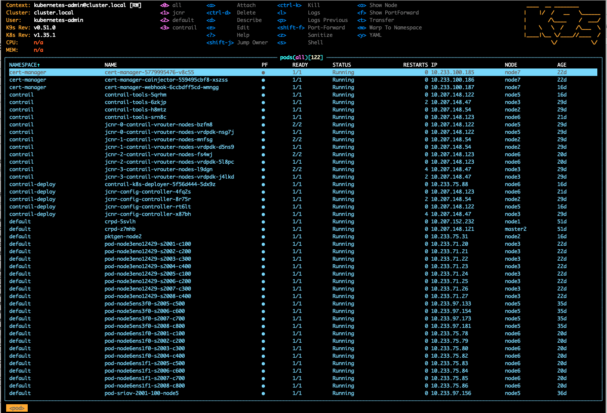

*Figure 29: K9 GUI*

7.  Type ‘1’ on the screen to open ‘jcnr’ pods. On the highlighted pod type ‘s’ on screen to enter shell mode

<span id="figure-30-view-jcnr-pods"></span>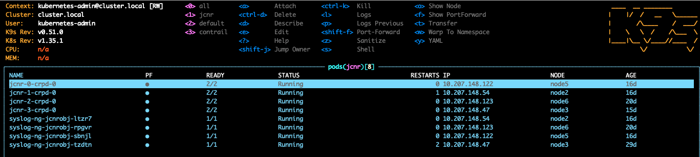

*Figure 30: View JCNR Pods*

8.  On the highlighted pod press up and down keys to select the pod and type ‘s’ on screen to enter shell mode.

<span id="figure-31-shell-mode"></span>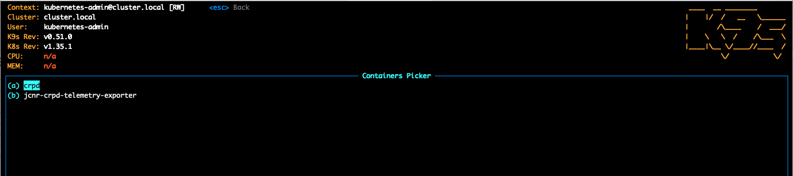

*Figure 31: Shell Mode*

9.  Press enter on `crpd` to open the container shell.

10. Enter the ‘cli’ mode and apply the junos OS configuration on JCNR. Repeat this step for all JCNR pods. After applying the config if returning to the main screen type ‘Exit’ twice to return to K9s GUI and then press ‘ESC’ and type ‘0’ to return to the main POD screen.

``` text
root@node2:/# ls
bin   config  etc   junos  lib32  libx32  mfs  opt  proc  run   smid_client_sem    smt_bbeOsClientRegistrar  srv  tmp  var
boot  dev     home  lib    lib64  media   mnt  pkg  root  sbin  smid_client_shmem  sonic                     sys  usr
root@node2:/# cli
root@node2> show configuration
## Last commit: 2026-08-03 14:41:50 UTC by root
version 20250610.050931_builder.r1495969;
groups {
    base { /* OMITTED */ };
    cni { /* OMITTED */ };
    internal { /* OMITTED */ };
}
apply-groups [ base internal cni ];
interfaces {
    bond0 {
        description "Fabric Interface";
        mtu 9100;
        unit 0 {
            description "VLAN 4000"; <<< VLAN 4000 configured as VN on Apstra
            family inet {
                address 172.31.255.3/24;
            }
            family inet6 {
                address fd51:9b86:a688:2862::3/64;
            }
        }
    }
    lo0 {
        unit 0 {
            family inet {
                address 173.31.255.3/32;
            }
            family inet6 {
                address fd52:9b86:a688:2862::3/128;
            }
        }
    }
}
policy-options {
    policy-statement pplb {
        then {
            load-balance per-packet;
        }
    }
}
routing-options {
    route-distinguisher-id 172.31.255.3;
    rib inet6.0 {
        static {
            route fd86:08ff:73b0:22de::b/128 next-hop fd51:9b86:a688:2862::ffff;
            route fdf8:db3c:29c5:ac6c::ffff:ffff/128 next-hop fd51:9b86:a688:2862::ffff;
        }
    }
    router-id 173.31.255.3;
    autonomous-system 4200000002;
    dynamic-tunnels {
        jcnr-overlay {
            source-address fd52:9b86:a688:2862::3;
            udp;
            destination-networks {
                fd86:8ff:73b0:22de::b/128;
                fd52:9b86:a688:2862::/64;
            }
        }
    }
    forwarding-table {
        export pplb;
    }
}
protocols {
    bgp {
        group client {          <<< IBGP with vrr to gather routes from Offramp gateway
            type internal;
            local-address fd52:9b86:a688:2862::3;
            family inet-vpn {
                unicast {
                    extended-nexthop;
                }
            }
            family inet6-vpn {
                unicast;
            }
            local-as 4200000001;
            neighbor fd86:8ff:73b0:22de::b;
            vpn-apply-export;
        }
    }
    lldp {
        interface all;
    }
}
```

11. Enter the ‘cli’ mode and apply the junos OS configuration on JCNR. Repeat this step for all JCNR pods. After applying config to end the K9s GUI, type ‘Exit’ twice to return to K9s GUI and then press ‘ESC’ and type ‘0’ to return main POD screen.

#### Virtual Route Reflector Setup

For configuring vRR a dedicated juniper cRPD pod is deployed on both master nodes. Juniper cRPD is deployed to configure vRR so as to exchange the JCNR and offramp gateway routes.

For cRPD deployment follow the [cRPD quick start guide](https://networkingdocs.hpe.com/documentation/us/en/quick-start/software/crpd/crpd-quick-start/topics/concept/step-1-crpd.html) to deploy Kubernetes containers.

``` text
root@node1:~# kubectl get pods -o wide
NAME                           READY   STATUS    RESTARTS   AGE   IP               NODE      NOMINATED NODE   READINESS GATES
crpd-5svlh                     1/1     Running   0          53d   10.207.152.232   master1     <none>           <none>
crpd-z7mhb                     1/1     Running   0          53d   10.207.148.121   master2   <none>           <none>
```

Run K9s command on the master node CLI and type the option from top that points to the `default` namespace for cRPD pod.

<span id="figure-32-select-crpd-pod"></span>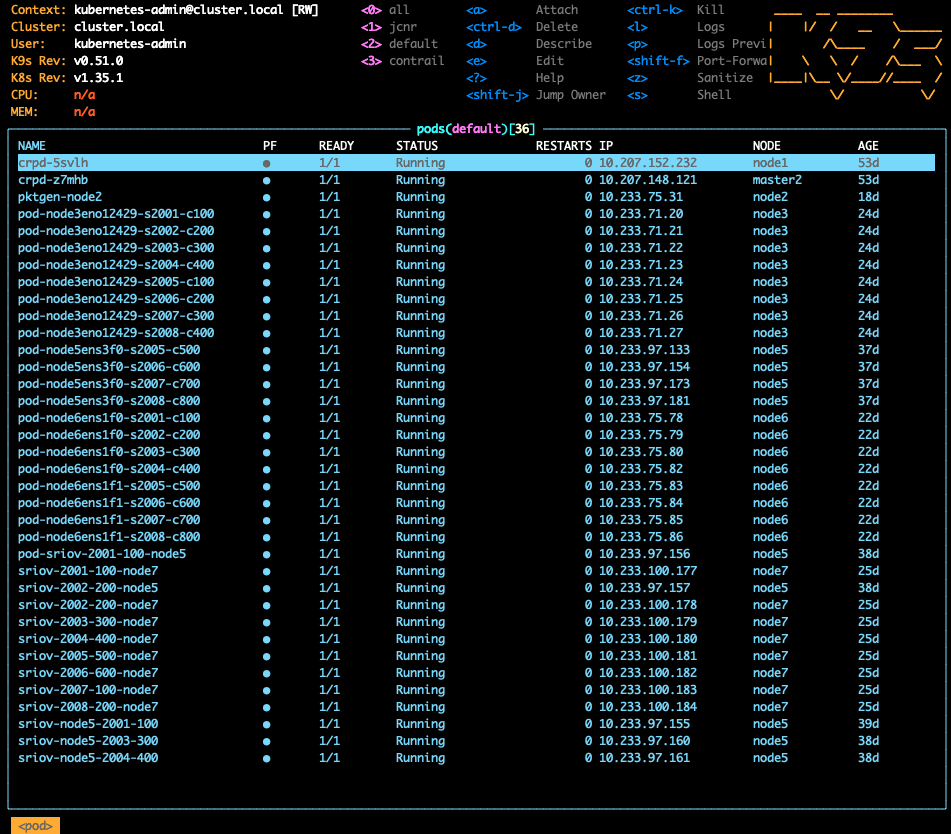

*Figure 32: Select CRPD Pod*

Select the cRPD Pod by moving the cursor Up and down and highlighting the pod and press Enter. On the next screen the container information is shown. Here type ‘s’ to get into the container shell mode. Type ‘cli’ and configure the vRR.

``` junos
## Last commit: 2026-07-27 21:36:58 UTC by root
version 20251208.182209_builder.r1529419;
interfaces {
    eno12399.4010 {
        unit 0 {
            family inet {
                address 193.168.255.10/24;
            }
            family inet6 {
                address fdf8:db3c:29c5:ac6c::ffff:ffff/64;
            }
        }
    }
    lo0 {
        unit 0 {
            family inet {
                address 193.168.1.1/32;
            }
            family inet6 {
                address fdf9:db3c:29c5:ac6c::ffff:ffff/128;
            }
        }
    }
}
routing-options {
    rib inet6.0 {
        static {
            route fd52:9b86:a688:2862::3/128 next-hop fdf8:db3c:29c5:ac6c::ffff;
            route fd86:8ff:73b0:22de::b/128 next-hop fdf8:db3c:29c5:ac6c::ffff;
            route fdf8:db3c:29c5:ac6c::ffff:ffff/128 next-hop fd51:9b86:a688:2862::ffff;
        }
    }
    router-id 193.168.1.1;
    autonomous-system 4200000001;
    static {
        route 192.168.255.11/32 next-hop 193.168.255.1;
    }
}
protocols {
    bgp {
        group client {
            type internal;
            local-address fdf9:db3c:29c5:ac6c::ffff:ffff;
            family inet-vpn {
                unicast {
                    nexthop-resolution {
                        no-resolution;
                    }
                    extended-nexthop;
                }
            }
            family inet6-vpn {
                unicast {
                    nexthop-resolution {
                        no-resolution;
                    }
                }
            }
            cluster 193.168.1.1;
            neighbor fd86:8ff:73b0:22de::b;
            neighbor fd52:9b86:a688:2862::3;
        }
    }
    lldp {
        interface all;
    }
} 
```

#### SR-IOV: Overlay Network-Based Q-in-Q Configuration on SR-IOV

1.  For SR-IOV workloads before deploying SR-IOV workload ensure `nmstate` is deployed. `Nmstate` to perform state driven network configuration on cluster nodes and to report back their current state. Both the configuration and reporting are controlled through Kubernetes objects.

``` text
((.venv) ) root@master1:~/kubespray# git clone https://github.com/nmstate/Kubernetes-nmstate.git
((.venv) ) root@master1:~/kubespray# cd Kubernetes-nmstate/deploy
((.venv) ) root@master1:~/kubespray/Kubernetes-nmstate/deploy# kubectl apply -f crds/nmstate.io_nodenetworkconfigurationpolicies.yaml
kubectl apply -f crds/nmstate.io_nodenetworkstates.yaml
customresourcedefinition.apiextensions.k8s.io/nodenetworkconfigurationpolicies.nmstate.io created
customresourcedefinition.apiextensions.k8s.io/nodenetworkstates.nmstate.io created
((.venv) ) root@master1:~/kubespray/Kubernetes-nmstate/deploy# kubectl get crds | grep nmstate
nodenetworkconfigurationpolicies.nmstate.io             2026-06-24T12:28:40Z
nodenetworkstates.nmstate.io                            2026-06-24T12:28:40Z
((.venv) ) root@master1:~/kubespray/Kubernetes-nmstate/deploy# kubectl apply -f operator.yaml
```

2.  Create Virtual Functions (VFs) and expose them to SR-IOV Operator. The node’s NIC creates Virtual Functions (VFs). These VFs act as lightweight virtual NICs carved out of the physical NIC. Apply each of the nmstate-vfs.yaml file using command `kubectl apply -f` with filename. For instance, `kubectl apply -f nmstate-master1-vfs.yaml`

``` text
root@master1:~# cd kubespray/SR-IOV/
root@master1:~/kubespray/SR-IOV# cat nmstate-master1-vfs.yaml
apiVersion: nmstate.io/v1
kind: NodeNetworkConfigurationPolicy
metadata:
  name: sriov-master1-intel
spec:
  nodeSelector:
    Kubernetes.io/hostname: master1
  desiredState:
    interfaces:
      - name: eno12409
        description: Intel E710 SR-IOV Port (Master1)
        type: ethernet
        state: up
        mtu: 9000
        ipv4:
          enabled: false
        ipv6:
          enabled: false
        ethernet:
          sr-iov:
            total-vfs: 4

root@master1:~/kubespray/SR-IOV# cat nmstate-node2-vfs.yaml
apiVersion: nmstate.io/v1
kind: NodeNetworkConfigurationPolicy
metadata:
  name: sriov-node2-intel
spec:
  nodeSelector:
    Kubernetes.io/hostname: node2
  desiredState:
    interfaces:
      - name: ens3f0
        description: Intel E810 SR-IOV Port (Node2)
        type: ethernet
        state: up
        mtu: 9000
        ipv4:
          enabled: false
        ipv6:
          enabled: false
        ethernet:
          sr-iov:
            total-vfs: 4

root@master1:~/kubespray/SR-IOV# cat nmstate-node3-vfs.yaml
apiVersion: nmstate.io/v1
kind: NodeNetworkConfigurationPolicy
metadata:
  name: sriov-node5-intel
spec:
  nodeSelector:
    Kubernetes.io/hostname: node5
  desiredState:
    interfaces:
      - name: eno12399
        description: Intel E810 SR-IOV Port (Node5)
        type: ethernet
        state: up
        mtu: 9000
        ipv4:
          enabled: false
        ipv6:
          enabled: false
        ethernet:
          sr-iov:
            total-vfs: 16

root@master1:~/kubespray/SR-IOV# cat nmstate-node5-vfs.yaml
apiVersion: nmstate.io/v1
kind: NodeNetworkConfigurationPolicy
metadata:
  name: sriov-node3-intel
spec:
  nodeSelector:
    Kubernetes.io/hostname: node3
  desiredState:
    interfaces:
      - name: eno12399
        description: Intel E810 SR-IOV Port (Node3)
        type: ethernet
        state: up
        mtu: 9000
        ipv4:
          enabled: false
        ipv6:
          enabled: false
        ethernet:
          sr-iov:
            total-vfs: 4

root@master1:~/kubespray/SR-IOV# cat nmstate-node6-vfs.yaml
apiVersion: nmstate.io/v1
kind: NodeNetworkConfigurationPolicy
metadata:
  name: sriov-node6-intel
spec:
  nodeSelector:
    Kubernetes.io/hostname: node6
  desiredState:
    interfaces:
      - name: ens1f0np0
        description: Intel E810 SR-IOV Port 0 (Node6)
        type: ethernet
        state: up
        mtu: 9000
        ipv4:
          enabled: false
        ipv6:
          enabled: false
        ethernet:
          sr-iov:
            total-vfs: 64
      - name: ens1f1np1
        description: Intel E810 SR-IOV Port 1 (Node6)
        type: ethernet
        state: up
        mtu: 9000
        ipv4:
          enabled: false
        ipv6:
          enabled: false
        ethernet:
          sr-iov:
            total-vfs: 64
```

3.  Make sure that the Virtual Functions created above are available for the Kubernetes scheduler. Create files targeting hardware vendor ID and device code as shown in the following for each node. The custom resource name label `resourceName`exposes the Virtual Functions to the Kubernetes for scheduling inside pods. `nodeSelector` tells Kubernetes which node the resource is available. Push the policy using `kubectl apply -f` command for each policy file.

``` text
root@master1:~/kubespray/SR-IOV# cat sriovnetpolicy-node-network.yaml

---
apiVersion: sriovnetwork.openshift.io/v1
kind: SriovNetworkNodePolicy
metadata:
  name: sriov-node3-x710
  namespace: sriov-network-operator
spec:
  resourceName: resourceX710
  nodeSelector:
    Kubernetes.io/hostname: node3
  priority: 10
  numVfs: 4
  externallyManaged: false
  deviceType: netdevice
  isRdma: false
  nicSelector:
    vendor: "8086"
    deviceID: "1572"
    rootDevices:
      - "0000:32:00.0"
    pfNames:
      - "eno12399#0-3"
---
apiVersion: sriovnetwork.openshift.io/v1
kind: SriovNetworkNodePolicy
metadata:
  name: sriov-node2-x810
  namespace: sriov-network-operator
spec:
  resourceName: resourceX810
  nodeSelector:
    Kubernetes.io/hostname: node2
  priority: 10
  numVfs: 4
  externallyManaged: false
  deviceType: netdevice
  isRdma: false
  nicSelector:
    vendor: "8086"
    deviceID: "159b"
    rootDevices:
      - "0000:9f:00.0"
    pfNames:
      - "ens3f0#0-3"

root@master1:~/kubespray/SR-IOV# cat sriovnetpolicy-node5-network.yaml

---
apiVersion: sriovnetwork.openshift.io/v1
kind: SriovNetworkNodePolicy
metadata:
  name: sriov-node5-x810
  namespace: sriov-network-operator
spec:
  resourceName: resourceC810 
  nodeSelector:
    Kubernetes.io/hostname: node5
  priority: 10
  numVfs: 16
  externallyManaged: false
  deviceType: netdevice
  isRdma: false
  nicSelector:
    vendor: "8086"
    deviceID: "1592"
    rootDevices:
      - "0000:12:00.0"
    pfNames:
      - "ens1f0np0#0-15"
root@master1:~/kubespray/SR-IOV# cat sriovnetpolicy-node6-network.yaml

---
apiVersion: sriovnetwork.openshift.io/v1
kind: SriovNetworkNodePolicy
metadata:
  name: sriov-node6-c810-port0
  namespace: sriov-network-operator
spec:
  resourceName: resourceC810port0
  nodeSelector:
    Kubernetes.io/hostname: node6
  priority: 10
  numVfs: 64
  externallyManaged: false
  deviceType: netdevice
  isRdma: false
  nicSelector:
    vendor: "8086"
    deviceID: "1592"
    rootDevices:
      - "0000:12:00.0"
    pfNames:
      - "ens1f0np0#0-63"

---
apiVersion: sriovnetwork.openshift.io/v1
kind: SriovNetworkNodePolicy
metadata:
  name: sriov-node6-c810-port1
  namespace: sriov-network-operator
spec:
  resourceName: resourceC810port1
  nodeSelector:
    Kubernetes.io/hostname: node6
  priority: 10
  numVfs: 64
  externallyManaged: false
  deviceType: netdevice
  isRdma: false
  nicSelector:
    vendor: "8086"
    deviceID: "1592"
    rootDevices:
      - "0000:12:00.1"
    pfNames:
      - "ens1f1np1#0-63"
```

4.  Set up outer SR-IOV tenant VLAN overlays (Service VLANs). Apply the configuration using commands:

    `kubectl apply -f nad-sriov-t1-svlan.yaml`

    `kubectl apply -f nad-sriov-t2-svlan.yaml`

``` text
root@master1:~/kubespray/SR-IOV# ls | grep svlan
nad-sriov-t1-svlan.yaml
nad-sriov-t2-svlan.yaml
root@master1:~/kubespray/SR-IOV# cat nad-sriov-t1-svlan.yaml
apiVersion: sriovnetwork.openshift.io/v1
kind: SriovNetwork
metadata:
  name: sriovnetwork-1q-t1-svlan
  namespace: sriov-network-operator
spec:
  ipam: |-
    {}
  vlan: 2001
  spoofChk: "off"
  trust: "off"
  vlanProto: "802.1q"
  linkState: "auto"
  capabilities: '{ "mac": true }'
  networkNamespace: default
  resourceName: resourceX710

---
apiVersion: sriovnetwork.openshift.io/v1
kind: SriovNetwork
metadata:
  name: sriovnetwork-1q-t1-svlan-x810
  namespace: sriov-network-operator
spec:
  ipam: "{}"
  vlan: 2001
  spoofChk: "off"
  trust: "off"
  vlanProto: "802.1q"
  linkState: "auto"
  capabilities: '{ "mac": true }'
  networkNamespace: default
  resourceName: resourceX810   # node2 PF
root@master1:~/kubespray/SR-IOV# cat nad-sriov-t2-svlan.yaml
apiVersion: sriovnetwork.openshift.io/v1
kind: SriovNetwork
metadata:
  name: sriovnetwork-1q-t2-svlan
  namespace: sriov-network-operator
spec:
  ipam: |-
    {}
  vlan: 2002
  spoofChk: "off"
  trust: "off"
  vlanProto: "802.1q"
  linkState: "auto"
  capabilities: '{ "mac": true }'
  networkNamespace: default
  resourceName: resourceX710

---
apiVersion: sriovnetwork.openshift.io/v1
kind: SriovNetwork
metadata:
  name: sriovnetwork-1q-t2-svlan-x810
  namespace: sriov-network-operator
spec:
  ipam: "{}"
  vlan: 2002
  spoofChk: "off"
  trust: "off"
  vlanProto: "802.1q"
  linkState: "auto"
  capabilities: '{ "mac": true }'
  networkNamespace: default
  resourceName: resourceX810   # node2 PF
```

5.  Create the inner customer VLAN (C-VLAN) for each tenant. The file Includes IPAM configuration (IP assignment) and routing rules for pod interfaces. Apply the configuration using commands:

`kubectl apply -f`nad-sriov-t1-vn1-cvlan.yaml

`kubectl apply -f`nad-sriov-t1-vn2-cvlan.yaml

`kubectl apply -f`nad-sriov-t2-vn1-cvlan.yaml

``` text
root@master1:~/kubespray/SR-IOV# cat nad-sriov-t1-vn1-cvlan.yaml
apiVersion: k8s.cni.cncf.io/v1
kind: NetworkAttachmentDefinition
metadata:
  name: nad-sriov-t1-vn1
  namespace: default
spec:
  config: '{
      "name": "nad-sriov-t1-vn1",
      "cniVersion": "0.3.1",
      "type": "vlan",
      "linkInContainer": true,
      "master": "net1",
      "vlanId": 100,
      "ipam": {
        "type": "whereabouts",
        "ipRanges": [{
          "range": "10.201.255.0/24",
          "exclude": [
            "10.201.255.1/32",
            "10.201.255.2/32",
            "10.201.255.254/32"
          ]
        }, {
          "range": "2001::10:201:255:0/112",
          "exclude": [
            "2001::10:201:255:1/128",
            "2001::10:201:255:2/128",
            "2001::10:201:255:ffff/128"
          ]
        }],
        "routes": [
          { "dst": "10.211.255.0/24", "gw": "10.201.255.254" },
          { "dst": "10.202.255.0/24", "gw": "10.201.255.254" },
          { "dst": "2001::10:211:255:0/112", "gw": "2001::10:201:255:ffff" },
          { "dst": "2001::10:202:255:0/112", "gw": "2001::10:201:255:ffff" }
        ]
      }
    }'

root@master1:~/kubespray/SR-IOV# cat nad-sriov-t1-vn2-cvlan.yaml
apiVersion: k8s.cni.cncf.io/v1
kind: NetworkAttachmentDefinition
metadata:
  name: nad-sriov-t1-vn2
  namespace: default
spec:
  config: '{
      "name": "nad-sriov-t1-vn2",
      "cniVersion": "0.3.1",
      "type": "vlan",
      "linkInContainer": true,
      "master": "net1",
      "vlanId": 200,
      "ipam": {
        "type": "whereabouts",
        "ipRanges": [{
          "range": "10.202.255.0/24",
          "exclude": [
            "10.202.255.1/32",
            "10.202.255.2/32",
            "10.202.255.254/32"
          ]
        }, {
          "range": "2001::10:202:255:0/112",
          "exclude": [
            "2001::10:202:255:1/128",
            "2001::10:202:255:2/128",
            "2001::10:202:255:ffff/128"
          ]
        }],
        "routes": [
          { "dst": "10.211.255.0/24", "gw": "10.202.255.254" },
          { "dst": "10.201.255.0/24", "gw": "10.202.255.254" },
          { "dst": "2001::10:211:255:0/112", "gw": "2001::10:202:255:ffff" },
          { "dst": "2001::10:201:255:0/112", "gw": "2001::10:202:255:ffff" }
        ]
      }
    }'

root@master1:~/kubespray/SR-IOV# cat nad-sriov-t2-vn1-cvlan.yaml
apiVersion: k8s.cni.cncf.io/v1
kind: NetworkAttachmentDefinition
metadata:
  name: nad-sriov-t2-vn1
  namespace: default
spec:
  config: '{
      "name": "nad-sriov-t2-vn1",
      "cniVersion": "0.3.1",
      "type": "vlan",
      "linkInContainer": true,
      "master": "net1",
      "vlanId": 100,
      "ipam": {
        "type": "whereabouts",
        "ipRanges": [{
          "range": "10.211.255.0/24",
          "exclude": [
            "10.211.255.1/32",
            "10.211.255.2/32",
            "10.211.255.254/32"
          ]
        }, {
          "range": "2001::10:211:255:0/112",
          "exclude": [
            "2001::10:211:255:1/128",
            "2001::10:211:255:2/128",
            "2001::10:211:255:ffff/128"
          ]
        }],
        "routes": [
          { "dst": "10.201.255.0/24", "gw": "10.211.255.254" },
          { "dst": "10.202.255.0/24", "gw": "10.211.255.254" },
          { "dst": "2001::10:201:255:0/112", "gw": "2001::10:211:255:ffff" },
          { "dst": "2001::10:202:255:0/112", "gw": "2001::10:211:255:ffff" }
        ]
      }
    }'
```

6.  Connect the Application pods to the Virtual Functions by creating pod files and applying it. Each pod attaches to its VF-based interface (net1) with VLAN overlays, IP addresses, and routes applied. Add the Multus networking annotation to the Pod metadata segment: `k8s.v1.cni.cncf.io/networks`.

kubectl apply -f pod-sriov-t1-vn1-c0.yaml

kubectl apply -f pod-sriov-t1-vn1-c2.yaml

kubectl apply -f pod-sriov-t1-vn2-c2.yaml

kubectl apply -f pod-sriov-t2-vn1-c0.yaml

``` text
root@master1:~/kubespray/SR-IOV# cat pod-sriov-t1-vn1-c0.yaml
apiVersion: v1
kind: Pod
metadata:
  name: net-tools-sriov-t1-vn1-c0
  annotations:
    k8s.v1.cni.cncf.io/networks: sriovnetwork-1q-t1-svlan-x810, nad-sriov-t1-vn1
spec:
  containers:
    - name: net-tools
      image: rtsp/net-tools:latest
      imagePullPolicy: IfNotPresent
      securityContext:
        privileged: true
      resources:
        requests:
          openshift.io/resourceX810: "1"
        limits:
          openshift.io/resourceX810: "1"
  nodeSelector:
    Kubernetes.io/hostname: node2
root@master1:~/kubespray/SR-IOV# pod-sriov-t1-vn1-c2.yaml
pod-sriov-t1-vn1-c2.yaml: command not found
root@master1:~/kubespray/SR-IOV# cat pod-sriov-t1-vn1-c2.yaml
apiVersion: v1
kind: Pod
metadata:
  name: net-tools-sriov-t1-vn1-c2
  annotations:
    k8s.v1.cni.cncf.io/networks: sriovnetwork-1q-t1-svlan, nad-sriov-t1-vn1
spec:
  containers:
    - name: net-tools
      image: rtsp/net-tools:latest
      imagePullPolicy: IfNotPresent
      securityContext:
        privileged: true
      resources:
        requests:
          openshift.io/resourceX710: "1"
        limits:
          openshift.io/resourceX710: "1"
  nodeSelector:
    Kubernetes.io/hostname: node3
```

## Traffic Workflow Scenarios

### JCNR to JCNR Same Tenant and Same Network

For traffic between computes (Kubernetes cluster) belonging to the same tenant and same JCNR network, the source JCNR data plane encapsulates the workload traffic using MPLS-over-UDP. The encapsulated packet is forwarded from the compute host to the attached leaf switch. If the destination workload is located on a different compute node, the leaf switch transports the traffic across the EVPN-VXLAN fabric towards the destination leaf switch. The MPLS-over-UDP packet is carried transparently across the fabric, with the leaf switches using EVPN Type-2 route information and MAC address learning to determine the forwarding path. The packet is then delivered to the destination compute host, where the receiving JCNR decapsulates the MPLS-over-UDP header and forwards the original packet to the destination workload.

As the source and destination workloads belong to the same virtual network, no Layer 3 routing lookup is required on the Off-Ramp Gateway, and the traffic remains entirely within the data center’s fabric.

<span id="figure-33-jcnr-to-jcnr-same-tenant-same-network"></span>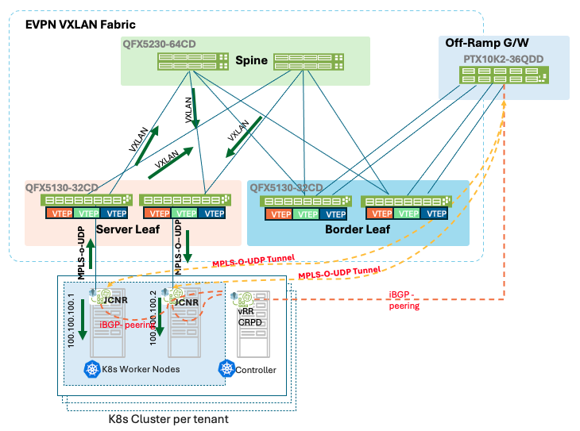

*Figure 33: JCNR to JCNR Same Tenant Same Network*

### JCNR to JCNR Same Tenant and Different Network

For traffic between workloads belonging to the same tenant but residing in different virtual networks (subnets), the source JCNR data plane encapsulates the traffic using MPLS-over-UDP and forwards it towards the attached leaf switch. The EVPN-VXLAN fabric transports the encapsulated traffic to the Border Leaf switch, where the VXLAN header is removed and the MPLS-over-UDP packet is forwarded towards the Off-Ramp Gateway.

The offramp gateway performs the Layer 3 lookup and route resolution between the source and destination virtual networks. Based on the tenant VRF routing information and route-leaking policies, the off-ramp gateway determines the destination JCNR endpoint and forwards the traffic back towards the fabric using MPLS-over-UDP.

The packet is then transported through the Border Leaf and EVPN-VXLAN fabric to the destination leaf switch, which delivers the packet to the destination JCNR. The receiving JCNR decapsulates the MPLS-over-UDP packet and forwards the traffic to the destination workload.

This design centralizes inter-network routing and policy enforcement on the Off-Ramp Gateway while maintaining Layer 2 transport within the EVPN-VXLAN fabric.

<span id="figure-34-jcnr-to-jcnr-same-tenant-different-network"></span>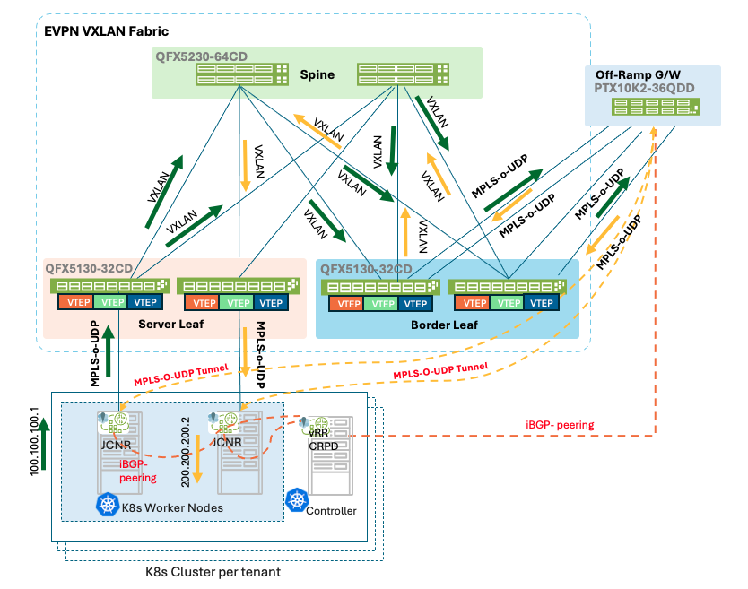

*Figure 34: JCNR to JCNR Same Tenant Different Network*

### JCNR to JCNR Inter-Tenant

By default, tenant networks are fully isolated from one another, with each tenant hosted within its own set of VRFs and VPN route targets. Communication between workloads belonging to different tenants therefore requires traffic to traverse the Off-Ramp Gateway as its central point for policy enforcement, route leaking, and inter-VRF connectivity. For traffic originating from compute attached to a JCNR instance in one tenant communicates with workload or application attached to a JCNR instance in a different tenant, the source JCNR encapsulates the traffic using MPLS-over-UDP and forwards it towards the EVPN-VXLAN fabric. The traffic is transported across the fabric to the Border Leaf switch, where the VXLAN encapsulation is removed, and the MPLS-over-UDP packet is forwarded to the Off-Ramp Gateway. The offramp gateway performs a Layer 3 lookup within the source tenant VRF and applies the required route-leaking and policy controls to determine whether communication with the destination tenant is permitted. If inter-tenant communication is allowed as per the route policies configured on the offramp gateway, then the offramp gateway forwards the traffic into the destination tenant VRF and re-encapsulates it for delivery towards the destination JCNR endpoint. The packet is then transported through the Border Leaf and EVPN-VXLAN fabric to the destination JCNR, which decapsulates the MPLS-over-UDP header and forwards the packet to the destination workload or application.

<span id="figure-35-jcnr-to-jcnr-inter-tenant-traffic-routing"></span>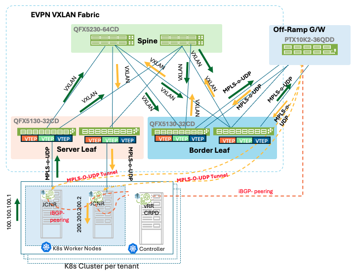

*Figure 35: JCNR to JCNR Inter Tenant Traffic Routing*

Inter-tenant communication is not performed directly between JCNR instances. Traffic must traverse the Off-Ramp Gateway, where route-target policies and VRF route leaking determine whether communication between tenant environments is permitted. This ensures strict tenant isolation while providing a controlled mechanism for inter-tenant connectivity when required.

### SR-IOV to SR-IOV Same Tenant and Same Subnet

For communication between SR-IOV workloads belonging to the same tenant and residing within the same subnet, traffic is forwarded entirely at Layer 2 across the EVPN-VXLAN fabric. The workload generates a standard Ethernet frame, which is transmitted through the assigned SR-IOV Virtual Function (VF) and encapsulated using Q-in-Q tagging, where the Service VLAN (S-VLAN) identifies the tenant service and the Customer VLAN (C-VLAN) identifies the tenant network. Upon reaching the ingress leaf switch, the outer S-VLAN is mapped to the corresponding EVPN instance (MAC-VRF) and transported across the fabric. The fabric uses EVPN Type-2 MAC route advertisements to identify the location of the destination workload and forward the traffic directly to the destination leaf switch. The destination leaf restores the Q-in-Q encapsulation and forwards the packet to the destination SR-IOV workload.

As both workloads belong to the same tenant and the same subnet, no Layer 3 routing lookup is required, and the traffic does not traverse the Off-Ramp Gateway.

<span id="figure-36-sr-iov-to-sr-iov-same-tenant-same-network-traffic-flow"></span>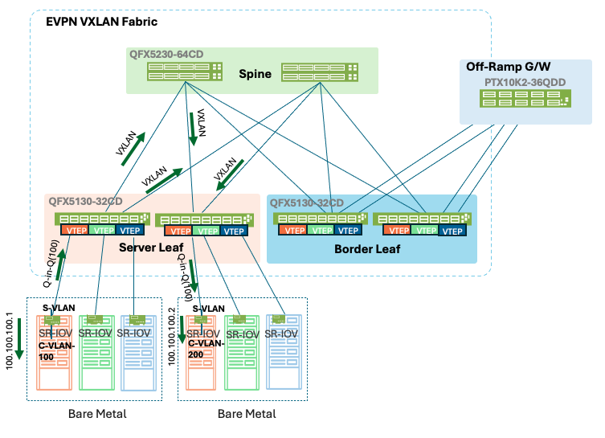

*Figure 36: SR-IOV to SR-IOV Same Tenant Same Network Traffic Flow*

### SR-IOV to SR-IOV Same Tenant and Different Network

For communication between SR-IOV workloads belonging to the same tenant but residing in different networks (different C-VLANs/subnets), the traffic must be routed by the Off-Ramp Gateway. While the EVPN-VXLAN fabric provides Layer 2 transport for the SR-IOV services, it does not perform inter-subnet routing. The Off-ramp gateway acts as the centralised Layer 3 gateway and policy enforcement point for all inter-network communication.

The source SR-IOV workload transmits traffic through its SR-IOV Virtual Function (VF) using Q-in-Q encapsulation, where the Service VLAN (S-VLAN) identifies the tenant and the Customer VLAN (C-VLAN) identifies the tenant’s network. The ingress leaf switch maps the S-VLAN to the corresponding EVPN-VXLAN forwarding domain and transports the packet across the fabric to the Border Leaf. The packet is then forwarded to the Off-Ramp Gateway through the tenant-specific Layer 2 service. The offramp gateway terminates the Q-in-Q service in the corresponding tenant VRF and performs a Layer 3 lookup to determine the destination network and applies relevant routing policies to route the packet. After routing the packet to the destination tenant network, the offramp gateway forwards the traffic back into the appropriate SR-IOV Layer 2 domain, where it is transported across the EVPN-VXLAN fabric to the destination leaf switch and finally delivered to the destination SR-IOV workload.

<span id="figure-37-sr-iov-to-sr-iov-inter-tenant-workflow"></span>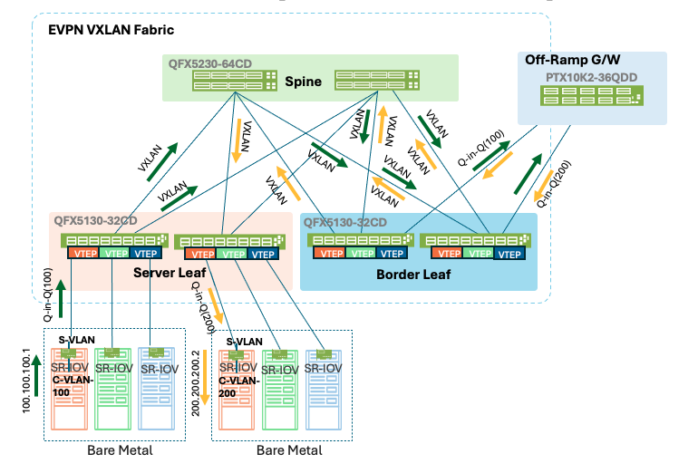

*Figure 37: SR-IOV to SR-IOV Inter-tenant Workflow*

### SR-IOV to SR-IOV Inter-tenant

By default, SR-IOV services belonging to different tenants are isolated through dedicated S-VLANs, tenant-specific Layer 2 forwarding domains (virtual-switch instances), VRFs, and VPN route targets. Communication between workloads belonging to different tenants therefore requires traffic to traverse the Off-Ramp Gateway, which acts as the centralized Layer 3 routing and policy enforcement point for inter-tenant connectivity. The source SR-IOV workload transmits traffic through its SR-IOV Virtual Function (VF) using Q-in-Q encapsulation, where the outer Service VLAN (S-VLAN) identifies the tenant and the inner Customer VLAN (C-VLAN) identifies the tenant network. The ingress leaf switch maps the S-VLAN to the corresponding EVPN-VXLAN forwarding domain and transports the traffic through the EVPN-VXLAN fabric to the Border Leaf switch. The Border Leaf forwards the Q-in-Q traffic towards the Off-Ramp Gateway, where the packet is terminated in the source tenant VRF. The Off-Ramp Gateway performs an inter-tenant routing lookup and applies to the configured route-target import/export policies and route-leaking controls to determine whether communication between the source and destination tenants is permitted. If authorized, the traffic is forwarded into the destination tenant VRF and associated with Layer 2 service before being sent back through the Border Leaf and EVPN-VXLAN fabric towards the destination SR-IOV workload.

<span id="figure-38-sr-iov-to-sr-iov-inter-vrf-traffic"></span>

*Figure 38: SR-IOV to SR-IOV Inter VRF Traffic*

### JCNR to SR-IOV

In cases where JCNR traffic is destined for SR-IOV connected systems, traffic traverses the Off-Ramp Gateway, which provides the routing transition between the JCNR MPLS-over-UDP domain and the SR-IOV Q-in-Q domain. The compute hosting the JCNR workloads generates traffic that is encapsulated using MPLS-over-UDP. The packet is forwarded to the local leaf switch and transported across the EVPN-VXLAN fabric to the Border Leaf switch. The Border Leaf removes the VXLAN encapsulation and forwards the MPLS-over-UDP packet towards the Off-Ramp Gateway. The Off-Ramp Gateway terminates the MPLS-over-UDP tunnel, performs a Layer 3 lookup within the source tenant VRF, and determines the destination SR-IOV network. Through controlled route leaking and route-target policies, the off-ramp gateway forwards the traffic into the appropriate SR-IOV VRF. The packet is then associated with the corresponding Q-in-Q service, where the appropriate S-VLAN and C-VLAN tags are applied before forwarding the traffic back through the Border Leaf and EVPN-VXLAN fabric to the destination SR-IOV workload.

<span id="figure-39-jcnr-to-sr-iov-traffic-flow"></span>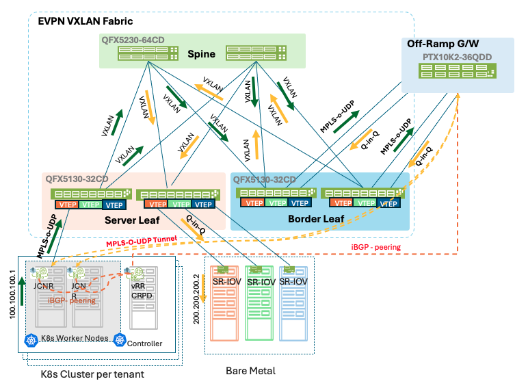

*Figure 39: JCNR to SR-IOV Traffic Flow*

### SR-IOV to JCNR

The source SR-IOV workload transmits traffic through its assigned SR-IOV Virtual Function (VF), with the packet encapsulated using Q-in-Q tagging. The outer Service VLAN (S-VLAN) identifies the tenant service, while the inner Customer VLAN (C-VLAN) identifies the tenant network. The ingress leaf switch maps the S-VLAN to the appropriate EVPN-VXLAN forwarding domain and transports the traffic across the fabric towards the Border Leaf switch.

The Border Leaf forwards the Q-in-Q traffic to the Off-Ramp Gateway, where the packet is terminated within the corresponding SR-IOV tenant VRF. The Off-Ramp Gateway performs a Layer 3 lookup and, through configured route-target import/export policies and route-leaking rules, identifies the destination JCNR network.

The traffic is then forwarded into the corresponding JCNR VRF and encapsulated as MPLS-over-UDP. The packet traverses the Border Leaf and EVPN-VXLAN fabric towards the destination compute node hosting the target JCNR instance. Upon receipt, the JCNR data plane decapsulates the MPLS-over-UDP header and forwards the original packet to the destination workload.

<span id="figure-40-sr-iov-to-jcnr-traffic"></span>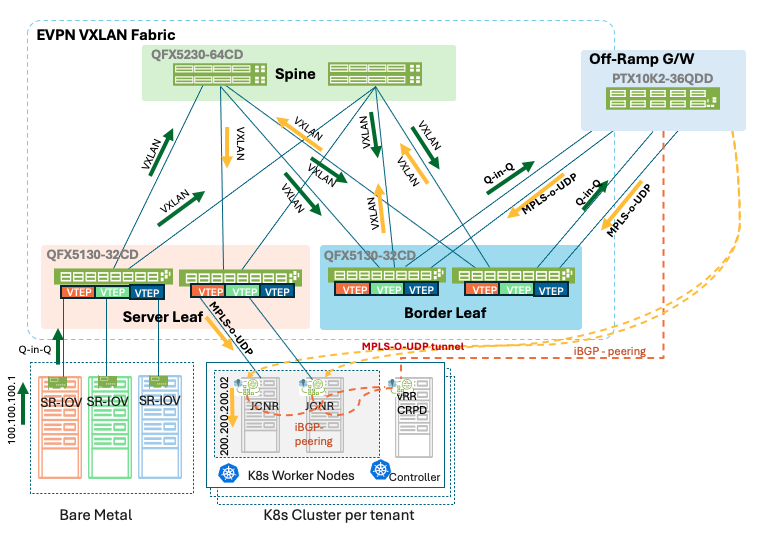

*Figure 40: SR-IOV to JCNR Traffic*

## Validation Framework

### Test Bed

The test bed environment consists of a 3-stage EVPN/VXLAN fabric managed by Apstra Data Center Director, with six server leaf switches of which two switches are configured as redundant pairs, four single (non-redundant) server leaf switch(non-ESI), and one border leaf switch connected to two spines. An external offramp gateway is also connected to the border leaf switches. A traffic generator is connected to the test ports to the server leaf switches. For the Kubernetes setup, two Kubernetes controllers with virtual route reflectors are configured as master and backup controller. And four worker nodes with JCNR and SR-IOV workload are deployed. And a separate server with SR-IOV is also deployed.

<span id="figure-41-telco-cloud-test-bed"></span>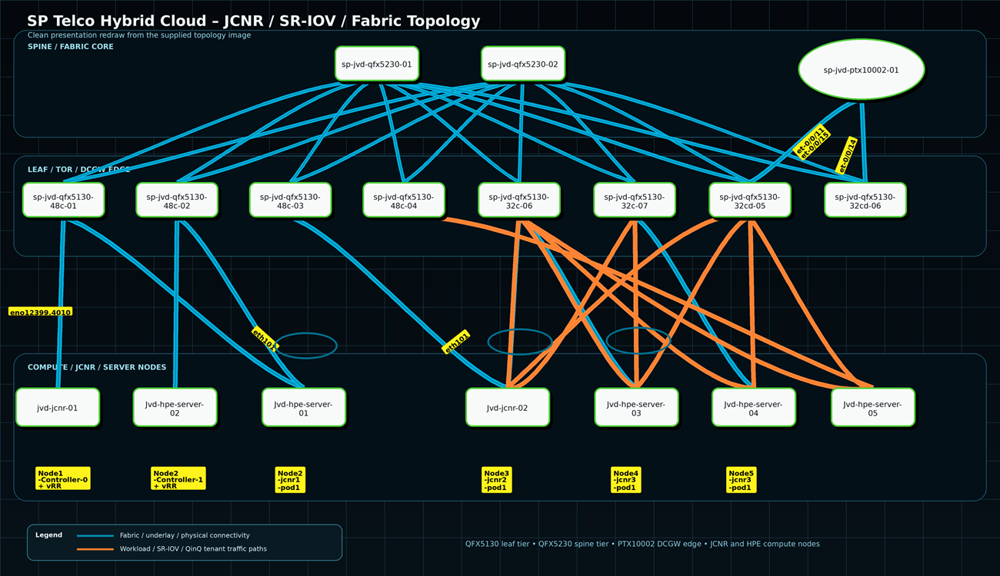

*Figure 41: Telco Cloud Test Bed*

### Platforms and Devices Under Test (DUT)

##### Table 9: Devices Under Test

<table>
<colgroup>
<col style="width: 20%" />
<col style="width: 20%" />
<col style="width: 20%" />
<col style="width: 20%" />
<col style="width: 20%" />
</colgroup>
<thead>
<tr class="header">
<th>Server Leaf Switches</th>
<th>Border Leaf Switches</th>
<th>Spine</th>
<th>Offramp Routers</th>
<th>Bare Metal Servers (SR-IOV and JCNR)</th>
</tr>
</thead>
<tbody>
<tr class="odd">
<td>QFX5130-48C</td>
<td>QFX5130-32CD</td>
<td>QFX5230-64CD</td>
<td>PTX10002-36QDD</td>
<td>HPE DL360 Gen<br />
DELL PowerEdge R750</td>
</tr>
</tbody>
</table>

##### Table 10: Tested Optics

<table>
<colgroup>
<col style="width: 25%" />
<col style="width: 25%" />
<col style="width: 25%" />
<col style="width: 25%" />
</colgroup>
<thead>
<tr class="header">
<th>Part number</th>
<th>Optics Name</th>
<th>Device Role</th>
<th>Device Model</th>
</tr>
</thead>
<tbody>
<tr class="odd">
<td>740-061405</td>
<td>QSFP-100GBASE-SR4</td>
<td>Server Leaf</td>
<td>QFX5130-32CD</td>
</tr>
<tr class="even">
<td>740-058734</td>
<td>QSFP-100GBASE-SR4</td>
<td>Server Leaf</td>
<td>QFX5130-32CD</td>
</tr>
<tr class="odd">
<td>740-089468</td>
<td>QSFP56-DD-4X100G-LR</td>
<td>Spine</td>
<td>QFX5230-64CD</td>
</tr>
<tr class="even">
<td>740-061405</td>
<td>QSFP-100GBASE-SR4</td>
<td>Spine</td>
<td>QFX5230-64CD</td>
</tr>
<tr class="odd">
<td>740-058734</td>
<td>QSFP-100GBASE-SR4</td>
<td>Spine</td>
<td>QFX5230-64CD</td>
</tr>
<tr class="even">
<td>740-031980</td>
<td>SFP+-10G-SR</td>
<td>Server Leaf</td>
<td>QFX5130-48C</td>
</tr>
<tr class="odd">
<td>740-061405</td>
<td>QSFP-100GBASE-SR4</td>
<td>Server Leaf</td>
<td>QFX5130-48C</td>
</tr>
<tr class="even">
<td>740-058734</td>
<td>QSFP-100GBASE-SR4</td>
<td>Server Leaf</td>
<td>QFX5130-48C</td>
</tr>
<tr class="odd">
<td>740-021308</td>
<td>SFP+-10G-SR</td>
<td>Server Leaf</td>
<td>QFX5130-48CM<br />
QFX5130-48C</td>
</tr>
<tr class="even">
<td>740-067442</td>
<td>QSFP+-40G-SR4</td>
<td>Server Leaf</td>
<td>QFX5130-48CM</td>
</tr>
<tr class="odd">
<td>740-061405</td>
<td>QSFP-100GBASE-SR4</td>
<td>Server Leaf</td>
<td>QFX5130-48CM</td>
</tr>
<tr class="even">
<td>740-032986</td>
<td>QSFP+-40G-SR4</td>
<td>Border Leaf</td>
<td>QFX5130-32CD</td>
</tr>
<tr class="odd">
<td>740-031980</td>
<td>SFP+-10G-SR</td>
<td>Border Leaf</td>
<td>QFX5130-32CD</td>
</tr>
<tr class="even">
<td>740-061405</td>
<td>QSFP-100GBASE-SR4</td>
<td>Border Leaf</td>
<td>QFX5130-32CD</td>
</tr>
<tr class="odd">
<td>740-058734</td>
<td>QSFP-100GBASE-SR4</td>
<td>Border Leaf</td>
<td>QFX5130-32CD</td>
</tr>
</tbody>
</table>

> Note: The optics qualified are with respect to the lab setup. The list of optics is not limited to the ones listed in this validated design. For more information on optics and supported platforms refer [HPE Juniper Network Hardware compatibility tool](https://apps.juniper.net/hct).

### Test Bed Configuration

Contact HPE Juniper Networking or your HPE Juniper Networking account representative to obtain the full archive of the test bed configuration used for this validated design.

### Test Objectives

This validated design focusses on testing the Telco Cloud Solution that combines EVPN-VXLAN based fabrics with host-based networking (JCNR/HBR) and SR-IOV based high-performance workload connectivity. The objective is to verify end-to-end functionality, tenant isolation, scalability and operational behavior of the solution that are the key aspects of the Telco Cloud Solution. The qualification is performed using Juniper products listed in [Table 9: Devices Under Test](#table-9-devices-under-test) and with software products listed in [Table 11: Juniper Software and Version](#table-11-juniper-software-and-version).

##### Table 11: Juniper Software and Version

| HPE Juniper Networking Products | Software or Image Version |
|---------------------------------|---------------------------|
| Apstra Data Center Director     | 6.2                       |
| Juniper OS Evolved              | 25.2X100-D30              |
| JCNR                            | 25.2                      |

### Test Goals

Following are the testing goals for this solution:

#### Apstra Deployment Validation

1.  Validate 3-stage Service Provider EVPN/VXLAN Datacenter deployment using Apstra Data Center Director.
2.  Validate IPV6 underlay in the fabric with Apstra 6.2
3.  Validate solution supports overlay and underlay eBGP built using Apstra Data Center Director.
4.  Validate Solutions supports IRB configuration on Border leaf switches
5.  Provision Offramp Gateway - PTX10002-36QDD

#### Hardware Validation

1.  Validate all the required Juniper Platforms are suitable for the role as shown in [Table 2: Telco Cloud Service Provider Devices and Positioning](#table-2-telco-cloud-service-provider-devices-and-positioning) and support the features required for Service Provider 3-stage EVPN-VXLAN deployment.
2.  Validate the optics described in [Table 10: Tested Optics](#table-10-tested-optics)

#### Feature Validation

1.  Validate all features listed in this validated design and as listed in [Table 4: Apstra Intent Based DC Reference](#table-4-pre-requisite-compute-software-configured-for-the-validated-design).
2.  Validate EBGP sessions are established between Leaf and Spine nodes
3.  Validate BFD sessions are established for all EBGP sessions. Validate sub-second convergence
4.  Validate solution supports Overlapping VLAN, VNIs across the fabric
5.  Validate solution support Multiple VLAN-Aware, VLAN Bundle MAC-VRF routing instance for Layer 2
6.  Validate solution supports EVPN Type 5 and Type2 routes with IRB only configured on Border leaf switches.
7.  Validate all the scenarios listed in Traffic Workflow Scenarios
8.  Validate EVPN-VXLAN control-plane behavior, including MAC-VRF and IP-VRF creation, route propagation and tenant isolation across the fabric.
9.  Validate host-based routing using JCNR, including correct establishment of MPLS-over-UDP tunnels between JCNR instances and offramp gateway devices over the IP fabric.
10. Validate tenant Layer 3 overlay connectivity using JCNR (intra-tenant communication) and confirm strict isolation between different tenants.
11. Validate SR-IOV-based workload connectivity on bare-metal servers, including direct Virtual function (VF) attachment VLAN tagging, and correct forwarding into the EVPN-VXLAN fabric.
12. Validate Q-in-Q based tenant isolation for SR-IOV workloads, allowing overlapping C-VLAN and IP assignments across tenants while maintaining strict separation using S-VLANs.
13. Validate correct VXLAN transport of S-VLAN/C-VLAN traffic across the fabric and proper handoff at border leaves and offramp gateway devices.
14. Validate controlled inter VRF, inter-subnet via designated Policy Enforcement Points.
15. Validate north–south traffic flows via DCGW/off-ramp to external networks or simulated hyperscaler environments.

#### Resiliency Validation

1.  Validate operational consistency across mixed traffic profiles (JCNR overlay traffic and SR-IOV traffic operating simultaneously).
2.  Verify resiliency and convergence behavior under failure scenarios, including link failures, node reloads, and offramp gateway or JCNR restarts, while preserving tenant isolation.

### Test Non-Goals

The following items are explicitly considered out of scope for this validated design:

1.  Hybrid Telco Cloud validation, which is a non-goal for this deployment and will be covered in a future release.
2.  Advanced security policy validation, including firewall rule correctness and threat detection beyond ensuring traffic passes through the designated Policy Enforcement Point.
3.  Kubernetes application workload validation, including performance testing on the compute infrastructure.
4.  Juniper Cloud Native Router (JCNR) supports the addition of a cSRX container. This capability is out of scope for Phase 1 of this Validated Design and was not deployed.
5.  Apstra Freeform and the terraform resources for Freeform although used to deploy Offramp-gateway is a non-goal.

## Results Summary and Analysis

Comprehensive validation testing was performed to verify the architecture, functionality, and traffic flows described in this validated design. The following key results were observed:

1.  The devices listed in [Table 9: Devices Under Test](#table-9-devices-under-test) are the devices validated using Junos OS releases listed in this validated design.
2.  Validation testing confirmed that Apstra Data Center Director 6.2 supports the EVPN-VXLAN architecture described in this validated design, including the deployment of a Bridged Overlay (BO) fabric with Anycast IRB gateways hosted on the Border Leaf switches as described in EVPN VXLAN Data Center Fabric. Apstra applies `crb-proxy-mac` configuration on leaf switches to avoid packet drops due to ARP refresh. See [CRB Proxy MAC Option for Bridged Overlay Fabric](#crb-proxy-mac-option-for-bridged-overlay-fabric).
3.  In RFC 7432, service carving is the technical term used to describe the default EVPN Designated Forwarder (DF) election mechanism using the modulo math algorithm. In an active-standby deployment, service carving splits VLANs between both links (for example, leaf switch-1 handles VLAN 10, leaf switch-2 handles VLAN 20). This forces both links to remain physically up, breaking the intended primary-backup model and causing split-brain routing that leads to traffic failover issues. To overcome this issue, the `df-election-granularity per-esi` knob is designed to override default behavior of RFC 7432, which then disables per-VLAN service carving and keeps only one leaf link active. The following configuration should be applied to all multi-homed leaf switches.

``` junos
set interfaces interface-name esi df-election-granularity per-esi
```

4.  The automated deployment of the Blueprint was carried out using Terraform especially useful when lots of Virtual Network (VN), switching zone and Routing zone must be created.

> Note: Apstra allows deployment of bulk Virtual Network, switching zone and routing zone using Import CSV option in the User Interface, see [Apstra user guide](https://networkingdocs.hpe.com/documentation/us/en/software/apstra6.2/apstra-user-guide/topics/task/virtual-network-import.html). However, for the virtual network where leaf devices assigned to the Virtual Network (VN) do not require IRB, the disabling of IRB must be performed from the User Interface for each Virtual Network. Alternatively, scripts were used to bulk disable IRB on leaf switches which operate as layer 2 switches.

5.  End-to-end testing successfully validated connectivity and traffic forwarding for:

- JCNR-to-JCNR communication
- SR-IOV-to-SR-IOV communication
- JCNR-to-SR-IOV communication
- Inter-subnet communication
- Inter-tenant communication

6.  Validation confirmed that the Off-Ramp Gateway acts as the centralized routing and policy enforcement point within the solution. The Off-Ramp Gateway performs inter-network routing, inter-VRF route leaking, inter-tenant connectivity, and route exchange between the JCNR MPLS-over-UDP domain and the SR-IOV Q-in-Q domain.

7.  Validation also confirmed the separation of control-plane and data-plane functions:

- The vRR provides scalable BGP route distribution and VPN route reflection.
- The EVPN-VXLAN fabric provides transport reachability.
- The Off-Ramp Gateway provides centralized inter-VRF routing, policy enforcement, and service integration.
- JCNR provides the tenant overlay using MPLS over UDP tunnels.

Overall, the validated design demonstrated a scalable and operationally consistent multi-tenant Telco Cloud architecture supporting both cloud-native JCNR workloads and high-performance SR-IOV workloads while maintaining tenant isolation and centralized policy control.

For a detailed test results report including Scale test numbers, see the Test Report Brief for more information on the tests performed.

## Recommendations

**Bridged Overlay Fabric and centralized Layer3 routing using Offramp Gateway**

This validated design recommends deploying an IPv6-based EVPN-VXLAN Bridged Overlay (BO) fabric with centralized Layer 3 routing on the Off-Ramp Gateway. The Border Leaf switches are configured with Anycast IRB gateways, while the server-facing leaf switches operate as Layer 2 bridges within the EVPN-VXLAN fabric.

For JCNR services, the Border Leaf switches terminate the VXLAN overlay and forward MPLS-over-UDP traffic towards the Off-Ramp Gateway for inter-subnet, inter-VRF, and inter-tenant routing. For SR-IOV services, traffic is transported across the fabric using Q-in-Q encapsulation. Since Q-in-Q services cannot be terminated directly on the Border Leaf IRB interfaces, the service termination is performed on the Off-Ramp Gateway. The Offramp gateway is configured with “physical loopback” construct where two interfaces are connected to each other.

The approach minimizes changes to the standard Apstra-managed data center fabric, simplifies operations, and provides a consistent framework for supporting JCNR MPLS-over-UDP services and SR-IOV Q-in-Q services within a multi-tenant environment.

For this solution, the validated design recommends HPE Juniper Networking switches QFX5130-48C, QFX5130-32CD as leaf and border leaf switches respectively, and QFX5230-64CD as lean spine. PTX10002-36QDD is recommended as an offramp-gateway router.

The Junos OS release validated and recommended for this release is 25.2X100-D30. For JCNR and PTX10002-36QDD, the release recommended is 25.4.

**New features Spported in Apstra 6.2 for Service Provider Fabric provisioning**

With the release of Apstra Data Center Director 6.2, an intent-based Service Provider Data Center Fabric solution can be deployed and managed easily. The solution supports critical new features such as **Q-in-Q packet encapsulation** and **overlapping VLAN with multiple EVPN instance**. The intent-based feature of Apstra enables monitoring of the fabric. However, these features are not limited to Service Provider Telco Cloud solution but can be extended to any data center deployment that requires these capabilities, for instance enterprise and large-scale data center deployments that require multi-tenancy, workload isolation, flexible Layer 2 and Layer 3 services, high availability.

The solution recommends MPLS-over-UDP as the JCNR overlay transport to avoid VNI collisions with the EVPN-VXLAN fabric and to maintain a clear separation between fabric and workload overlays. This approach eliminates the need for Kubernetes hosts to operate as VTEPs, allowing Apstra to retain full management of the fabric overlay.

**Virtual Route Reflector for Minimizing Mesh of BGP Connections from JCNR**

JCNR should be deployed as the cloud-native networking platform for Kubernetes workloads. A Virtual Route Reflector (vRR) is recommended for scalable BGP route distribution and tenant connectivity. Without a vRR, every JCNR instance would need to establish direct BGP peering sessions with other JCNRs or routing devices, resulting in a complex and difficult-to-manage mesh of BGP connections. As the number of JCNR nodes grow, the number of BGP sessions increases significantly.

**Q-in-Q Encapsulation for SR-IOV and Apstra Support**

For SR-IOV workloads, the Customer VLAN (C-VLAN) should be configured on the BareMetal servers, virtual machines, or Kubernetes pods hosting the workload. A Service VLAN (S-VLAN) is then used to provide Q-in-Q encapsulation, allowing multiple customer VLANs to be transported as a tenant-specific service across the fabric. In Apstra 6.2, the S-VLAN should be mapped to a corresponding VXLAN Network Identifier (VNI), enabling the EVPN-VXLAN fabric to transport SR-IOV traffic while preserving tenant isolation.

**Kubernetes Deployment with Multiple Control Plane**

The solution recommends deploying Kubernetes in a highly available configuration with multiple control-plane nodes to eliminate single points of failure and improve cluster resiliency. Additional control-plane nodes can be added by updating the Kubespray inventory and redeploying the cluster configuration. Where high availability is required, each control-plane node should also participate in the etcd cluster to ensure redundancy of the Kubernetes control plane and cluster state database. An odd number of etcd members (for example, three or five) is recommended to maintain quorum and avoid split-brain conditions. Its strongly recommended that the Kubernetes documentation is followed for all best practices for production environments.

## Revision History

Table 12: Revision History

| Date         | Version            | Description        |
|--------------|--------------------|--------------------|
| October 2026 | JVD-TELCO-DC-01-01 | Initial Publishing |

## Validated Platforms and Software

Review all network devices and Junos/ Junos Evo OS versions validated for compatibility with the JVD solution.

## Sources

- Published document: [Telco Cloud and EVPN-VXLAN Data Center Fabric Using HPE Networking Apstra Data Center Director — Validated Design](https://www.juniper.net/documentation/us/en/software/jvd/jvd-hybrid-telco-dcfabric/index.html) ([PDF](https://www.juniper.net/documentation/us/en/software/jvd/jvd-hybrid-telco-dcfabric/jvd-hybrid_telco_dcfabric.pdf))
- [Datasheet](datasheet.md)
- [Validated configurations](../configuration/conf/)
