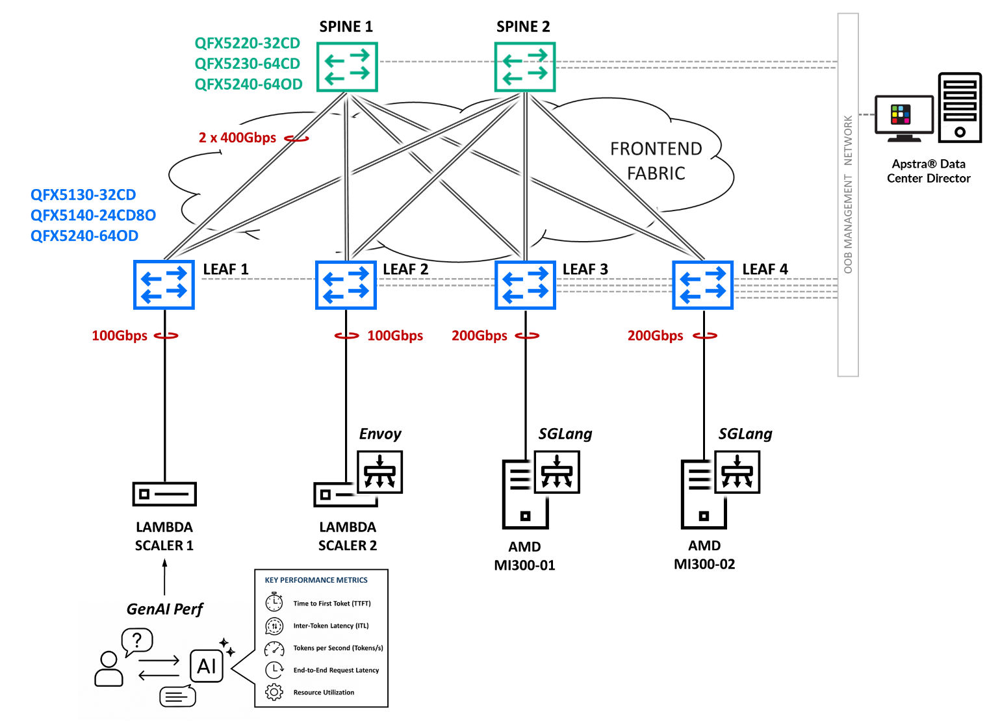

# Configuration Snippets (snips)

This `snips/` directory contains **focused, templated configuration excerpts**
extracted from the validated device configurations in [`../conf/`](../conf/).
Each file isolates one construct — a fabric link, an access port or breakout, an
IRB gateway, a VLAN, the eBGP underlay group, a routing policy or community, or a
system service — so it can be read, compared and adapted on its own. Every body
is measured against the source: the `Count:` header is the number of exact
source instances the template reproduces on each device.

## Topology



A 3-stage IP Clos frontend fabric managed by Juniper Apstra: four leaves
(`leaf1`–`leaf4`, QFX5130-32CD) and two spines (`spine1`, `spine2`,
QFX5220-32CD), all running **Junos OS Evolved**, joined by point-to-point /31
links with a pure IPv4 eBGP underlay (one AS per device, BFD, per-packet load
balancing). There is **no** EVPN/VXLAN overlay in this design. The client-facing
leaves (`leaf1`, `leaf2`) attach the Lambda Scaler client and load-balancer
hosts; the GPU-facing leaves (`leaf3`, `leaf4`) attach the AMD Instinct MI300X
inference servers; each leaf gives its hosts one VLAN with an IRB gateway.
Device tokens in snippet headers are the file names in `../conf/` (for example
`leaf1_qfx5130-32cd`, `spine2_qfx5220-32cd`).

## Layout

```
snips/
  evo/          ← Junos OS Evolved forms (QFX5130-32CD, QFX5220-32CD)
```

35 snippet files, all EVO.

| Sub-folder | What's in it |
|---|---|
| `interfaces/` | Fabric links and their /31 units, breakout ports, access ports and their trunk or Layer 3 units, the IRB interface and unit, and the loopback. |
| `vlans/` | The frontend cluster VLAN with its IRB Layer 3 interface. |
| `protocols/` | BGP global options, the leaf and spine eBGP underlay groups, LLDP, RSTP and Layer 2 learning telemetry. |
| `policy-options/` | The direct-route, export, spine-tier tagging and per-packet load-balancing policies, and their communities. |
| `routing-options/` | Router ID, AS, graceful restart and the forwarding-table load-balance export. |
| `system/`, `security/` | Host name, management instance, the gRPC service over SSL and its local certificate. |

## Snippet headers

Every snippet starts with a C-style header whose fields follow the repository
snippet contract:

- **`Seen on:`** — every validated device whose configuration reproduces this
  exact template, split by OS. Shared applicability is not a peer relationship.
- **`Count:`** — distinct source instances of the template per device and in
  total, generated from [`_bindings.json`](_bindings.json); never hand-edited.
- **`Pair with:`** — directed, required same-device dependencies measured from
  the source: named objects a snippet references by a fixed name (here the
  `FROM_SPINE_FABRIC_TIER` community). Dependencies that go through a template
  value are listed as Needs in the BYOAI bundle.
- **`Peers with:`** — `n/a` for local constructs. Constructs whose peer
  cannot be verified from the configurations carry no claim: see Scope.

## Templated values — `$VAR` placeholders

Deployment-specific values (loopbacks, addresses, AS numbers, interface, VLAN,
group, policy, term and community names, VLAN IDs, ports) appear as `$VAR`
placeholders. Design constants and the names other configuration references by
name are left literal. Each header lists the placeholders it uses with example
values from a validated device; the full glossary is
[`_variables.md`](_variables.md).

## Source examples

[`_bindings.md`](_bindings.md) summarises, and [`_bindings.json`](_bindings.json)
records in full, the exact source instances and variable bindings each template
reproduces. Example values in headers are illustrative; the bindings are the
evidence.

## Scope

Snippets reproduce the active configuration of the six design devices. The
software version stamp of each device is excluded
([`_source-exclusions.json`](_source-exclusions.json)); the published
configurations contain no `traceoptions` and no deactivated configuration.

### Known limitations of the published configurations

- **Management instance.** leaf3 carries no `management-instance` statement;
  the other devices do.
- **gRPC certificate.** The local certificate's key is sanitized in the
  published configurations; supply your own certificate and key.
- **Peers.** The eBGP underlay groups carry verified leaf–spine peer groups.
  System, LLDP, RSTP, Layer 2 learning, VLAN and BGP global constructs have no
  peer rule and carry no claim.
- **Building blocks.** Snippets are building blocks, not complete device
  configurations. The device configurations under [`../conf/`](../conf/) are the
  as-captured reference.

## Topic index

Totals are source instances across all devices.

| Topic | What it shows |
|---|---|
| `evo/interfaces/ifd-breakout-description-10g.conf` | Port broken out into 10-Gbps sub-ports, with a description (1) |
| `evo/interfaces/ifd-breakout-description-400g.conf` | Port broken out into 400-Gbps sub-ports, with a description (4) |
| `evo/interfaces/ifd-description-100g-unit-0-inet.conf` | 100-Gbps access port with a description and an IPv4 address on unit 0 (2) |
| `evo/interfaces/ifd-description-mtu-9216.conf` | Physical interface with a description and a 9216-byte MTU (32) |
| `evo/interfaces/ifd-description-native-vlan-mtu-9216.conf` | Access port with a description, a native VLAN and a 9216-byte MTU (3) |
| `evo/interfaces/ifl-core-inet-mtu-9170.conf` | Unit 0 with an IPv4 address and a 9170-byte family MTU on a fabric link (32) |
| `evo/interfaces/ifl-ethernet-switching-trunk-1-vlan.conf` | Unit 0 as an Ethernet-switching trunk carrying one VLAN (3) |
| `evo/interfaces/ifl-loopback-inet.conf` | Loopback unit with one IPv4 address (6) |
| `evo/interfaces/irb-inet-mtu-9000.conf` | IRB unit with an IPv4 gateway address and a 9000-byte family MTU (3) |
| `evo/interfaces/irb-mtu-9216.conf` | IRB interface with a 9216-byte MTU (3) |
| `evo/policy-options/community/community-2-members.conf` | Community with two standard members (6) |
| `evo/policy-options/community/from-spine-fabric-tier.conf` | FROM_SPINE_FABRIC_TIER: the community that marks routes advertised by the spine tier (6) |
| `evo/policy-options/policy-statement/per-packet-load-balance-no-term.conf` | Per-packet load-balancing policy without terms (6) |
| `evo/policy-options/policy-statement/ps-add-from-spine-tier-accept.conf` | Spine export policy that tags every route FROM_SPINE_FABRIC_TIER and accepts it (2) |
| `evo/policy-options/policy-statement/ps-direct-inet-community-add-reject.conf` | Policy that accepts direct IPv4 routes with a community added and rejects everything else (6) |
| `evo/policy-options/policy-statement/ps-from-policy-accept-reject.conf` | Export policy that accepts the routes another policy accepts and rejects everything else (4) |
| `evo/policy-options/policy-statement/ps-from-policy-bgp-accept-reject.conf` | Export policy that accepts the routes another policy accepts and BGP routes, and rejects everything else (2) |
| `evo/policy-options/policy-statement/ps-reject-bgp-from-spine-tier-accept.conf` | Leaf export policy that rejects BGP routes tagged FROM_SPINE_FABRIC_TIER and accepts everything else (4) |
| `evo/protocols/bgp-group-ebgp-underlay-4-peers-bfd-export-2-policies.conf` | Leaf eBGP underlay group with four directly connected spine peers, a two-policy export chain, BFD at 1000 ms and multiple-AS multipath (4) |
| `evo/protocols/bgp-group-ebgp-underlay-8-peers-bfd-export-2-policies.conf` | Spine eBGP underlay group with eight directly connected leaf peers, a two-policy export chain, BFD at 1000 ms and multiple-AS multipath (2) |
| `evo/protocols/bgp-log-updown-multipath-graceful-restart.conf` | BGP global options: log-updown, multipath, and graceful restart without helping on shared-fate BFD down (6) |
| `evo/protocols/l2-learning-telemetry-remote-entries.conf` | Layer 2 learning telemetry that includes remote entries (4) |
| `evo/protocols/lldp-interface-all-port-id-interface-name.conf` | LLDP on all interfaces with the interface name as port ID and the interface description as port description (6) |
| `evo/protocols/rstp-bridge-priority-0-bpdu-block-on-edge.conf` | RSTP with bridge priority 0 and BPDU block on edge ports (4) |
| `evo/protocols/rstp-disable.conf` | RSTP disabled (2) |
| `evo/protocols/rstp-interface-edge.conf` | RSTP edge port (3) |
| `evo/routing-options/autonomous-system.conf` | Device autonomous-system number (6) |
| `evo/routing-options/forwarding-table-pplb-ecmp-fast-reroute.conf` | Forwarding-table export of the per-packet load-balancing policy, with ECMP fast reroute (6) |
| `evo/routing-options/graceful-restart.conf` | Graceful restart (6) |
| `evo/routing-options/router-id.conf` | Transport router identity (6) |
| `evo/security/certificates-local.conf` | Local certificate and private key used by the gRPC SSL service (6) |
| `evo/system/host-name.conf` | System host name (6) |
| `evo/system/management-instance.conf` | Dedicated management routing instance (mgmt_junos) for the management interface and services (5) |
| `evo/system/services-grpc-ssl-local-certificate-mgmt-junos.conf` | gRPC request-response extension service over SSL in the management instance, using a local certificate (6) |
| `evo/vlans/vlan-description-vlan-id-l3-interface.conf` | VLAN with a description, a VLAN ID and an IRB Layer 3 interface (4) |
