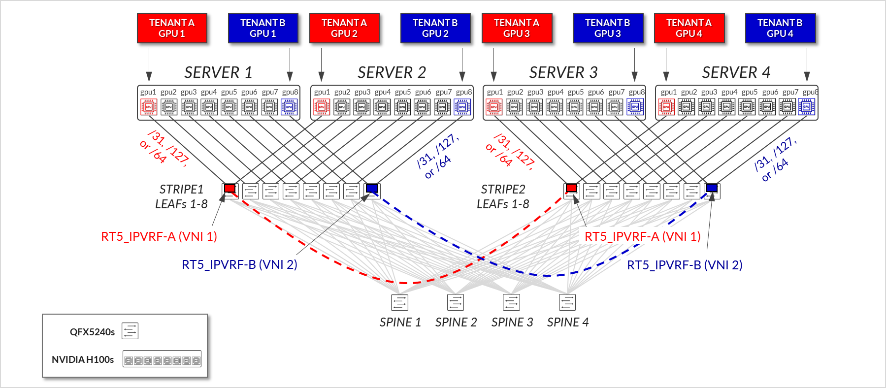

# Configuration Snippets (snips)

This `snips/` directory contains **focused, templated configuration excerpts**
extracted from the validated device configurations in [`../conf/`](../conf/).
Each file isolates one construct — a fabric link, a GPU server link or breakout, a
tenant VRF, an eBGP underlay or EVPN overlay group, a class-of-service object, a
routing policy or community, or a system service — so it can be read, compared
and adapted on its own. Every body
is measured against the source: the `Count:` header is the number of exact
source instances the template reproduces on each device.

## Topology



A 3-stage IP Clos GPU backend fabric managed by Juniper Apstra: four leaves
(`leaf1`–`leaf4`) and four spines (`spine1`–`spine4`), all QFX5240-64OD
running **Junos OS Evolved**, joined by two point-to-point /31 links between
every leaf and spine. An eBGP underlay (one AS per device, BFD) carries an eBGP
EVPN overlay between the leaf and spine loopbacks. Each leaf gives every tenant
an EVPN Type 5 VRF (IP prefix routes over VXLAN) on its GPU server links, with a
lossless RoCEv2 class of service (PFC, ECN and congestion notification) and
dynamic load balancing in flowlet mode. Device tokens in snippet headers are the
file names in `../conf/` (for example `leaf1_qfx5240-64od`,
`spine2_qfx5240-64od`).

## Layout

```
snips/
  evo/          ← Junos OS Evolved forms (QFX5240-64OD)
```

56 snippet files, all EVO.

| Sub-folder | What's in it |
|---|---|
| `interfaces/` | Fabric links and their /31 units, breakout ports, GPU server and tester links and their units, unused ports, the IRB interface and units, and the loopback units. |
| `routing-instances/` | The per-tenant EVPN Type 5 VRFs (`l3vpn/`) and the management instance's default route. |
| `class-of-service/` | The lossless RoCEv2 model: DSCP classifier, forwarding classes, congestion notification profile, drop profile, schedulers and scheduler map, shared and dedicated buffers, and their binding on every interface. |
| `protocols/` | BGP global options, the eBGP underlay group, the leaf and spine EVPN overlay groups, IPv6 router advertisements, LLDP, RSTP and Layer 2 learning telemetry. |
| `policy-options/` | The direct-route, export, EVPN Type 5 export, spine-tier tagging and per-packet load-balancing policies, and their communities. |
| `routing-options/`, `forwarding-options/` | Router ID, AS, graceful restart, the forwarding-table load-balance export, and the hash keys and dynamic load balancing. |
| `system/`, `security/`, `chassis/` | Host name, management instance, DDoS protection, NETCONF and the gRPC service over SSL, its local certificate, and the FPC buffer monitor. |

## Snippet headers

Every snippet starts with a C-style header whose fields follow the repository
snippet contract:

- **`Seen on:`** — every validated device whose configuration reproduces this
  exact template, split by OS. Shared applicability is not a peer relationship.
- **`Count:`** — distinct source instances of the template per device and in
  total, generated from [`_bindings.json`](_bindings.json); never hand-edited.
- **`Pair with:`** — directed, required same-device dependencies measured from
  the source: named objects a snippet references by a fixed name (here the
  `FROM_SPINE_FABRIC_TIER` and `FROM_SPINE_EVPN_TIER` communities, and the
  class-of-service objects of the lossless model). Dependencies that go through a
  template value are listed as Needs in the BYOAI bundle.
- **`Peers with:`** — `n/a` for local constructs. Constructs whose peer
  cannot be verified from the configurations carry no claim: see Scope.

## Templated values — `$VAR` placeholders

Deployment-specific values (loopbacks, addresses, AS numbers, interface, instance,
group, policy, term and community names, VNIs, route distinguishers and targets,
ports) appear as `$VAR`
placeholders. Design constants and the names other configuration references by
name are left literal. Each header lists the placeholders it uses with example
values from a validated device; the full glossary is
[`_variables.md`](_variables.md).

## Source examples

[`_bindings.md`](_bindings.md) summarises, and [`_bindings.json`](_bindings.json)
records in full, the exact source instances and variable bindings each template
reproduces. Example values in headers are illustrative; the bindings are the
evidence.

## Scope

Snippets reproduce the active configuration of the eight design devices; nothing
is excluded ([`_source-exclusions.json`](_source-exclusions.json) is empty). The
published configurations contain no software version stamp, no `traceoptions`
and no deactivated configuration.

### Known limitations of the published configurations

- **Underlay addressing.** The published configurations number the eBGP
  underlay with IPv4 /31 addresses; the design documentation describes an IPv6
  link-local (unnumbered) underlay. The snippets follow the published
  configurations.
- **IRB units.** The leaves carry IRB units that no VLAN or routing instance
  references.
- **gRPC certificate.** The local certificate's key is sanitized in the
  published configurations; supply your own certificate and key.
- **Peers.** The eBGP underlay and EVPN overlay groups carry verified
  leaf–spine peer groups. System, LLDP, RSTP, router advertisement, Layer 2
  learning, tenant VRF and BGP global constructs have no peer rule and carry no
  claim.
- **Building blocks.** Snippets are building blocks, not complete device
  configurations. The device configurations under [`../conf/`](../conf/) are the
  as-captured reference.

## Topic index

Totals are source instances across all devices.

| Topic | What it shows |
|---|---|
| `evo/chassis/fpc-traffic-manager-buffer-monitor.conf` | Traffic-manager buffer monitoring on an FPC (8) |
| `evo/class-of-service/classifiers/cl-dscp-cnp-no-loss.conf` | DSCP classifier for the CNP and NO-LOSS forwarding classes (8) |
| `evo/class-of-service/congestion-notification-profile/cnp-pfc-watchdog.conf` | Congestion notification profile: PFC watchdog, PFC on the lossless DSCP code point, and IEEE 802.1p flow control on queue 4 (8) |
| `evo/class-of-service/dedicated-buffer.conf` | Dedicated buffer: 15 percent ingress, 30 percent egress (8) |
| `evo/class-of-service/drop-profiles/dp-interpolate-55-90.conf` | Drop profile whose drop probability rises from 0 to 100 percent between 55 and 90 percent buffer fill (8) |
| `evo/class-of-service/forwarding-classes/fc-cnp-no-loss.conf` | Forwarding classes CNP (queue 3) and NO-LOSS (queue 4, lossless, PFC priority 3) (8) |
| `evo/class-of-service/interfaces/ifd-all-et-cnp-scheduler-map-dscp-classifier.conf` | CoS on every et- interface: congestion notification profile, scheduler map and DSCP classifier on every unit (8) |
| `evo/class-of-service/scheduler-maps/sm-cnp-no-loss.conf` | Scheduler map for the CNP and NO-LOSS forwarding classes (8) |
| `evo/class-of-service/schedulers/schedulers-ecn-strict-high.conf` | Schedulers: explicit congestion notification with a drop profile for lossless traffic, strict-high priority at 5 percent for CNP (8) |
| `evo/class-of-service/shared-buffer-lossless-lossy.conf` | Shared buffer partitions for lossless, lossless-headroom and lossy traffic (8) |
| `evo/forwarding-options/enhanced-hash-key-ecmp-dlb-flowlet.conf` | ECMP dynamic load balancing in flowlet mode for IPv4 and IPv6, with reassignment thresholds and a sampling rate (8) |
| `evo/forwarding-options/hash-key-inet-layer-3-layer-4.conf` | Load-balancing hash key for IPv4 traffic: Layer 3 and Layer 4 fields (8) |
| `evo/interfaces/ifd-breakout-description-400g.conf` | Port broken out into 400-Gbps sub-ports, with a description (68) |
| `evo/interfaces/ifd-description-mtu-9192.conf` | Access port with a description and a 9192-byte MTU (8) |
| `evo/interfaces/ifd-description-mtu-9216.conf` | Physical interface with a description and a 9216-byte MTU (96) |
| `evo/interfaces/ifl-core-inet-mtu-9170.conf` | Unit 0 with an IPv4 address and a 9170-byte family MTU on a fabric link (64) |
| `evo/interfaces/ifl-loopback-inet-inet6.conf` | Loopback unit with one IPv4 and one IPv6 address (24) |
| `evo/interfaces/ifl-unit-0-inet-inet6.conf` | Unit 0 with an IPv4 address and family inet6 (8) |
| `evo/interfaces/ifl-unit-0-inet-mtu-9170-inet6.conf` | Unit 0 with an IPv4 address and a 9170-byte family MTU, and family inet6, on a GPU server link (32) |
| `evo/interfaces/ifl-unit-0-inet-no-address.conf` | Unit 0 with family inet and no address, on a port that carries no traffic in the design (520) |
| `evo/interfaces/irb-inet-mtu-9000-mac.conf` | IRB unit with an IPv4 gateway address, a 9000-byte family MTU and a MAC address (73) |
| `evo/interfaces/irb-mtu-9216.conf` | IRB interface with a 9216-byte MTU (4) |
| `evo/policy-options/community/community-2-members.conf` | Community with two standard members (56) |
| `evo/policy-options/community/from-spine-evpn-tier.conf` | FROM_SPINE_EVPN_TIER: the community that marks routes advertised by the spine EVPN tier (8) |
| `evo/policy-options/community/from-spine-fabric-tier.conf` | FROM_SPINE_FABRIC_TIER: the community that marks routes advertised by the spine tier (8) |
| `evo/policy-options/policy-statement/per-packet-load-balance-no-term.conf` | Per-packet load-balancing policy without terms (8) |
| `evo/policy-options/policy-statement/ps-accept.conf` | Export policy with one term that accepts every route (4) |
| `evo/policy-options/policy-statement/ps-add-from-spine-evpn-tier-accept.conf` | Spine EVPN export policy that tags every route FROM_SPINE_EVPN_TIER and accepts it (4) |
| `evo/policy-options/policy-statement/ps-add-from-spine-tier-accept.conf` | Spine export policy that tags every route FROM_SPINE_FABRIC_TIER and accepts it (4) |
| `evo/policy-options/policy-statement/ps-direct-inet-inet6-community-add-reject.conf` | Policy that accepts direct IPv4 and IPv6 routes, each with a community added, and rejects everything else (28) |
| `evo/policy-options/policy-statement/ps-from-policy-bgp-accept-reject.conf` | Export policy that accepts the routes another policy accepts and BGP routes, and rejects everything else (4) |
| `evo/policy-options/policy-statement/ps-from-policy-evpn-host-routes-accept-reject.conf` | Export policy that accepts the routes another policy accepts and EVPN IPv4 /32 and IPv6 /128 host routes, and rejects everything else (4) |
| `evo/policy-options/policy-statement/ps-from-policy-evpn-host-routes-community-add-reject.conf` | EVPN Type 5 export policy that accepts the routes another policy accepts, adds a community to EVPN IPv4 /32 and IPv6 /128 host routes, and rejects everything else (20) |
| `evo/policy-options/policy-statement/ps-reject-bgp-from-spine-evpn-tier-accept.conf` | Leaf EVPN export policy that rejects BGP routes tagged FROM_SPINE_EVPN_TIER and accepts every other route (4) |
| `evo/policy-options/policy-statement/ps-reject-bgp-from-spine-tier-accept.conf` | Leaf export policy that rejects BGP routes tagged FROM_SPINE_FABRIC_TIER and accepts every other route (4) |
| `evo/protocols/bgp-group-ebgp-evpn-overlay-4-peers-bfd-export-1-policy.conf` | Spine eBGP EVPN overlay group with four leaf loopback peers, BFD and one export policy (4) |
| `evo/protocols/bgp-group-ebgp-evpn-overlay-4-peers-bfd-export-2-policies.conf` | Leaf eBGP EVPN overlay group with four spine loopback peers, BFD and a two-policy export chain (4) |
| `evo/protocols/bgp-group-ebgp-underlay-8-peers-bfd-export-2-policies.conf` | eBGP underlay group with eight directly connected peers (two links to each of four peer devices), BFD and a two-policy export chain (8) |
| `evo/protocols/bgp-log-updown-graceful-restart-multipath.conf` | BGP global options: log-updown, graceful restart without helping on shared-fate BFD down, and multipath (8) |
| `evo/protocols/l2-learning-telemetry-enable-remote-entries.conf` | Layer 2 learning telemetry that includes remote entries (4) |
| `evo/protocols/lldp-interface-all-port-id-interface-name.conf` | LLDP on all interfaces with the interface name as port ID and the interface description as port description (8) |
| `evo/protocols/router-advertisement-interface.conf` | IPv6 router advertisements on one interface, with 30-second maximum and 10-second minimum intervals (32) |
| `evo/protocols/rstp-disable.conf` | RSTP disabled (4) |
| `evo/routing-instances/l3vpn/ri-vrf-evpn-type-5-2-ac.conf` | EVPN Type 5 VRF with two server links and a loopback unit (12) |
| `evo/routing-instances/l3vpn/ri-vrf-evpn-type-5-4-ac.conf` | EVPN Type 5 VRF with four server links and a loopback unit (4) |
| `evo/routing-instances/mgmt-junos-static-default-route.conf` | Management instance (mgmt_junos) static default route (4) |
| `evo/routing-options/autonomous-system.conf` | Device autonomous-system number (8) |
| `evo/routing-options/forwarding-table-pplb-ecmp-fast-reroute-chained-composite-evpn.conf` | Forwarding-table export of the per-packet load-balancing policy, with ECMP fast reroute and ingress chained composite next hops for EVPN (4) |
| `evo/routing-options/forwarding-table-pplb-ecmp-fast-reroute.conf` | Forwarding-table export of the per-packet load-balancing policy, with ECMP fast reroute (4) |
| `evo/routing-options/graceful-restart.conf` | Graceful restart (8) |
| `evo/routing-options/router-id.conf` | Transport router identity (8) |
| `evo/security/certificates-local.conf` | Local certificate and private key used by the gRPC SSL service (8) |
| `evo/system/ddos-protection-resolve-aggregate-disable-fpc.conf` | DDoS protection for resolve traffic: the aggregate policer is not enforced per FPC (disable-fpc) (8) |
| `evo/system/host-name.conf` | System host name (8) |
| `evo/system/management-instance.conf` | Dedicated management routing instance (mgmt_junos) for the management interface and services (8) |
| `evo/system/services-netconf-ssh-grpc-ssl-local-certificate-mgmt-junos.conf` | NETCONF over SSH, and the gRPC request-response extension service over SSL in the management instance, using a local certificate (8) |
