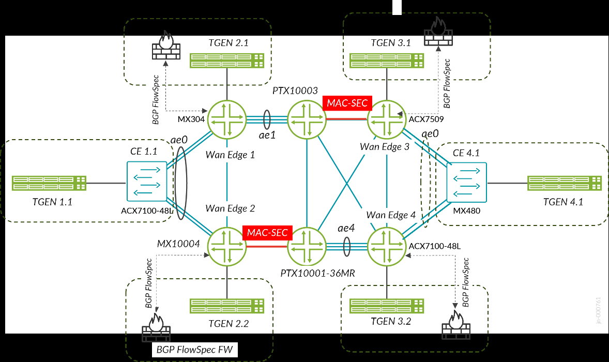

# Configuration Snippets (snips)

This `snips/` directory contains **focused, templated configuration excerpts**
extracted from the validated device configurations in [`../conf/`](../conf/).
Each file isolates one construct — an EVPN-VPWS, flexible cross-connect, EVPN-ELAN
or EVPN Type 5 routing instance, an interface or unit form, a class-of-service
map, a firewall filter, a policy, an OSPF, segment routing, LDP, MPLS or BGP form —
so it can be read, compared and adapted without reading a hundred-thousand-line
WAN edge configuration. Every body is measured against the source: the
`Count:` header is the number of exact source instances the template
reproduces on each device.

## Topology



Device tokens in snippet headers are the file names in `../conf/`:
`wanedge1_mx304`, `wanedge2_mx10004`, `wanedge3_acx7509`, `wanedge4_acx7100-48l`
(WAN edge PEs), `p1_ptx10003`, `p2_ptx10001-36mr` (core P routers and route
reflectors) and `ce1_acx7100-48l`, `ce4_mx480` (L2-mode helper switches).

## Layout

```
snips/
  junos/        ← Junos OS forms (MX304, MX10004 WAN edges; MX480 helper switch)
  evo/          ← Junos Evolved forms (ACX7509, ACX7100-48L, PTX10003, PTX10001-36MR)
```

186 snippet files: 79 Junos, 107 EVO; 47 constructs have
byte-identical Junos and EVO forms registered as OS-scoped mirrors in
[`_snip-library.json`](_snip-library.json).

| Sub-folder | What's in it |
|---|---|
| `routing-instances/evpn-vpws/` | EVPN-VPWS with control word and EVPN flexible cross-connect (VLAN-aware, two attachment circuits). |
| `routing-instances/evpn-elan/` | EVPN-ELAN: Junos EVPN instances and EVO MAC-VRFs with one or two attachment circuits, and with an IRB gateway. |
| `routing-instances/l3vpn/` | EVPN Type 5 IP-prefix VRFs. |
| `interfaces/` | Port, aggregate and LAG-member forms; VLAN bridge, cross-connect (all-active ESI), routed, IRB and filter units; core links; loopbacks. |
| `class-of-service/` | Forwarding-class models, classifier and rewrite-rule maps, drop profiles and the unit bindings of classifiers and rewrite rules. |
| `protocols/` | OSPF backbone and scale-area forms, OSPF segment routing and LFA options, OSPFv3 areas, LDP and MPLS forms, iBGP overlay (WAN edge and route-reflector forms), Ethernet CFM and performance monitoring, LLDP, L2 learning. |
| `firewall/` | Filter-based forwarding filters on TCP ports and on source or destination addresses. |
| `policy-options/` | Export, load-balancing and next-hop policies. |
| `bridge-domains/`, `vlans/` | Helper-switch bridge domains (Junos) and VLANs (EVO). |
| `chassis/`, `forwarding-options/`, `routing-options/` | Line-card port speeds, aggregated device count, enhanced-IP mode, hash keys, router identity, forwarding-table load balancing, BGP flow specification routes, segment routing mapping server. |

## Snippet headers

Every snippet starts with a C-style header whose fields follow the repository
snippet contract:

- **`Seen on:`** — every validated device whose configuration reproduces this
  exact template, split by OS. Shared applicability is not a peer relationship.
- **`Count:`** — distinct source instances of the template per device and in
  total, generated from [`_bindings.json`](_bindings.json); never hand-edited.
- **`Pair with:`** — directed, required same-device dependencies: the snippet
  that defines a named object this one uses (a unit, a classifier, a
  forwarding-class model or a policy). A reference that several forms can satisfy is not listed.
- **`Peers with:`** — the validated devices this construct's configured
  relationships connect (Ethernet-segment pairs, iBGP sessions, EVPN-VPWS and
  flexible cross-connect endpoints), or `n/a` for local constructs.

## Templated values — `$VAR` placeholders

Deployment-specific values (loopbacks, RD/RT subfields, instance names,
attachment units, VLANs, VPWS service identifiers, addresses, filter and
flow-route match values) appear as `$VAR` placeholders. Names that other
configuration refers to by one fixed spelling and design constants are left
literal. Each header lists the placeholders it uses with example values from a
validated device; the full glossary is [`_variables.md`](_variables.md).

## Source examples

[`_bindings.md`](_bindings.md) summarises, and [`_bindings.json`](_bindings.json)
records in full, the exact source instances and variable bindings each template
reproduces. Example values in headers are illustrative; the bindings are the
evidence.

## Scope

Snippets reproduce the active configuration of the eight design devices.
`traceoptions` are not modelled; each of the 4 `traceoptions`
blocks is recorded with its source location in `_source-exclusions.json`.

### Known limitations of the published configurations

- **MACsec.** The published configurations carry no MACsec configuration.
- **Hierarchical QoS.** wanedge1 and wanedge2 enable `hierarchical-scheduler` on
  one port each, but the published configurations carry no schedulers or
  traffic-control profiles. No HQoS snippet is offered.
- **Class of service.** wanedge2's EXP classifier maps code point 001 to
  BEST-EFFORT and 000 to LOW, the reverse of the other routers; the snippet
  reproduces it as configured.
- **Building blocks.** Snippets are building blocks, not complete device
  configurations. The device configurations under [`../conf/`](../conf/) are the
  as-captured reference.

## Topic index

Totals are source instances across all devices; OS mirrors are listed once per
OS.

| Topic | What it shows |
|---|---|
| `junos/bridge-domains/bridge-domain-vlan-2-interfaces.conf` | VLAN bridge domain with two units (2,500) |
| `evo/chassis/aggregated-devices-ethernet.conf` | Aggregated Ethernet device count (5) |
| `junos/chassis/aggregated-devices-ethernet.conf` | Aggregated Ethernet device count (3) |
| `junos/chassis/fpc-mx10004-2-pic-100g.conf` | MX10004 line card port speeds (1) |
| `junos/chassis/fpc-mx304-8x100g-2x4x10g.conf` | MX304 line card port speeds (1) |
| `evo/chassis/fpc-ptx10003-port-speeds-100g-40g.conf` | PTX10003 line card port speeds (1) |
| `evo/chassis/network-services-enhanced-ip.conf` | Enhanced-IP network services mode (4) |
| `junos/chassis/network-services-enhanced-ip.conf` | Enhanced-IP network services mode (2) |
| `junos/class-of-service/classifiers/cl-dscp-exp-ieee8021p-7class-exp-be-001.conf` | DSCP, EXP and IEEE 802.1p classifiers for seven forwarding classes, EXP 001 to BEST-EFFORT (1) |
| `evo/class-of-service/classifiers/cl-dscp-exp-ieee8021p-7class.conf` | DSCP, EXP and IEEE 802.1p classifiers for seven forwarding classes (1) |
| `evo/class-of-service/classifiers/cl-dscp-exp-ieee8021p-8class.conf` | DSCP, EXP and IEEE 802.1p classifiers for eight forwarding classes (1) |
| `junos/class-of-service/classifiers/cl-dscp-exp-ieee8021p-8class.conf` | DSCP, EXP and IEEE 802.1p classifiers for eight forwarding classes (1) |
| `evo/class-of-service/classifiers/cl-exp-8class.conf` | MPLS EXP classifier for eight forwarding classes (2) |
| `evo/class-of-service/drop-profiles/drop-profiles-fill-level.conf` | Two fill-level drop profiles (1) |
| `junos/class-of-service/drop-profiles/drop-profiles-fill-level.conf` | Two fill-level drop profiles (1) |
| `evo/class-of-service/forwarding-classes/fc-7queue-model.conf` | Seven forwarding classes on seven queues (1) |
| `junos/class-of-service/forwarding-classes/fc-7queue-model.conf` | Seven forwarding classes on seven queues (1) |
| `evo/class-of-service/forwarding-classes/fc-8queue-model.conf` | Eight forwarding classes on eight queues (3) |
| `junos/class-of-service/forwarding-classes/fc-8queue-model.conf` | Eight forwarding classes on eight queues (1) |
| `evo/class-of-service/interfaces/ifl-dscp-classifier.conf` | DSCP classifier on a logical interface (650) |
| `junos/class-of-service/interfaces/ifl-dscp-classifier.conf` | DSCP classifier on a logical interface (650) |
| `evo/class-of-service/interfaces/ifl-exp-classifier-rewrite-ieee8021p-rewrite.conf` | EXP classifier with EXP and 802.1p rewrite on a logical interface (6) |
| `junos/class-of-service/interfaces/ifl-exp-classifier-rewrite-ieee8021p-rewrite.conf` | EXP classifier with EXP and 802.1p rewrite on a logical interface (1) |
| `evo/class-of-service/interfaces/ifl-exp-classifier-rewrite.conf` | Per-unit EXP classifier and rewrite application (8) |
| `junos/class-of-service/interfaces/ifl-exp-classifier-rewrite.conf` | Per-unit EXP classifier and rewrite application (2) |
| `junos/class-of-service/interfaces/ifl-exp-classifier.conf` | EXP classifier on a logical interface (1) |
| `evo/class-of-service/interfaces/ifl-ieee8021p-classifier.conf` | Per-unit 802.1p classifier application (4,950) |
| `junos/class-of-service/interfaces/ifl-ieee8021p-classifier.conf` | IEEE 802.1p classifier on a logical interface (4,950) |
| `evo/class-of-service/rewrite-rules/rr-dscp-exp-ieee8021p-8class.conf` | DSCP, EXP and IEEE 802.1p rewrite rules for eight forwarding classes (1) |
| `junos/class-of-service/rewrite-rules/rr-dscp-exp-ieee8021p-8class.conf` | DSCP, EXP and IEEE 802.1p rewrite rules for eight forwarding classes (1) |
| `evo/class-of-service/rewrite-rules/rr-exp-8class.conf` | MPLS EXP rewrite rule for eight forwarding classes (2) |
| `evo/class-of-service/rewrite-rules/rr-exp-ieee8021p-7class.conf` | EXP and IEEE 802.1p rewrite rules for seven forwarding classes (1) |
| `junos/class-of-service/rewrite-rules/rr-exp-ieee8021p-7class.conf` | EXP and IEEE 802.1p rewrite rules for seven forwarding classes (1) |
| `junos/firewall/filter-destination-address-next-interface.conf` | Filter-based forwarding on destination address to a next interface (2) |
| `junos/firewall/filter-destination-address-next-ip.conf` | Filter-based forwarding on destination address to a next-hop IP address (2) |
| `evo/firewall/filter-interface-specific-destination-address-next-interface.conf` | Interface-specific filter-based forwarding on destination address to a next interface (2) |
| `evo/firewall/filter-interface-specific-destination-address-next-ip.conf` | Interface-specific filter-based forwarding on destination address to a next-hop IP address (2) |
| `evo/firewall/filter-interface-specific-source-address-next-interface.conf` | Interface-specific filter-based forwarding on source address to a next interface (2) |
| `evo/firewall/filter-interface-specific-source-address-next-ip.conf` | Interface-specific filter-based forwarding on source address to a next-hop IP address (2) |
| `evo/firewall/filter-interface-specific-tcp-destination-port-next-interface.conf` | Interface-specific filter-based forwarding on TCP destination port to a next interface (2) |
| `evo/firewall/filter-interface-specific-tcp-destination-port-next-ip.conf` | Interface-specific filter-based forwarding on TCP destination port to a next-hop IP address (2) |
| `evo/firewall/filter-interface-specific-tcp-source-port-next-interface.conf` | Interface-specific filter-based forwarding on TCP source port to a next interface (2) |
| `evo/firewall/filter-interface-specific-tcp-source-port-next-ip.conf` | Interface-specific filter-based forwarding on TCP source port to a next-hop IP address (2) |
| `junos/firewall/filter-source-address-next-interface.conf` | Filter-based forwarding on source address to a next interface (2) |
| `junos/firewall/filter-source-address-next-ip.conf` | Filter-based forwarding on source address to a next-hop IP address (2) |
| `junos/firewall/filter-tcp-destination-port-next-interface.conf` | Filter-based forwarding on TCP destination port to a next interface (2) |
| `junos/firewall/filter-tcp-destination-port-next-ip.conf` | Filter-based forwarding on TCP destination port to a next-hop IP address (2) |
| `junos/firewall/filter-tcp-source-port-next-interface.conf` | Filter-based forwarding on TCP source port to a next interface (2) |
| `junos/firewall/filter-tcp-source-port-next-ip.conf` | Filter-based forwarding on TCP source port to a next-hop IP address (2) |
| `evo/forwarding-options/hash-key-inet-inet6-layer-3-4-multiservice-mac.conf` | Load-balancing hash on layer 3 and 4 for IPv4 and IPv6, MAC addresses for multiservice (2) |
| `junos/forwarding-options/hash-key-inet-inet6-layer-3-4-multiservice-mac.conf` | Load-balancing hash on layer 3 and 4 for IPv4 and IPv6, MAC addresses for multiservice (2) |
| `evo/forwarding-options/hash-key-mpls-all-labels.conf` | Hash key on IPv4/IPv6 layer 3-4, all MPLS labels with IP payload, and Ethernet MACs (3) |
| `junos/interfaces/ifd-ae-description-flexible-lacp-fast-failover-revertive-system-id.conf` | Aggregated Ethernet with fast LACP, fast failover, revertive link protection and system ID (1) |
| `evo/interfaces/ifd-ae-description-flexible-lacp-fast-failover-system-id.conf` | Aggregated Ethernet with fast LACP, fast failover and system ID (1) |
| `evo/interfaces/ifd-ae-description-flexible-lacp-fast-system-id.conf` | Aggregated Ethernet with flexible services, fast LACP and system ID (1) |
| `junos/interfaces/ifd-ae-description-flexible-lacp-fast-system-id.conf` | Aggregated Ethernet with flexible services, fast LACP and system ID (1) |
| `evo/interfaces/ifd-ae-description-flexible-lacp-fast.conf` | Aggregated Ethernet with flexible services and fast LACP (2) |
| `junos/interfaces/ifd-ae-description-flexible-lacp-fast.conf` | Aggregated Ethernet with flexible services and fast LACP (1) |
| `evo/interfaces/ifd-ae-description-flexible-mtu-lacp-fast.conf` | Aggregated Ethernet with flexible services, MTU and fast LACP (1) |
| `evo/interfaces/ifd-ae-description-lacp-fast.conf` | Described aggregated Ethernet bundle with active fast LACP (1) |
| `junos/interfaces/ifd-ae-description-lacp-fast.conf` | Described aggregated Ethernet bundle with active fast LACP (1) |
| `evo/interfaces/ifd-breakout-4x10g.conf` | Four-subport 10G physical interface breakout (2) |
| `evo/interfaces/ifd-core-lag-member-ether-description-100g.conf` | Described 100G physical member of a core aggregated Ethernet bundle (4) |
| `evo/interfaces/ifd-description-100g.conf` | Described 100G port (5) |
| `evo/interfaces/ifd-description-flexible-speed-100g.conf` | Described 100G port with flexible VLAN tagging and flexible Ethernet services (1) |
| `evo/interfaces/ifd-description-speed-40g.conf` | 40G port with a description (1) |
| `evo/interfaces/ifd-description.conf` | Interface description (1) |
| `junos/interfaces/ifd-description.conf` | Interface description (2) |
| `evo/interfaces/ifd-flexible-ethernet-services-description-speed-10g.conf` | 10G port with flexible services (2) |
| `evo/interfaces/ifd-flexible-ethernet-services-description.conf` | Described port with flexible VLAN tagging and flexible Ethernet services (4) |
| `junos/interfaces/ifd-flexible-ethernet-services-description.conf` | Described port with flexible VLAN tagging and flexible Ethernet services (5) |
| `junos/interfaces/ifd-hierarchical-scheduler-flexible-ethernet-services-description.conf` | Port with hierarchical scheduling and flexible services (2) |
| `evo/interfaces/ifd-lag-member-ether-100g.conf` | 100G aggregated Ethernet member link through ether-options (2) |
| `evo/interfaces/ifd-lag-member-ether-description.conf` | Described member link of an aggregated-Ethernet bundle (2) |
| `evo/interfaces/ifd-lag-member-ether.conf` | Aggregated Ethernet member link through ether-options (9) |
| `junos/interfaces/ifd-lag-member-gigether-description.conf` | Described member link of an aggregated-Ethernet bundle (gigether-options) (2) |
| `junos/interfaces/ifd-lag-member-gigether.conf` | Aggregated Ethernet member link through gigether-options (9) |
| `evo/interfaces/ifd-speed-100g.conf` | 100G port speed (1) |
| `evo/interfaces/ifd-speed-10g.conf` | Interface device at 10G (1) |
| `evo/interfaces/ifd-unused.conf` | Port marked unused (3) |
| `evo/interfaces/ifl-core-inet-inet6-mpls.conf` | Core unit with IPv4, IPv6 and MPLS (1) |
| `evo/interfaces/ifl-core-inet-mpls.conf` | Core-facing point-to-point link with IPv4 and MPLS families (12) |
| `junos/interfaces/ifl-core-inet-mpls.conf` | Core-facing point-to-point link with IPv4 and MPLS families (5) |
| `evo/interfaces/ifl-core-vlan-inet-inet6-mpls.conf` | Tagged core unit with IPv4, IPv6 and MPLS (3) |
| `evo/interfaces/ifl-irb-inet.conf` | IRB unit carrying a single IPv4 address (375) |
| `junos/interfaces/ifl-irb-inet.conf` | IRB unit carrying a single IPv4 address (375) |
| `evo/interfaces/ifl-irb-virtual-gateway.conf` | IRB unit acting as an anycast default gateway with a virtual-gateway address (300) |
| `junos/interfaces/ifl-irb-virtual-gateway.conf` | IRB unit with EVPN anycast virtual gateway and accept-data (300) |
| `evo/interfaces/ifl-loopback-inet.conf` | Loopback unit with one IPv4 address (2) |
| `junos/interfaces/ifl-loopback-inet.conf` | Loopback unit with one IPv4 address (1) |
| `evo/interfaces/ifl-vlan-bridge-esi.conf` | Bridged logical interface with EVPN ESI multihoming (1,500) |
| `junos/interfaces/ifl-vlan-bridge-esi.conf` | Bridged logical interface with EVPN ESI multihoming (1,500) |
| `evo/interfaces/ifl-vlan-bridge.conf` | VLAN-tagged bridge unit (7,129) |
| `junos/interfaces/ifl-vlan-bridge.conf` | VLAN-tagged bridge unit (7,128) |
| `evo/interfaces/ifl-vlan-ccc-esi-all-active-family-ccc.conf` | Single-tagged cross-connect logical interface with an all-active ESI (3,400) |
| `junos/interfaces/ifl-vlan-ccc-esi-all-active-family-ccc.conf` | VLAN CCC unit on an all-active Ethernet segment (3,400) |
| `evo/interfaces/ifl-vlan-ccc-family-ccc.conf` | VLAN-tagged circuit cross-connect unit with family ccc (600) |
| `junos/interfaces/ifl-vlan-ccc-family-ccc.conf` | VLAN-tagged circuit cross-connect unit with family ccc (600) |
| `evo/interfaces/ifl-vlan-family-inet-inet6.conf` | VLAN unit with the IPv4 and IPv6 families enabled (100) |
| `evo/interfaces/ifl-vlan-inet-family-inet6.conf` | VLAN unit with an IPv4 address and the IPv6 family enabled (100) |
| `evo/interfaces/ifl-vlan-inet-filter-input.conf` | IPv4 VLAN unit with an input firewall filter (16) |
| `junos/interfaces/ifl-vlan-inet-filter-input.conf` | IPv4 VLAN unit with an input firewall filter (16) |
| `evo/interfaces/ifl-vlan-inet-inet6-rpf-check-loose.conf` | Dual-stack VLAN unit with loose unicast RPF (200) |
| `evo/interfaces/ifl-vlan-inet-inet6.conf` | VLAN unit with IPv4 and IPv6 addresses (400) |
| `junos/interfaces/ifl-vlan-inet-inet6.conf` | VLAN logical interface with IPv4 and IPv6 addresses (400) |
| `junos/interfaces/ifl-vlan-inet-mpls.conf` | VLAN-tagged IPv4 unit with MPLS (1) |
| `evo/interfaces/ifl-vlan-inet.conf` | VLAN-tagged IPv4 unit (24) |
| `junos/interfaces/ifl-vlan-inet.conf` | VLAN-tagged IPv4 unit (24) |
| `evo/policy-options/policy-statement/per-packet-load-balance-accept.conf` | Per-packet load-balancing policy with an explicit accept (3) |
| `junos/policy-options/policy-statement/per-packet-load-balance-accept.conf` | Per-packet load-balancing policy with an explicit accept (1) |
| `junos/policy-options/policy-statement/ps-advertise-loop-direct.conf` | Policy accepting direct routes (advertise-loop) (1) |
| `evo/policy-options/policy-statement/ps-bgp-to-ospf.conf` | Policy bgp-to-ospf accepting BGP routes (2) |
| `junos/policy-options/policy-statement/ps-bgp-to-ospf.conf` | Policy bgp-to-ospf accepting BGP routes (2) |
| `evo/policy-options/policy-statement/ps-nexthop-bgp-next-hop-self.conf` | Next-hop-self for BGP routes (1) |
| `junos/policy-options/policy-statement/ps-pplb-evpn-term-accept.conf` | Per-packet load balancing with an EVPN term (2) |
| `evo/policy-options/policy-statement/ps-pplb-evpn-term.conf` | Per-packet load balancing with an EVPN term (2) |
| `evo/policy-options/policy-statement/ps-send-direct.conf` | Export policy for directly connected routes (2) |
| `junos/policy-options/policy-statement/ps-send-direct.conf` | Export policy for directly connected routes (2) |
| `evo/policy-options/policy-statement/ps-send-ospf.conf` | Policy accepting OSPF routes (3) |
| `junos/policy-options/policy-statement/ps-send-ospf.conf` | Policy accepting OSPF routes (1) |
| `evo/protocols/bgp-advertise-peer-as-graceful-restart.conf` | BGP advertise-peer-as with graceful restart (1) |
| `evo/protocols/bgp-advertise-peer-as.conf` | BGP advertise-peer-as (1) |
| `junos/protocols/bgp-family-inet-unicast-loops.conf` | BGP IPv4 unicast AS-path loops (1) |
| `evo/protocols/bgp-multipath.conf` | BGP multipath (1) |
| `junos/protocols/bgp-overlay-pe-advertise-external-flow-evpn-multipath.conf` | iBGP PE group for IPv4 with flow, and EVPN (1) |
| `junos/protocols/bgp-overlay-pe-flow-evpn-route-target-multipath.conf` | iBGP PE group for IPv4 with flow, EVPN and route-target (1) |
| `evo/protocols/bgp-overlay-pe-flow-evpn-route-target.conf` | iBGP PE group for IPv4 with flow, EVPN and route-target (2) |
| `evo/protocols/bgp-overlay-rr-cluster-evpn-route-target-multipath.conf` | iBGP route reflector for IPv4, EVPN and route-target (1) |
| `evo/protocols/bgp-overlay-rr-cluster-evpn.conf` | iBGP route reflector for IPv4 and EVPN (1) |
| `evo/protocols/l2-learning-global-mac-limit.conf` | Global MAC learning limit (1) |
| `evo/protocols/ldp-interface-3-core-loopback.conf` | LDP on three core links and the loopback (1) |
| `evo/protocols/ldp-interface-core-loopback-sr-mapping-client.conf` | LDP on one core interface and the loopback, segment routing mapping client (3) |
| `evo/protocols/lldp-interface-all.conf` | LLDP enabled on all interfaces (5) |
| `junos/protocols/lldp-interface-all.conf` | LLDP on all interfaces (3) |
| `evo/protocols/mpls-interface-4-core.conf` | MPLS on four core links (2) |
| `junos/protocols/mpls-interface-all.conf` | MPLS on all interfaces (1) |
| `junos/protocols/mpls-te-2-lsp-1-core.conf` | MPLS with traffic engineering, two LSPs and one core interface (1) |
| `junos/protocols/mpls-te-2-lsp-2-core.conf` | MPLS with traffic engineering, two LSPs and two core interfaces (1) |
| `evo/protocols/mpls-te-2-lsp-3-core.conf` | MPLS with traffic engineering, two LSPs and three core interfaces (2) |
| `evo/protocols/oam-cfm-mep-up-auto-discovery.conf` | CFM maintenance domain with an up MEP and automatic remote MEP discovery (350) |
| `junos/protocols/oam-cfm-mep-up-auto-discovery.conf` | CFM maintenance domain with an up MEP and automatic remote MEP discovery (350) |
| `evo/protocols/oam-cfm-perf-mon-two-way-delay-slm.conf` | CFM performance monitoring with two-way delay and synthetic loss iterator profiles (2) |
| `junos/protocols/oam-cfm-perf-mon-two-way-delay-slm.conf` | CFM performance monitoring with two-way delay and synthetic loss iterator profiles (2) |
| `evo/protocols/ospf-area-2-interface-p2p.conf` | OSPF area with two interfaces, one point-to-point (100) |
| `junos/protocols/ospf-area-2-interface-p2p.conf` | OSPF area with two interfaces, one point-to-point (100) |
| `evo/protocols/ospf-area-2-interface.conf` | OSPF area with two interfaces (100) |
| `evo/protocols/ospf-area0-2-p2p-1-ldp-sync-core-loopback.conf` | OSPF backbone area with two point-to-point and one LDP-synchronized core interface (1) |
| `junos/protocols/ospf-area0-2-p2p-core-loopback.conf` | OSPF backbone area with two point-to-point core interfaces (2) |
| `evo/protocols/ospf-area0-3-ldp-sync-core-loopback.conf` | OSPF backbone area with three LDP-synchronized core interfaces (1) |
| `evo/protocols/ospf-area0-3-p2p-1-ldp-sync-core-loopback-mgmt-disable.conf` | OSPF backbone area with core interfaces and management interfaces disabled (1) |
| `evo/protocols/ospf-area0-3-p2p-1-ldp-sync-core-loopback.conf` | OSPF backbone area with three point-to-point and one LDP-synchronized core interface (1) |
| `evo/protocols/ospf-backup-spf-options-traffic-engineering-sr-mapping-server.conf` | OSPF post-convergence LFA, traffic engineering and segment routing with a mapping server (3) |
| `junos/protocols/ospf-backup-spf-options-traffic-engineering-sr.conf` | OSPF post-convergence LFA, traffic engineering and segment routing (2) |
| `evo/protocols/ospf-traffic-engineering.conf` | OSPF traffic-engineering extensions (1) |
| `evo/protocols/ospf3-area-1-interface.conf` | OSPFv3 area with one interface (1) |
| `junos/protocols/ospf3-area-1-interface.conf` | OSPFv3 area with one interface (1) |
| `evo/protocols/ospf3-area-2-interface-p2p.conf` | OSPFv3 area with two interfaces, one point-to-point (100) |
| `junos/protocols/ospf3-area-2-interface-p2p.conf` | OSPFv3 area with two interfaces, one point-to-point (100) |
| `evo/protocols/ospf3-area-2-interface.conf` | OSPFv3 area with two interfaces (102) |
| `junos/protocols/rsvp-interface-all.conf` | RSVP on all interfaces (1) |
| `junos/routing-instances/evpn-elan/ri-evpn-elan-2-uni.conf` | EVPN-ELAN instance with two attachment circuits (1,200) |
| `junos/routing-instances/evpn-elan/ri-evpn-elan-irb-no-normalization.conf` | EVPN-ELAN instance with an IRB gateway, no VLAN normalization (675) |
| `junos/routing-instances/evpn-elan/ri-evpn-elan-no-normalization.conf` | EVPN-ELAN instance with one attachment circuit, no VLAN normalization (550) |
| `evo/routing-instances/evpn-elan/ri-evpn-elan-vlan-based-irb.conf` | EVPN-ELAN VLAN-based MAC-VRF with an IRB gateway (675) |
| `evo/routing-instances/evpn-elan/ri-evpn-elan-vlan-based-no-control-word.conf` | EVPN-ELAN VLAN-based MAC-VRF with one attachment circuit (550) |
| `evo/routing-instances/evpn-elan/ri-evpn-elan-vlan-bundle-2-uni-no-control-word.conf` | EVPN-ELAN VLAN-bundle MAC-VRF with two attachment circuits (1,200) |
| `evo/routing-instances/evpn-vpws/ri-evpn-fxc-vlan-aware-2-uni.conf` | EVPN flexible cross-connect, VLAN-aware, two attachment circuits (1,000) |
| `junos/routing-instances/evpn-vpws/ri-evpn-fxc-vlan-aware-2-uni.conf` | EVPN flexible cross-connect, VLAN-aware, two attachment circuits (1,000) |
| `evo/routing-instances/evpn-vpws/ri-evpn-vpws-control-word.conf` | EVPN-VPWS point-to-point service with control word (2,000) |
| `junos/routing-instances/evpn-vpws/ri-evpn-vpws-control-word.conf` | EVPN-VPWS point-to-point service with control word (2,000) |
| `evo/routing-instances/l3vpn/ri-l3vpn-evpn-ip-prefix-vrf-target.conf` | EVPN Type 5 IP-prefix VRF with vrf-target (675) |
| `junos/routing-instances/l3vpn/ri-l3vpn-evpn-ip-prefix-vrf-target.conf` | EVPN Type 5 IP-prefix VRF with vrf-target (675) |
| `evo/routing-options/autonomous-system.conf` | Autonomous system number (4) |
| `junos/routing-options/autonomous-system.conf` | Autonomous system number (2) |
| `evo/routing-options/flow-route-6-match-accept.conf` | BGP flow specification routes matching source, destination, ports, DSCP and ICMP (2) |
| `junos/routing-options/flow-route-6-match-accept.conf` | BGP flow specification routes matching source, destination, ports, DSCP and ICMP (2) |
| `evo/routing-options/forwarding-table-pplb-chained-nh-evpn.conf` | Forwarding table with per-packet load balancing and EVPN chained composite next hops (1) |
| `junos/routing-options/forwarding-table-pplb-chained-nh-evpn.conf` | Forwarding-table per-packet load balancing with chained composite next hops for EVPN (1) |
| `evo/routing-options/forwarding-table-pplb-evpn-egress-link-protection.conf` | Forwarding table with per-packet load balancing and EVPN egress link protection (1) |
| `evo/routing-options/forwarding-table-pplb.conf` | Forwarding-table per-packet load balancing (3) |
| `junos/routing-options/forwarding-table-pplb.conf` | Forwarding-table per-packet load balancing (2) |
| `evo/routing-options/graceful-restart.conf` | Graceful restart (1) |
| `evo/routing-options/router-id.conf` | Router ID (4) |
| `junos/routing-options/router-id.conf` | Router ID (2) |
| `evo/routing-options/source-packet-routing-mapping-server-entry.conf` | Segment routing mapping server entry for LDP prefixes (3) |
| `evo/vlans/vlan-2-interfaces.conf` | VLAN with two units (2,500) |
