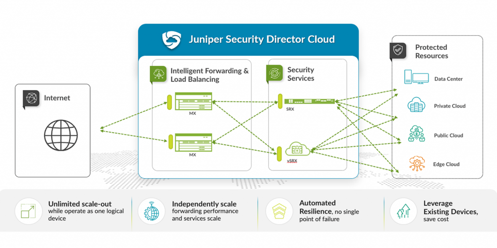

# Configuration Snippets (snips)

This `snips/` directory contains **focused, templated configuration excerpts**
extracted from the validated device configurations in [`../conf/`](../conf/).
Each file isolates one construct — a security subtree of an SRX (zones, policies,
NAT or the global address book), SRX Multinode High Availability, a Traffic Load
Balancer instance or its network-monitoring profiles, a firewall filter, an
interface or unit, a routing instance, a routing policy or a system service — so it
can be read, compared and adapted on its own. Every body is measured against the
source: the `Count:` header is the number of exact source instances the template
reproduces on each device.

## Topology



A scale-out stateful firewall and NAT design: an MX304 (`mx1_mx304`) forwards and
load-balances traffic across four SRX4600 firewalls in two Multinode High
Availability (MNHA) pairs (`srx1a`/`srx1b` and `srx2a`/`srx2b`), in routing
(L3) mode. The MX runs eBGP with BFD to every SRX node in a trust (`TRUST_VR`)
and an untrust (`UNTRUST_VR`) virtual router and an inter-chassis link
instance (`MNHA-VR`). It load-balances either with ECMP and symmetric hashing or
with the Routing Engine based Traffic Load Balancer (TLB) in direct-server-return
mode: firewall filters on the gateway-facing units steer the SFW and NAT client
prefixes into the TLB forwarding instances, and the TLB health-checks each SRX pair
from `lo0` units 1 and 2. Each SRX pair translates into its own NAT pools and
advertises them, with an AS-path prepend that depends on the MNHA signal route, so
return traffic reaches the SRX that holds the session. `gateway_emulator_mx304`
emulates the client-side and Internet-side gateways. Device tokens in snippet
headers are the file names in `../conf/`.

## Layout

```
snips/
  junos/        ← Junos OS forms (MX304, SRX4600); this JVD has no Junos OS Evolved device
```

81 snippet files, all Junos.

| Sub-folder | What's in it |
|---|---|
| `security/` | The SRX security zones, the trust-to-untrust security policies, source NAT (NAPT44 and NAT64 pools) with NAT64 destination NAT, the global address book (two entry orders) and the SIP ALG. Each is one whole subtree. |
| `chassis/` | SRX Multinode High Availability (services-redundancy group 0, BFD monitor, install-on-failure signal route); FPC/PIC port settings, aggregated-device count, enhanced IP and Routing Engine redundancy. |
| `services/` | The four TLB instances (IPv4 and IPv6, trust and untrust), TLB routing-engine mode and the network-monitoring health-check profiles. |
| `firewall/` | The MX filters that redirect the SFW and NAT prefixes into the TLB forwarding instances (IPv4 and IPv6, trust and untrust). |
| `interfaces/` | Aggregated Ethernet interfaces and their members, VLAN units (with the TLB input filters on the gateway-facing units), physical units and the loopback units. |
| `routing-instances/` | The virtual routers (`virtual-router/`: SRX VR-1 and MNHA-VR, MX TRUST_VR, UNTRUST_VR and MNHA-VR, the gateway emulator's TRUST_VR and UNTRUST_VR) and the TLB forwarding instances (`forwarding/`). |
| `policy-options/` | The export policies (including the MNHA signal-route AS-path prepend policies), the load-balancing policies, the MNHA signal-route condition and the NAT-pool route-filter list. |
| `routing-options/`, `forwarding-options/` | AS, forwarding-table load-balance export and nonstop routing; symmetric enhanced hash key. |
| `system/`, `snmp/`, `groups/` | Management services, console log-out, commit synchronization and the SDK service process; the SNMP community and trap group; the `apply-groups` lists. |

## Snippet headers

Every snippet starts with a C-style header whose fields follow the repository
snippet contract:

- **`Seen on:`** — every validated device whose configuration reproduces this
  exact template. Shared applicability is not a peer relationship.
- **`Count:`** — distinct source instances of the template per device and in
  total, generated from [`_bindings.json`](_bindings.json); never hand-edited.
- **`Pair with:`** — directed, required same-device dependencies measured from
  the source: named objects a snippet references by a fixed name (here the
  security zones, the routing instances, the firewall filters, the
  network-monitoring profiles and the loopback units). Dependencies that go
  through a template value (interfaces, policies, the condition, the address-book
  entries, the route-filter list) are listed as Needs in the BYOAI bundle.
- **`Peers with:`** — `n/a` for local constructs. Constructs whose peer
  cannot be verified from the configurations carry no claim: see Scope.

## Templated values — `$VAR` placeholders

Deployment-specific values (addresses, prefixes, interfaces, unit and VLAN
numbers, AS numbers, MNHA node IDs, NAT pool prefixes, TLB real-service
addresses, policy, condition and term names, the SNMP community) appear as
`$VAR` placeholders. The names of security objects and routing instances, which
other configuration references by name, and the design constants are left literal.
Each header lists the placeholders it uses with example values from a validated
device; the full glossary is [`_variables.md`](_variables.md).

## Source examples

[`_bindings.md`](_bindings.md) summarises, and [`_bindings.json`](_bindings.json)
records in full, the exact source instances and variable bindings each template
reproduces. Example values in headers are illustrative; the bindings are the
evidence.

## Scope

Snippets reproduce the active configuration of the 6 device configurations.
Excluded ([`_source-exclusions.json`](_source-exclusions.json)): the software
version stamp of each device (release information of the captured device, not
reusable configuration) and the diagnostic `traceoptions` of the MX Traffic Load
Balancer. The configurations contain no deactivated configuration.

### Known limitations of the published configurations

- **Undefined references.** Every device applies the configuration groups
  `global` and `re0` (the MX304s also `re1`), and the four MX TLB instances
  name `lo0.0` as their interface; the published configurations define none of
  these (18 references). The snippets reproduce the references as configured; the
  BYOAI bundle lists them as not included.
- **NAT scope.** The validation covers NAPT44; the configurations also carry
  NAT64 source and destination NAT, which the snippets reproduce as configured.
- **Peers.** 31 constructs carry no peer claim: the security, TLB,
  network-monitoring, SNMP and system constructs have no peer rule, the
  virtual-router eBGP sessions have no verified peer rule, and the aggregated
  Ethernet interfaces configure no remote LACP actor.
- **Building blocks.** Snippets are building blocks, not complete device
  configurations. The device configurations under [`../conf/`](../conf/) are the
  as-captured reference.

## Topic index

Totals are source instances across all devices.

| Topic | What it shows |
|---|---|
| `junos/chassis/aggregated-devices-ethernet.conf` | Aggregated Ethernet device-count for the chassis (6) |
| `junos/chassis/fpc-pic-0-1-pic-mode-100g-16-ports.conf` | FPC with PICs 0 and 1 in 100G mode, 16 ports each (1) |
| `junos/chassis/fpc-pic-0-1-pic-mode-100g-2-ports.conf` | FPC with PICs 0 and 1 in 100G mode, two ports each (1) |
| `junos/chassis/fpc-pic-0-ports-0-3-100g-pic-1-0-ports.conf` | FPC with ports 0 to 3 of PIC 0 at 100G and PIC 1 set to zero ports (4) |
| `junos/chassis/high-availability-mnha-srg-0-bfd-monitor-install-on-failure-route.conf` | SRX Multinode High Availability (routing mode) with SRG 0, a BFD liveliness monitor and an install-on-failure signal route (4) |
| `junos/chassis/network-services-enhanced-ip.conf` | Enhanced IP chassis network-services mode (2) |
| `junos/chassis/redundancy-graceful-switchover.conf` | Graceful Routing Engine switchover (1) |
| `junos/firewall/filter-ipv6-mx-tlb-lb-trust.conf` | IPv6 filter IPv6_MX_TLB_LB_TRUST: count and redirect the NAT64 and SFW66 source prefixes to the TLB trust forwarding instance, accept the rest (1) |
| `junos/firewall/filter-ipv6-mx-tlb-lb-untrust.conf` | IPv6 filter IPv6_MX_TLB_LB_UNTRUST: count and redirect return traffic to the NAT64 and SFW66 prefixes to the TLB untrust forwarding instance, accept the rest (1) |
| `junos/firewall/filter-mx-tlb-lb-trust.conf` | IPv4 filter MX_TLB_LB_TRUST: count and redirect the NAPT44 and SFW44 source prefixes to the TLB trust forwarding instance, accept the rest (1) |
| `junos/firewall/filter-mx-tlb-lb-untrust.conf` | IPv4 filter MX_TLB_LB_UNTRUST: count and redirect return traffic to the NAPT44 and SFW44 prefixes to the TLB untrust forwarding instance, accept the rest (1) |
| `junos/forwarding-options/enhanced-hash-key-symmetric.conf` | Symmetric enhanced hash key (1) |
| `junos/groups/apply-global-three.conf` | Ordered global three-group application (2) |
| `junos/groups/apply-global-two.conf` | Ordered global two-group application (4) |
| `junos/interfaces/ifd-ae-flexible-vlan-tagging-flexible-ethernet-services-lacp-fast.conf` | Aggregated Ethernet interface with flexible VLAN tagging, flexible Ethernet services and fast active LACP (2) |
| `junos/interfaces/ifd-ae-vlan-tagging-lacp-fast.conf` | Aggregated Ethernet interface with VLAN tagging, one minimum link and fast active LACP (8) |
| `junos/interfaces/ifd-lag-member-gigether.conf` | Aggregated Ethernet member link through gigether-options (20) |
| `junos/interfaces/ifd-mtu-9192.conf` | Physical interface with MTU 9192 (3) |
| `junos/interfaces/ifl-loopback-description-inet-inet6.conf` | Loopback unit with a description and one IPv4 and one IPv6 address (2) |
| `junos/interfaces/ifl-loopback-inet-inet6.conf` | Loopback unit with one IPv4 and one IPv6 address (4) |
| `junos/interfaces/ifl-loopback-inet-primary.conf` | Primary IPv4 loopback address (4) |
| `junos/interfaces/ifl-unit-0-inet-inet6.conf` | Unit 0 with one IPv4 and one IPv6 address (4) |
| `junos/interfaces/ifl-vlan-inet-inet6-input-filter-mx-tlb-lb-trust.conf` | VLAN unit with IPv4 and IPv6 addresses and the MX_TLB_LB_TRUST input filters (1) |
| `junos/interfaces/ifl-vlan-inet-inet6-input-filter-mx-tlb-lb-untrust.conf` | VLAN unit with IPv4 and IPv6 addresses and the MX_TLB_LB_UNTRUST input filters (1) |
| `junos/interfaces/ifl-vlan-inet-inet6.conf` | VLAN logical interface with IPv4 and IPv6 addresses (18) |
| `junos/interfaces/ifl-vlan-inet.conf` | Single-tagged routed logical interface carrying an IPv4 customer address (8) |
| `junos/policy-options/condition/condition-if-route-exists-mnha-vr-signal-route.conf` | Policy condition true while the MNHA signal route exists in MNHA-VR.inet.0 (4) |
| `junos/policy-options/policy-statement/per-flow-load-balance-term-accept.conf` | Per-flow load-balance policy in one term with accept (2) |
| `junos/policy-options/policy-statement/per-flow-load-balance.conf` | Per-flow load-balance policy (4) |
| `junos/policy-options/policy-statement/per-packet-load-balance-no-term.conf` | Per-packet load-balancing policy without terms (2) |
| `junos/policy-options/policy-statement/per-packet-load-balance-term-accept.conf` | Per-packet load-balance policy in one term with accept (1) |
| `junos/policy-options/policy-statement/ps-bgp-default-route-inet-next-hop-self-accept-reject.conf` | Policy accepting the BGP IPv4 default route with next-hop self and rejecting everything else (2) |
| `junos/policy-options/policy-statement/ps-bgp-default-route-inet6-next-hop-self-accept-reject.conf` | Policy accepting the BGP IPv6 default route with next-hop self and rejecting everything else (1) |
| `junos/policy-options/policy-statement/ps-bgp-napt44-orlonger-accept-reject.conf` | Policy accepting BGP routes within the NAPT44 prefix and rejecting everything else (1) |
| `junos/policy-options/policy-statement/ps-bgp-napt44-sfw44-orlonger-accept-reject.conf` | Policy accepting BGP routes within the NAPT44 and SFW44 prefixes and rejecting everything else (1) |
| `junos/policy-options/policy-statement/ps-bgp-next-hop-self-accept-reject.conf` | Policy that accepts BGP routes with next-hop self and rejects everything else (1) |
| `junos/policy-options/policy-statement/ps-bgp-sfw66-orlonger-next-hop-self-accept-reject.conf` | Policy accepting BGP routes within the SFW66 prefix with next-hop self and rejecting everything else (2) |
| `junos/policy-options/policy-statement/ps-direct-route-filter-accept-bgp-next-hop-self-reject.conf` | Policy accepting one direct prefix and BGP routes with next-hop self, rejecting everything else (4) |
| `junos/policy-options/policy-statement/ps-direct-route-filter-signal-condition-as-path-prepend-3-or-1-reject.conf` | Policy advertising one direct prefix with next-hop self, prepending the AS three times while the MNHA signal route exists and once otherwise (6) |
| `junos/policy-options/policy-statement/ps-direct-route-filter-signal-condition-as-path-prepend-4-or-2-reject.conf` | Policy advertising one direct prefix with next-hop self, prepending the AS four times while the MNHA signal route exists and twice otherwise (6) |
| `junos/policy-options/policy-statement/ps-nat-pools-loopback-signal-condition-as-path-prepend-3-or-1-reject.conf` | Policy advertising the two NAT pool routes and one direct prefix with next-hop self, prepending the AS three times while the MNHA signal route exists and once otherwise (2) |
| `junos/policy-options/policy-statement/ps-nat-pools-loopback-signal-condition-as-path-prepend-4-or-2-pool-2-signal-reject.conf` | Policy advertising the NAT pool routes and one direct prefix with AS-path prepends, rejecting the second pool route while the MNHA signal route exists (1) |
| `junos/policy-options/policy-statement/ps-nat-pools-loopback-signal-condition-as-path-prepend-4-or-2-reject.conf` | Policy advertising the two NAT pool routes and one direct prefix with next-hop self, prepending the AS four times while the MNHA signal route exists and twice otherwise (1) |
| `junos/policy-options/policy-statement/ps-route-filter-next-hop-self-accept-reject.conf` | Policy accepting one prefix with next-hop self and rejecting everything else (5) |
| `junos/policy-options/policy-statement/ps-static-nat64-sfw66-exact-accept-reject.conf` | Policy accepting the static NAT64 and SFW66 IPv6 prefixes (exact) and rejecting everything else (1) |
| `junos/policy-options/policy-statement/ps-static-route-filter-exact-accept-reject.conf` | Policy accepting one static prefix (exact) and rejecting everything else (6) |
| `junos/policy-options/policy-statement/ps-static-sfw44-exact-bgp-route-filter-list-accept-reject.conf` | Policy accepting the static SFW44 prefix and BGP routes in a route-filter list, rejecting everything else (1) |
| `junos/policy-options/policy-statement/ps-static-sfw44-exact-napt44-orlonger-accept-reject.conf` | Policy accepting the static SFW44 prefix (exact) and NAPT44 prefix (orlonger) and rejecting everything else (1) |
| `junos/policy-options/route-filter-list/rfl-inet-4-exact.conf` | Route-filter list of four IPv4 prefixes (exact) (1) |
| `junos/routing-instances/forwarding/ri-srx-mnha-group-tlb-trust-fi.conf` | Forwarding instance srx_mnha_group_tlb-trust_fi for the TLB trust virtual services (1) |
| `junos/routing-instances/forwarding/ri-srx-mnha-group-tlb-untrust-fi.conf` | Forwarding instance srx_mnha_group_tlb-untrust_fi for the TLB untrust virtual services (1) |
| `junos/routing-instances/virtual-router/ri-mnha-vr-ebgp-4-icl-groups.conf` | MNHA-VR virtual router with one eBGP group per SRX node over the inter-chassis link units (1) |
| `junos/routing-instances/virtual-router/ri-mnha-vr-ebgp-icl-bfd.conf` | MNHA-VR virtual router with an eBGP inter-chassis link session to the MX and the lo0.0 node address (4) |
| `junos/routing-instances/virtual-router/ri-trust-vr-static-discard-default-ebgp-10-groups.conf` | TRUST_VR virtual router with discard default routes, eBGP multipath groups to each SRX node and eBGP to the trust gateway (1) |
| `junos/routing-instances/virtual-router/ri-trust-vr-static-next-hop-ebgp-inet-inet6.conf` | TRUST_VR virtual router with static client routes and IPv4 and IPv6 eBGP groups toward the MX (1) |
| `junos/routing-instances/virtual-router/ri-untrust-vr-static-discard-default-ebgp-inet-inet6.conf` | UNTRUST_VR virtual router with discard default routes and IPv4 and IPv6 eBGP groups toward the MX (1) |
| `junos/routing-instances/virtual-router/ri-untrust-vr-static-discard-sfw-ebgp-10-groups.conf` | UNTRUST_VR virtual router with discard SFW routes, eBGP multipath groups to each SRX node and eBGP to the untrust gateway (1) |
| `junos/routing-instances/virtual-router/ri-vr-1-nat-pool-discard-ebgp-trust-untrust-inet-inet6.conf` | VR-1 virtual router with NAT pool discard routes and IPv4 and IPv6 eBGP groups to the MX trust and untrust instances (4) |
| `junos/routing-options/autonomous-system.conf` | Device autonomous-system number (2) |
| `junos/routing-options/forwarding-table-export.conf` | Forwarding-table export — per-packet load-balance applied to the forwarding table (minimal EVO form). (5) |
| `junos/routing-options/nonstop-routing.conf` | Nonstop active routing (1) |
| `junos/security/address-book-global-napt44-sfw44-nat64-sfw66.conf` | Global address book with the NAPT44, SFW44, NAT64 and SFW66 source prefixes, in that order (2) |
| `junos/security/address-book-global-napt44-sfw44-sfw66-nat64.conf` | Global address book with the NAPT44, SFW44, SFW66 and NAT64 source prefixes, in that order (2) |
| `junos/security/alg-sip.conf` | SIP application layer gateway (1) |
| `junos/security/nat-source-napt44-nat64-pools-destination-nat64.conf` | Source NAT (NAPT44 and NAT64 pools with paired address pooling) and NAT64 destination NAT from the VR-1 trust zone (4) |
| `junos/security/policies-trust-to-untrust-permit-sfw-nat-default-permit-all.conf` | Trust-to-untrust security policies permitting the NAPT44, NAT64, SFW66 and SFW44 source prefixes, default policy permit-all (4) |
| `junos/security/zones-vr-1-trust-untrust-mnha.conf` | VR-1 trust and untrust security zones and the MNHA zone, all host-inbound services and protocols (4) |
| `junos/services/network-monitoring-icmp-tcp-8088-profiles.conf` | Network-monitoring ICMP and TCP port 8088 health-check profiles with 1-second probes and single retries (1) |
| `junos/services/traffic-load-balance-instance-ipv6-tlb-sfw-trust.conf` | TLB instance ipv6_tlb_sfw_trust: IPv6 direct-server-return virtual service hashing on source IP across two SRX real services (1) |
| `junos/services/traffic-load-balance-instance-ipv6-tlb-sfw-untrust.conf` | TLB instance ipv6_tlb_sfw_untrust: IPv6 direct-server-return virtual service hashing on destination IP across two SRX real services (1) |
| `junos/services/traffic-load-balance-instance-tlb-sfw-trust.conf` | TLB instance tlb_sfw_trust: direct-server-return virtual service hashing on source IP across two SRX real services (1) |
| `junos/services/traffic-load-balance-instance-tlb-sfw-untrust.conf` | TLB instance tlb_sfw_untrust: direct-server-return virtual service hashing on destination IP across two SRX real services (1) |
| `junos/services/traffic-load-balance-routing-engine-mode.conf` | Traffic Load Balancer in routing-engine mode (1) |
| `junos/snmp/community-read-only-all-clients.conf` | Read-only SNMP community open to all IPv4 and IPv6 clients (6) |
| `junos/snmp/trap-group-space-one-target.conf` | SNMP trap group with one target (4) |
| `junos/system/commit-synchronize.conf` | Commit synchronization between Routing Engines (1) |
| `junos/system/ports-console-log-out.conf` | Console log-out on disconnect (6) |
| `junos/system/processes-sdk-service-enable.conf` | SDK service process enabled (1) |
| `junos/system/services-netconf-ssh-root-login-allow.conf` | NETCONF over SSH and SSH service with root login allowed (1) |
| `junos/system/services-netconf-ssh-web-management-http-8088.conf` | NETCONF over SSH, SSH with root login allowed and HTTP web management on port 8088 (4) |
| `junos/system/services-ssh-root-login-allow.conf` | SSH service with root login allowed (1) |
