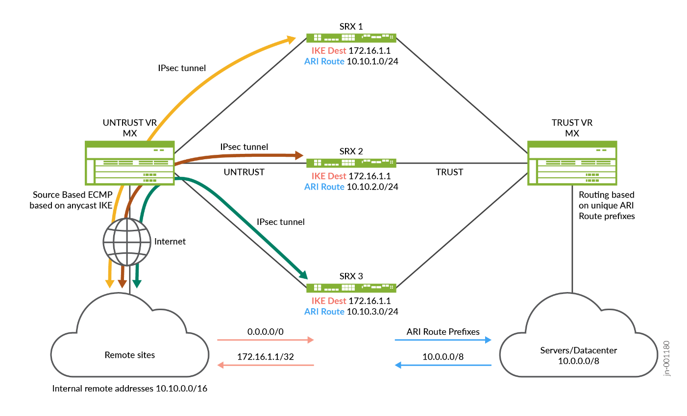

# Configuration Snippets (snips)

This `snips/` directory contains **focused, templated configuration excerpts**
extracted from the validated device configurations in [`../conf/`](../conf/).
Each file isolates one construct — a security subtree of an SRX or of the initiator
gateway (IKE, IPsec, zones, policies or the global address book), SRX Multinode High
Availability, a Traffic Load Balancer instance or its network-monitoring profiles, a
service-set, a firewall filter, an interface or unit, a routing instance, a BGP group,
a routing policy or a system statement — so it can be read, compared and adapted on
its own. Every body is measured against the source: the `Count:` header is the
number of exact source instances the template reproduces on each device.

## Topology



A scale-out IPsec design: an MX304 (`mx1_mx304`) forwards and load-balances IKE and
IPsec traffic across four SRX4600 IPsec security gateways in two Multinode High
Availability (MNHA) pairs (`srx1a`/`srx1b` and `srx2a`/`srx2b`), in routing
(L3) mode. Every SRX node is an IKEv2 AutoVPN responder on the same anycast IKE
address on `lo0.1`. On the MX, the firewall filter `IPSEC_LB` on the
gateway-facing unit steers that address into the forwarding instance
`srx-tproxy-fi`, where the Routing Engine based Traffic Load Balancer (TLB) spreads
it across the two MNHA pairs in direct-server-return mode, health-checking each
pair's probe address. The MX runs eBGP with BFD to every SRX node in a trust
(`TRUST_VR`) and an untrust (`UNTRUST_VR`) virtual router and an inter-chassis
link instance (`MNHA-VR`). Each SRX pair runs services-redundancy group 1 for
IPsec with an encrypted inter-chassis link, an activeness probe and active and
backup signal routes; its export policies lengthen the AS path of the auto route
insertion (ARI) routes and of the probe address on the backup node, so traffic
returns to the active node. `ipsec_initiator_gateway_mx304` emulates five remote
sites that initiate IKEv2 tunnels through its aggregated multiservices (AMS)
interface. Device tokens in snippet headers are the file names in `../conf/`.

## Layout

```
snips/
  junos/        ← Junos OS forms (MX304, SRX4600); this JVD has no Junos OS Evolved device
```

103 snippet files, all Junos.

| Sub-folder | What's in it |
|---|---|
| `security/` | The SRX IKE AutoVPN responder and IPsec AutoVPN with the MNHA inter-chassis link encryption, the security zones, the intra-zone security policies and the global address book; the initiator gateway's IKE gateways and IPsec VPNs; distribution profile and flow settings. Each is one whole subtree. |
| `chassis/` | SRX Multinode High Availability (encrypted inter-chassis link, IPsec services-redundancy group 1; preferred and backup node); FPC/PIC port settings and powered-off slots, aggregated-device count, enhanced IP and Routing Engine redundancy. |
| `services/` | The TLB instance `ipsec_lb`, TLB routing-engine mode, the network-monitoring health-check profiles, the initiator gateway's five next-hop service-sets and application identification. |
| `firewall/` | The MX filter `IPSEC_LB` that redirects the IKE anycast address into the TLB forwarding instance. |
| `interfaces/` | Aggregated Ethernet interfaces and their members, VLAN units (with the `IPSEC_LB` input filter on the gateway-facing unit), the AMS interface and its inside and outside units, st0 tunnel units, physical units and the loopback units. |
| `routing-instances/` | The virtual routers (`virtual-router/`: SRX MNHA-VR, MX TRUST_VR, UNTRUST_VR and MNHA-VR, the initiator gateway's TRUST_VR, UNTRUST_VR and `client`) and the TLB forwarding instance (`forwarding/`). |
| `protocols/` | The SRX eBGP groups to the MX trust and untrust instances, BGP multipath and LLDP. |
| `policy-options/` | The export policies (including the MNHA signal-route AS-path prepend policies), the load-balancing policies, the MNHA signal-route conditions, the prefix lists and the route-filter lists. |
| `applications/` | The custom ESP application the security policies name. |
| `routing-options/`, `forwarding-options/` | AS, forwarding-table load-balance export and nonstop routing; symmetric enhanced hash key. |
| `system/`, `snmp/`, `groups/` | Management services, login and root authentication, DNS, RADIUS, syslog, time zone and debugger settings, console log-out, commit synchronization and the network-monitoring process; the SNMP community and trap group; the `apply-groups` lists. |

## Snippet headers

Every snippet starts with a C-style header whose fields follow the repository
snippet contract:

- **`Seen on:`** — every validated device whose configuration reproduces this
  exact template. Shared applicability is not a peer relationship.
- **`Count:`** — distinct source instances of the template per device and in
  total, generated from [`_bindings.json`](_bindings.json); never hand-edited.
- **`Pair with:`** — directed, required same-device dependencies measured from
  the source: named objects a snippet references by a fixed name (here the
  security objects, the prefix lists, the routing instances, the firewall filter,
  the network-monitoring profiles and the interface units). Dependencies that go
  through a template value (interfaces, policies, the conditions, the route-filter
  lists) or that two forms can provide (the security zones) are listed as Needs in
  the BYOAI bundle.
- **`Peers with:`** — `n/a` for local constructs. Constructs whose peer
  cannot be verified from the configurations carry no claim: see Scope.

## Templated values — `$VAR` placeholders

Deployment-specific values (addresses, prefixes, interfaces, unit and VLAN
numbers, AS numbers, MNHA node IDs and monitored addresses, TLB real-service
addresses, policy, condition and term names, system DNS and RADIUS servers) and
every credential (pre-shared keys, passwords, RADIUS secrets, the SNMP community;
the header example is a placeholder) appear as `$VAR` placeholders. The names of
security objects, prefix lists and routing instances, which other configuration
references by name, and the design constants are left literal.
Each header lists the placeholders it uses with example values from a validated
device; the full glossary is [`_variables.md`](_variables.md).

## Source examples

[`_bindings.md`](_bindings.md) summarises, and [`_bindings.json`](_bindings.json)
records in full, the exact source instances and variable bindings each template
reproduces. Example values in headers are illustrative; the bindings are the
evidence.

## Scope

Snippets reproduce the active configuration of the 6 device configurations.
Excluded ([`_source-exclusions.json`](_source-exclusions.json)): the diagnostic
`traceoptions` (IKE on the SRX nodes and the initiator gateway, the SDK service
process on the MX) and deactivated (`inactive:`) configuration (a default
permit-all security policy on the SRX nodes and flow traceoptions on the initiator
gateway). The configurations carry no software version stamp.

### Known limitations of the published configurations

- **Undefined references.** The MX and the SRX nodes apply the configuration
  groups `global` and `re0` (all but `srx2a` also `re1`); the published
  configurations define none of them (14 references). The snippets reproduce the
  references as configured; the BYOAI bundle lists them as not included.
- **Initiator gateway.** `ipsec_initiator_gateway_mx304` emulates the remote
  sites of the test bed; its snippets reproduce that emulation as configured.
- **Credentials.** The published configurations carry the placeholder
  `"$9$SANITIZED"` for every IKE pre-shared key and RADIUS secret, and hashed
  passwords; every snippet replaces them with a placeholder variable.
- **Peers.** 53 constructs carry no peer claim: the security, IKE/IPsec,
  TLB, network-monitoring, service-set, SNMP and system constructs have no peer
  rule, the virtual-router and BGP-group eBGP sessions have no verified peer rule,
  and the aggregated Ethernet interfaces configure no remote LACP actor.
- **Building blocks.** Snippets are building blocks, not complete device
  configurations. The device configurations under [`../conf/`](../conf/) are the
  as-captured reference.

## Topic index

Totals are source instances across all devices.

| Topic | What it shows |
|---|---|
| `junos/applications/application-esp.conf` | Custom application ESP (IP protocol esp) (4) |
| `junos/chassis/aggregated-devices-ethernet.conf` | Aggregated Ethernet device-count for the chassis (6) |
| `junos/chassis/fpc-pic-0-1-pic-mode-100g-16-ports.conf` | FPC with PICs 0 and 1 in 100G mode, 16 ports each (1) |
| `junos/chassis/fpc-pic-0-1-pic-mode-100g-2-ports.conf` | FPC with PICs 0 and 1 in 100G mode, two ports each (1) |
| `junos/chassis/fpc-pic-0-ports-0-3-100g-pic-1-0-ports.conf` | FPC with ports 0 to 3 of PIC 0 at 100G and PIC 1 set to zero ports (4) |
| `junos/chassis/fpc-power-off.conf` | Powered-off line card slot (2) |
| `junos/chassis/high-availability-mnha-icl-encryption-srg-1-ipsec-activeness-probe-preemption-priority-200.conf` | SRX Multinode High Availability (routing mode) with an encrypted inter-chassis link and IPsec SRG 1 (activeness probe, BFD monitor, signal routes), preemption and activeness priority 200 (2) |
| `junos/chassis/high-availability-mnha-icl-encryption-srg-1-ipsec-activeness-probe-priority-1.conf` | SRX Multinode High Availability (routing mode) with an encrypted inter-chassis link and IPsec SRG 1 (activeness probe, BFD monitor, signal routes), activeness priority 1 (2) |
| `junos/chassis/network-services-enhanced-ip.conf` | Enhanced IP chassis network-services mode (2) |
| `junos/chassis/redundancy-graceful-switchover.conf` | Graceful Routing Engine switchover (1) |
| `junos/firewall/filter-ipsec-lb-ike-anycast-to-srx-tproxy-fi.conf` | Filter IPSEC_LB: counts, logs and sends traffic for the IKE anycast address 10.100.0.1/32 to forwarding instance srx-tproxy-fi; counts and accepts everything else (1) |
| `junos/forwarding-options/enhanced-hash-key-symmetric.conf` | Symmetric enhanced hash key (1) |
| `junos/groups/apply-global-three.conf` | Ordered global three-group application (4) |
| `junos/groups/apply-global-two.conf` | Ordered global two-group application (1) |
| `junos/interfaces/ifd-ae-flexible-vlan-tagging-mtu-9192-flexible-ethernet-services-lacp-fast.conf` | Aggregated Ethernet interface with flexible VLAN tagging, MTU 9192, flexible Ethernet services and fast active LACP (2) |
| `junos/interfaces/ifd-ae-vlan-tagging-mtu-9130-lacp-fast.conf` | Aggregated Ethernet interface with VLAN tagging, MTU 9130, one minimum link and fast active LACP (8) |
| `junos/interfaces/ifd-ams-2-members-drop-member-traffic-rejoin.conf` | Aggregated multiservices (AMS) interface with two member service interfaces, dropping a failed member's traffic and rejoining it (1) |
| `junos/interfaces/ifd-lag-member-gigether.conf` | Aggregated Ethernet member link through gigether-options (20) |
| `junos/interfaces/ifd-mtu-9192.conf` | Physical interface with MTU 9192 (2) |
| `junos/interfaces/ifl-ams-inside-disable-hash.conf` | AMS unit in the inside service domain with hashing disabled (5) |
| `junos/interfaces/ifl-ams-outside-disable-hash.conf` | AMS unit in the outside service domain with hashing disabled (5) |
| `junos/interfaces/ifl-loopback-inet-5-addresses.conf` | Loopback unit 0 with five IPv4 addresses (1) |
| `junos/interfaces/ifl-loopback-inet-primary.conf` | Primary IPv4 loopback address (4) |
| `junos/interfaces/ifl-loopback-inet-two-addresses.conf` | Loopback unit with two IPv4 addresses (4) |
| `junos/interfaces/ifl-loopback-inet.conf` | Loopback unit with one IPv4 address (1) |
| `junos/interfaces/ifl-unit-0-inet-address-inet6.conf` | Unit 0 with one IPv4 address and family inet6 without an address (1) |
| `junos/interfaces/ifl-unit-0-inet.conf` | Unit 0 with one IPv4 address (10) |
| `junos/interfaces/ifl-unit-inet.conf` | Logical unit with family inet and no address (17) |
| `junos/interfaces/ifl-vlan-inet-input-filter-ipsec-lb.conf` | VLAN unit with an IPv4 address and the IPSEC_LB input filter (1) |
| `junos/interfaces/ifl-vlan-inet.conf` | Single-tagged routed logical interface carrying an IPv4 customer address (27) |
| `junos/policy-options/condition/condition-if-route-exists-mnha-vr-active-signal-route.conf` | Condition true while the MNHA active signal route 192.168.255.0/32 exists in MNHA-VR.inet.0 (4) |
| `junos/policy-options/condition/condition-if-route-exists-mnha-vr-backup-signal-route.conf` | Condition true while the MNHA backup signal route 192.168.255.1/32 exists in MNHA-VR.inet.0 (4) |
| `junos/policy-options/policy-statement/per-packet-load-balance-no-term.conf` | Per-packet load-balancing policy without terms (5) |
| `junos/policy-options/policy-statement/per-packet-load-balance-term-accept.conf` | Per-packet load-balance policy in one term with accept (1) |
| `junos/policy-options/policy-statement/ps-ari-ts-signal-condition-as-path-prepend-1-or-2-reject.conf` | Policy exporting ARI traffic-selector routes unchanged while the active signal route exists, with one AS-path prepend while the backup signal route exists and with two otherwise; rejecting everything else (4) |
| `junos/policy-options/policy-statement/ps-bgp-next-hop-self-accept-reject.conf` | Policy that accepts BGP routes with next-hop self and rejects everything else (1) |
| `junos/policy-options/policy-statement/ps-bgp-route-filter-list-next-hop-self-accept-reject.conf` | Policy accepting BGP routes in a route-filter list with next-hop self and rejecting everything else (1) |
| `junos/policy-options/policy-statement/ps-bgp-static-next-hop-self-accept-reject.conf` | Policy accepting BGP and static routes with next-hop self and rejecting everything else (1) |
| `junos/policy-options/policy-statement/ps-direct-orlonger-accept-reject.conf` | Policy accepting direct routes within 10.200.0.0/16 (orlonger) and rejecting everything else (1) |
| `junos/policy-options/policy-statement/ps-direct-route-filter-accept-bgp-route-filter-list-next-hop-self-reject.conf` | Policy accepting one direct prefix (exact) and, with next-hop self, BGP routes in a route-filter list; rejecting everything else (1) |
| `junos/policy-options/policy-statement/ps-prefix-list-signal-condition-as-path-prepend-1-or-2-reject.conf` | Policy exporting a prefix list unchanged while the active signal route exists, with one AS-path prepend while the backup signal route exists and with two otherwise; rejecting everything else (4) |
| `junos/policy-options/policy-statement/ps-route-filter-next-hop-self-accept-reject.conf` | Policy accepting one prefix with next-hop self and rejecting everything else (4) |
| `junos/policy-options/policy-statement/ps-static-default-exact-next-hop-self-accept-reject.conf` | Policy accepting the static default route (exact) with next-hop self and rejecting everything else (1) |
| `junos/policy-options/policy-statement/ps-static-route-filter-exact-accept-reject.conf` | Policy accepting one static prefix (exact) and rejecting everything else (1) |
| `junos/policy-options/policy-statement/ps-static-server-and-default-exact-accept-reject.conf` | Policy accepting the static 172.160.0.0/16 and default routes (exact) and rejecting everything else (1) |
| `junos/policy-options/prefix-list/prefix-list-active-probe-ip.conf` | Prefix list active_probe_ip with one prefix (the MNHA pair's activeness-probe address) (4) |
| `junos/policy-options/prefix-list/prefix-list-ike-lo0.conf` | Prefix list ike_lo0 with the IKE anycast address 10.100.0.1/32 (4) |
| `junos/policy-options/prefix-list/prefix-list-mnha-lo0.conf` | Prefix list mnha_lo0 with one prefix (4) |
| `junos/policy-options/route-filter-list/rfl-inet-1-orlonger.conf` | Route-filter list with one IPv4 prefix (orlonger) (2) |
| `junos/protocols/bgp-group-srx-to-mx-trust-ebgp-bfd.conf` | eBGP group SRX-to-MX_TRUST with one neighbor, a local AS and BFD (4) |
| `junos/protocols/bgp-group-srx-to-mx-untrust-ebgp-bfd.conf` | eBGP group SRX-to-MX_UNTRUST with one neighbor, a local AS and BFD (4) |
| `junos/protocols/bgp-multipath.conf` | BGP multipath (4) |
| `junos/protocols/lldp-port-id-interface-name-interface-all.conf` | LLDP on all interfaces with the interface name as port ID (5) |
| `junos/routing-instances/forwarding/ri-srx-tproxy-fi.conf` | Forwarding instance srx-tproxy-fi (1) |
| `junos/routing-instances/virtual-router/ri-client-static-next-hop-ams-inside-st0.conf` | client virtual router with a static route to the client prefix, the AMS inside units and the st0 tunnel units (1) |
| `junos/routing-instances/virtual-router/ri-mnha-vr-ebgp-4-icl-groups.conf` | MNHA-VR virtual router with one eBGP group per SRX node over the inter-chassis link units (1) |
| `junos/routing-instances/virtual-router/ri-mnha-vr-ebgp-icl-bfd.conf` | MNHA-VR virtual router with an eBGP inter-chassis link session to the MX and the lo0.0 node address (4) |
| `junos/routing-instances/virtual-router/ri-trust-vr-as-static-next-hop-ebgp-1-group.conf` | TRUST_VR virtual router with its own AS, a static route to the server prefix and one eBGP group with BFD (1) |
| `junos/routing-instances/virtual-router/ri-trust-vr-static-discard-default-ebgp-srx-4-neighbors-gateway.conf` | TRUST_VR virtual router with a static discard default route, an eBGP group to the four SRX nodes (as-override) and an eBGP group to the gateway, BFD on both (1) |
| `junos/routing-instances/virtual-router/ri-untrust-vr-as-ebgp-1-group-ams-outside-lo0.conf` | UNTRUST_VR virtual router with its own AS, one eBGP group with BFD, the AMS outside units and lo0.0 (1) |
| `junos/routing-instances/virtual-router/ri-untrust-vr-ebgp-srx-4-neighbors-gateway.conf` | UNTRUST_VR virtual router with an eBGP group to the four SRX nodes and an eBGP group to the gateway, BFD on both (1) |
| `junos/routing-options/autonomous-system.conf` | Device autonomous-system number (3) |
| `junos/routing-options/forwarding-table-export.conf` | Forwarding-table export — per-packet load-balance applied to the forwarding table (minimal EVO form). (6) |
| `junos/routing-options/nonstop-routing.conf` | Nonstop active routing (1) |
| `junos/security/address-book-global-mnha-ike-ipsec-client-server.conf` | Global address book with the MNHA loopback, IKE source, IPsec client and IPsec server prefixes (4) |
| `junos/security/distribution-profile-fat-core.conf` | Security distribution profile fat-core (5) |
| `junos/security/flow-drop-flow-timeout-30.conf` | Drop-flow timeout of 30 seconds (4) |
| `junos/security/flow-power-mode-ipsec.conf` | Flow power mode for IPsec (power-mode-ipsec) (1) |
| `junos/security/ike-autovpn-responder-group-ike-id-mnha-icl.conf` | IKEv2 AutoVPN responder (dynamic hostname, group IKE ID) on the lo0.1 anycast address 10.100.0.1, and the MNHA inter-chassis link IKE gateway (4) |
| `junos/security/ike-initiator-5-gateways-ikev2-pre-shared-key.conf` | IKEv2 initiator: one pre-shared-key policy and five gateways to the 10.100.0.1 responder, each with its own local address and hostname identity (1) |
| `junos/security/ipsec-autovpn-st0-1-mnha-icl-link-encryption-aes-256-gcm.conf` | IPsec AutoVPN bound to st0.1 with a 0.0.0.0/0 traffic selector and the MNHA inter-chassis link encryption VPN, both AES-256-GCM (4) |
| `junos/security/ipsec-initiator-5-vpns-aes-256-gcm-establish-immediately.conf` | IPsec initiator: five route-based VPNs on st0.1 to st0.5 with AES-256-GCM, one host traffic selector each, established immediately (1) |
| `junos/security/policies-intra-zone-esp-block-mnha-icl-ipsec-data.conf` | Intra-zone security policies: ESP denied and everything else permitted in the VR-1 trust zone, MNHA loopbacks permitted, IPsec client-server data permitted in the untrust zone (4) |
| `junos/security/zones-vr-1-trust-any-service-untrust-st0-mnha.conf` | VR-1 trust zone (lo0.1, any host-inbound service), untrust zone (st0.1) and MNHA zone (lo0.0), all host-inbound protocols (1) |
| `junos/security/zones-vr-1-trust-untrust-st0-mnha.conf` | VR-1 trust zone (lo0.1), untrust zone (st0.1) and MNHA zone (lo0.0), all host-inbound services and protocols (3) |
| `junos/services/application-identification.conf` | Application identification enabled (1) |
| `junos/services/network-monitoring-icmp-tcp-8088-profiles-5-failure-retries.conf` | Network-monitoring ICMP and TCP port 8088 health-check profiles with 1-second probes, 5 failure retries and 1 recovery retry (1) |
| `junos/services/service-set-ipsec-tun-1.conf` | Next-hop service-set IPSEC_TUN_1 for IPsec VPN TUN_1 on AMS units ams1.1 (inside) and ams1.2001 (outside) (1) |
| `junos/services/service-set-ipsec-tun-2.conf` | Next-hop service-set IPSEC_TUN_2 for IPsec VPN TUN_2 on AMS units ams1.2 (inside) and ams1.2002 (outside) (1) |
| `junos/services/service-set-ipsec-tun-3.conf` | Next-hop service-set IPSEC_TUN_3 for IPsec VPN TUN_3 on AMS units ams1.3 (inside) and ams1.2003 (outside) (1) |
| `junos/services/service-set-ipsec-tun-4.conf` | Next-hop service-set IPSEC_TUN_4 for IPsec VPN TUN_4 on AMS units ams1.4 (inside) and ams1.2004 (outside) (1) |
| `junos/services/service-set-ipsec-tun-5.conf` | Next-hop service-set IPSEC_TUN_5 for IPsec VPN TUN_5 on AMS units ams1.5 (inside) and ams1.2005 (outside) (1) |
| `junos/services/traffic-load-balance-instance-ipsec-lb.conf` | TLB instance ipsec_lb: direct-server-return virtual service for the IKE anycast address 10.100.0.1, hashing on source IP across two SRX real services (1) |
| `junos/services/traffic-load-balance-routing-engine-mode.conf` | Traffic Load Balancer in routing-engine mode (1) |
| `junos/snmp/community-read-only-all-clients.conf` | Read-only SNMP community open to all IPv4 and IPv6 clients (4) |
| `junos/snmp/trap-group-space-one-target.conf` | SNMP trap group with one target (2) |
| `junos/system/authentication-order-password-radius.conf` | Authentication order: local password, then RADIUS (2) |
| `junos/system/commit-synchronize.conf` | Commit synchronization between Routing Engines (1) |
| `junos/system/debugger-on-break.conf` | Kernel debugger entered on a console break (2) |
| `junos/system/debugger-on-panic.conf` | Kernel debugger entered on a panic instead of a reboot (2) |
| `junos/system/domain-search-5-domains.conf` | DNS search list of five domains (2) |
| `junos/system/login-user-superuser-csh.conf` | One local login account in class superuser with the csh shell and an encrypted password (2) |
| `junos/system/name-server-2-servers.conf` | Two DNS name servers (2) |
| `junos/system/ports-console-log-out.conf` | Console log-out on disconnect (2) |
| `junos/system/processes-net-monitord-enable.conf` | Network-monitoring process (net-monitord) enabled (1) |
| `junos/system/radius-server-2-servers.conf` | Two RADIUS servers with their shared secrets (2) |
| `junos/system/root-authentication-encrypted-password.conf` | Root account authentication with an encrypted password (1) |
| `junos/system/services-netconf-ssh-ssh-ftp-telnet-web-management-http-8088.conf` | NETCONF over SSH, SSH, FTP, Telnet and HTTP web management on port 8088 (2) |
| `junos/system/services-netconf-ssh-ssh-max-sessions-64-web-management-http-8088.conf` | NETCONF over SSH, SSH with 64 sessions per connection and HTTP web management on port 8088 (1) |
| `junos/system/services-netconf-ssh-ssh-web-management-http-8088.conf` | NETCONF over SSH, SSH and HTTP web management on port 8088 (1) |
| `junos/system/services-netconf-ssh.conf` | NETCONF over SSH service (1) |
| `junos/system/syslog-default-log-messages-interactive-commands-messages.conf` | Syslog files default-log-messages (commit, FRU, link and license events), interactive-commands and messages (1) |
| `junos/system/time-zone.conf` | System time zone (2) |
